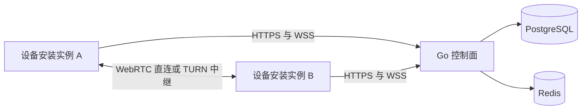

# Peerloom 设备连接平台

Peerloom 面向远程控制、云真机、设备集群和 Agent 应用，提供设备安装实例的注册、在线状态、授权、寻址和通用数据通道。平台不实现屏幕采集、视频编码、输入注入或业务文件协议。

**当前状态：Linux 控制面与真实授权通信切片已通过 CI，SDK 与管理能力持续完善。** 已有持久身份与凭证轮换、原生直连、服务端 WSS/Redis fencing 和 grant-only 会话授权；Rust HTTP 身份客户端提供可注入存储与内存实现。真实双设备授权后通信、强制 TURN 和失联租约到期已本地通过；最小 DeviceSdk facade（单连接/可靠消息）、WSS 自动恢复、传输层可靠字节流与 Linux 异步 C ABI 已实现并进行真实服务测试；direct 注册、平台安全存储、数据连接自动重建、多连接/多通道及五端封装未完成，不可用于生产。管理 API 已实现应用、设备、授权、会话与审计，使用离线签发的 scoped service key；交互后台及管理员登录尚未实现。HTTPS/WSS 共用系统平台证书验证；Linux C 产物包含动态库、静态库及唯一规范头文件，但不是五端 Release。阶段验证以对应提交 CI 为准。

## 先读哪些文档

| 文档 | 解决的问题 |
|---|---|
| [产品需求](docs/产品需求.md) | 产品边界、角色、场景、安全约束和发布范围 |
| [整体架构](docs/整体架构.md) | 模块职责、依赖、运行拓扑和故障边界 |
| [接口与数据契约](docs/接口与数据契约.md) | REST、WSS、数据约束、SDK 与 C ABI 草案 |
| [开发与验收](docs/开发与验收.md) | M0 至 M9 的交付顺序、测试与发布门槛 |
| [部署指南](docs/部署指南.md) | 目标 Compose 部署、配置、安全与恢复要求 |
| [用户使用说明](docs/用户使用说明.md) | 面向平台管理员和 SDK 集成者的目标操作流程 |

## 已确定的技术方向

- 控制面：Go 模块化单体；PostgreSQL 保存持久数据，Redis 保存可重建的在线租约与路由。
- 原生通信：Rust、webrtc-rs、WebRTC DataChannel；设备业务数据不经过 Go 服务。
- SDK：Rust 核心与 C ABI；Android 使用 Kotlin/JNI，iOS 使用 Swift/XCFramework。
- 原生首版：Windows、macOS、Linux、Android、iOS；Web SDK 可独立延期。
- 部署：Docker Compose 单机优先，独立 coturn 中继服务；集群不是首版交付承诺。



## 不能被弱化的约束

1. 设备是 App 安装实例，不是物理机器；同一机器上的不同 App 有独立身份。
2. 同租户不同应用也必须经授权才能连接；不同租户始终拒绝连接。
3. 默认拒绝，目标端拒绝优先于平台策略；首期授权实现以显式 grant 为主。
4. WebRTC 的 DTLS 安全传输始终启用；默认关闭的是额外的应用层 E2EE。
5. 撤销后立即停止发放新授权并通知在线端；失联端依靠有界授权租约到期关闭。平台不能强制停止串通端点私自维持的 P2P 通信。
6. `application_id` 与安装公钥都不是秘密凭证；尚未定义持有证明的公钥不能用于认证或身份恢复。
7. 所有队列有界、异步操作可取消，退出流程不能无限等待。

## 开发方式

遵循 [AGENTS.md](AGENTS.md)。先评审文档和契约，再按 [开发与验收](docs/开发与验收.md) 的模块依赖逐步实现，每个模块同步更新文档、测试、示例与实际状态。未验证的功能不得标为完成；不要以日期或阶段另建重复说明。

V1.1 是本设计的产品输入。仓库保留经过整理的实现基线。数据模型与 ABI 的缺口在契约文档中显式修正，仍需通过迁移、代码及测试落地。

## 开发入口

需要 Go 1.27.3、Rust 1.99.1、Python 3.11+；容器测试另需 Docker Engine 与 Compose。

```sh
python3 -m pip install -r scripts/requirements-contracts.txt
make check
make build
make secrets
make compose-config
make dev-up
```

本机开发入口为 `http://127.0.0.1:18080`，提供健康和设备身份 API；不是管理后台。`make dev-down` 保留数据库卷；不要删除秘密后复用旧数据库卷。Compose 真实启动与数据库并发测试需看该提交的 CI 结果，不以配置校验替代。

模块实现：[控制面基础模块](docs/控制面基础模块.md)、[SDK基础模块](docs/SDK基础模块.md)。

身份与传输说明：[设备身份模块](docs/设备身份模块.md)、[原生传输模块](docs/原生传输模块.md)。已有 M0 开发秘密升级时，先运行 `python3 scripts/generate-dev-secrets.py --add-replay-key`，不得重建数据库密码。

## 许可

Peerloom 原创代码使用 [MIT License](LICENSE)。第三方依赖适用各自许可；发布时保留第三方声明与依赖清单，依赖上线法律审查由项目法务另行完成。

C 集成见[ C 语言接口模块](docs/C语言接口模块.md)。构建同时生成第三方依赖清单、原始许可文本与缺失证据报告；Peerloom 自有代码的 MIT 不替代第三方义务，也不表示法务审查完成。
