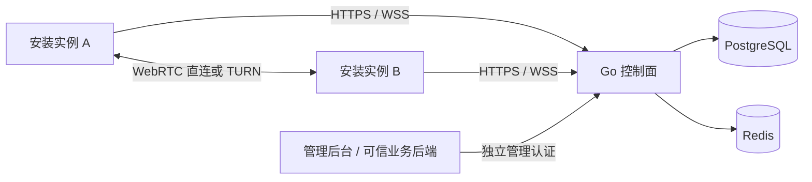

# Peerloom 设备连接平台

Peerloom 为 App 安装实例提供注册、在线状态、授权、寻址和通用数据通道，可用于远程控制、云真机、设备集群等上层应用。它不实现屏幕采集、视频编码、输入注入、远程命令执行或业务文件协议。

**当前已有可运行的原生 SDK、控制面和管理后台。正式交付以同一提交的全部必需门禁及实际 Release 资产为准。** 已实现 grant/direct 注册、持久身份与轮换/reset、WSS 心跳与重连、默认拒绝的会话授权、托管 TURN、重建式数据恢复、多连接及三类通道、Rust/C ABI、Kotlin/JNI 和 Swift/XCFramework。平台存储包括 Linux Secret Service、Windows CurrentUser DPAPI、Android Keystore 与 Apple Keychain，不默认回退明文。

Linux、Windows、Android 和 iOS Simulator 已分别执行真实授权通信服务链；Apple 完整原生测试与交付包也已有通过证据。**这些分提交证据不替代当前精确提交的全部必需 CI。** 生产签名宿主、物理设备、复杂公网长期运行未全面实测；不能仅凭实现或分平台成功认定已正式发布，也不宣称生产就绪。详见[开发与验收](docs/开发与验收.md)。

## 文档导航

| 文档 | 内容 |
|---|---|
| [产品需求](docs/产品需求.md) / [整体架构](docs/整体架构.md) | 产品边界、模块职责、拓扑与故障边界 |
| [接口与数据契约](docs/接口与数据契约.md) | REST、WSS、数据不变量与 SDK/C ABI |
| [部署指南](docs/部署指南.md) / [用户使用说明](docs/用户使用说明.md) | Compose、TLS、管理员启用、备份与 SDK 接入 |
| [开发与验收](docs/开发与验收.md) | M0–M9、实际证据、必需门禁与限制 |
| [SDK 身份与信令](docs/SDK身份与信令模块.md) / [C 语言接口](docs/C语言接口模块.md) | 生命周期、存储、连接、typed 通道与异步调用 |
| [管理服务](docs/管理服务模块.md) / [浏览器管理](docs/浏览器管理模块.md) | 可信后端 API、内置管理员登录与中英文管理后台 |
| [Android 封装](docs/Android封装模块.md) / [Apple 封装](bindings/ios/Apple封装说明.md) | 原生集成与平台限制 |
| [发布与分支清理](docs/发布与分支清理模块.md) | 产物核验、精确提交门控与受控发布计划 |

## 技术与能力

- **控制面**：Go 模块化单体；PostgreSQL 保存持久身份、授权与审计，Redis 保存可重建的在线状态与租约。单节点路由，不承诺首版集群。
- **数据面**：Rust/webrtc-rs WebRTC DataChannel，支持 `auto`、`direct_only`、`relay_only`；业务数据直连或经 TURN，不经过 Go 控制面。
- **通道**：可靠消息、低延迟消息、可靠字节流；Core/C/Kotlin/Swift 的连接与活动通道默认各 1、可配置至 32。累计 DCEP 创建预算默认 8、最高 128，与当前活动通道数独立。
- **平台封装**：Rust 核心与版本化异步 C ABI；Android Kotlin/JNI、Apple Swift/XCFramework，以及 Windows/macOS/Linux 原生集成。Web SDK 尚未实现，可独立延期。
- **管理**：scoped 服务 API 与可选管理员登录后台，提供应用、设备、授权、会话和审计；Webhook 具备签名、重试和目标地址限制。管理后台不是 SDK 业务界面。
- **部署**：Docker Compose 单机、独立 coturn、用户证书 TLS 覆盖与隔离备份恢复脚本；不会自动申请生产证书或部署公网服务。



## 不可弱化的约束

1. 设备是 App 安装实例，不是物理机器；同一机器上的不同 App 有独立身份。
2. 同租户不同应用也必须经授权连接，不同租户始终拒绝；默认拒绝，目标拒绝优先。
3. WebRTC DTLS 始终启用；默认关闭的是额外应用层 E2EE，不能据此关闭 DTLS。
4. 撤销后拒绝新授权并通知在线端；失联端依靠有界授权租约关闭。平台不能强制停止串通端点自行维持的 P2P 通信。
5. WSS 中断不立即关闭有效租约内的健康数据连接，但不延长授权。数据恢复采用重建连接，不是原地 ICE restart，也不承诺业务消息 exactly-once。
6. `application_id` 和安装公钥不是秘密凭据；尚未定义持有证明的公钥不能用于认证或领取旧秘密。
7. 队列与资源有界；异步取消不伪称远端事务回滚，shutdown 完成后才释放对象。系统存储不可用时失败关闭，不静默换身份。

## 本地开发入口

需要 Go 1.27.3、Rust 1.99.1、Python 3.11+；容器测试需要 Docker Engine 与 Compose。各原生平台还需对应构建工具，Linux 检查不能代替 Xcode、Android 或 Windows 运行。

```sh
python3 -m pip install -r scripts/requirements-contracts.txt
make check
make build
make secrets
make compose-config
make dev-up
```

开发网关默认仅监听 `http://127.0.0.1:18080`，提供健康、设备和信令/API 路由。`make dev-up` 启动数据库并执行迁移；`make dev-down` 保留数据库卷。不要删除秘密后复用旧数据库卷，也不要把开发明文端口开放公网。

### 启用管理后台

管理后台已内嵌在 Go 服务，运行时不需要 Node。**默认关闭，没有默认管理员或自动创建的账户。** 本机开发可在启动前显式设置：

```sh
export ADMIN_ORIGIN=http://127.0.0.1:18080
export ADMIN_DEVELOPMENT_LOOPBACK=true
make dev-up
```

由已授权的运维者先创建租户，再按[部署指南](docs/部署指南.md#可选浏览器管理入口)使用离线 `device-admin-user` 和密码标准输入创建管理员，随后访问 **`http://127.0.0.1:18080/admin/`**。精确 Host/Origin、会话与 CSRF 校验不可关闭；生产使用配置好的 HTTPS origin。后端 scoped service key 与浏览器管理员会话是两种独立认证，不能把服务密钥放进浏览器或客户端。

### 集成 SDK

按[用户使用说明](docs/用户使用说明.md)准备应用、注册授权与存储，再进行连接授权/目标确认和真实收发。最小示例与接口见相应平台文档；默认仅提供通信基础能力，业务协议、用户权限和消费确认由上层应用负责。

## 开发与许可

遵循 [AGENTS.md](AGENTS.md)，按文档与契约分模块实现、测试并同步当前状态。V1.1 是产品输入，经过审计的数据约束和 ABI 生命周期修正均保留在实现与契约中；不得把未来目标写成已经交付。

Peerloom 原创代码使用 [MIT License](LICENSE)。产物附第三方清单、原始许可文本与明确缺项；这些证据不改变第三方许可、不表示项目 MIT 覆盖全部依赖，也不等于法务审查完成。
