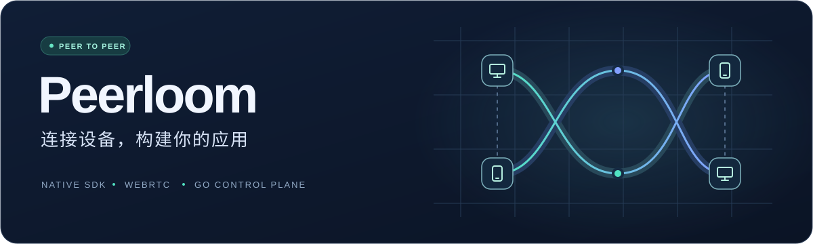
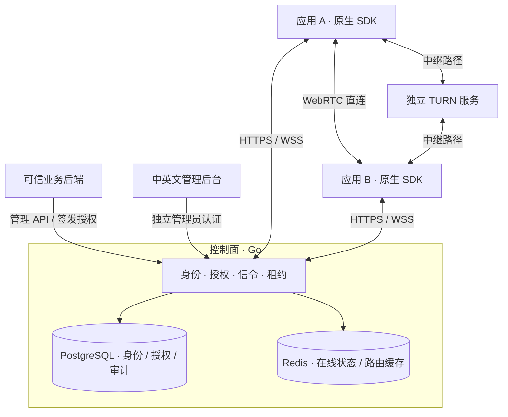

<p align="center">
  
</p>

<p align="center">
  <strong>面向原生应用的设备身份、授权与实时数据连接基础设施</strong>
</p>

<p align="center">
  <a href="https://github.com/barry-ran/peerloom/actions/workflows/ci.yml"></a>
  <a href="https://github.com/barry-ran/peerloom/releases"></a>
  <a href="LICENSE"></a>
  <a href="docs/整体架构.md"></a>
</p>

<p align="center">
  <a href="#核心能力">核心能力</a> ·
  <a href="#工作原理">工作原理</a> ·
  <a href="#下载与部署">下载与部署</a> ·
  <a href="#开始使用">开始使用</a> ·
  <a href="#文档导航">文档导航</a>
</p>

---

Peerloom 为 **App 安装实例**提供注册、持久身份、在线状态、会话授权和通用数据通道。你的应用负责业务体验，Peerloom 负责让经过授权的两端建立连接，并通过 WebRTC 直连或 TURN 中继交换数据。

它可以作为远程控制、云真机和设备集群等应用的通信底座。屏幕采集、视频编码、输入注入、远程命令和业务文件协议由上层应用实现；仓库中的管理后台用于平台管理，不是远程桌面或云手机租赁界面。

## 核心能力

| 能力 | Peerloom 提供什么 |
|---|---|
| **设备身份** | grant / direct 注册、持久身份、凭证轮换与本地 reset；安全存储不可用时失败关闭，不静默回退明文或更换身份 |
| **租户与授权** | 租户隔离、方向性连接 grant、目标确认与拒绝、授权租约及撤销；同一应用内也不默认互信 |
| **在线与信令** | HTTPS / WSS、认证心跳、在线状态、自动重连；在线与可连接状态明确区分 |
| **连接路径** | WebRTC DataChannel，支持 `auto`、`direct_only`、`relay_only`；按会话授权获取短期 TURN 凭证 |
| **原生集成** | Rust 核心、异步 C ABI、Android Kotlin / JNI、Apple Swift / XCFramework；多连接与多通道 |
| **平台管理** | 应用、设备、授权、会话、审计与签名 Webhook；可信后端 API 与可选中英文管理后台 |

### 三种通道，一套连接模型

| 通道 | 语义 | 适合承载 |
|---|---|---|
| `reliable_message` | 可靠、有序、保留消息边界 | 控制指令、业务事件 |
| `low_latency_message` | 无序或有限重传，允许丢包 | 可被新值覆盖的实时状态 |
| `reliable_stream` | 可靠字节流、背压、FIN 半关闭 | 由应用自行定义帧格式的连续数据 |

每实例会话数、每会话活动通道数默认各为 1，可配置至 32。发送完成不等于对端业务处理完成；消息确认、去重和断线恢复由业务协议设计。详细资源限制见[接口与数据契约](docs/接口与数据契约.md)。

## 工作原理

**控制面管理身份与权限，数据面承载业务数据。** Go 服务不转发业务数据；两端直连不通时，可以按策略经独立 TURN 服务中继。



控制面采用 Go 模块化单体，当前面向单机 Compose、单节点路由，不承诺首版集群。Rust 数据面基于 webrtc-rs；数据恢复会重建连接与通道，不是原地 ICE restart，也不承诺无损换路或 exactly-once。

### 安全边界

- **设备身份属于安装实例。** 同一物理机器上的不同 App 拥有独立身份；`application_id` 与安装公钥都不是秘密认证凭据。
- **默认拒绝连接。** 同租户跨应用连接仍需授权，跨租户始终拒绝；目标拒绝优先。
- **WebRTC DTLS 始终启用。** 额外应用层 E2EE 默认关闭，不能因此关闭 DTLS。
- **授权有期限。** WSS 断开时，健康数据连接可在有效租约内继续工作；续租失败则到期关闭。平台无法强制切断串通端点自行维持的 P2P 通信。
- **服务密钥只留在可信后端。** 不放入浏览器或客户端；平台授权也不替代业务自己的用户权限检查。

## 下载与部署

**部署平台选 Server，集成客户端选 SDK。两者不是同一个包。**

下表是 **v0.1.1 及以后的独立包布局**，以 v0.1.1 文件名为例，不代表特定版本已可下载。请在 [Releases](https://github.com/barry-ran/peerloom/releases) 选择实际发布的资产，并核对版本、源码提交、`release-metadata.json` 与 `SHA256SUMS`。旧版 [v0.1.0](https://github.com/barry-ran/peerloom/releases/tag/v0.1.0) 的 Linux 包为混合交付，请使用[对应 tag 的文档](https://github.com/barry-ran/peerloom/blob/v0.1.0/README.md)。

| 用途 | v0.1.1 资产名称 | 内容 |
|---|---|---|
| **部署服务端** | `peerloom-server-v0.1.1-linux-amd64.zip` | 5 个预编译 Go 程序、迁移 SQL、运行时 Docker / Compose、TLS 配置与私密初始化工具 |
| Linux 客户端 | `peerloom-sdk-v0.1.1-linux-x86_64.zip` | Rust / C ABI 库、规范头文件与 SDK 材料 |
| Windows 客户端 | `peerloom-sdk-v0.1.1-windows-x86_64.zip` | DLL、导入库、静态库与头文件 |
| macOS / iOS 客户端 | `peerloom-sdk-v0.1.1-apple.zip` | Swift Package 与五架构 XCFramework |
| Android 客户端 | `peerloom-sdk-v0.1.1-android.zip` | AAR、接口与依赖证据 |

服务端当前受测平台为 **Linux amd64**。运行包不需要源码或 Go / Rust / Node 编译环境，管理后台已内嵌；宿主仍需 Docker Engine、Docker Compose、Python 3.10+ 和基础镜像下载网络。**这不是完整离线镜像包，TURN 仍需独立部署。** 四类 SDK 包均不含服务端程序、数据库迁移或部署工具。

部署时使用外层 ZIP 中保留 Unix 可执行位的安装载荷，并从包内的 `deploy/README.md` 开始。仓库对应模板为[服务端运行包说明](deploy/server/README.md)，生产网络、TLS、备份与升级要求见[部署指南](docs/部署指南.md)。不要把下面的源码开发命令当作运行包安装步骤。

## 开始使用

### 我想部署服务端

先下载实际 Release 中的独立 Server 包，按随包说明解压外层 ZIP，再将其中的 `peerloom-server-linux-amd64.tar.gz` 安装载荷解压到**全新目录**。以下命令仅在该载荷根目录执行，不在源码目录或 SDK 包中执行：

```sh
sha256sum -c SHA256SUMS
python3 deploy/init-private.py
docker compose -f deploy/compose.yaml config --quiet
docker compose -f deploy/compose.yaml build
docker compose -f deploy/compose.yaml up -d --wait postgres redis
docker compose -f deploy/compose.yaml run --rm migrate
docker compose -f deploy/compose.yaml up -d --wait device-server gateway
curl --fail http://127.0.0.1:18080/readyz
```

这会启动本机控制面，不会创建租户或管理员，也不会启动 TURN。管理后台默认关闭且无默认账号；继续按包内的 `deploy/README.md` 创建租户及管理员、配置精确管理 Origin 和 HTTPS/WSS。默认仅回环监听，不要直接将明文端口开放公网。升级不得覆盖既有秘密或数据库卷。

### 我想接入 SDK

1. **准备平台**：部署控制面，由运维者创建租户和应用，按需启用管理后台。
2. **注册安装实例**：从可信业务后端取得一次性注册 grant，配置平台安全存储并启动 SDK。
3. **授权并连接**：业务后端为源、目标设备创建方向性连接 grant，处理目标确认，建立连接。
4. **收发业务数据**：选择通道类型，处理背压、重连与消费确认；退出时等待 shutdown 完成再释放对象。

从[用户使用说明](docs/用户使用说明.md)开始，再选择 [Rust / 核心 SDK](docs/SDK身份与信令模块.md)、[C ABI](docs/C语言接口模块.md)、[Android](docs/Android封装模块.md) 或 [Apple](bindings/ios/Apple封装说明.md) 的集成入口。

### 我想从源码运行

<details>
<summary>展开源码开发步骤（不是服务端运行包安装步骤）</summary>

以下命令在**仓库根目录**执行，适用于本机开发。准备 Go **1.27.3**、Rust **1.99.1**、Python **3.11+**、Docker Engine / Compose，以及[开发与验收](docs/开发与验收.md)要求的原生编译与平台依赖。

```sh
python3 -m venv .venv
. .venv/bin/activate
python3 -m pip install -r scripts/requirements-contracts.txt
make secrets
make compose-config
make dev-up
curl --fail http://127.0.0.1:18080/readyz
```

`make dev-up` 构建容器、启动 PostgreSQL / Redis、执行迁移并启动服务。入口仅监听 `127.0.0.1:18080`；不要将开发明文端口开放公网。停止用 `make dev-down`，数据库卷会保留；**不要删除秘密后复用旧数据库卷**。源码检查与本机构建分别使用 `make check`、`make build`，它们不能代替其他原生平台的验证。

管理后台**默认关闭，没有默认账号**。在启动前设置 `ADMIN_ORIGIN=http://127.0.0.1:18080` 和 `ADMIN_DEVELOPMENT_LOOPBACK=true`，并按[部署指南](docs/部署指南.md#可选浏览器管理入口)显式创建租户及管理员后，才能访问 `/admin/`。生产使用精确的 HTTPS origin，不关闭 Host、Origin、会话或 CSRF 校验。

</details>

## 平台支持与验证范围

| 平台 | 集成方式与安全存储 | 已有验证范围 |
|---|---|---|
| Linux | Rust / C ABI · Secret Service | 原生链接、安全存储与真实授权通信链 |
| Windows | C ABI · CurrentUser DPAPI | 原生 SDK 与真实授权通信链 |
| Android | Kotlin / JNI · Keystore | 4 KiB / 16 KiB 页大小模拟器及真实服务链 |
| macOS | Swift / XCFramework · Keychain | 原生测试；隔离 DEBUG Keychain 路径 |
| iOS | Swift / XCFramework · Keychain | Simulator 真实 Keychain 与 Go 服务链 |
| Web | 尚未提供 Web SDK | 浏览器管理后台不等于 Web SDK |

> [!IMPORTANT]
> 上述验证不等于生产就绪。生产签名宿主、实体设备、各类公网 NAT、长期运行与移动端后台行为尚未全面实测。移动端后台保活由操作系统及宿主应用决定。正式交付必须核对**同一发布源码提交**的完整必需 CI 与实际 Release 资产；纯文档不启动功能 CI，功能改动先在非 master 验证分支通过，再正常快进 master，不重复跑一套矩阵。纯发布计划复用已验证的精确源码产物，详见[开发与验收](docs/开发与验收.md)。

## 文档导航

| 我想了解… | 从这里开始 |
|---|---|
| 产品定位与整体设计 | [产品需求](docs/产品需求.md) · [整体架构](docs/整体架构.md) |
| 部署、管理与首次接入 | [部署指南](docs/部署指南.md) · [用户使用说明](docs/用户使用说明.md) |
| API、协议与数据约束 | [接口与数据契约](docs/接口与数据契约.md) |
| SDK、传输与中继 | [SDK 身份与信令](docs/SDK身份与信令模块.md) · [原生传输](docs/原生传输模块.md) · [中继服务](docs/中继服务模块.md) |
| 平台绑定 | [C 语言接口](docs/C语言接口模块.md) · [Android 封装](docs/Android封装模块.md) · [Apple 封装](bindings/ios/Apple封装说明.md) |
| 管理 API 与后台 | [管理服务](docs/管理服务模块.md) · [浏览器管理](docs/浏览器管理模块.md) · [Webhook](docs/Webhook通知模块.md) |
| 测试证据与发布要求 | [开发与验收](docs/开发与验收.md) · [发布模块](docs/发布与分支清理模块.md) |

## 参与开发与许可

开发约定见 [AGENTS.md](AGENTS.md)。修改实现时同步契约、测试和对应模块文档；提交问题时附平台、版本、脱敏错误与复现步骤，不附密钥、设备凭证或业务正文。

Peerloom 原创代码采用 [MIT License](LICENSE)。第三方依赖遵循各自许可；产物中的清单、原文和**明确披露的许可缺项**不代表全部依赖由 MIT 覆盖，也不代表法务审核完成。上线与再分发前仍需处理相关许可缺口。
