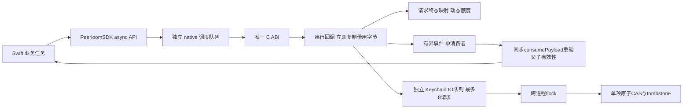
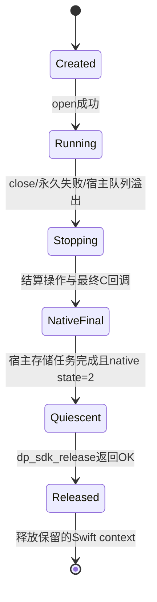

# Apple 原生封装

## 当前状态与交付边界

本目录提供 iOS 15+/macOS 12+ 的 Swift 源码封装、Keychain 存储、XCTest、独立 XCFramework 构建与验证入口。**[精确提交 `cf3c50a1a7b213b39eac12c24898d56037f8d89a` 的 Apple job](https://github.com/barry-ran/peerloom/actions/runs/40752590811/job/123043607293) 已完整通过；正式交付仍以同一提交全部必需门禁与实际 Release 资产为准。** 实际包含五 slice XCFramework、macOS XCTest 14 项、Rust TLS 2 项、iOS Simulator XCTest 12 项、unsigned device build、独立真实 Go 服务链及最终打包；新提交仍须满足自己的完整门禁。macOS 使用下文的隔离 DEBUG 文件 Keychain，iOS 使用 Xcode 生成的 Simulator 应用宿主，不能据此宣称生产签名 DP Keychain 宿主或真机已验证。主分支不能仅凭 Linux 检查通过开放新的平台能力。

封装只消费 `src/device-sdk/device-ffi/include/device_sdk.h`，不复制 Rust 内部布局或维护第二套手写 C 声明。生成的 XCFramework 复制这份规范头，并校验 SHA-256 一致；Swift package 链接其 `CPeerloom` 模块。已实现多连接、可靠消息/低延迟消息/字节流的 typed 通道与 reset 包装；三个数量配置默认 0（不限人工数量），正数可选；SCTP、硬件/系统资源及操作队列背压仍有限。已发布 v0.1.1 包保持其旧容量行为；各版本证据与交付门禁见[开发与验收](../../docs/开发与验收.md)。typed 通道与暂停执行器安全回归已包含在上述精确提交的原生门禁中，后续变更仍需重新验收。硬件标识、独立 Agent、业务界面不在此封装内。

Swift package 要求 Swift 6.0 或更高编译器，保持 Swift 5 语言模式及 iOS 15/macOS 12 最低系统；不依赖仅新系统才有的 AsyncIterator 隔离协议 witness。固定 Xcode 16.4 提供相应编译器，最低系统声明不等于已在每个旧系统版本实测。

## 结构与线程



- `open` 在后台创建原生线程和存储适配；所有 `SecItem*`、文件锁与存储 IO 在专用后台队列。直接在主线程调用存储适配会拒绝，不弹解锁 UI。
- C event/payload 指针只在 callback 中借用；Swift 复制后才排队，回调不等待下一个回调或 Keychain。
- 默认自动按实际活跃连接 C、stream S 提供 `64+8*C+2*S` 数据操作额度及独立 `64+C+S` 管理额度；completion 可以早于 C submit 返回，因此调用与 request 登记在同一锁内完成，回调在登记后查找。字节流 `read` 将调用者 isolation 显式传至 core，恢复后再检查 child gate；检查至返回之间没有新的 await，信用也不在 C callback 时提前释放。结果只报告固定错误码，不把凭证写入错误文本。
- 事件与操作共享各自的数据/管理资源预算，已经从 `next()` 取出但未消费的事件仍占用额度；事件副本共享单次消费状态与同一额度，消费或最后释放后归还。宿主不消费导致溢出时停止实例，不静默丢可靠消息后继续假装健康。`PeerloomEvents` 只支持一个并发 `next()`。
- `next()` 仅预先过滤失效事件，不能保证旧 AsyncIterator 的返回值不会再次排队到调用者 actor。事件字节保持私有，应用须在实际使用处同步调用一次 `consumePayload()`；它重新检查 Ready/Message 的父连接或通道 gate，过期、关闭或 shutdown 则抛错，不交付字节。`incomingChannel(from:)` 会消费 CHANNEL_READY 的元数据，不要先消费同一事件。只读查询不续租；同步消费成功后的再次排队/保存属于业务自己的字节所有权，SDK 不能追回已交付数据。
- 取消只请求取消尚未执行的操作。运行中的注册/轮换可能已提交，不能伪称远端回滚；等待真实终态。注册调用方须保留原注册输入和幂等键，当前没有跨进程崩溃的 mutation journal。

## 关闭与 context 生命周期



context 以 `Unmanaged.passRetained` 保留，只有 C runtime/callback 静止、宿主存储任务结束且 `release` 成功后才释放。`close()` 等待此边界；取消等待或 Swift 外层对象析构不会提前销毁 context。析构仅启动安全关闭，调用方仍应显式 `await close()`。自动停止同样进入清理。回调或系统调用永久卡住时不提供强杀线程或固定时限释放承诺。

C 库代码在成功 release 前必须保持加载。所有已经接受的普通操作会得到实际终态；连接关闭一旦接受就不可取消。后台存储在 native shutdown 期间仍处理已发请求，超时/取消允许完整旧 snapshot 或完整新 snapshot，绝不通过局部写入模拟成功。

## Keychain CAS 与访问控制

默认使用数据保护 Keychain：macOS 显式设置 `kSecUseDataProtectionKeychain`，iOS 使用系统唯一实现。凭证采用 `WhenUnlockedThisDeviceOnly`、不参与 iCloud 同步；`LAContext.interactionNotAllowed` 禁止隐式认证 UI。锁定、缺 entitlement、不可用或损坏都失败关闭，**不当作空存储、不回落 UserDefaults/明文文件**。Apple 对可访问类别的说明明确此类别只在解锁时访问，且不迁移到新设备。[可访问类别](https://developer.apple.com/documentation/security/ksecattraccessiblewhenunlockedthisdeviceonly)、[禁止认证交互](https://developer.apple.com/documentation/localauthentication/lacontext/interactionnotallowed)

- scope 为 Rust 规范化的服务器 origin + application UUID；账户名只保存其 SHA-256。完整 snapshot（format、scope、revision、identity 或 null）放在一个 generic-password 项中；revision 同时放入 `kSecAttrGeneric` 作为条件更新依据。
- `save/delete` 都检查期望 revision，成功严格增加 1；delete 保存 identity=null 的 tombstone，不删除 revision。溢出拒绝，不重置为零。
- 锁文件位于当前应用支持目录的 0700 子目录，文件 0600、`O_NOFOLLOW`、要求普通单硬链文件；`flock` 有 2 秒尝试期限。共享 access group 必须显式提供所有参与进程一致的 app-group 锁目录；SDK 不猜 Team ID 或申请额外 entitlement。
- 持有跨进程锁后读当前 snapshot，再使用 `SecItemAdd` 唯一约束或带旧 revision 条件的 `SecItemUpdate` 一次更新数据与 revision。即使误配成不同锁目录，Keychain 条件更新也不能让两个旧 revision 写入都成功。Apple 说明 update 以查询属性匹配并原子修改所选项；这些行为仍由真实并发测试验证。[SecItemUpdate](https://developer.apple.com/documentation/security/secitemupdate(_:_:))、[Apple SecItem 注意事项](https://developer.apple.com/forums/thread/724013)
- 锁文件只协调提交，不含凭证。Swift String/Data 的内存副本不提供可验证的零化保证；本实现不声称密钥始终位于 Secure Enclave。

macOS 的数据保护 Keychain 依赖宿主用户登录上下文和获授权的签名 entitlement，不适用于任意无用户会话 daemon。测试专用 DEBUG/SPI 初始化器指向独立文件 Keychain，**不会修改默认/登录 Keychain 或全局搜索列表**；它用于可重复的 CAS、锁定和跨进程测试，不冒充生产 DP Keychain 的 entitlement 验证。[Apple TN3137](https://developer.apple.com/documentation/technotes/tn3137-on-mac-keychains)

iOS 卸载后 Keychain 可能保留；本封装不会依据一个丢失的普通文件擅自清除已有 Keychain 身份，也不承诺检测卸载重装。重启/升级读取原 snapshot；存储真正丢失后需要新的受控注册。宿主直接调用存储 delete 并不撤销服务端凭证。当前 Swift `resetIdentity(expectedDeviceID:retry:)` 通过 C ABI 关闭旧权限并写入 CAS tombstone，成功后还需显式新注册；不转移旧授权，也不等于服务端吊销旧设备。新增 reset 包装需通过当前原生门禁。

## 接入

`Examples/最小接入.swift` 演示开关生命周期。正常运行使用 HTTPS/WSS 与系统信任链，不存在跳过证书验证选项；`developmentLoopback` 默认 false，只供明确开发 IP 回环例外。首装注册 grant 来自有权客户后端，不可内嵌长期管理 key。

```swift
let config = PeerloomConfiguration(origin: "https://signal.example.com/", applicationID: appID)
let sdk = try await PeerloomSDK.open(configuration: config)
let deviceID = try await sdk.start() // 已有身份；首装显式传 registration + 保留的 idempotencyKey
// connect completion != connected；等待 Ready。incoming 必须由业务明确决定 accept。
try await sdk.close()
```

后台/锁屏时平台可能挂起应用或拒绝 Keychain；本封装不保证后台常驻连接。WSS 重连不会延长旧授权，平台暂停后的租约边界和真机锁屏行为仍需单独验收。

## 独立真实服务链验收

`ServiceTests/SwiftServiceTests.swift` 与 `PeerloomSwiftService` scheme 提供一个独立 iOS Simulator 场景，**已在上述精确提交实际通过**；不替换既有 macOS 14 项/iOS 12 项、TLS 或签名检查。它不注入 MockNative 或内存存储：宿主仅为独立第四个 App 签发一次性注册 grant，不预注册其设备；Swift 先确认该 App 的真实默认 DP Keychain 为空，通过公开 `start(registration:idempotencyKey:)` 首次注册并持久化，关闭后新建 SDK，以 `start()` 恢复且核对同一设备 ID。其后三设备通道场景保持独立：真实 Go 管理 API 创建三个不同 App 的安装身份及方向性授权，Swift 将身份写入真实默认 DP Keychain 后由 SDK 恢复、认证 WSS、明确接受会话，再验证两条连接、可靠/低延迟消息、256 KiB 字节流、双工读写、FIN 半关闭与父子失效。首次注册与恢复断言仍在同一个具名 service case 内，不增加或替换既有 14/12 项原生测试。

仅在 macOS CI 自己的回环地址启动 PostgreSQL、Redis 和 Go；先只读探测预装的精确版本，不匹配时校验官方归档 SHA-256 后在用户私有目录编译。缓存按 runner/镜像、依赖 manifest 与构建脚本区分，恢复后核对文件哈希和实际版本，绝不缓存 PGDATA、配置秘密或测试身份，也不调用 `brew services`、提权或操作已有数据库。依赖原始许可证随构建缓存保留，不代替第三方法律审查。

fixture 只在本次 Simulator 应用的 Documents 中以 0600 保存，不改已签名的 bundle；Go/数据库日志、凭证、测试 xcresult 和运行时原始日志只留在临时私有目录并在结束清理。公开证据仅包含固定测试名、结果、无秘密阶段标记与编译日志；失败时也尝试删除已确认 UUID 的本次 Simulator，并逐项停止自己创建的前台服务；清理未完成会明确失败，不承诺在创建结果不确定或 runner 被强制终止时仍能清理。测试使用显式 developmentLoopback HTTP/WS 与真实 WebRTC，不能外推为生产正向 HTTPS 信任或真机验证；现有双平台 TLS 拒绝测试仍独立必需。

## 原生构建与验收门禁

脚本固定 Xcode **16.4 / 16F6**、Rust **1.99.1**；官方 `macos-15` arm64 runner 镜像列出该 Xcode 路径。runner 镜像仍滚动更新，构建记录实际 ImageVersion 与 SDK 版本，不能称不可变运行环境。[GitHub runner 官方清单](https://github.com/actions/runner-images/blob/main/images/macos/macos-15-arm64-Readme.md)

```sh
export DEVELOPER_DIR=/Applications/Xcode_16.4.app/Contents/Developer
export PEERLOOM_REPO_ROOT="$PWD"
export PEERLOOM_APPLE_OUTPUT="$PWD/dist/apple-validation" # 必须不存在
# 由受控CI预先安装固定Rust和五个Apple targets；脚本不自动下载大工具链。
bindings/ios/scripts/build-xcframework.sh
bindings/ios/scripts/test-native.sh
```

XCFramework 包含独立的 iOS device arm64、iOS simulator arm64+x86_64、macOS arm64+x86_64 分片，只在同一平台内用 lipo，绝不把 device/simulator arm64 混在一个 fat archive。Swift 源码 package 与原生 `CPeerloom.xcframework` 一同交付，设备构建不等于真机运行。遵循 [Apple XCFramework 指南](https://developer.apple.com/documentation/xcode/creating-a-multi-platform-binary-framework-bundle)。

验收必须实际执行：macOS Swift/XCTest、独立临时 Keychain 锁定失败和两进程 CAS、真实 C create/load/shutdown、宿主排队后过期重验、宿主事件溢出、macOS Rust 系统 TLS 负向，以及 Swift macOS/iOS 两次真实自签握手拒绝（服务器侧计数，绝不安装信任根）；iOS 18.5 模拟器 XCTest/DP Keychain；unsigned iOS device build 与三类 XCFramework 结构。真机签名/安装、真机锁屏、后台暂停与生产 entitlement 不能由这些门禁替代；回环环境下完整双端 Swift 通信另由上述真实服务场景证明。

iOS 测试使用 `SimulatorHost` 中的空应用宿主和显式 XCTest target，直接引用原有 `KeychainTests.swift` / `NativeCoreTests.swift`，保留原 8 项并加入 typed 通道、延后消费/信用及暂停 actor 回归，当前共 12 项。裸 SwiftPM 测试由 Xcode `xctest` agent 托管，实际返回 `errSecMissingEntitlement` 时不能归咎为锁文件失败或改用明文存储。标准 `TEST_HOST` 将测试注入本次构建的应用 executable。[Apple TEST_HOST 定义](https://developer.apple.com/documentation/xcode/build-settings-reference)、[Keychain entitlement 错误](https://developer.apple.com/documentation/security/errsecmissingentitlement)

此夹具仅支持 `iphonesimulator`，使用本地 ad-hoc Simulator 签名；不设置虚构 Team ID、不导入证书、不请求 provisioning profile。Keychain group 由 Xcode 展开标准 `$(AppIdentifierPrefix)$(PRODUCT_BUNDLE_IDENTIFIER)`，门禁检查实际 xctestrun 宿主及 Xcode 生成的 `.xcent`；Simulator entitlement 也可能被放入 Mach-O，而非代码签名，因此只看 `codesign` 不能冒充完整权限验收。应用宿主只是测试容器，没有业务 UI。该宿主已在上述精确提交中通过真实 CI；新增测试仍须当前门禁确认，不能外推为真机或生产 macOS DP 签名权限通过。

为尽快定位模拟器问题，CI 先构建独立单 arm64 Simulator 诊断包并执行相同 12 项测试；此产物不是发布 XCFramework。诊断通过后仍须完成全部五 slice 构建与全部原生门禁，失败不会跳过检查晋级。

Linux 可运行 `python3 bindings/ios/scripts/test-static.py`，只覆盖打包边界与脚本，不替代原生运行。上述精确提交的原 14/12 项、独立服务场景及包装均已真实通过；服务 artifact `12847506114` 的 SHA256 为 `f37a8c7582c96904bccba29ba2b1ace370b84a93fe719d3b51d37b78386412c1`，明确记录 Swift 首次注册与重开同 ID。release-profile artifact `12847091166` 已通过未修改的 `release-policy.verify_zip` 整包校验，包含三平台变体/五架构、统一规范 C 头、notice/SBOM 与已记录缺项；正式交付仍须当前提交所有必需门禁及审核后的发布步骤。项目 MIT 不覆盖第三方，证据收集不等于法律清关，也不等于生产签名或真机验收。

### 宿主资源预算

`ffiResourceBudgetBytes` 编码为 `ffi_resource_budget_bytes`，默认 128 MiB、最小 2 MiB。native 与 Swift 分别管理自己的预算，不是整个进程 RSS 的总上限。关键区保留 `R=max(256 KiB, B/8)`，数据不能借用；每个 reservation 另计 256 字节元数据。C 回调在复制 `Data` 前申请额度，completion 使用原 admission ticket，直到等待调用者恢复才释放；每 stream 一个 READ。关闭事件消费前保留生命周期计数，缩容不撤销旧 ticket。并发 close 共享一个关闭任务，不设置固定 32 个等待者上限。

未请求的 push 事件超出宿主预算时明确报资源溢出并停止，不静默丢可靠数据；ABI1 void callback 没有消费 ACK，不将此机制描述为跨 native/宿主的端到端反压。调用者取得或消费后的数据及其后续自建队列属于调用者内存。

关键分区 R 内再分为管理操作/存储回复与生命周期通知各半；每个登记对象预留一个 Closed ticket，不能耗用管理操作计数或管理字节。最终空 payload shutdown 通知有独立保证路径，不因缩容或旧宿主票据未消费而丢失；存储回调预算失败会明确回复失败，不把未回复 CAS 当作完成或回滚。

RESET 另有唯一 pending 紧急槽，不受旧 CLOSE completion 仍占用且 C/S 已缩小的 M 计数阻断，但仍受管理字节预算限制。只在对应 native 终态到达或受理失败时释放该槽；旧结果字节仍归原 ticket，直到宿主消费才释放，旧清理不能清除较新的 reset 槽。native 可以抑制已经失效的 Ready/OPEN birth 后仍送 Closed；未向宿主发布的句柄终态使用有界生命周期备用预算，不凭空创建连接/流，也不因此停止其他兄弟连接。


## 独占准备会话

Swift `connectPrepared(sessionID:)` 只提交可信服务已创建的 session ID，先查询实际 C 库 capability 256；旧库明确 Unsupported。不会把服务管理凭证或调用方提供的 epoch 传给设备 SDK。原 `connect(to:)` 与 handle API 保留。

`readyConnection(from:)` 仅消费 CONNECTION_READY，返回只读 `PeerloomConnectionInfo`（handle/sessionID/peerDeviceID/generation/targetEpoch）。它使用已有 `consumePayload`，在最终同步消费点重新核 native validity；retained event 在 epoch/lease 失效后不能变成有效 ConnectionInfo。调用一次即消费，与直接读取 payload 共用相同单次所有权。

`PeerloomChannel.targetEpoch` 同样只作描述。独占字段必须同时为 `exclusive_target=true`、`exclusive_protocol_version=1` 和 1..9223372036854775807 的规范十进制字符串，未知版本、前导零或溢出拒绝；非独占省略。包装层不复制 native 租约时钟、不用墙钟恢复权限；所有流最终交付仍调用 native gate。source close 不等于目标安全释放，target barrier/fence ACK 由 native 与服务端执行。原动态预算、共享 close、紧急 reset 和宿主消费前 READ 校验不变。
