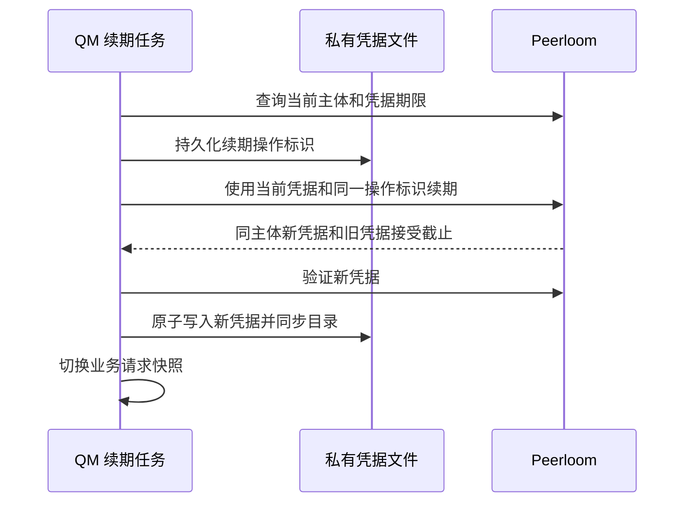

# Peerloom 服务端运行包

本说明适用于 `server-linux-amd64` 的解压后安装载荷，不是 SDK 安装说明。请从正式 Release 选择实际可下载的服务端包，并核对该版本的功能验收来源、实际构建源码、版本元数据及校验清单；本说明本身不证明特定版本已发布或已部署生产环境。历史已发布资产不覆盖。

## 包含什么、仍需什么

- `bin/`：`device-server`、`device-migrate`、`device-bootstrap`、`device-admin`、`device-admin-user`，均为 Linux amd64 预编译程序。管理后台 HTML/CSS/JavaScript 内嵌在 `device-server`。
- `infra/migrations/`：版本 1–12 的 12 对 up/down SQL。
- `deploy/`：仅复制预编译程序的运行时 Dockerfile、Compose、TLS 覆盖、网关配置及秘密初始化脚本。
- `docs/部署指南.md`、版本元数据、许可证据与完整校验清单。

宿主需要 Linux amd64、Docker Engine、Docker Compose（TLS 覆盖需 ≥2.24.4）、Python 3.10+ 标准库，以及解压/校验工具。**不需要项目源码、Go、Rust、Cargo、Node 或 npm。** 构建运行镜像仍需联网拉取文件中已固定版本与摘要的 Alpine/PostgreSQL/Redis/nginx 镜像；这不是全部镜像的离线交付包。不要擅自将固定镜像改成 `latest`。

仅控制面与管理入口随 Compose 启动；TURN 需独立部署、配置网络/证书及登记运营者 secret 引用。包内没有生产 TURN 默认主密钥或完整公网配置。

## 解压与校验

先从正式 Release 核对外层 ZIP 的版本、摘要与来源。外层 ZIP 仅供封装；**安装使用其中的 `peerloom-server-linux-amd64.tar.gz`**，它保留 Unix 可执行位，不使用 ZIP 松散文件替代程序。

```sh
# 在一个全新目录操作，不覆盖已有部署。
# 先将 PEERLOOM_VERSION 设为已实际下载的发布版本号（不含 v），不要填写未发布版本。
: "${PEERLOOM_VERSION:?请先设置实际下载的发布版本号（不含 v）}"
mkdir "peerloom-server-${PEERLOOM_VERSION}"
cd "peerloom-server-${PEERLOOM_VERSION}"
unzip "../peerloom-server-v${PEERLOOM_VERSION}-linux-amd64.zip" -d archive
mkdir runtime
tar -xzf archive/peerloom-server-linux-amd64.tar.gz -C runtime
cd runtime
sha256sum -c SHA256SUMS
```

以下命令全部在这个 `runtime` 包根执行。`release-metadata.json` 必须标明正确版本/提交、`platform=server-linux-amd64`、`product=server`；校验和只证明字节一致，不替代可信下载来源或签名。

## 简化自建部署（推荐首次安装）

在已校验的 Linux 发布包 `runtime` 根目录执行：

```sh
python3 deploy/selfhost.py up --project-name my-peerloom \
  --tenant-name '我的平台' --application-name '我的应用'
python3 deploy/selfhost.py status --project-name my-peerloom
```

`up` 依次生成私有数据库秘密、构建固定运行时镜像、启动数据库与 Redis、迁移、一次性创建租户/应用/30 天服务凭据，并启动控制面与回环网关。没有默认密码，不开启管理后台，不开放公网；**仍需先下载、校验发布包，以及准备 Docker/Compose/Python**。发布包之外不下载源码或安装开发工具。


接入信息写入 `.operator/connection.json`（目录 0700，文件 0600），包含租户、应用 ID、凭据 ID、有效期和服务凭据；终端只显示非秘密状态。只交给可信业务后端，不能放到 PC/手机客户端、Git 或日志。`status` 查询真实数据库中的凭据到期、撤销和租户状态，不会生成、续期或撤销密钥。

必须固定 `--project-name` 和安装目录，重复 `up` 时使用相同租户/应用名称。包装会校验已保存的参数、项目归属和完整秘密，正常重入不会新建租户/应用或轮换凭据。每阶段失败后保留原状态；普通命令失败可修正原因后重入，部分秘密或初始化结果不完整则拒绝，需运维核查，**不要删除秘密或数据库卷来重试**。发现同名外部 Compose 项目、已有手工部署秘密时不会自动接管；已有安装继续使用下面的显式运维方式。

该入口不是公网一键部署：域名、可信 TLS 证书及公网/TURN 策略仍由运营者提供，按后面的 HTTPS/WSS 流程配置。

凭据签发在 Linux 部署容器内执行，输出父目录必须由运维用户拥有且为私有目录。不支持在该容器外的非 Linux 主机直接签发需要持久化保证的 setup/issue 输出。

恢复边界：仅当保留状态完整且验证通过时，才支持自动重试。若 `init-private.py` 在生成 `.secrets` 时中断，下次 `up` 会拒绝不完整目录并保留现场，交由运维核查，不会补写、删除或重新生成密码。若 setup 输出已落盘但数据库提交结果不确定，必须通过 `setup-verify` 才能继续。标记文件内容及父目录都会执行 fsync；同步失败仍保留文件并报错，不会报告就绪。

初始化默认只创建一个租户和一个应用，不会自动配置 QM 所需的双角色应用映射。业务后端仍须按自身角色与授权模型配置接入；此入口不是整个 QM 项目的一键部署。

### 服务凭据自动续期

Peerloom 提供稳定服务主体与可过期凭据的续期接口；它不会替所有消费者修改各自磁盘文件。配套 QM 业务后端在可写私有凭据文件的托管模式下自动续期，无需每月手工换密钥；静态环境变量、只读文件或未实现续期的其他消费者不具备这一能力。具体托管配置以 QM 后端的部署说明为准，不要把 `selfhost status` 当作续期任务。

新凭据有效期 30 天，进入到期前 7 天的窗口后续期。新旧凭据最多重叠 24 小时，且不延长旧凭据原有到期时间。QM 先持久化本次操作标识，再请求续期；新凭据校验并原子持久化后才切换业务请求。响应丢失时用相同操作标识恢复，不创建分叉凭据。网络短暂故障会退避重试；长期离线超过有效期、磁盘不可写、凭据或主体被撤销时会明确报错，不能靠重新签发绕过撤销。

自动续期权限单独控制：新 `setup` 创建的服务主体默认启用；迁移前已有主体以及普通 `bootstrap` / `issue-key` 创建的主体默认关闭，不能因为升级而延长原有授权。运维仅能通过离线 `device-admin enable-renewal` / `disable-renewal`，明确指定 `--offline --tenant-id UUID --subject-id UUID` 启停。禁用后现有凭据保持原有限期，但续期与续期结果回放均被拒绝；撤销主体会立即使整条凭据链失效。启用现有服务必须先获得该服务的具体授权，不能由部署脚本自动开启。



续期不会提升权限，也不是泄漏后的自动补救：持有当前凭据的攻击者仍可能抢先续期。发生泄漏应撤销整个服务主体，使所有代凭据及续期回放失效；仅撤销某个旧凭据不等于撤销主体。

## 首次启动：仅本机 HTTP

```sh
python3 deploy/init-private.py
docker compose -f deploy/compose.yaml config --quiet
docker compose -f deploy/compose.yaml build
docker compose -f deploy/compose.yaml up -d --wait postgres redis
docker compose -f deploy/compose.yaml run --rm migrate
docker compose -f deploy/compose.yaml up -d --wait device-server gateway
curl --fail http://127.0.0.1:18080/readyz
```

初始化只新建 `.secrets`，不生成账户或 `.env`、不启动服务。已有同名目录/文件/符号链接、路径或权限不安全时拒绝；中途失败保留本次目录供运维核对，不能靠删除后重试恢复已有数据库。**不要删除秘密后复用旧数据库卷。**

新 `.secrets` 父目录为 0700，授权单文件为 0444，并只挂载给需要它的容器。父目录阻止其他宿主 UID 遍历；单文件只读权限用于 Compose bind-secret 的非 root 容器兼容，不表示可放入公开目录。Docker daemon、宿主 root 及获授权挂载容器属于信任边界。运行时镜像构建上下文仅允许 5 个程序及 24 个 SQL，不复制 secrets。

默认端口仅 `127.0.0.1:18080`。PostgreSQL/Redis 不发布宿主端口，网关拒绝 `/metrics`；管理后台默认关闭，没有默认管理员。只有 `device-server` 另接独立 `egress` 网络，用于策略允许的 HTTPS Webhook 等出站；不会新增宿主监听端口，PostgreSQL/Redis/迁移仍只在内部网络。出口网络不绕过 Webhook 的 SSRF、DNS、重定向和授权检查。明文 HTTP/WS 仅供回环开发，不能把端口改成公网绑定后就当生产部署。

## 显式创建租户与管理员

以下是有数据库操作权限的运维者动作，不是匿名注册流程。`device-admin bootstrap` 创建**新租户**并签发短期 scoped 后端密钥；已有租户不要重复 bootstrap。输出含秘密，禁用 shell tracing，保存到新建私有目录，不用 `tee` 或 CI 日志。

```bash
set -euo pipefail
set +x
umask 077
mkdir -m 700 .operator
( set -C
  docker compose -f deploy/compose.yaml --profile tools run --rm -T \
    --entrypoint device-admin migrate bootstrap --offline \
    --tenant-name '我的租户' --scope admin --ttl 24h --label '初始运维' \
    > .operator/tenant-key.json
)
# 只读取非秘密租户 UUID，后端密钥留在私有文件中。
TENANT_ID="$(python3 -c 'import json,uuid; print(uuid.UUID(json.load(open(".operator/tenant-key.json"))["tenant_id"]))')"
IFS= read -r -s -p '新的管理员密码（至少 15 个字符）: ' admin_password
printf '\n'
printf '%s\n' "$admin_password" | docker compose -f deploy/compose.yaml \
  --profile tools run --rm -T --entrypoint device-admin-user migrate \
  create --offline --tenant-id "$TENANT_ID" --username owner \
  --scope admin --password-stdin
unset admin_password
```

失败时先检查命令分类和数据库状态，不盲目重复创建；文件重定向拒绝覆盖不等于远端数据库动作可回滚。已有租户可直接用运维确认的 UUID 创建账户；服务密钥只交可信业务后端，不能放进浏览器或客户端。`device-bootstrap --development` 仅用于开发夹具，不是生产初始化默认命令。

本机开发显式启用浏览器入口：

```sh
export ADMIN_ORIGIN=http://127.0.0.1:18080
export ADMIN_DEVELOPMENT_LOOPBACK=true
docker compose -f deploy/compose.yaml up -d --wait device-server gateway
# 浏览器访问 http://127.0.0.1:18080/admin/
```

账户密码不进入 argv/环境或日志；唯一 Origin、Host、CSRF 与会话安全校验不可关闭。关闭网页入口不等于撤销已有会话，必要时通过离线账户禁用/重置完成撤销。

## HTTPS/WSS：用户证书、仍默认回环

提供 SAN 与访问主机名匹配的完整 PEM 证书链和私钥。原文件须由当前用户拥有，为非符号链接、单硬链接的普通文件，每个不超过 1 MiB；证书不可被组/其他用户写入，私钥必须禁止组/其他用户访问（例如 0600/0400）。祖先路径也会校验。原私钥保持原字节与权限，不为适配非 root 容器而 chmod 原文件。

```sh
python3 deploy/init-private.py --stage-tls \
  --certificate /absolute/private/fullchain.pem \
  --private-key /absolute/private/server.key
export TLS_ADMIN_ORIGIN=https://localhost:18443  # 留空关闭管理后台
# 以下叠加相同项目，不另建数据库卷；已有镜像由前面 build 生成。
docker compose -f deploy/compose.yaml -f deploy/compose.tls.yaml config --quiet
docker compose -f deploy/compose.yaml -f deploy/compose.tls.yaml up -d --wait postgres redis
docker compose -f deploy/compose.yaml -f deploy/compose.tls.yaml run --rm migrate
docker compose -f deploy/compose.yaml -f deploy/compose.tls.yaml up -d --wait device-server gateway
curl --fail --cacert /absolute/private/issuing-ca.pem https://localhost:18443/readyz
```

工具只在新建 `.tls` 0700 私有目录内生成 `certificate.pem` 和 `private-key.pem` 的 0444 只读副本，供 UID65532 的精确 Compose secret 挂载；不改原文件，不输出内容，不安装信任根。TLS 覆盖固定读取这两份副本，不使用 `TLS_CERTIFICATE_FILE` / `TLS_PRIVATE_KEY_FILE` 路径变量。`.tls` 已存在或中途失败时不覆盖、不自动清理；续期需运维在新的安全目录准备副本并保持原项目/数据库卷归属，不能把重新生成数据库秘密当作证书续期。

TLS 覆盖**替换** HTTP 发布端口为 `127.0.0.1:18443`，不同时保留明文入口，并强制关闭管理开发例外。HTTPS 管理会话使用 Secure Cookie；WSS 保持认证。不要使用 `-k` 或安装测试 CA 到宿主信任库。公网监听、DNS、防火墙、受信证书/续期、出口与 TURN 可达性须由运维单独审核，不自动开放公网。

## 保留状态、升级与参考

- `docker compose -f deploy/compose.yaml down` 停服务但保留数据库卷；TLS 部署使用相同两份配置。不要添加 `-v` 作为普通停机/升级步骤。
- Compose 默认项目名为 `peerloom-server`；多实例需显式指定不同项目名。已有部署升级须保持原项目/卷归属并先备份，不能把新目录、旧数据库和新秘密随意组合。
- 不覆盖旧配置或 `.secrets`；在新目录验证新包并人工合并配置，确保数据库及重放密钥连续。down SQL 可能删除数据，不是自动无损回滚。
- [随包部署指南](../docs/部署指南.md) 含网络、备份和运维限制。其标注的源码维护工具不随本包提供，不能把仓库 `make` 当作安装命令。
- 管理/API 与中继接口沿用公开 v0.1.0 文档：[管理服务](https://github.com/barry-ran/peerloom/blob/v0.1.0/docs/管理服务模块.md)、[浏览器管理](https://github.com/barry-ran/peerloom/blob/v0.1.0/docs/浏览器管理模块.md)、[中继配置](https://github.com/barry-ran/peerloom/blob/v0.1.0/docs/中继服务模块.md)。新拆包启动命令以本说明为准，不要求下载旧源码才能运行。
- 随包第三方 evidence 是共同 Cargo/Go 全锁定候选扫描，不是本服务二进制精确链接清单；许可原文、精确缺项和未法务审核状态完整保留。


## 托管 TURN 密钥

新安装会在 `.secrets/relay_encryption_key` 生成独立原始 32 字节主密钥，并仅向 device-server 挂载。管理界面的 TURN `secret` 是 coturn 的动态 REST 共享密钥，不是这个数据库加密主密钥。后者不应修改、丢失或随数据库一起公开。节点密钥加密保存，节点更新只供后续首次协商的新会话使用；旧会话保留旧版本，不会自动替换 TURN 配置。coturn 必须另行正确配置同一共享密钥。

已有安装缺少此主密钥会保留原文件并拒绝不完整初始化，不会自动重建数据库或覆盖密钥。旧 registry 文件不再作为配置来源；需要经管理入口重新录入。升级或修复前保留已有数据库及其对应主密钥，不要删除 `.secrets` 后重跑初始化。
