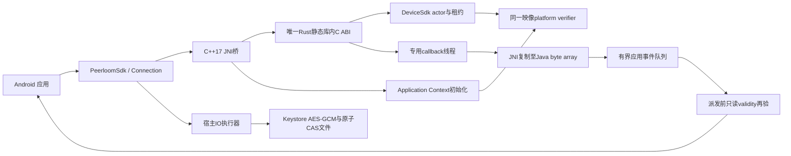

# Android 封装模块

本模块位于 `bindings/android`，复用唯一 C ABI 和 Rust `DeviceSdk`。Android 原生构建以及 4KB、16KB emulator 门禁已取得实际通过证据；本地静态检查不替代它们。发布仍要求最终默认配置的精确 SHA 通过全部必需平台门禁，不能把单个平台成功等同整体已发布。

## 架构与边界

当前仍为一条连接、一条可靠消息通道；stream、多通道、数据会话自动重建、ICE restart 不因增加 JNI 而成为已实现能力。WebRTC 必需安全机制不关闭，也不添加任意自创应用层加密。

- C++ 只调用 `src/device-sdk/device-ffi/include/device_sdk.h`，不复制第二套 C 声明。
- 最终 `libpeerloom_android.so` 链接**一份完整 `libdevice_ffi.a`**，Android TLS 初始化也在这份 Rust 链接图中；不把独立 verifier singleton 放到另一个 DSO。
- Rust `dp_android_tls_initialize` 使用 verifier 0.7.1 对应的 JNI API，在网络创建前保留 Application Context/JVM/classloader。缺初始化会明确失败，不 panic 或退回不验证 TLS。
- JNI 不跨线程保存 `JNIEnv`；callback 线程按作用域 attach/detach。每 SDK 的 receiver 使用 GlobalRef，成功 native quiescence/release 后才删除。verifier 的 Application 引用是上游定义的进程级 singleton，不是每实例 receiver 泄漏。
- JNI 回调建立有限局部引用 frame、立即复制借用 payload、检查并清除异常；不使用 `ExceptionDescribe` 输出可能敏感的应用异常。异常导致失效关闭，不越过 Rust/C/JNI 边界传播。

## Kotlin API

`PeerloomSdk.create(context, config, executor, listener)` 返回 `CompletableFuture`，初始化和平台 IO 不在 UI 线程执行。配置只需提供 HTTPS origin 与 application UUID；存储固定采用 Keystore-backed external adapter，不提供默认明文或内存后备。

| 调用 | 语义 |
|---|---|
| `start()` | 读取已有持久身份并自查 |
| `register(registration, key)` | grant 注册；调用方保留原 body/key 处理不确定结果 |
| `connect(target)` / `respond(session, accept)` | 请求或确认服务端授权；CONNECT completion 不等于 Ready |
| `refreshCredentials()` | 轮换、CAS 保存、新 token 重新认证 WSS |
| `Connection.send(bytes)` | 单条可靠消息，本地接受不代表业务远端确认 |
| `Connection.close()` | 不可逆地禁止新增收发，然后异步资源清理 |
| `close()` | 非阻塞停止新操作，等待 native release 和已有宿主事件派发结束 |

每次普通调用返回 `Operation(requestId, completion)`；`cancelQueued()` 仅取消尚未开始的工作。运行中的变更与关闭返回 Busy，不冒称回滚。不要在同步 completion continuation 中长时间阻塞原生 callback；使用显式异步 continuation/executor。

应用事件队列最多 32 项，最多一个 drain task 投递给应用 executor。Ready/Message 在真正交给应用前调用只读 `dp_connection_is_valid`，防止 C callback 时仍有效但在 Java 队列等待期间已过期/撤销。查询不能续租、不暴露 transport；旧、释放或错误父句柄都不能变为有效。已开始的应用 callback 不能追回；若它不返回，wrapper close 也不能声称已经静止。

## 安全存储

`IdentityStore` 使用 Android Keystore 内不可导出的 AES-256 密钥，标准 AES/GCM/NoPadding，每次系统生成随机 IV，scope hash 作为 AAD；这只是本地持久化保护，不是新的数据通道加密协议。

- 文件位于 `Application.noBackupFilesDir/peerloom-identity-v1`，不进入自动备份。示例和测试还显式禁用 backup。
- 整个 `revision + identity` 一起加密并经 独占创建的 0600/NOFOLLOW 临时密文文件写入、同步、抛错的 `Os.rename` 原子切换及目录同步；delete 保存 tombstone，不重置 revision。
- 进程内锁和同 scope 的 OS file lock 串行化 CAS；不同实例/进程比较同一 revision。文件/锁名只含长度分隔 scope 的 SHA-256，不含凭证。
- 密文和锁文件要求普通文件、同 UID、0600、单 link，目录 0700；锁使用 NOFOLLOW。OS 锁竞争有明确等待上界，不阻塞 UI。已有临时文件失败关闭，不跟随软链接；rename/sync 失败不得回报 CAS 成功。
- 密钥缺失但密文存在，或已生成密钥但密文缺失，都失败关闭，不能静默重新生成身份。Keystore 锁定/损坏/不可用也无明文后备。
- 崩溃遗留 `.enc.new` 时，旧完整快照仍可读，但后续写入失败关闭；不自动删除不确定事务文件。须停止写入、核对服务端注册/轮换结果后显式恢复。当前未提供自动恢复工具，也未完成两个 fsync/rename 切点的强杀验收。
- 外部存储调用超时或取消不能撤回可能已完整提交的宿主操作。当前没有跨进程崩溃的完整注册/轮换日志，遵守 C ABI 的 OutcomeUnknown 边界。
- 不声称所有设备都有硬件安全模块；emulator 的 Keystore 结果不证明真机硬件保护、卸载行为或厂商后台策略。

## 固定构建输入

| 组件 | 固定值 |
|---|---|
| Rust | 1.99.1 |
| AGP / Gradle / JDK | 8.13.2 / 8.13 / 17 |
| Kotlin | 2.2.20 |
| NDK / CMake | 29.0.14206865 / 3.22.1 |
| compile/target API / min API | 36 / 24 |
| ABI | arm64-v8a、x86_64 |
| verifier Kotlin AAR | 从 Cargo.lock 校验 `rustls-platform-verifier-android` 0.2.0，实际 Maven group 为 `org.rustls` |
| emulator | 官方 stable 37.2.12；API36 两类镜像 revision7，变化时必须显式复核 |

Gradle wrapper jar 与 distribution 均核对官方 SHA256；`gradle/wrapper/来源.json` 记录官方 commit、JAR 与嵌入 Apache-2.0 原文哈希，`许可证.txt` 保留原文，不把第三方改标为项目 MIT。NDK 不在本地脚本隐式下载；CI 明确安装固定版本。构建包括 Rust 本体、JNI、Kotlin、AAR 和示例 APK，不以单独交叉编译替代实际运行。Gradle 输入同时跟踪 SDK 目录外的已固定 nix 补丁源码，避免本地增量构建复用旧 native archive。

CI checkout 不持久化 Git 凭证。下载后先验证八项完整产物清单和 SHA256，再安装/运行。模拟器固定使用 4096MiB RAM；启动前只读检查宿主至少有 6144MiB 可用内存，并记录数值，不修改 swap、内核或安全配置。模拟器使用固定独占端口、明确 serial 和 AVD 名称，启动前拒绝碰撞；清理仅针对自己启动的 PID，身份不符不向其他模拟器发送清理命令。优先使用 runner 既有 KVM 权限，必要时仅临时赋予当前 runner 用户 ACL（保留共享 mask，不扩大其他用户有效权限），作业结束恢复原 ACL；工具缺失或权限不足失败关闭，不使用 world-write、持久用户组或桌面设置修改。

## 原生验证门禁

`.github/workflows/android.yml` 分为构建和 emulator jobs；模拟器分别断言真实 `PAGE_SIZE` 为 4096/16384，不仅检查编译 flag。

1. 构建两个 ABI，检查每个 ELF LOAD 段 >=16KB 对齐；对示例/测试 APK 执行 `zipalign -P 16`。
2. CheckJNI 下多轮 create/start/close/release、无效句柄与 receiver 引用归零。
3. Keystore 同进程/独立进程 CAS、持锁子进程强杀释放、tombstone、rename 故障和软链接拒绝、磁盘不含测试明文；通过独立 instrumentation 进程与 force-stop 验证重启读取。
4. 仅 GitHub Actions 独占临时 AVD 的测试 APK 可临时启用测试管理员，安装从已核验 APK 提取、按 DER SHA256 确认的单张临时 CA；HTTPS 与 WSS 分别验证正确 CA/SAN 接受、错误 SAN 和不可信 CA 拒绝。无论成功失败，先卸载并确认该 CA 消失，再移除管理员并确认失效，最后销毁本任务 AVD；清理失败必须 CI 失败。禁止批量清空 CA、修改宿主/用户设备或把管理员、测试 CA 带入 AAR/示例 APK。锁定的 verifier 使用 `AndroidCAStore`，不会读取应用 NSC 的自定义 raw CA；测试不通过修改生产验证器绕过此差异。
5. 独立 Go/PostgreSQL/Redis 环境：真实 Android 注册、同租户跨应用授权确认、WebRTC 二进制收发、凭证旋转后进程重启仍用同设备身份。
6. 应用 executor 暂停时确认真实消息已排队；远端关闭后读取 gate 已失效，再恢复 executor，消息不得交给应用。

本地完成了 Rust host check、JNI C++17 `-Werror` 静态编译、官方 API36/AndroidX 类型的 Kotlin 编译，以及脚本边界检查。实际 Android 构建、4KB 与 16KB emulator 已通过上述全部门禁，包括各自固定五轮跨进程 CAS/持锁强杀测试，以及宿主队列中精确 payload/connection 的撤销断言；参见[对应精确提交的完整 CI 证据](https://github.com/barry-ran/peerloom/actions/runs/40686771276)。这只证明对应提交，不自动覆盖后续组合提交。

16KB 测试曾从本包 `ApplicationExitInfo` 取得 `REASON_LOW_MEMORY=3` 的明确记录，表明持锁测试进程被系统低内存清理，因而采用上述固定内存 fixture；保持原断言、五轮首败即红，不重试掩盖。该证据不追认更早所有崩溃都属于同一根因，也不证明任意低内存真机的长期行为。失败诊断仅保留白名单阶段、数值退出原因和受限异常类别，不读取进程 trace/description，不上传原始 logcat 或凭证。普通 emulator 不等于真机；移动网络切换、系统休眠、OEM Keystore 与长期后台生命周期仍需专项验收。

产物必须随带项目 MIT、Rust Android target 与 Maven runtime/test 分开的依赖/许可证证据。现有 Linux SBOM 不能冒充 AAR 完整清单；Maven 证据仍需配套发布流程补齐，不能仅凭 native tests 绿就宣布许可证审计完成。

## 官方依据

- [Android JNI 最佳实践](https://developer.android.com/training/articles/perf-jni)
- [Android Keystore](https://developer.android.com/privacy-and-security/keystore)
- [备份排除与 noBackupFilesDir](https://developer.android.com/identity/data/autobackup)
- [AGP 8.13 兼容矩阵](https://developer.android.com/build/releases/agp-8-13-0-release-notes)
- [16KB 页面支持与验证](https://developer.android.com/guide/practices/page-sizes)
- [rustls platform verifier Android 集成](https://github.com/rustls/rustls-platform-verifier)

- [锁定 verifier 的 AndroidCAStore 实现](https://github.com/rustls/rustls-platform-verifier/blob/252e25161a91af476cbea620e29d277592d27ec7/android/rustls-platform-verifier/src/main/java/org/rustls/platformverifier/CertificateVerifier.kt)
- [Android 单张 CA 安装/卸载管理 API](https://developer.android.com/reference/android/app/admin/DevicePolicyManager#installCaCert(android.content.ComponentName,%20byte[]))

- [Android 进程低内存退出原因](https://developer.android.com/reference/android/app/ApplicationExitInfo#REASON_LOW_MEMORY)
