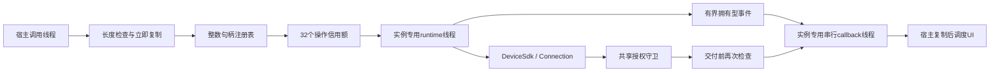
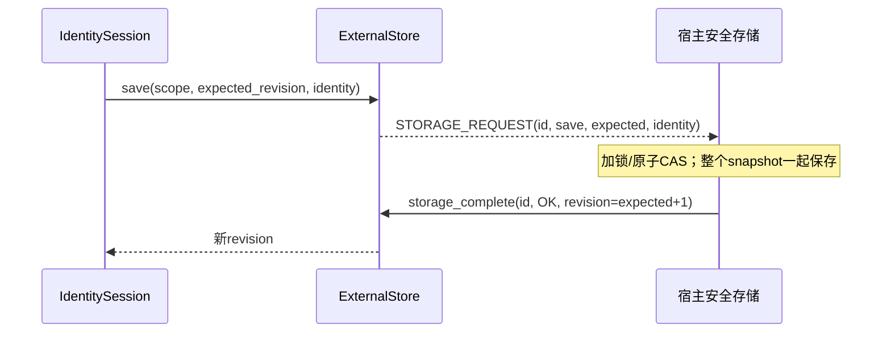
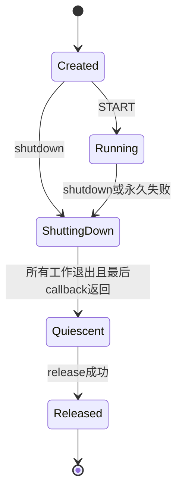

# C 语言接口模块

`src/device-sdk/device-ffi` 提供当前 Rust `DeviceSdk` 的原生异步 C ABI。**本次多连接、三类通道扩展已在 Linux 通过真实 C/Go/WebRTC 联合测试；Kotlin/Swift 扩展仍需对应原生 CI，不能沿用旧单通道平台结果冒充本次五端验收。**

唯一规范头文件是 [`device_sdk.h`](../src/device-sdk/device-ffi/include/device_sdk.h)。不要维护第二份手写声明。ABI 主版本为 1；事件携带 `abi_version`、`struct_size`，状态与事件种类使用固定宽度整数。C11 与 C++17 均已编译验证。

## 当前范围

| 能力 | 状态 |
|---|---|
| 加载已有身份、grant 注册、凭证轮换 | 调用真实 HTTP 身份客户端；注册须传入并保留幂等键 |
| WSS、目标确认、授权租约、可靠消息 | 调用真实 `DeviceSdk` actor，不复制控制面协议 |
| 自动 WSS 重连、轮换后重新认证 | 沿用 Rust facade；重连本身不延长旧授权 |
| 存储 | 显式 `memory` 或宿主异步 `external` CAS；无默认明文落盘 |
| 安全整数句柄、有界回调、取消、关闭 | 已实现并运行真实 C 生命周期与服务集成测试 |
| 显式身份 reset | 已增加能力位、确认 DeviceID、CAS tombstone 与未知结果恢复；本地真实服务专项已通过，最新候选 CI 待验收 |
| 字节流、低延迟、多连接、多通道 | 已接入父子句柄和独立有界 worker；真实三设备、两连接、三类通道测试通过 |
| 数据传输失败后恢复 | Core 已实现重建 PeerConnection/Channel 的恢复路径，新增组合仍须精确 CI；不宣称原地 ICE restart |
| Android JNI、Swift、Windows 封装及五端安全存储 | 沿用各平台 create/TLS/存储边界；本次新增接口须各平台精确 CI。Apple 签名生产 Keychain 与真机仍有独立验收条件 |

`dp_capabilities()` 按位返回可靠消息、异步 CAS、显式内存存储、reset，以及新增多连接、typed channel、可靠字节流、低延迟消息能力；位定义只以规范头为准，不能把总和值当 ABI 版本。默认仍一连接、一条默认可靠消息通道；`max_connections` 为 1..32，`max_channels_per_connection` 为 1..32（包含默认通道）。独立的 `max_channel_creations_per_connection` 为 active 限额..128，默认 8，关闭不返还累计 DCEP 预算。进程最多 16 实例，工程限额不是吞吐 SLA。

## 线程与所有权



- SDK、connection、channel、request 都是全局单调、溢出即拒绝的 `uint64_t`，不是地址；释放后永不复用。connection 必须属于传入 SDK，channel 必须属于传入 connection 及其当前 generation。注册表只保存当前对象，不靠无限历史集合防复用。
- 输入在调用返回前复制。非零长度的地址仍必须由 C 调用方保证可读、输出地址可写且正确对齐；空指针检查不能证明任意悬空指针安全。
- Tokio 任务只持有 Rust 拥有的数据，不跨异步保存调用方缓冲区。`context` 是宿主选择的整数标识，库不解释、不释放。
- `dp_event` 及其 payload 只在 callback 期间借用。没有返回拥有型字节块，因此没有无用途的 `dp_bytes_free`；需要保留时宿主自己复制。
- callback 串行运行，不持注册表或操作表锁。允许重入非阻塞 API；不可在 callback 中等待下一个 callback，不可跨边界抛异常、`longjmp` 或 unwind。
- callback 不在 UI 线程。创建实例会创建 OS 线程，但不执行网络或平台信任库加载；不承诺线程创建具有硬实时上界。

unsafe 仅限 `boundary.rs` 的 C 指针/导出边界；Rust core/storage/transport 仍禁止 unsafe。Rust 可恢复 panic 不跨 C 返回，异步 worker panic转为错误终态；这不保护非法 C 指针、OOM abort、外部异常或被破坏的内存。

## 异步操作

`dp_sdk_submit(sdk, operation, connection, input, len, &request)` 使用头文件中的操作常量。配置/控制输入是 UTF-8 JSON、最多 16 KiB；消息是原始二进制、最多 64 KiB。

| 操作 | 输入与结果 |
|---|---|
| START | `{}` 从存储加载；或传 `registration` 与 `idempotency_key` 注册。成功 completion 返回 device_id，不返回凭证 |
| CONNECT | `{"target_device_id":"UUID"}`；completion 只表示请求已提交，等待 CONNECTION_READY 才可发送 |
| RESPOND | `{"session_id":"UUID","accept":true}`；服务端仍决定权威授权状态 |
| SEND | connection handle 与二进制；成功仅表示本地发送队列接受，不是远端业务确认 |
| REFRESH | 空输入；使用身份模块串行轮换与恢复逻辑，并重新认证 WSS |
| CLOSE_CONNECTION | 空输入；接受后立即拒绝新增 send 与后续消息/Ready 回调，再等待实际资源清理 |

立即失败时输出 request=0，不产生 completion。每个接受的普通操作预留一个终态事件信用额，最多 32 个；信用在终态 callback 返回后释放，确保慢 callback 不造成无限积压。消息最多 32 个、其他控制事件最多 32 个；shutdown 另有独立信用，底层事件队列总容量 97。非终态溢出会停止实例，不静默丢弃后继续声称健康。

completion 可能早于 `submit` 返回；宿主应按 request ID 关联，不假设线程时序。连接 Ready 与消息在 callback 派发前再次检查只读 `ConnectionValidity`、本地关闭与 shutdown 状态。已经开始的 callback 或已经提交的网络发送不可追回。

### Typed channel 与多连接

保留原操作 1..7 与 `dp_event` 原字段偏移；`channel` 只追加在结构末尾，读取前检查 `struct_size`。新增 `OPEN_CHANNEL` 返回 child handle；对端开通道通过 `CHANNEL_READY` 通知。Ready 包含 session/generation/peer DeviceID，源端保留 CONNECT 的 request 关联，失败不冒用另一个连接。 CONNECTION_READY 的 JSON 增加可选 `ice_gathering` 元数据（`complete`、`partial_at_deadline`，未完成时为 `pending`）；只描述本地 SDP 收集状态，不表示连接类型或绕过授权。旧字段与 C 结构布局不变；消费 JSON 的应用应忽略未知可选字段。Kotlin/Swift 包装继续传递受 gate 保护的 payload，不使用拒绝未知字段的 Ready 解码器。

`dp_channel_submit(sdk, connection, channel, operation, ...)` 与旧 API 共享实例 32 个终态信用额：

- 消息 SEND 返回本地 `sent` 或明确策略 `dropped`，不是远端业务确认。发送队列按配置支持 Fail/DropOldest/DropNewest 与 TTL；从 ABI 受理开始计算绝对截止，不因转发 worker 重新起算。
- 流 READ 的 `max_bytes` 为 1..65536，返回原始部分数据，零字节成功表示 EOF；单流最多一个 pending READ，但其反向 WRITE、其他通道与控制面继续运行。
- WRITE 返回实际 `written`，调用方只推进该数量；不得自动重发未知结果。FIN 仅结束写半边，反向读仍可用。流拒绝消息 queue 配置；WRITE/FIN 当前固定 30 秒发送截止，包含 ABI 排队时间。超期关闭整个流，不跳过中间字节。接收端只有有界回压，没有新接收 TTL。
- 关闭 child 不关闭兄弟；关闭父连接、租约失效、generation 替换或 reset 立即使子对象失效。FIN/close 接受后不可取消。READ 已接受后即使授权过期也必须结算一次：清除数据并返回 CLOSED，不能悄悄丢 completion。
- native callback 与宿主实际消费时均重验 validity。Kotlin 的 READ 宿主交付另限 32 个；Swift READ 完整传递 caller isolation，在调用者 actor 恢复后重验并释放操作信用；旧系统 AsyncSequence 的事件不公开 Data，必须同步调用单次 `consumePayload()`，事件信用持有到消费或丢弃。库移交 Data 后，应用自行再次排队/复制不属于 SDK 可撤回范围。

Kotlin 暴露 MessageChannel/ByteStream、typed send disposition/partial-write count/read bytes、resetIdentity 与可注入异步 IdentityStorage（默认仍 Keystore）。Swift 对应 PeerloomChannel 的模式检查和 async read/write/FIN/reset；Swift 编译器最低为 Swift 6.0（当前 CI Xcode 16.4），语言模式保留 v5、最低系统仍 iOS 15/macOS 12；不依赖仅新系统可用的 AsyncIterator runtime。新增真实编译、暂停 actor 与消费信用测试必须由 Xcode CI 给出证据。

### 取消与不确定结果

`dp_sdk_cancel` 只取消尚未执行的普通操作，产生一次 `CANCELLED` completion。运行中的操作及已接受的关闭返回 `BUSY`，不会伪称回滚远端注册/凭证轮换。连接关闭的本地禁止收发效果不可撤销；若紧接 shutdown，关闭操作在同一清理完成后结算，不谎报取消。

网络响应丢失可能返回 `OUTCOME_UNKNOWN`。注册调用方必须保留原请求与幂等键，在服务端有限 replay 窗口内恢复。当前待定变更日志仍只在内存中；进程崩溃、持续丢响应或持续存储失败并不保证凭证可恢复。

## 宿主异步存储

选择 `storage:"external"` 后，`IdentityStore` 请求变成 `STORAGE_REQUEST` callback。宿主可复制数据、异步调用系统安全存储，再从任意线程调用 `dp_storage_complete`。callback 不需要等待 IO。



- `load` 返回 `revision` 及 `identity` 或 null；`save/delete` 返回严格的 `expected_revision+1`。CAS 冲突用 `BUSY`，不可用用 `INTERNAL`。最大 revision 在发出变更前拒绝。
- scope 包括规范化服务器 origin 与 application UUID。删除保留 tombstone revision，不能重置为 0；多进程/多实例宿主适配器需要真正的跨调用 CAS，单纯“读后写”不够。
- 每次请求最多等待 10 秒，最多 8 个待定存储请求；回复最多 16 KiB。迟到、重复或跨实例回复拒绝。
- 存储等待取消/超时不撤回宿主可能已完成的提交：状态只能是完整旧值或完整新值。身份模块会通过 load 核对同一 token/identity，恢复“提交成功但结果未收到”的 revision。
- shutdown 期间仍须处理已发出的存储请求，否则凭证持久化可能失败。内存适配与测试 C 适配不等于安全持久存储。
- payload 包含敏感凭证，只交给可信适配器；不得记录日志。当前不声称清除了所有 JSON/HTTP 内存副本。

HTTPS/WSS 已统一使用同一 platform verifier 配置，保留证书和主机名验证；明文仅允许显式 development 模式的 IP 字面量 loopback。Android 已在同一 Rust 映像初始化 JVM/Application Context 与匹配 verifier，既有 4K/16K 模拟器 TLS 正负测试通过；本次新增 channel 绑定仍须原生回归，不能据 Linux 测试声称移动平台新能力已验收。

## 退出协议



1. `dp_sdk_shutdown` 非阻塞停止新操作；已有未执行操作结算，运行中的有界变更先完成。
2. 关闭连接与 SDK，等待拥有的 runtime/阻塞工作结束，再投递最后的 SHUTDOWN callback。自动停止的该事件 request ID 为 0。
3. 最后 callback 返回后不再回调。宿主轮询 `dp_sdk_state`/`dp_sdk_release`；线程尾部仍未完全结束时 release 可短暂返回 `BUSY`。
4. 成功 release 才可卸载动态库或释放宿主 callback 代码/关联资源。callback 内 release 返回 `BUSY`，不会自 join。

若宿主 callback 永不返回，或系统阻塞工作未退出，实例不能安全静止；没有强杀线程或固定时限安全释放的承诺。宿主不可在此时自行卸载库。

## 构建与验证

```bash
cd src/device-sdk
cargo build --locked -p device-ffi
cargo test --locked -p device-ffi
cargo clippy --locked -p device-ffi --all-targets -- -D warnings
./device-ffi/tests/run-c.sh
```

产物为当前主机的 `libdevice_ffi.so`、`libdevice_ffi.a` 与 Rust rlib；规范头文件从 include 目录复制。分发时保留项目 MIT 和第三方许可证/依赖证据。

已实际验证：
- Rust CAS load/save/delete、冲突、精确 revision、取消后的待定回复清理与错误分类单测。
- C11/C++17 头编译，真实 `.so` 调用；32 个恰好一次终态、31 个 queued cancellation、running cancellation=Busy、卡住 callback 时不得 release、重入关闭检查、迟到回复和失效句柄拒绝。
- 真实 Go/PostgreSQL/Redis 管理接口生成同租户跨应用授权 pair，C 经外部存储加载身份、WSS 确认、真实 WebRTC 双向二进制消息、凭证旋转 CAS 与 WSS 恢复、跨父句柄拒绝、关闭立即 gate。
- 持续命令洪泛期间 Ready/Message 仍取得进展；回调消费不被命令优先级永久饿死。
- HTTPS/WSS 自签拒绝、受信任 CA 正确 SAN 连接、错误 SAN 拒绝；CA 测试用独立子进程隔离环境。

真实服务测试必须使用独立新 fixture，会轮换 source credential：

```bash
TEST_IDENTITY_BASE_URL=http://127.0.0.1:8080 \
TEST_SIGNAL_FIXTURE_FILE=/absolute/private/fresh-pair.json \
python3 src/device-sdk/device-ffi/tests/run-service.py
```

fixture 必须为 0600；runner 自动生成并删除 0600 临时 C 输入，不输出凭证。未提供 fixture 不等于测试通过。Linux 的这些结果不证明五端后台挂起、系统安全存储、移动网络切换或真实公网 NAT 已验收。

### 多通道联合验证

`TEST_MULTICONNECTION_FIXTURE_FILE` 指向管理 HTTP 创建的 source/target/third 三设备新 0600 fixture，配合 `TEST_IDENTITY_BASE_URL` 运行 `python3 src/device-sdk/device-ffi/tests/run-channels.py`。测试覆盖两条跨应用授权连接、三类通道、256KiB 部分读写、同时双向流、FIN、跨父句柄拒绝和兄弟连接存活；真实低延迟链路不承诺全部消息必达。原 service.c 洪泛与 reset 测试继续保留，含无秘密阶段/计数诊断；本地通过不解释此前远端偶发洪泛超时，精确 CI 仍必须通过。
