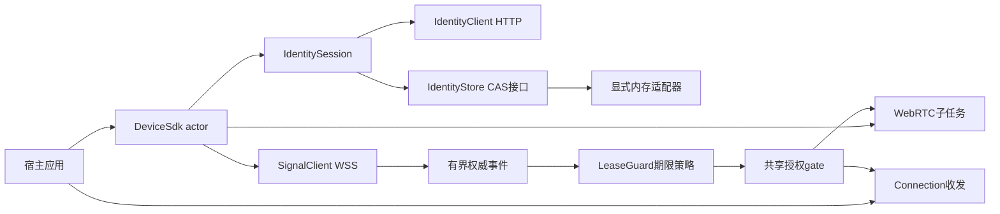
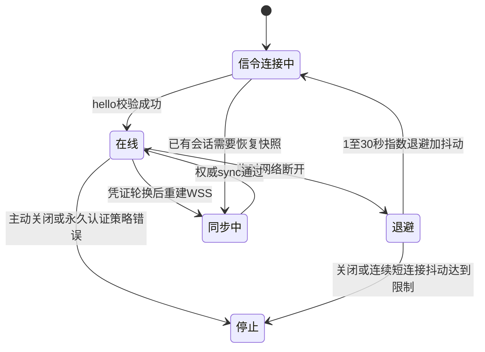
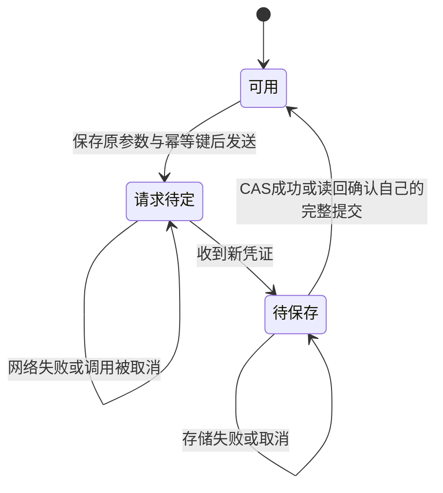

# SDK 身份与信令模块

本模块位于 `src/device-sdk/device-core` 与 `device-storage`。`DeviceSdk`/`Connection` 已把身份、原生 WSS、目标确认、授权期限与真实 WebRTC 组合为可调用的 Rust facade；也保留低层组件供专门集成。当前硬边界是**单个活动或待确认会话、单条可靠消息通道**，不是最终多连接多通道 SDK，不包含五端安全存储；Linux 的 C ABI 子集见 [C 语言接口模块](C语言接口模块.md)，不代表五端 ABI 已验收。



## DeviceSdk 与 Connection

| API | 当前含义 |
|---|---|
| `DeviceSdk::load` | 从明确注入的存储读取身份，执行设备自查，然后启动后台连接 |
| `DeviceSdk::register` | 使用注册 grant 与调用者保留的幂等键注册；若仅持久化失败，仍保留已发行的新内存凭证并发出 `IdentityPersistencePending` |
| `connect` | 提交目标设备连接请求；成功返回不等于已获授权或数据已连通 |
| `accept` / `reject` | 回应 `IncomingConnection`，由服务端决定权威状态 |
| `next_event` | 接收 Online/Offline、连接请求、ConnectionReady、ConnectionClosed、Stopped 等事件 |
| `refresh_credentials` | 串行轮换或恢复待定轮换，以新凭证重建 WSS；不因更换连接而延长旧数据授权 |
| `Connection::send` / `receive` | 有界可靠消息收发；不暴露可绕过授权守卫的 raw transport |
| `Connection::close` / `DeviceSdk::close` | 先禁止新收发，再有界等待资源清理；正常 SDK 退出允许正在执行的有界凭证变更结束 |

`max_connections` 和 `max_channels_per_connection` 当前只接受 1，其余值明确拒绝。底层传输也硬设为单通道；Ready 前检查 label 为 `peerloom.reliable`、protocol 为空，并且有序、没有有限重传次数或期限，不能把低延迟或字节流通道伪装为可靠消息。

SDK 命令/事件队列各 32；连接收发队列各 32，消息至多 64 KiB，待发送消息 TTL 为 30 秒。满队列明确拒绝或关闭，不能无限缓冲；这些数值不是整个进程内存上限。消息发送完成只代表本地传输受理，不代表对端业务已消费。传输协商在子任务中执行，身份变更也不阻塞授权计时。



- WSS 自动重连默认开启；HTTP 握手 401/403、WebSocket 1008 策略关闭与非法协议停止重试。连续 8 次不足 30 秒的成功连接后异常断开也停止，避免相同身份的多个实例持续抢占；没有无限即时重试。
- WSS 断开时，健康 P2P 可在**原授权期限**内保留。恢复后先 `sync.request`，权威快照通过前不主动续租；hello、同代次快照和重新上线都不延长旧期限。
- 双方 actor 独立主动续租；只有关联本端续租请求且提高授权代次的权威响应可以延长 gate。终止、明确授权失败或截止到达时先关闭 gate；挂起中的 receive 被唤醒，已排队但尚未交付的数据也不能在失效后继续返回。
- 数据传输失败后关闭旧会话，并明确报告 `ConnectionClosed`；目前需应用显式重新 `connect`。保留 desired-target 状态不等于已经实现数据连接自动重建或 ICE restart。
- 连接请求已发送但响应前断线时，报告 `RequestOutcomeUnknown` 并解除本地 Busy，不暗自用新键重放。服务端可能已经占位，应用后续显式重试仍可能暂遇并发限额，直到原请求终结。
- 对占用容量时的新入站请求有界去重拒绝；其他会话的终止通知不会再触发拒绝回环。
- 自动凭证刷新按已校验服务端时间提前 5 分钟安排，单次间隔最多 12 小时。未知提交结果用保留的原 key/token 在 1–2 秒抖动后重试，避免主动等满服务端旧 token 的 30 秒重叠窗口；保存失败则按 30 秒重试 CAS。永久 4xx（429 除外）和非法响应停止 SDK。
- 创建 future 取消、进程崩溃、响应持续丢失或保存持续不可用仍不能保证恢复。调用方应保留原注册请求/幂等键；内存 pending 状态不是持久化变更日志。Drop 不能代替正常 `close().await` 的有序退出。

## 身份与 HTTP 边界

- `IdentityClient` 使用锁定版本 reqwest，提供注册、`device-self` 和凭证刷新；租户、设备及授权结果以服务端认证结果为准。
- 默认只接受 HTTPS 根 origin。只有显式开启开发选项时，允许 IP 字面量回环地址上的 HTTP；普通域名、`localhost`、非回环 HTTP 都不能借此放行。WSS 地址由同一 origin 派生。
- URL 不接受用户名、密码、查询参数、片段或非根路径。禁止重定向、环境代理和 HTTP 自动重试；凭证只放 Authorization 请求头，不放 URL。
- HTTP 超时必须大于零且不超过 60 秒；响应按 Content-Length 和实际流式累计双重限制为 64 KiB。注册请求本体限制为 16 KiB，平台必填，元数据数量及键值长度受限。
- 注册的 installation_public_key 目前是安装标识输入，不证明私钥持有，也不是无凭证找回身份的凭据。
- 变更调用必须持有 `IdempotencyKey`。不确定结果重试必须保留原键、原请求与原凭证，不得换新键假装前一次未执行；服务端回放窗口有限。
- 错误保留稳定机器码，敏感字符串的 Debug 隐藏内容，包装器释放时清理其持有内存。不能据此声称 HTTP 库内部副本、操作系统缓冲区或所有进程内存都已清零。

## 存储、轮换与取消恢复

`IdentityStore` 是可注入异步接口，按规范化服务端 origin 与应用 UUID 隔离身份。`save` 和 `delete` 必须原子比较 revision 后更新；删除也递增 revision，防止旧写入在删除后重新生效。

唯一内置实现 `MemoryIdentityStore` 显式保存在内存中，进程退出后丢失。接口本身不证明存储加密；平台适配器需另行实现系统安全设施、原子提交、取消安全和非阻塞调用，不提供明文文件后备。



- `IdentitySession` 的单个可变所有者串行处理变更；不同所有者由存储 CAS 检出竞争，不自动覆盖另一个写入者。
- `retry_pending()` 重用原始变更参数。仅取消调用 future 不丢弃 session 中的待重试状态；销毁整个 session 会丢失这些内存恢复信息，尚无崩溃恢复日志。
- 网络已经返回新凭证后，即使保存失败，也不回退到旧凭证。`needs_persistence()` 表示仍需 `retry_persist()`。
- 若存储其实已提交，但保存 future 在返回前被取消，重试可读回并核对更高 revision、设备 ID、凭证与到期时间，确认自己的完整结果；不匹配则返回冲突而不是覆盖。
- 同一应用 UUID 的大小写输入规范化为同一存储作用域；设备自查还校验返回应用与当前作用域一致。

## 原生 WSS 客户端

`SignalClient` 使用锁定版本 tokio-tungstenite；TLS 显式选择 rustls provider 并加载系统根证书，不关闭证书校验。根证书加载放在阻塞任务中，不占用异步网络执行器。

| 边界 | 当前实现 |
|---|---|
| 连接与 hello | 连接超时 10 秒；hello 响应超时 10 秒；校验响应关联 ID |
| 所有权 | 校验服务器 hello 的 connection_generation/fencing_token，之后每帧严格匹配 |
| 顺序 | 双向序号独立递增；错序、旧所有权或非法信封关闭连接 |
| 帧及队列 | 文本消息/帧 128 KiB；命令与事件队列各 32；不是整个进程内存上限 |
| 单次写入 | 5 秒超时；命令入队满立即返回 QueueFull |
| 消费停滞 | 事件队列满则终止后台连接，不静默丢弃会话事件后继续运行 |
| 心跳 | 使用 hello 下发的有界心跳与 presence TTL；收不到有效服务端帧则超时 |
| 退出 | `close().await` 有界等待；超时或 Drop 中止后台任务；取消 close 仍保留任务所有权供 Drop 中止 |

目前支持会话请求、接受/拒绝、续租、连接报告、终止、按会话查询快照及完整 offer/answer。SDP 上限 64 KiB，协商代次固定为 1；`SignalClient` 自身不包含自动重连；这一层由 `DeviceSdk` 编排。trickle、ICE restart 和 SDP 持久重放仍未实现。

`send().await` 成功只证明帧已提交至 WebSocket 写入流程，不证明服务器授权或目标处理成功；业务结果通过事件接收。取消等待不撤销已经排队或发送的操作。关闭信令对象也不等于关闭另一个对象持有的 WebRTC 连接。

## 授权期限策略

`LeaseGuard` 本身不持有 socket。`DeviceSdk` 已将其绑定到共享 gate 和传输子任务，执行首次授权、持续收发检查及截止/终止关闭；直接组合低层组件的调用者仍必须自行执行这些动作，不能只创建 guard。

- hello 发出前记录本地单调时间，用经过 TLS 和关联校验的服务端 ack 时间建立时间估计；计算时计入往返时间并提前 1 秒失效，不用客户端墙钟推迟截止。
- 接受的任何新截止最多为接收时刻之后 60 秒，并取双方服务端 lease 与总 lease 的最早期限。该上限不等于承诺所有机器时钟、系统休眠和网络条件已完成验收。
- 校验 session ID、双方设备 ID、授权状态和正数 lease_generation；authorizing 不允许数据传输。
- 同代次、旧代次、重连或普通状态快照不能延长已有期限。新代次只有关联本端已提交 `session.renew` 请求 ID 的响应才可以延长；发送续租本身不能延长。
- 已到期或收到 terminated 的 guard 不能复活。WSS 断开不立即终止仍在有效期内的健康 P2P；但不能隐式续期，到期必须关闭。

服务端无法强迫串通端点停止自行通信。这套策略约束合规宿主及 SDK；多连接、数据连接自动重建、休眠恢复处理和平台端接入仍待实现与验收。Go hello 时间与数据库租约时间存在偏移时依靠接收后最多 60 秒的硬上限约束，而非宣称精确发行时刻到期；各平台 `std::Instant` 在系统挂起期间的计时行为尚未验收。

## 测试与验收边界

常规测试位于 `device-core/tests` 及 `device-storage` 模块内，覆盖身份作用域、CAS 竞争、取消后恢复、HTTPS/回环限制、错误与响应长度、真实回环 WebSocket 的握手/心跳/命令/关闭及协议拒绝、租约重放与终态不可复活。当前本地通过 11 项身份、6 项租约、16 项队列、5 项信令、2 项真实 TLS 不可信证书拒绝、5 项 facade 内部测试、7 项 SDK 回环场景及 3 项存储测试。SDK 场景包括默认重连、永久认证/策略停止、取消与持久化边界、未知请求不永久 Busy、容量限制和拒绝回环防护；错误标签/协议/可靠性及授权失效后数据交付也有专门回归。

```sh
cd src/device-sdk
cargo test --locked -p device-core -p device-storage
```

`identity_service.rs`、`authorized_pair.rs` 与 `sdk_service.rs` 是显式集成目标，需要一次性测试 fixture 和真实 Go 服务，不会因普通测试默认跳过而算作通过。已本地真实验证 HTTP 注册/同键重放/自查/轮换、授权 WSS 路由接入 WebRTC 双向消息，以及断信令后租约内继续传输、到期由编排调用方关闭和拒绝之后发送；授权双设备测试约 60 秒。独立传输集成也已验证真实 TURN 双端所选候选为 Relay/Relay，以及错误密码拒绝。

`sdk_service.rs` 的应用代码只调用 facade，不复制 SDP/lease 编排：同租户跨应用请求和显式接受、真实双向消息、凭证轮换后重建 WSS、保留原 P2P，并等待 32 秒越过初始 30 秒确认租约后再次收发，最后主动关闭并验证 gate 拒绝。此场景本地真实 Go/PostgreSQL/Redis/WebRTC 通过，耗时约 32.70 秒。最后新增的未知刷新结果重试参数由对应单测覆盖；发布应继续对冻结提交运行完整 CI，而不是把较早二进制的集成结果当作所有后续改动均已验证。

```sh
# 仅使用新建的临时开发fixture；该测试会真实轮换source凭证。
TEST_IDENTITY_BASE_URL=http://127.0.0.1:18080 \
TEST_SIGNAL_FIXTURE_FILE=/absolute/path/to/fresh-pair.json \
cargo test --locked -p device-core --test sdk_service -- --ignored --nocapture
```

fixture 必须是 0600 私有文件；不把凭证放入命令行参数、日志或仓库。当前新增阶段的远端 CI 尚需按准确提交确认，不能以本地结果替代。

尚未完成的验收包括授权业务链路中的自动 TURN 回退、网络切换/休眠恢复、24 小时级凭证生命周期与长期续租压力、多连接多通道 facade、五端安全存储、稳定 C ABI 与 Android/iOS 原生绑定。底层可靠字节流即使单独通过传输测试，也不等于已接入当前可靠消息 facade。接口和测试不得把这些目标写成已交付能力。
