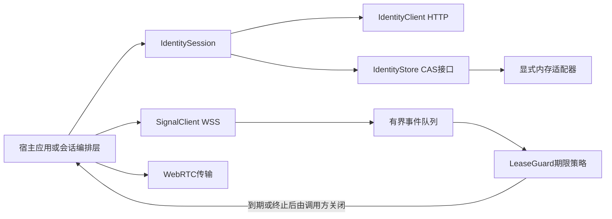
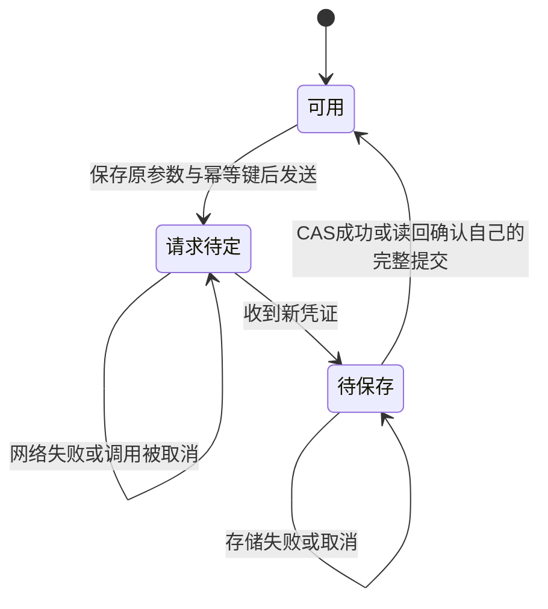

# SDK 身份与信令模块

本模块位于 `src/device-sdk/device-core` 与 `device-storage`，提供可组合的 Rust 身份、信令和授权期限策略。已具备 HTTP 注册、凭证轮换、设备自查和原生 WebSocket 客户端，不等于已经完成五端产品 SDK、平台安全存储或稳定 C ABI。



## 身份与 HTTP 边界

- `IdentityClient` 使用锁定版本 reqwest，提供注册、`device-self` 和凭证刷新；租户、设备及授权结果以服务端认证结果为准。
- 默认只接受 HTTPS 根 origin。只有显式开启开发选项时，允许 IP 字面量回环地址上的 HTTP；普通域名、`localhost`、非回环 HTTP 都不能借此放行。WSS 地址由同一 origin 派生。
- URL 不接受用户名、密码、查询参数、片段或非根路径。禁止重定向、环境代理和 HTTP 自动重试；凭证只放 Authorization 请求头，不放 URL。
- HTTP 超时必须大于零且不超过 60 秒；响应按 Content-Length 和实际流式累计双重限制为 64 KiB。注册请求本体限制为 16 KiB，平台必填，元数据数量及键值长度受限。
- 注册的 installation_public_key 目前是安装标识输入，不证明私钥持有，也不是无凭证找回身份的凭据。
- 变更调用必须持有 `IdempotencyKey`。不确定结果重试必须保留原键、原请求与原凭证，不得换新键假装前一次未执行；服务端回放窗口有限。
- 错误保留稳定机器码，敏感字符串的 Debug 隐藏内容，包装器释放时清理其持有内存。不能据此声称 HTTP 库内部副本、操作系统缓冲区或所有进程内存都已清零。

## 存储、轮换与取消恢复

`IdentityStore` 是可注入异步接口，按规范化服务端 origin 与应用 UUID 隔离身份。`save` 和 `delete` 必须原子比较 revision 后更新；删除也递增 revision，防止旧写入在删除后重新生效。

唯一内置实现 `MemoryIdentityStore` 显式保存在内存中，进程退出后丢失。接口本身不证明存储加密；平台适配器需另行实现系统安全设施、原子提交、取消安全和非阻塞调用，不提供明文文件后备。



- `IdentitySession` 的单个可变所有者串行处理变更；不同所有者由存储 CAS 检出竞争，不自动覆盖另一个写入者。
- `retry_pending()` 重用原始变更参数。仅取消调用 future 不丢弃 session 中的待重试状态；销毁整个 session 会丢失这些内存恢复信息，尚无崩溃恢复日志。
- 网络已经返回新凭证后，即使保存失败，也不回退到旧凭证。`needs_persistence()` 表示仍需 `retry_persist()`。
- 若存储其实已提交，但保存 future 在返回前被取消，重试可读回并核对更高 revision、设备 ID、凭证与到期时间，确认自己的完整结果；不匹配则返回冲突而不是覆盖。
- 同一应用 UUID 的大小写输入规范化为同一存储作用域；设备自查还校验返回应用与当前作用域一致。

## 原生 WSS 客户端

`SignalClient` 使用锁定版本 tokio-tungstenite；TLS 显式选择 rustls provider 并加载系统根证书，不关闭证书校验。根证书加载放在阻塞任务中，不占用异步网络执行器。

| 边界 | 当前实现 |
|---|---|
| 连接与 hello | 连接超时 10 秒；hello 响应超时 10 秒；校验响应关联 ID |
| 所有权 | 校验服务器 hello 的 connection_generation/fencing_token，之后每帧严格匹配 |
| 顺序 | 双向序号独立递增；错序、旧所有权或非法信封关闭连接 |
| 帧及队列 | 文本消息/帧 128 KiB；命令与事件队列各 32；不是整个进程内存上限 |
| 单次写入 | 5 秒超时；命令入队满立即返回 QueueFull |
| 消费停滞 | 事件队列满则终止后台连接，不静默丢弃会话事件后继续运行 |
| 心跳 | 使用 hello 下发的有界心跳与 presence TTL；收不到有效服务端帧则超时 |
| 退出 | `close().await` 有界等待；超时或 Drop 中止后台任务；取消 close 仍保留任务所有权供 Drop 中止 |

目前支持会话请求、接受/拒绝、续租、连接报告、终止、按会话查询快照及完整 offer/answer。SDP 上限 64 KiB，协商代次固定为 1；不包含自动重连、trickle、ICE restart 或 SDP 持久重放。

`send().await` 成功只证明帧已提交至 WebSocket 写入流程，不证明服务器授权或目标处理成功；业务结果通过事件接收。取消等待不撤销已经排队或发送的操作。关闭信令对象也不等于关闭另一个对象持有的 WebRTC 连接。

## 授权期限策略

`LeaseGuard` **不持有 socket，也不启动自动关闭任务**。调用方必须在首次传输前检查授权，在截止时间到达、权威终止或明确授权失败时停止发送并关闭传输；不能只创建 guard 而不执行这些动作。

- hello 发出前记录本地单调时间，用经过 TLS 和关联校验的服务端 ack 时间建立时间估计；计算时计入往返时间并提前 1 秒失效，不用客户端墙钟推迟截止。
- 接受的任何新截止最多为接收时刻之后 60 秒，并取双方服务端 lease 与总 lease 的最早期限。该上限不等于承诺所有机器时钟、系统休眠和网络条件已完成验收。
- 校验 session ID、双方设备 ID、授权状态和正数 lease_generation；authorizing 不允许数据传输。
- 同代次、旧代次、重连或普通状态快照不能延长已有期限。新代次只有关联本端已提交 `session.renew` 请求 ID 的响应才可以延长；发送续租本身不能延长。
- 已到期或收到 terminated 的 guard 不能复活。WSS 断开不立即终止仍在有效期内的健康 P2P；但不能隐式续期，到期必须关闭。

服务端无法强迫串通端点停止自行通信。这套策略约束合规宿主及 SDK；完整自动会话编排、休眠恢复处理和平台端接入仍待实现与验收。

## 测试与验收边界

常规测试位于 `device-core/tests` 及 `device-storage` 模块内，覆盖身份作用域、CAS 竞争、取消后恢复、HTTPS/回环限制、错误与响应长度、真实回环 WebSocket 的握手/心跳/命令/关闭及协议拒绝、租约重放与终态不可复活。当前本地通过 11 项身份、6 项租约、16 项队列、5 项信令、2 项真实 TLS 不可信证书拒绝及 3 项存储测试。

```sh
cd src/device-sdk
cargo test --locked -p device-core -p device-storage
```

`identity_service.rs` 与 `authorized_pair.rs` 是显式集成目标，需要一次性测试 fixture 和真实 Go 服务，不会因普通测试默认跳过而算作通过。已本地真实验证 HTTP 注册/同键重放/自查/轮换、授权 WSS 路由接入 WebRTC 双向消息，以及断信令后租约内继续传输、到期由编排调用方关闭和拒绝之后发送；授权双设备测试约 60 秒。独立传输集成也已验证真实 TURN 双端所选候选为 Relay/Relay，以及错误密码拒绝。当前新增阶段的远端 CI 仍待执行，不能以本地结果替代。

尚未完成的验收包括授权业务链路中的自动 TURN 回退、网络切换/休眠恢复、持续自动续租编排、五端安全存储、稳定 C ABI 与 Android/iOS 原生绑定。接口和测试不得把这些目标写成已交付能力。
