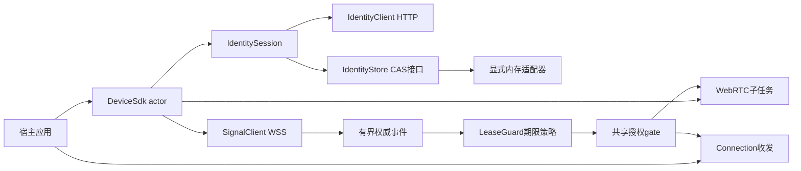
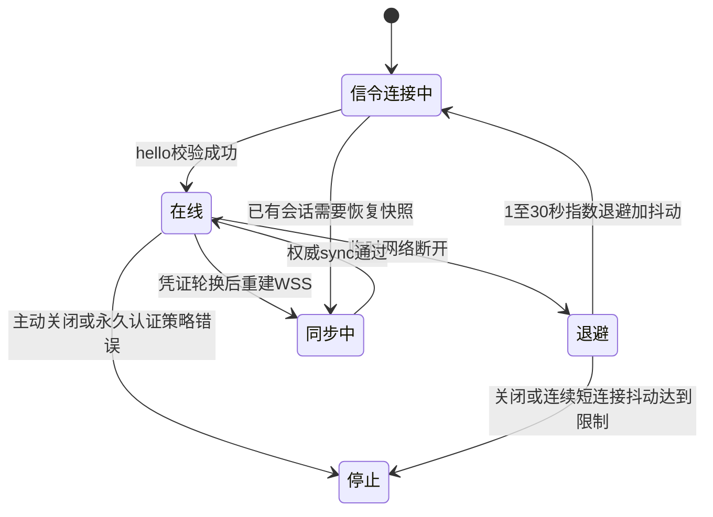
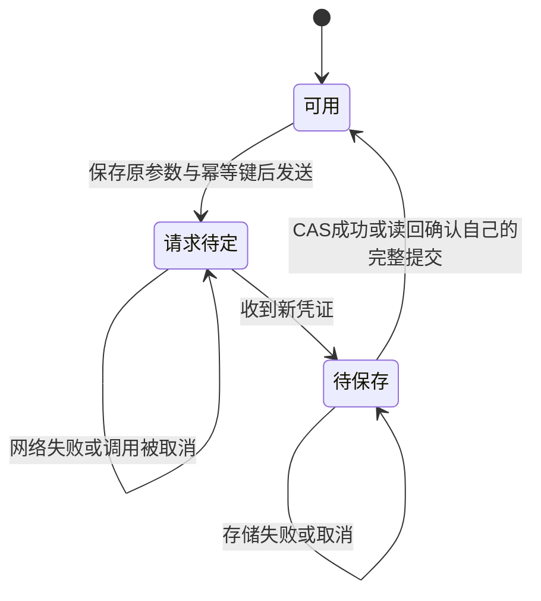

# SDK 身份与信令模块

本模块位于 `src/device-sdk/device-core` 与 `device-storage`。`DeviceSdk`/`Connection` 已把身份、原生 WSS、目标确认、授权期限与真实 WebRTC 组合为可调用的 Rust facade；也保留低层组件供专门集成。当前 Rust facade 支持**单身份、单 WSS 下多会话，每会话可热开可靠消息、低延迟消息和可靠字节流**，不是最终多连接多通道 SDK，不包含五端安全存储；Linux 的 C ABI 子集见 [C 语言接口模块](C语言接口模块.md)，不代表五端 ABI 已验收。



## Rust 多通道接口与边界

`Connection::peer_device_id()` 返回经过会话参与者校验的对端；`request_id()` 仅源端关联最初 `connect_with_request`，目标端为 `None`，同会话恢复新代保留原关联。不能把仅有 session ID 的 Ready 猜测成最近一次 connect。

- `open_message(label, mode, QueueConfig)` 只接可靠消息/低延迟消息；`open_stream(label)` 采用现有 `peerloom.stream.v1`，不新增协议或密码学。相同 label 不用来猜类型。
- 一个 worker 独占 `accept_incoming`，按协议/可靠性元数据严格分派。`take_incoming_channels()` 一次性取得独立接收器，避免默认消息 receive 与通道 accept 抢同一可变借用；丢弃接收器不会关闭父连接，无法交付的新子通道自行关闭。
- 消息 `sender()` 可克隆并与 receive 并发；发送完成仅代表本地传输受理，`Dropped` 明确表示整条策略丢弃，不是送达确认。发送能力的克隆被丢弃不关闭 owner；owner 关闭/失效后克隆也不可用。
- `SdkByteStream::split()` 返回独立 reader/writer，挂起 read 不阻止 write/FIN。write 可部分受理，调用者按返回 n 前进；FIN 仅关闭本端写方向，之后误 write 被拒，但反向读仍可继续。任一半显式 close/drop 关闭整个子流；正常 FIN 不是 drop。读到 EOF 后，worker 仍观察底层完全关闭，不重复投递 EOF，也不影响反向写入。
- 每个子 handle 保存父 session/generation 与只读 `ChannelValidity`。关闭子通道不关闭兄弟；父租约失效、撤销、reset 或旧代关闭同步禁止所有旧子通道收发。`ChannelValidity::invalidated()` 可取消地等待子通道或父授权失效；失效不等于资源已排空。FFI 的空闲 stream 即使没有挂起 READ 也观察失效并排空 worker，按原有借用规则结算操作后投递一次 CHANNEL_CLOSED，无需宿主再提交 CLOSE 或关闭父连接。raw transport 不外泄。

活动通道额度与底层累计创建预算不同：`transport.max_channels` 默认 0（不设人工累计上限），正数为可选累计预算，初始默认通道计入；正常关闭释放活动额度，但不回收累计预算，创建超时也保留底层不确定名额。需要新累计预算应按正常会话授权创建新 PeerConnection，不能绕过既有租约或静默重置身份。

### 发送预算、TTL 与回压

SDK 全部会话共享发送预算，默认有效载荷 4 MiB/1024 条（可配置、硬上界64 MiB/65536），queued 与实际 I/O in-flight 都计费，取消/失败只在实际持有者销毁后释放。每消息通道可独立设置队列条数/字节数/单条上限/TTL/整条 fail、drop_oldest、drop_newest；drop_oldest 不夺取兄弟或 in-flight 字节。绝对 `send_before` 将上层受理 deadline 与默认 TTL 取小值，异序 deadline 扫描有界队列全部条目，不被较晚过期的队首挡住；每个被丢弃/过期请求独立结算一次。

stream 不使用消息丢弃队列，write 每次最多16 KiB、待发命令槽1，默认发送TTL30秒。`write_before`/`shutdown_write_before` 保留外层受理deadline，绝不重新计时；排队/进行中取消或超时使整条子流失败关闭，不自动重放中段。明确未受理的 BufferFull 可在应用排空后重试。消息实际发送的超时/不确定错误也关闭该子通道，只有明确未受理的 BufferFull/MessageTooLarge 不因此关闭。

接收方向是有界回压，不额外发明入站TTL：消息接收32条，stream最多4个16 KiB分片，局部读取保留余字节。SCTP共享拥塞/接收窗口可能耦合通道吞吐，不承诺任意停读时其他通道完全无影响。上述发送payload预算不包含底层DTLS/SCTP、接收缓存、协议元数据、FFI已受理请求或宿主内存，不能声称是进程总内存上限。stream无数据轮询超时不消费任何frame，不改变序号/半关闭状态；发送超时则不能类推为未发送。

## 托管 TURN 与初始 ICE 配置

`SdkConfig.managed_relays` 默认 `true`。在同租户会话获准、目标接受（或应用明确配置免确认）后，Auto/RelayOnly 的传输子任务使用当前设备凭据调用 `GET /v1/device-sessions/{id}/ice-servers`，然后才创建 PeerConnection。HTTP复用身份客户端的系统TLS验证、禁止redirect/proxy、无自动重试、10秒超时及64KiB响应上限；不会在actor/UI线程等待网络。


- DirectOnly 不请求托管TURN。Auto收到明确的空 `ice_servers` 可继续直连；RelayOnly空数组则明确失败 `RelayRequired`。鉴权拒绝、限额、服务不可用、传输错误或畸形响应不会被当作空数组，也不静默改为直连。
- 托管响应只接受匹配会话、匹配本次协商的 `negotiation_generation`（1..9007199254740991，JSON 安全整数边界）、最多4个单URL TURN条目、未来整秒RFC3339 expiry、有限用户名与密码。过期/异常超长TTL拒绝；客户端允许的未来上限为11分钟（服务端最大10分钟，留有限时钟偏差），不是延长实际TURN认证期限。准备创建transport前再次检查expiry及SDK授权gate。
- RelayOnly在DataChannel就绪后还读取实际选中候选，要求本地候选为Relay，才向应用发Ready。对端可以采用其他合法策略，不错误要求混合策略双方都必须配置RelayOnly。
- 需要人工配置 `transport.ice_servers` 的集成方必须显式设置 `managed_relays=false`。托管Auto/RelayOnly与非空人工ICE配置互斥，避免隐式混合不同来源的凭据。旧的人工配置代码需要明确选择此兼容模式。
- Close/租约到期可取消尚未完成的HTTP获取；迟到响应无法恢复已关闭gate。HTTP token只作敏感字符串快照，不写日志；身份轮换与原有存储CAS逻辑不受此路径改变。

初次协商及同会话的新代恢复均重新获取当前代配置；恢复采用重建 PeerConnection/Channel，而非原地 ICE restart，不实现持续原地 TURN 凭据替换。凭据REST到期不等于既有allocation立即失效，不能将TURN expiry当成P2P撤销计时器；连接仍由独立SDK授权租约限制。新的授权连接会重新获取配置，不把上一会话的TURN凭据当作通用客户端缓存。TURN服务器范围、既有allocation Refresh的实际边界见[中继服务模块](中继服务模块.md)。

## DeviceSdk 与 Connection

| API | 当前含义 |
|---|---|
| `DeviceSdk::load` | 从明确注入的存储读取身份，执行设备自查，然后启动后台连接 |
| `DeviceSdk::register` | 使用注册 grant 与调用者保留的幂等键注册；若仅持久化失败，仍保留已发行的新内存凭证并发出 `IdentityPersistencePending` |
| `connect` / `connect_with_request` | 提交目标设备连接请求；后者返回稳定 request_id。成功仅表示本地准入与发送，不等于获授权或数据连通 |
| `accept` / `reject` | 回应 `IncomingConnection`，由服务端决定权威状态 |
| `next_event` | 接收 Online/Offline、连接请求、ConnectionReady、ConnectionClosed、Stopped 等事件 |
| `refresh_credentials` | 串行轮换或恢复待定轮换，以新凭证重建 WSS；不因更换连接而延长旧数据授权 |
| `Connection::send` / `receive` | 有界可靠消息收发；不暴露可绕过授权守卫的 raw transport |
| `Connection::close` / `DeviceSdk::close` | 先禁止新收发，再有界等待资源清理；正常 SDK 退出允许正在执行的有界凭证变更结束 |

`max_connections` 与 `max_channels_per_connection` 默认 0（不设人工数量上限），正数启用显式配额；pending、待授权、协商、Ready、恢复的会话计入活动配额；本地关闭 gate 并完成有界 worker 收束后即释放活动配额，不等待服务端确认。关闭后尚未确认的轻量记录独立保留，仅供补发终止与阻止旧会话复活，不占活动配额、不设置额外累计数量上限；服务端终态/明确不存在或整个安装停止/reset 后才移除，不能按旧本地 deadline 猜测清除。活动通道计数包含默认可靠消息通道及正在创建/握手的通道；只有活动与累计创建预算都为正数时才要求 active≤creation。数量不限不按配置预分配，仍可能因硬件/操作系统资源、SCTP stream-ID 或独立队列背压失败。[C ABI](C语言接口模块.md)、[Kotlin](Android封装模块.md)与[Swift](../bindings/ios/Apple封装说明.md)已暴露多连接及三类型 typed 通道，保留默认可靠消息通道的兼容入口；各平台真实验收独立于 Rust 测试，不能据配置上限推断长期并发或所有系统版本已通过。每会话初始仍创建默认可靠消息通道以保持旧 `send/receive`；Ready 前检查 label 为 `peerloom.reliable`、protocol 为空，并且有序、没有有限重传次数或期限，不能把低延迟或字节流通道伪装为可靠消息。

连接请求被拒时发出同样的 `ConnectionRequestFailed`（reason 为拒绝错误），不会释放其他目标的 pending，也不会关闭已获准的兄弟会话。未知或旧代响应不作用于当前代。服务端已分配会话后的事件继续以 session_id 关联。ABI1 保持事件布局与编号不变：请求失败映射既有 CONNECTION_CLOSED（connection_id=0、session_id 为空），JSON 追加 request_id 和 target_device_id；旧客户端可忽略新增字段。

当前源码不设每实例累计1024个会话的工程上限，同时保留关闭后不复活的授权边界：未知 incoming 先取得关联 request_id 的服务端最新快照，验证参与者、代次与双端租约后才交应用或建立 transport；本地关闭立即关闭旧 gate，终止确认前保留待收束状态并补发 terminate。终态释放后，迟到通知必须再次核验服务端，不能凭旧 snapshot 重新建立连接。固定32项仅作为同步在途窗口，不作为连接总数或累计生命周期配额。验证范围与交付门禁见[开发与验收](开发与验收.md)。

通过会话、参与者及全部期限字段校验的较旧 live 快照不会回退状态/代次，也不能自行延长授权；迟到的本端续租确认必须匹配仍待处理的请求且代次高于发起时记录，兑现期限同时受该确认与最新已验证快照的较严格上界约束。终止、已过期授权及重复确认均不能恢复或延长旧句柄。

每个会话独立持有租约、generation、恢复退避、同步状态和有界请求路由；身份轮换只重建一次 WSS，并逐会话同步，不重放业务消息。reset/撤销停止时先同步关闭全部 gate，再等待有界子任务退出。单个会话故障/主动关闭不替换其他会话。重连的 ConnectionClosed 可先于服务端最终终止到达，表示旧 handle 永久失效，不代表服务端会话已经释放。

SDK 命令队列 32，事件和内部通知队列各固定 256，与连接数量配置解耦，不按不限配置预分配；连接收发队列各 32，消息至多 64 KiB，待发送消息 TTL 为 30 秒。满队列明确拒绝或关闭，不能无限缓冲；这些数值不是整个进程内存上限。消息发送完成只代表本地传输受理，不代表对端业务已消费。传输协商在子任务中执行，身份变更也不阻塞授权计时。



- WSS 自动重连默认开启；HTTP 握手 401/403、WebSocket 1008 策略关闭与非法协议停止重试。连续 8 次不足 30 秒的成功连接后异常断开也停止，避免相同身份的多个实例持续抢占；没有无限即时重试。
- WSS 断开时，健康 P2P 可在**原授权期限**内保留。恢复后先 `sync.request`，权威快照通过前不主动续租；hello、同代次快照和重新上线都不延长旧期限。
- 双方 actor 独立主动续租；只有关联本端续租请求且提高授权代次的权威响应可以延长 gate。终止、明确授权失败或截止到达时先关闭 gate；挂起中的 receive 被唤醒，已排队但尚未交付的数据也不能在失效后继续返回。
- 可恢复的传输失败使旧 Connection 永久失效并报告 `ConnectionClosed`。默认按1–30秒指数退避加抖动请求同一已接受会话的下一代；双方租约/grant/设备凭据仍须有效，恢复请求本身不续租。服务端CAS每次最少间隔1秒、代次采用 JSON 安全整数边界 9007199254740991，不再另设32代业务配额，source固定发offer。新代成功另发 `ConnectionReady` 和新handle；不自动重放消息、不保证无损或exactly-once。主动关闭、拒绝、撤销、授权到期或永久认证错误停止恢复。
- 连接请求已发送但响应前断线时，发出关联 `ConnectionRequestFailed { target_device_id, request_id, reason: RequestOutcomeUnknown }` 并仅释放匹配的本地 pending，不暗自用新键重放。服务端可能已经占位，应用后续显式重试仍可能暂遇并发限额，直到原请求终结。
- 对占用容量时的新入站请求有界去重拒绝；其他会话的终止通知不会再触发拒绝回环。
- 自动凭证刷新按已校验服务端时间提前 5 分钟安排，单次间隔最多 12 小时。未知提交结果用保留的原 key/token 在 1–2 秒抖动后重试，避免主动等满服务端旧 token 的 30 秒重叠窗口；保存失败则按 30 秒重试 CAS。永久 4xx（429 除外）和非法响应停止 SDK。
- 创建 future 取消、进程崩溃、响应持续丢失或保存持续不可用仍不能保证恢复。调用方应保留原注册请求/幂等键；内存 pending 状态不是持久化变更日志。Drop 不能代替正常 `close().await` 的有序退出。

## 身份与 HTTP 边界

- `IdentityClient` 使用锁定版本 reqwest，提供注册、`device-self` 和凭证刷新；租户、设备及授权结果以服务端认证结果为准。
- 默认只接受 HTTPS 根 origin。只有显式开启开发选项时，允许 IP 字面量回环地址上的 HTTP；普通域名、`localhost`、非回环 HTTP 都不能借此放行。WSS 地址由同一 origin 派生。
- URL 不接受用户名、密码、查询参数、片段或非根路径。禁止重定向、环境代理和 HTTP 自动重试；凭证只放 Authorization 请求头，不放 URL。
- HTTP 超时必须大于零且不超过 60 秒；响应按 Content-Length 和实际流式累计双重限制为 64 KiB。注册请求本体限制为 16 KiB，平台必填，元数据数量及键值长度受限。
- 注册的 installation_public_key 目前是安装标识输入，不证明私钥持有，也不是无凭证找回身份的凭据。
- 变更调用必须持有 `IdempotencyKey`。不确定结果重试必须保留原键、原请求与原凭证，不得换新键假装前一次未执行；服务端回放窗口有限。
- 错误保留稳定机器码，敏感字符串的 Debug 隐藏内容，包装器释放时清理其持有内存。不能据此声称 HTTP 库内部副本、操作系统缓冲区或所有进程内存都已清零。

## 存储、轮换与取消恢复

`IdentityStore` 是可注入异步接口，按规范化服务端 origin 与应用 UUID 隔离身份。`save` 和 `delete` 必须原子比较 revision 后更新；删除也递增 revision，防止旧写入在删除后重新生效。

唯一内置实现 `MemoryIdentityStore` 显式保存在内存中，进程退出后丢失。接口本身不证明存储加密；平台适配器需另行实现系统安全设施、原子提交、取消安全和非阻塞调用，不提供明文文件后备。



- `IdentitySession` 的单个可变所有者串行处理变更；不同所有者由存储 CAS 检出竞争，不自动覆盖另一个写入者。
- `retry_pending()` 重用原始变更参数。仅取消调用 future 不丢弃 session 中的待重试状态；销毁整个 session 会丢失这些内存恢复信息，尚无崩溃恢复日志。
- 网络已经返回新凭证后，即使保存失败，也不回退到旧凭证。`needs_persistence()` 表示仍需 `retry_persist()`。
- 若存储其实已提交，但保存 future 在返回前被取消，重试可读回并核对更高 revision、设备 ID、凭证与到期时间，确认自己的完整结果；不匹配则返回冲突而不是覆盖。
- 同一应用 UUID 的大小写输入规范化为同一存储作用域；设备自查还校验返回应用与当前作用域一致。

## 原生 WSS 客户端

`SignalClient` 使用锁定版本 tokio-tungstenite；TLS 显式选择 rustls provider 并加载系统根证书，不关闭证书校验。根证书加载放在阻塞任务中，不占用异步网络执行器。

| 边界 | 当前实现 |
|---|---|
| 连接与 hello | 连接超时 10 秒；hello 响应超时 10 秒；校验响应关联 ID |
| 所有权 | 校验服务器 hello 的 connection_generation/fencing_token，之后每帧严格匹配 |
| 顺序 | 双向序号独立递增；错序、旧所有权或非法信封关闭连接 |
| 帧及队列 | 文本消息/帧 128 KiB；命令与事件队列各 32；不是整个进程内存上限 |
| 单次写入 | 5 秒超时；命令入队满立即返回 QueueFull |
| 消费停滞 | 事件队列满则终止后台连接，不静默丢弃会话事件后继续运行 |
| 心跳 | 使用 hello 下发的有界心跳与 presence TTL；收不到有效服务端帧则超时 |
| 退出 | `close().await` 有界等待；超时或 Drop 中止后台任务；取消 close 仍保留任务所有权供 Drop 中止 |

目前支持会话请求、接受/拒绝、续租、连接报告、终止、按会话查询快照及完整 offer/answer。SDP 上限 64 KiB，协商代次为1..9007199254740991（JSON 安全整数边界）；旧connected帧省略代号仅按1处理，不能作用于新代；`SignalClient` 自身不包含自动重连；这一层由 `DeviceSdk` 编排。trickle、原地ICE restart 和 SDP 持久重放仍未实现。

`send().await` 成功只证明帧已提交至 WebSocket 写入流程，不证明服务器授权或目标处理成功；业务结果通过事件接收。取消等待不撤销已经排队或发送的操作。关闭信令对象也不等于关闭另一个对象持有的 WebRTC 连接。

## 授权期限策略

`LeaseGuard` 本身不持有 socket。`DeviceSdk` 已将其绑定到共享 gate 和传输子任务，执行首次授权、持续收发检查及截止/终止关闭；直接组合低层组件的调用者仍必须自行执行这些动作，不能只创建 guard。

- hello 发出前捕获包含系统休眠的连续时间，用经过 TLS 和关联校验的服务端 ack 时间建立时间估计；计算时计入整个往返（含休眠）并提前 1 秒失效，不用客户端墙钟推迟截止。
- 接受的任何新截止最多为本次 `apply` 入口捕获的连续接收锚点之后 60 秒，并取双方服务端 lease 与总 lease 的最早期限。计算期间休眠不会重置上限；首次授权与续约提交前均重新验证有效性。该上限不等于承诺所有机器时钟、系统休眠和网络条件已完成验收。
- 校验 session ID、双方设备 ID、授权状态和正数 lease_generation；authorizing 不允许数据传输。
- 同代次、旧代次、重连或普通状态快照不能延长已有期限。新代次只有关联本端已提交 `session.renew` 请求 ID 的响应才可以延长；发送续租本身不能延长。
- 已到期或收到 terminated 的 guard 不能复活。WSS 断开不立即终止仍在有效期内的健康 P2P；但不能隐式续期，到期必须关闭。

服务端无法强迫串通端点停止自行通信。这套策略约束合规宿主及 SDK；系统休眠、恢复后的网络重建与平台长期后台行为仍需真机专项验收。Go hello 时间与数据库租约时间存在偏移时依靠接收后最多 60 秒的硬上限约束，而非宣称精确发行时刻到期；授权使用 Linux/Android `CLOCK_BOOTTIME`、Apple `mach_continuous_time`、Windows QPC；`Instant` 只保留调度及兼容截止。系统时钟读取失败、倒退或算术溢出时拒绝授权，不回退到墙钟或不含休眠的时钟。所有生产连接共享时钟故障锁存，重连不能恢复已故障的时钟。

连续截止同时用于租约更新、共享通道 gate、同步 send/read、validity 和队列数据最终交付检查；挂起期间没有线程执行，恢复后无需等计时器回调即可拒绝旧数据。共享 gate 在取得截止锁并读取时钟后，返回前再次检查会话和安装级关闭，覆盖等待读数期间的撤销；不承诺消除任意检查返回后的 check-to-use 竞态。空闲通道另以短周期调度检查触发关闭，不能把该周期当成授权宽限。


Rust 低层策略 API 是公开模块：旧 `ServerClockBound::from_hello(&str, Instant)` 保留行为并标记弃用，**不提供跨休眠保证**。新集成必须在 hello 发送前调用 `HelloClockStart::capture()`，再用 `from_hello_started`；完整 SDK 的生产信令只使用新入口。既有连续授权不能降级为旧时钟。C ABI、Kotlin/Swift 业务入口、服务端协议及存储格式均不改变。确定性注入测试不等于 Apple/Android/Windows 真机休眠验收，后者仍需平台专项验证。

## 测试与验收边界

常规测试位于 `device-core/tests` 及 `device-storage` 模块内，覆盖身份作用域、CAS 竞争、取消后恢复、HTTPS/回环限制、错误与响应长度、真实回环 WebSocket 的握手/心跳/命令/关闭及协议拒绝、租约重放与终态不可复活。当前本地通过 11 项身份、6 项租约、16 项队列、5 项信令、2 项真实 TLS 不可信证书拒绝、5 项 facade 内部测试、7 项 SDK 回环场景及 3 项存储测试。SDK 场景包括默认重连、永久认证/策略停止、取消与持久化边界、未知请求不永久 Busy、容量限制和拒绝回环防护；错误标签/协议/可靠性及授权失效后数据交付也有专门回归。

```sh
cd src/device-sdk
cargo test --locked -p device-core -p device-storage
```

`identity_service.rs`、`authorized_pair.rs` 与 `sdk_service.rs` 是显式集成目标，需要一次性测试 fixture 和真实 Go 服务，不会因普通测试默认跳过而算作通过。已本地真实验证 HTTP 注册/同键重放/自查/轮换、授权 WSS 路由接入 WebRTC 双向消息，以及断信令后租约内继续传输、到期由编排调用方关闭和拒绝之后发送；授权双设备测试约 60 秒。独立传输集成也已验证真实 TURN 双端所选候选为 Relay/Relay，以及错误密码拒绝。

`sdk_service.rs` 的应用代码只调用 facade，不复制 SDP/lease 编排，覆盖同租户跨应用请求、显式接受、真实双向消息、凭证轮换后 WSS 重建、P2P保留与主动关闭。批准等待超时为30秒，**批准后的默认授权租约为60秒**，两者不能混用。短暂数据/轮换测试不证明越过租约；托管RelayOnly专项从同租户只读管理查询捕获数据库持久化的双端deadline与`lease_generation`，等到两个实际捕获deadline都过去后，再断言代次与双端deadline增长、仍未到期并实际双向收发。该私有service credential仅用于测试观测，不传入生产SDK；发布仍以精确提交CI和实际运行证据为准。 默认60秒租约的服务端负测不缩短TTL、不修改deadline：停止目标续租，源端在捕获的目标deadline前5秒仍正常续租，跨过该数据库实际deadline后源端续租被拒绝且会话信令关闭。它证明服务端双端失效关闭，不冒称宿主阻塞回调或SDK整机休眠验收。

```sh
# 仅使用新建的临时开发fixture；该测试会真实轮换source凭证。
TEST_IDENTITY_BASE_URL=http://127.0.0.1:18080 \
TEST_SIGNAL_FIXTURE_FILE=/absolute/path/to/fresh-pair.json \
cargo test --locked -p device-core --test sdk_service -- --ignored --nocapture
```

fixture 必须是 0600 私有文件；不把凭证放入命令行参数、日志或仓库。当前新增阶段的远端 CI 尚需按准确提交确认，不能以本地结果替代。

当前已实现 Rust/C/Kotlin/Swift 的多连接与三类型通道、显式身份 reset，以及 Linux Secret Service、Windows DPAPI、Android Keystore 和 Apple Keychain 存储。原生 C 前缀兼容和有界生命周期已有独立测试，但不据此宣称 ABI 永久稳定或正式发布。Auto 遇不可达 TURN 时的有界候选快照回退已有真实黑洞/Host-Host/DTLS 数据与授权 C 链路验收，详见[原生传输模块](原生传输模块.md)；不是任意 NAT、动态切路或移动网络切换保证。

仍待专项验收的是网络切换/系统休眠、24小时级凭证生命周期与长期续租/多连接多通道压力，以及平台生产签名、真机权限与长期后台行为。Android 已有4K/16K模拟器真实通道、有限后台、控制面短断与真实授权撤销用例；Windows 已有原生 Go/DPAPI/双端通信、实际租约期限与进程重启用例；Apple 的测试 Keychain、Simulator 与生产签名 DP Keychain/真机必须区分。参见[平台存储](存储模块.md)、[Windows原生验收](Windows原生验收.md)和各封装模块；新提交是否通过必须查同一 SHA 的实际完整门禁，不能由历史或 Rust 单测替代。

托管中继的真实验收使用新的一对设备夹具（权限0600，经过目标批准的定向grant），服务端已配置批准的coturn REST节点：

```sh
TEST_MANAGED_RELAY=1 \
TEST_IDENTITY_BASE_URL=http://127.0.0.1:58080 \
TEST_SIGNAL_FIXTURE_FILE=/private/fresh-pair.json \
  cargo test -p device-core --test sdk_service --locked -- --ignored --nocapture
```

该模式不向SDK传入静态TURN用户名或密码；双方只有平台注册凭据，从已授权会话接口获取配置，按RelayOnly连接并检查本地实际Relay候选后才Ready。测试覆盖双向二进制消息、设备凭据轮换/WSS重建、主动租约续期与关闭；会旋转source凭据，不可复用旧夹具。无该环境变量时仍跑DirectOnly回归，两种验证不可相互替代。初次取得TURN配置的实际成功不代表网络切换/ICE restart或任意长度的稳定性验收。
