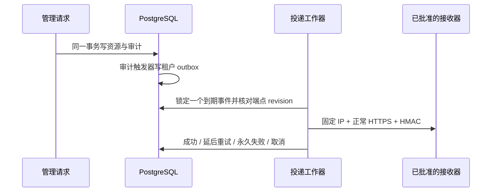

# Webhook 通知模块

## 边界与配置

本模块发送控制面审计事件，不提供设备实时在线状态订阅，也不承诺恰好一次送达。租户管理员管理端点；运维必须先通过 `WEBHOOK_REGISTRY_FILE` 配置该租户的完整 HTTPS 地址、`secret_ref`、签名秘密和明确允许的公网 IP。文件缺省为空注册表，不允许创建未经批准的端点。该文件应作为只读秘密挂载，不进入源码、日志或发布包；修改配置后重启服务。

注册表是 JSON 数组，条目字段为 `tenant_id`、`url`、`secret_ref`、`secret`、`addresses`。秘密为 32–256 个可打印非空白 ASCII 字节，建议使用密码学安全随机生成值。每项 1–4 个公网 IP，最多 256 项；HTTPS 仅端口 443，不接受用户名、密码、查询参数或片段。URL 与租户、秘密引用必须全部精确匹配。网络请求不使用环境代理，不执行 DNS 解析，不跟随重定向，并保留正常系统根证书和主机名验证。IP 变更需运维更新固定地址，不能通过租户输入绕过内网隔离。

## 管理契约

- `GET /v1/webhook-endpoints`：当前租户端点，最多 4 个。
- `POST /v1/webhook-endpoints`：`url`、`secret_ref`，需要管理员权限与 `Idempotency-Key`。
- `PATCH /v1/webhook-endpoints/{id}`：更新 `enabled`、`url`、`secret_ref` 中至少一个；UUID 大小写使用同一幂等作用域。
- `DELETE /v1/webhook-endpoints/{id}`：幂等禁用，不删除历史投递。

写入遵循现有租户权限、CSRF（浏览器入口）、凭据撤销和幂等检查；秘密值不会通过管理 API 返回。端点每次有效更新增加 revision。旧 revision 的待发事件取消，不发送到新地址或使用新秘密。禁用或租户停用与正在发送的请求通过数据库锁串行化；不能撤回已被远端接收的请求。

## 数据流与一致性

支持事件为 `application.create`、`application.update`、`device.update`、`device.revoke`、`device.register.direct`、`connection_grant.create`、`connection_grant.revoke`、`session.terminate`。负载包含 version、event_id、tenant_id、event、resource_type、resource_id、occurred_at；不复制任意审计 details 或凭据。

每端点最多 1,000 个 pending 事件；队列满时整个触发审计的资源事务回滚，避免悄悄丢通知。每次请求限 5 秒，最多 8 次；5xx、网络失败、408 和 429 延后重试，其他非成功响应永久失败。每轮最多处理 4 个事件，轮询间隔 1 秒。非 pending 记录保留 7 天后分批清理。工作器取消会终止请求并等待退出，不遗留后台线程。

接收器应在消费前验证 `Peerloom-Signature: v1=<hex>`，计算 HMAC-SHA256(secret, `timestamp + "." + delivery_id + "." + 原始请求体`)；timestamp 和 delivery_id 分别来自 `Peerloom-Timestamp`、`Peerloom-Delivery-ID`。接收器需限定合理时间窗口并持久去重 delivery_id。发送成功但数据库提交前进程崩溃可能重发同一 ID；不得将重试解释为新的业务事件。

## 验证与限制

单元测试验证注册表隔离、非公网地址拒绝、嵌套日志脱敏及签名绑定；本地 HTTPS 测试验证正常 CA、错误 CA 拒绝与重定向不跟随。隔离 PostgreSQL 集成测试验证 UUID 大小写幂等、跨租户拒绝、同 ID 重试、禁用取消及队列满时事务回滚。HTTPS 请求测试使用测试进程自己的 CA 池，不改宿主信任库；不替代公网固定 IP 出站部署验收。

迁移依赖已有 direct-registration 和 session-recovery 迁移，新增 webhook-delivery 迁移。上线前应核对实际出站防火墙、秘密轮换、接收器去重实现与运维告警。本模块不自动授予网络或云账户权限。
