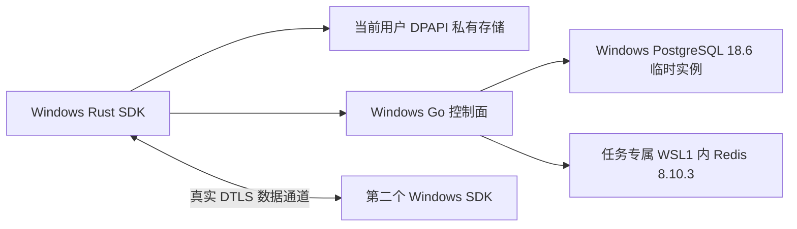

# Windows 原生验收

## 运行边界

`native.yml` 的 `windows-native` 作业在 Windows Server 2022 上运行原生 Go、Rust SDK、CurrentUser DPAPI 和 MSVC C/C++ ABI 测试。控制面联合测试脚本已接线，但必须以同一提交的 Windows 作业实际通过作为验收证据；本地 Linux 静态检查不能替代它。

仅 Redis 在任务专属 WSL1 中执行；这不是 Linux SDK、Wine 或交叉编译冒充 Windows 运行。PostgreSQL 与部署基线版本相同，不使用 runner 的全局 PostgreSQL 服务。WSL1 对当前 Redis 的兼容性由真实启动、认证、PING、Lua 和完整控制面测试验证，不以安装成功推断兼容。

## 依赖与权限

`windows-service-dependencies.json` 固定官方 Ubuntu Base、Redis 源码和 EDB PostgreSQL 便携包 URL、版本及 SHA-256。先验证下载摘要，再解包或执行；所有下载限制大小；PostgreSQL ZIP 另检查目录穿越、归档符号链接和解压总量。Ubuntu Base 与 Redis 归档仅在官方固定摘要匹配后由 WSL/系统 tar 消费，不声称已实现通用 tar 内容审计。依赖保持各自许可证，不能因本项目 MIT 而重许可。

脚本首先只读检查 runner 已启用 WSL。缺少功能时失败，不自动启用 Windows 功能、Hyper-V、服务或防火墙设置，不提权。仅导入随机唯一命名的临时发行版，不修改默认发行版或已有发行版。所有凭证先写入只允许当前 SID 访问的任务目录，不进入命令行、公开日志或上传产物。

## 实际验收内容

- 真实 grant 注册、身份查询以及 DPAPI 持久化。
- 同租户跨应用、目标明确同意后的会话与双向二进制 DTLS 消息。
- 凭证轮换后重建 WSS，通过同租户管理端只读查询捕获两端实际初始租约截止时间，等待越过两者后，断言持久化 lease_generation 增长、两端截止时间均增长且仍有效，再验证双向收发；不凭固定睡眠时间推断续租。
- 主动关闭后禁止继续收发。
- 另一个全新 Windows 测试进程仅从 DPAPI 加载身份和已轮换凭证，再通过真实控制面确认 DeviceID 不变；不重新导入旧凭证。

此联合测试使用明确的 loopback 开发 HTTP；生产 TLS 验证由同一原生作业的独立系统 TLS 测试负责。它不代表 Windows GUI 封装、签名安装器或所有连接/通道组合已交付。

## 监督与清理

每个子命令有限时；超时仅终止本脚本创建的进程树，不按名称杀其他任务。清理依次停止本次 Go/Redis 进程、私有 PostgreSQL，并注销精确任务发行版。清理无法确认时作业失败，不写成功证据；宿主 runner 销毁不是脚本清理成功的替代声明。

成功产物 `dist/validation/windows-service.txt` 只包含平台、依赖版本和通过项目。数据库、设备凭证、日志和 DPAPI 文件不上传。`test-windows-service-script.py` 覆盖宿主边界、下载校验、解包路径、进程超时和禁止全局变更；这些 mock 不代替实际 Windows 验收。
