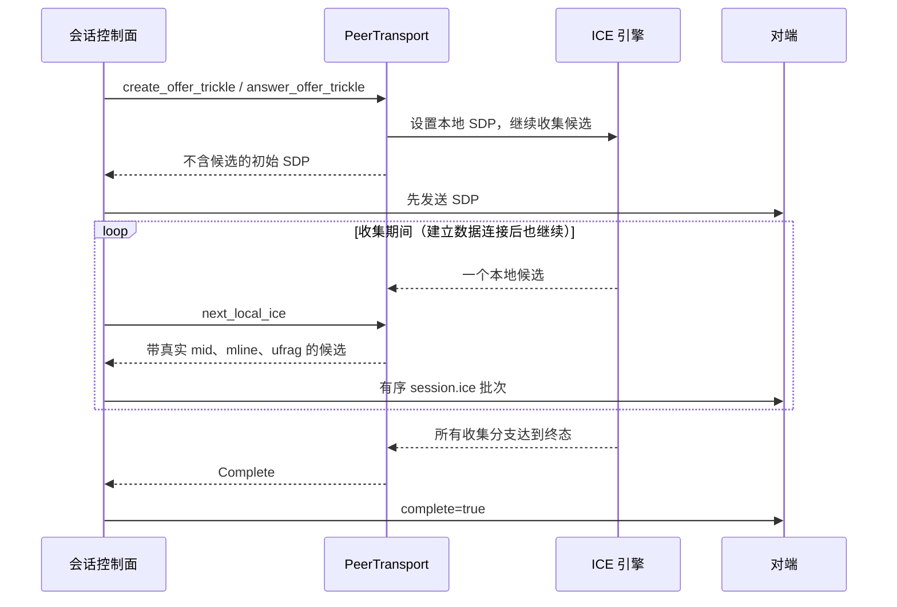

# 增量 ICE 传输

增量接口在本地 SDP 就绪后立即交换凭据与 DTLS 指纹，不等待所有接口的 STUN/TURN 收集结束。各接口继续原有收集和重试，晚到候选仍交给对端；不按网卡名称排除网络，不修改系统网络权限。

## 职责和边界

- 控制面负责会话授权、协商代次、初始 SDP 先于候选发送、远端 SDP 未应用前的有界暂存，以及连接建立后继续运行候选收发。
- 传输层负责真实 SDP 的 mid、媒体索引和 ICE ufrag 校验、候选语法、DirectOnly/RelayOnly 的既有策略和资源边界。
- 当前只支持一个 application 媒体区段的 DataChannel 连接；不假装底层空 mid 是有效上下文，不接受歧义媒体区段。
- 每批最多 16 个候选，每代每方向最多 256 个候选、256 KiB 字段预算；重复候选也计入接收预算。队列溢出是显式错误，不静默丢候选。
- Complete 只表示全部收集工作已结束，不代表每个 TURN 成功。完成后拒绝新远端候选，重复空完成标记幂等。
- 结束会话时取消候选收发 future，再显式关闭 peer。原始候选、地址、SDP 与 ufrag 不输出日志。

`create_offer`、`answer_offer` 等完整 SDP 底层接口仍可用于独立传输测试；产品新信令使用增量接口，不通过旧协议兼容分支降级。

## 验证

`cargo test -p device-transport-webrtc --lib` 覆盖上下文错误、注入、资源上限和完成顺序；`cargo test -p device-transport-webrtc --test trickle_pair -- --ignored` 使用仅本机 UDP 黑洞验证慢 TURN 未终态时已经通过可用 host 候选双向传输，并继续接收真实收集完成通知。这不替代真实双端、中继及业务授权的整合验收。
