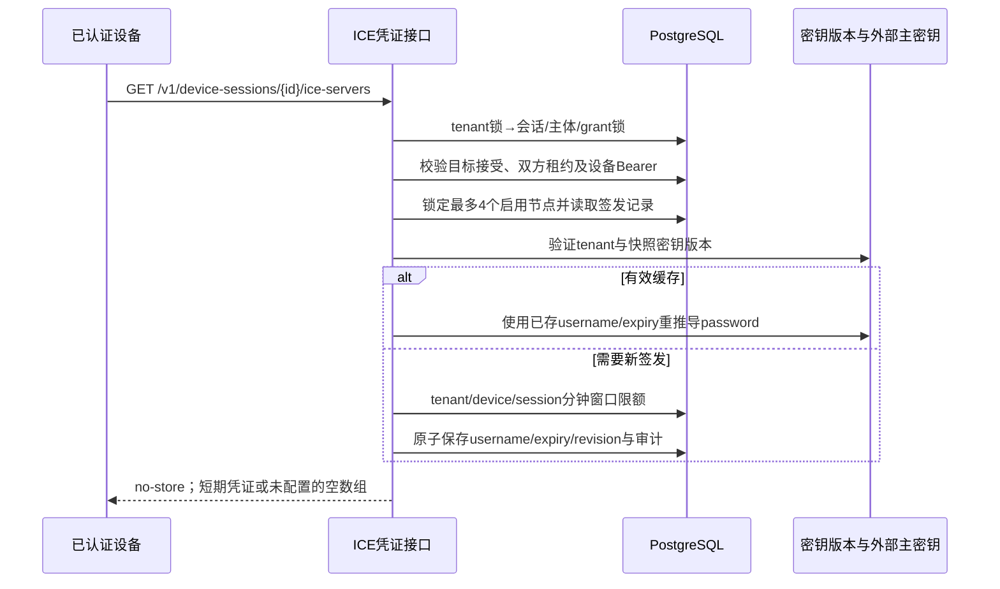
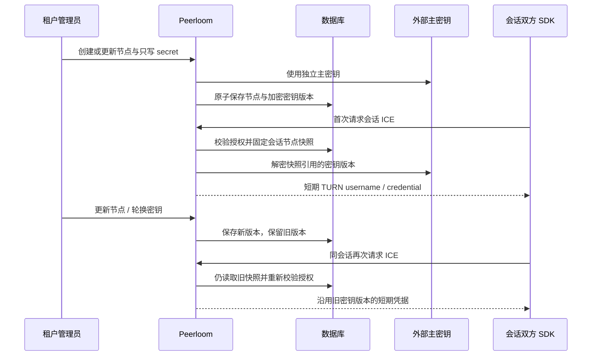

# 中继服务模块

## 实现范围

服务端提供租户中继节点管理、数据库管理的加密密钥版本、已授权会话短期 TURN 凭证及 PostgreSQL 持久限流。使用 coturn TURN REST 的 HMAC-SHA1 兼容算法，不设计新加密协议。密钥、设备凭据和 TURN password 不写日志或审计。

签发收据按会话当前 `negotiation_generation`（1..9007199254740991，JSON 安全整数边界）隔离；初次及授权的新代重建前获取本代配置。SDK在目标接受后自动获取初始会话ICE配置，再创建PeerConnection；独立本地Go/PG/Redis/coturn REST/双SDK RelayOnly链路已验证，无需静态TURN用户名或密码。新基线仍须由准确提交的CI确认。原地ICE restart和持续原地凭据替换尚未实现，初次建链不代表网络切换恢复或任意时长稳定性。客户端边界见[SDK身份与信令模块](SDK身份与信令模块.md)。



## 节点管理与独立权限

租户服务端凭据 `read` 可 GET `/v1/relay-nodes`、`/v1/relay-nodes/{id}`；`admin` 可 POST、PATCH 和 DELETE。变更复用管理模块的幂等回执、审计及事务边界。PATCH 区分未提供与 `false`，拒绝空更新；DELETE 为软禁用并递增 revision，不物理删除历史引用。节点字段为 `name`、`region`、单个 `endpoint`、只写 `secret`、`enabled`。响应不含真实共享密钥。

tenant 从服务凭据派生，不接受请求中的 tenant。跨租户或共享节点的单资源管理返回 404。租户只能管理自己的节点与密钥版本；共享节点只允许离线运维入口管理。列表采用租户绑定 keyset 游标，默认50、最大100；设备签发按租户节点优先、创建时间及ID排序，最多4个启用节点，每个仅1个URL。节点创建数量目前没有另设租户总量上限，不承诺任意规模数据库负载。

共享节点只有明确的离线数据库运维入口：

```sh
# DATABASE_URL_FILE / RELAY_ENCRYPTION_KEY_FILE 由运维安全注入；不把secret放在参数中。
device-admin relay-set-shared --offline \
  --node-id 9ab274c6-10ca-4eae-bddb-1c4ac23a1390 \
  --name shared-turn --region local \
  --endpoint 'turn:relay.example.com:3478?transport=udp' \
  --secret-file /run/private/coturn-secret
# 同一node-id更新；--enabled=false禁用。不能接管已有租户节点。
```

离线更新也写审计。共享节点更新以节点行锁与签发互斥，不获取不同租户的锁；租户管理和签发先获取相同 tenant advisory lock，避免与撤销操作发生授权检查/写入竞争。HTTP 设备 Bearer 与 `svc_` 管理凭据是独立 audience，服务密钥不能嵌入浏览器或客户端 SDK。

## 数据库存储与配置生效

`relay_nodes` 的管理入口保留名称、区域、单个 `endpoint` 和启用状态。创建节点提交只写字段 `secret`，更新节点可省略它以保留当前密钥；空字符串不是清空操作。响应只包含 `has_secret`、`secret_version` 等非秘密状态。TURN 共享密钥必须与 coturn 配置完全一致，长度 32–256 个非空格可打印 ASCII 字符，不作 Base64 解码。这不是固定 TURN 用户名密码配置。

迁移 `000013_managed_relay_secrets` 将不可变密钥版本以 AEAD 密文存放于数据库。`RELAY_ENCRYPTION_KEY_FILE` 是数据库外独立部署的 **原始 32 字节** 主密钥文件，不是 Base64 文本；不能复用 replay key。部署生成器为新部署自动生成并仅挂载到 device-server。不要将它存入源码、镜像、数据库或日志。主密钥丢失会导致历史密文无法解密，本版本不提供自动主密钥轮换或销毁；备份数据库时必须独立安全保管此文件。

没有主密钥的服务可以启动但不能管理密钥或签发已配置节点的 TURN 凭据；配置了无效主密钥则启动失败。旧 `RELAY_REGISTRY_FILE` 不再读取，也不作为失败回退源。旧数据库节点没有密钥版本时必须通过管理入口重新配置，不能把旧 `secret_ref` 当作有效密钥。

首次任一端为某一会话请求 ICE 时，在事务内固定整组节点配置，包括空列表。另一端以及同一会话后续协商使用同一快照与密钥版本。修改、禁用、轮换影响此后首次获取配置的新会话，不主动改变已有连接；已创建但从未取过 ICE 的会话采用首次取配置时的状态。设备、grant、会话撤销和租约验证仍逐次执行，不因快照而放宽权限。



轮换必须先协调 coturn 接受相应的新旧密钥，再更新管理配置。仅在 Peerloom 修改密钥不会替 coturn 修改配置。旧版本不自动删除；不能仅凭短期凭据的 TTL 就保证旧 TURN allocation 不受影响。现有会话如果仍引用旧版本，也可能需要继续用该版本签发新凭据，清退旧密钥前须结束或检查这些会话。

## 持久签发、限流及撤销

迁移5新增 `relay_issuances`、`relay_issuance_windows` 和节点 revision。签发记录按 tenant/device/session/node/协商代际唯一，仅保存随机用户名、expiry、secret_ref、node_revision及递增签发序号，不保存 password。用户名不含租户、设备或会话ID；这只是最小披露，不是 coturn 资源配额或会话绑定。

每次命中仍校验会话参与者、目标明确接受（或应用已配置免确认）、主体有效性、grant语义及双端租约；HTTP还在事务内持凭据行锁重新认证 Bearer；所有签发/审计语句后、提交前再次按数据库时钟校验 Bearer 与最早租约，时间到期不依赖锁保护。节点禁用、revision变化或密钥引用变化不会沿用旧缓存。距离expiry至少15秒时复用，否则重新签发。每个新节点凭证消耗tenant/device/session三个UTC自然分钟窗口的额度，所有记录与审计在同一事务提交；任何一个限额失败整批回滚，返回429。重启服务或Redis不会清零计数。固定窗口边界可能出现相邻两个窗口额度的突发，不是滑动窗口。

每分钟维护最多删除256条过期1小时的签发记录、256条超过2分钟的限流窗口；不删除当前窗口。这里是单批工作量上限，不是强删除时限；持续高于清理吞吐的签发会形成积压，需要监控表规模并扩展清理吞吐，尚未完成长期容量验收。设备响应 `Cache-Control: no-store`，最多4个条目，无配置为非null空数组。请求不接受query/body；并发64、上下文5秒。配置与数据库错误返回无秘密的稳定错误码。服务端签发失败不延长SDK租约。

## TURN 到期与长连接的真实边界

TURN REST 凭据的到期用于限制新的认证/分配，不能等同于既有 allocation 被强制销毁。coturn 4.18.0 对现有连接缓存认证密钥，Refresh 不保证再次检查 REST 时间戳；同一allocation不能通过更换username原地换身份。TURN allocation 自身仍有寿命，客户端必须持续Refresh。依据：[RFC8656](https://www.rfc-editor.org/rfc/rfc8656.html)、[coturn固定版本认证源码](https://github.com/coturn/coturn/blob/23c6c1d32a3d2b21a56cee65d3203bcc4ea82d2b/src/server/ns_turn_server.c)、[REST时间戳处理](https://github.com/coturn/coturn/blob/23c6c1d32a3d2b21a56cee65d3203bcc4ea82d2b/src/apps/relay/userdb.c)。历史[TURN REST草案](https://datatracker.ietf.org/doc/html/draft-uberti-behave-turn-rest-00)不是正式RFC，其旧WebRTC接口示例不应照搬。

因此短TTL不构成P2P/现有TURN连接撤销机制；应用授权撤销依赖服务端状态通知和SDK独立租约。持有凭据者也可能在到期前创建其他allocation或向其他peer使用，不能宣称密码绑定了某一WebRTC会话。生产 coturn 还需部署独立的总带宽、总allocation、peer地址等限制。

网络变化、TURN重启或新5-tuple需要重新认证时，SDK可在原会话授权仍有效的前提下请求服务端CAS新代并重建PeerConnection/Channel；旧handle和旧代回调永久失效，不能借此延长租约。不能仅凭短时Relay/Relay收发测试承诺跨expiry长连接连续性；`scripts/test-turn-refresh.py` 已在 coturn 4.18.0 实测：REST到期后同一5-tuple的Refresh成功且响应MESSAGE-INTEGRITY正确，新5-tuple使用同过期凭据返回401，随后fresh凭据分配成功。该测试证明认证/Refresh边界，不证明网络切换或任意时长的数据连续性。

## 验证

`go test -tags=integration -race ./internal/management ./internal/authorization ./internal/identity ./internal/migrate` 使用真实 PostgreSQL 独立schema。覆盖节点审批、共享/租户隔离、并发缓存唯一性、重启复用、持久限额、未接受会话/单端过期拒绝、Bearer撤销与会话撤销后不重放、管理回滚重放及HTTP audience/no-store。无真实TURN参与的服务测试不冒称网络中继成功；真实coturn证据与SDK自动接线状态应独立记录。

本地独立协议验证：`python3 scripts/test-turn-refresh.py --turnserver /path/to/turnserver`。固定使用隔离loopback端口53478，端口被占用即拒绝；需Go工具链生成实际Issuer凭据。临时密钥目录0700、文件0600并在退出时清理，不输出凭据。

已有密钥版本或会话快照时，迁移13拒绝向下回滚；不会自动删除这些记录，不能承诺任意版本无损回滚。
