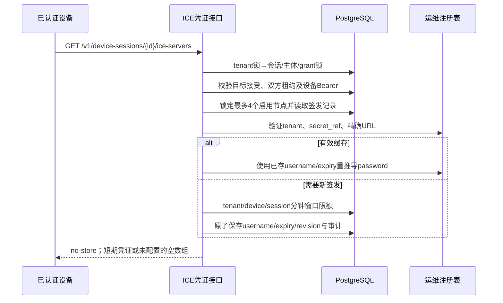

# 中继服务模块

## 实现范围

服务端提供租户中继节点管理、运维批准的密钥注册表、已授权会话短期 TURN 凭证及 PostgreSQL 持久限流。使用 coturn TURN REST 的 HMAC-SHA1 兼容算法，不设计新加密协议。密钥、设备凭据和 TURN password 不写日志或审计。

当前只支持固定 `negotiation_generation=1`。SDK在目标接受后自动获取初始会话ICE配置，再创建PeerConnection；独立本地Go/PG/Redis/coturn REST/双SDK RelayOnly链路已验证，无需静态TURN用户名或密码。新基线仍须由准确提交的CI确认。ICE restart和持续凭据替换尚未实现，初次建链不代表网络切换恢复或任意时长稳定性。客户端边界见[SDK身份与信令模块](SDK身份与信令模块.md)。



## 节点管理与独立权限

租户服务端凭据 `read` 可 GET `/v1/relay-nodes`、`/v1/relay-nodes/{id}`；`admin` 可 POST、PATCH 和 DELETE。变更复用管理模块的幂等回执、审计及事务边界。PATCH 区分未提供与 `false`，拒绝空更新；DELETE 为软禁用并递增 revision，不物理删除历史引用。节点字段为 `name`、`region`、单个 `endpoint`、`secret_ref`、`enabled`。响应不含真实共享密钥。

tenant 从服务凭据派生，不接受请求中的 tenant。跨租户或共享节点的单资源管理返回 404。租户不能使用共享注册表引用来创建自己的节点。列表采用租户绑定 keyset 游标，默认50、最大100；设备签发按租户节点优先、创建时间及ID排序，最多4个启用节点，每个仅1个URL。节点创建数量目前没有另设租户总量上限，不承诺任意规模数据库负载。

共享节点只有明确的离线数据库运维入口：

```sh
# DATABASE_URL_FILE / RELAY_REGISTRY_FILE 由运维安全注入；不把secret放在参数中。
device-admin relay-set-shared --offline \
  --node-id 9ab274c6-10ca-4eae-bddb-1c4ac23a1390 \
  --name shared-turn --region local \
  --endpoint 'turn:relay.example.com:3478?transport=udp' \
  --secret-ref shared-turn-v1
# 同一node-id更新；--enabled=false禁用。不能接管已有租户节点。
```

离线更新也写审计。共享节点更新以节点行锁与签发互斥，不获取不同租户的锁；租户管理和签发先获取相同 tenant advisory lock，避免与撤销操作发生授权检查/写入竞争。HTTP 设备 Bearer 与 `svc_` 管理凭据是独立 audience，服务密钥不能嵌入浏览器或客户端 SDK。

## 运维注册表与配置

`RELAY_REGISTRY_FILE` 指向运维指定的 JSON 文件，最多128KiB、64个绑定；拒绝未知字段、非法格式及尾随内容。租户请求只能提交引用，不能指定文件路径。文件应只对服务进程可读；密钥不应进入源码、镜像层或命令行。配置缺省表示没有批准节点；配置错误启动失败，不静默降级。

结构如下，示例中的密钥为占位符，不能用于部署：

```json
{
  "bindings": {
    "tenant-turn-v1": {
      "tenant_id": "9ab274c6-10ca-4eae-bddb-1c4ac23a1351",
      "secret": "REPLACE_WITH_RANDOM_PRINTABLE_SECRET",
      "urls": ["turn:relay.example.com:3478?transport=udp"]
    }
  }
}
```

省略或空 `tenant_id` 才是运维共享绑定。secret 必须32–256字节可打印 ASCII `0x21..0x7e`，精确匹配 coturn 配置；若采用随机十六进制/Base64文本，使用文本本身，**不解码**。拒绝NUL、空白及非ASCII，以避免 coturn C字符串截断。每个引用最多4个批准URL，但每个节点只使用其中1个。URL必须逐字命中，限制 `turn:`/`turns:`、显式端口及UDP/TCP参数；禁止userinfo、fragment和路径。DNS归属及网络可达范围由运维审批，本服务不宣称防止DNS重绑定。

| 环境变量 | 默认与约束 |
| --- | --- |
| `RELAY_CREDENTIAL_TTL` | `5m`；整秒，1–10分钟 |
| `RELAY_DEVELOPMENT_LOOPBACK` | `false`；仅本地测试显式开启允许批准的loopback URL |
| `RELAY_TENANT_ISSUES_PER_MINUTE` | 1024；1–100000 |
| `RELAY_DEVICE_ISSUES_PER_MINUTE` | 128；1–10000 |
| `RELAY_SESSION_ISSUES_PER_MINUTE` | 16；1–1000，双端共享 |

注册表在启动时复制并固定，不提供动态重载。轮换时必须使用新 `secret_ref`，更新节点并递增 revision；同名引用不得悄悄替换密钥或语义。旧 TURN 凭证仍可能在其原期限内用于新分配，因此轮换需要运维与 coturn 配置共同规划。

## 持久签发、限流及撤销

迁移5新增 `relay_issuances`、`relay_issuance_windows` 和节点 revision。签发记录按 tenant/device/session/node/协商代际唯一，仅保存随机用户名、expiry、secret_ref、node_revision及递增签发序号，不保存 password。用户名不含租户、设备或会话ID；这只是最小披露，不是 coturn 资源配额或会话绑定。

每次命中仍校验会话参与者、目标明确接受（或应用已配置免确认）、主体有效性、grant语义及双端租约；HTTP还在事务内持凭据行锁重新认证 Bearer；所有签发/审计语句后、提交前再次按数据库时钟校验 Bearer 与最早租约，时间到期不依赖锁保护。节点禁用、revision变化或密钥引用变化不会沿用旧缓存。距离expiry至少15秒时复用，否则重新签发。每个新节点凭证消耗tenant/device/session三个UTC自然分钟窗口的额度，所有记录与审计在同一事务提交；任何一个限额失败整批回滚，返回429。重启服务或Redis不会清零计数。固定窗口边界可能出现相邻两个窗口额度的突发，不是滑动窗口。

每分钟维护最多删除256条过期1小时的签发记录、256条超过2分钟的限流窗口；不删除当前窗口。这里是单批工作量上限，不是强删除时限；持续高于清理吞吐的签发会形成积压，需要监控表规模并扩展清理吞吐，尚未完成长期容量验收。设备响应 `Cache-Control: no-store`，最多4个条目，无配置为非null空数组。请求不接受query/body；并发64、上下文5秒。配置与数据库错误返回无秘密的稳定错误码。服务端签发失败不延长SDK租约。

## TURN 到期与长连接的真实边界

TURN REST 凭据的到期用于限制新的认证/分配，不能等同于既有 allocation 被强制销毁。coturn 4.18.0 对现有连接缓存认证密钥，Refresh 不保证再次检查 REST 时间戳；同一allocation不能通过更换username原地换身份。TURN allocation 自身仍有寿命，客户端必须持续Refresh。依据：[RFC8656](https://www.rfc-editor.org/rfc/rfc8656.html)、[coturn固定版本认证源码](https://github.com/coturn/coturn/blob/23c6c1d32a3d2b21a56cee65d3203bcc4ea82d2b/src/server/ns_turn_server.c)、[REST时间戳处理](https://github.com/coturn/coturn/blob/23c6c1d32a3d2b21a56cee65d3203bcc4ea82d2b/src/apps/relay/userdb.c)。历史[TURN REST草案](https://datatracker.ietf.org/doc/html/draft-uberti-behave-turn-rest-00)不是正式RFC，其旧WebRTC接口示例不应照搬。

因此短TTL不构成P2P/现有TURN连接撤销机制；应用授权撤销依赖服务端状态通知和SDK独立租约。持有凭据者也可能在到期前创建其他allocation或向其他peer使用，不能宣称密码绑定了某一WebRTC会话。生产 coturn 还需部署独立的总带宽、总allocation、peer地址等限制。

当前gen1实现不支持重新ICE协商；网络变化、TURN重启或新5-tuple需要重新认证时，应关闭旧连接、取得新授权会话/凭证并建立新PeerConnection。不能仅凭短时Relay/Relay收发测试承诺跨expiry长连接连续性；`scripts/test-turn-refresh.py` 已在 coturn 4.18.0 实测：REST到期后同一5-tuple的Refresh成功且响应MESSAGE-INTEGRITY正确，新5-tuple使用同过期凭据返回401，随后fresh凭据分配成功。该测试证明认证/Refresh边界，不证明网络切换或任意时长的数据连续性。

## 验证

`go test -tags=integration -race ./internal/management ./internal/authorization ./internal/identity ./internal/migrate` 使用真实 PostgreSQL 独立schema。覆盖节点审批、共享/租户隔离、并发缓存唯一性、重启复用、持久限额、未接受会话/单端过期拒绝、Bearer撤销与会话撤销后不重放、管理回滚重放及HTTP audience/no-store。无真实TURN参与的服务测试不冒称网络中继成功；真实coturn证据与SDK自动接线状态应独立记录。

本地独立协议验证：`python3 scripts/test-turn-refresh.py --turnserver /path/to/turnserver`。固定使用隔离loopback端口53478，端口被占用即拒绝；需Go工具链生成实际Issuer凭据。临时密钥目录0700、文件0600并在退出时清理，不输出凭据。
