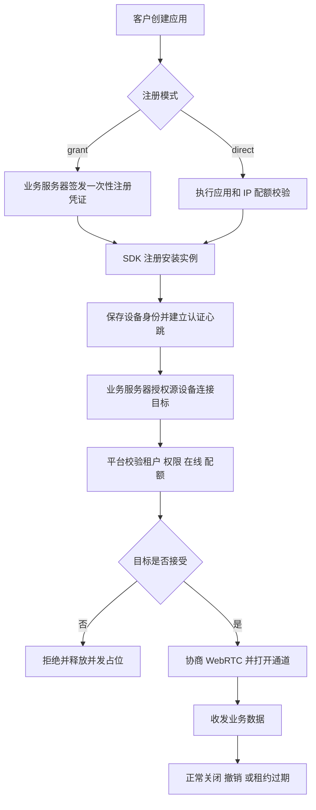

# Peerloom 产品需求

本文定义设备连接平台及原生 SDK 的首版范围、授权边界和验收要求，供产品、开发、测试和集成方共同使用。

**状态：原生首版的产品基线，正在分模块实现与验收。** 本文的“必须”“支持”表示目标要求，不能仅据本文认定某项已交付；模块进度以[开发与验收](开发与验收.md)为准。数值建议不是 SLA。

## 产品定位

Peerloom 是第三方应用的设备连接基础设施。平台处理安装实例身份、在线发现、连接权限与通用数据通道，让业务方在此之上实现远程控制、设备管理和 Agent 协作。

设备连接权限不等于业务用户登录权限。业务用户及其角色由客户业务系统管理，客户业务服务器负责把业务决策转换成平台可验证的授权。

## 核心概念

| 概念 | 含义 | 边界 |
|---|---|---|
| 租户 | 一个客户的资源和管理边界 | 不同租户之间不允许设备互连 |
| 应用 | 租户下的 SDK 集成配置 | `application_id` 可公开，不是服务端密钥 |
| 设备 | 某 App 的一次安装身份 | 不是物理硬件标识；不可用于跨 App 隐式跟踪 |
| 注册凭证 | 允许注册设备的一次性授权 | 短期有效，与租户和应用绑定 |
| 设备凭证 | 安装实例的专属认证凭证 | 可轮换、可撤销，不能交给其他设备复用 |
| 连接授权 | 从源设备到目标设备的方向性许可 | 不隐含反向许可，也不允许跨租户 |
| 会话 | 一次获授权的逻辑连接 | 与具体网络路径、信令连接生命周期分离 |
| 通道 | 会话内的消息或流接口 | 各自限制队列、速率和生命周期 |
| 在线 | 认证心跳租约尚未过期 | 不等于设备允许接入 |
| 可连接 | 设备允许接受新会话的配置 | `connectable=false` 不等于设备离线 |

## 用户角色与职责

- 平台运营者：部署、维护共享基础设施，管理全局中继节点和故障恢复。
- 租户管理员：管理本租户的应用、设备、授权、会话、审计和 Webhook。
- 客户业务服务器：保存租户服务端凭证，签发注册和连接 grant。
- SDK 集成者：接入 SDK、实现业务数据协议和可选目标确认界面。
- 最终业务用户：通过客户应用发起或接受连接，不直接获得平台管理凭证。

管理后台已采用内置管理员、租户角色与会话认证；OIDC 尚未实现。浏览器会话与客户业务服务器的 scoped service key 分开使用，不允许跳过管理认证与租户隔离。

## 范围与非目标

### 原生首版必须包含

- 租户、应用、设备安装实例及凭证生命周期。
- 认证心跳、在线租约、可连接状态及设备查询。
- 默认拒绝的连接授权、目标确认、并发配额和会话终止。
- WebRTC DataChannel、P2P 优先及 TURN 兜底。
- Rust API、C ABI、Android/iOS 原生包装和五端示例。
- 管理后台、审计、指标、限流、部署和恢复文档。
- 中文与英文的国际化设计，错误码不依赖展示语言。

### 不在平台范围内

- 视频编码、屏幕采集、音视频业务功能和输入注入。
- 文件业务协议、业务消息持久化、离线投递和业务 exactly-once。
- 客户业务用户体系、第三方 App 的后台常驻或系统权限绕过。
- 保证检测所有系统的卸载重装、保证所有 NAT 环境直接连通。
- 自动把同物理设备上的不同 App 合并成一个身份。
- 在首版承诺集群部署、无损动态换路或未经验证的性能 SLA。

Web SDK 使用 TypeScript 与浏览器 WebRTC，列入 M9 独立交付；延期不阻塞原生发布。

## 主要业务流程

## 身份与注册要求

安装实例首次启动时生成本地安装密钥材料，提交应用、平台及必要注册信息。平台创建随机 UUID Device ID 和设备凭证，SDK 原子保存。

重启和升级必须复用已有身份。主动 reset 或存储丢失产生新身份；平台不保证判断一次安装是否由卸载重装导致。备份还原、系统安全存储残留与设备迁移的差异必须在各平台封装文档中说明。

注册支持 `direct`、`grant` 或应用允许的两者。直接注册也要通过配额、IP 限流和滥用校验；`application_id` 公开不意味着任意无限注册。

一次性注册 grant 的消费、设备创建、凭证记录和持久幂等结果必须原子完成。Redis 故障不能使已消费 grant 再次注册，也不能让重试产生多个设备。

设备凭证正常数据库字段只存哈希，日志、错误和审计不得输出明文。注册结果重放的加密短期记录与过期恢复规则必须在上线前实现并验证，详见[接口与数据契约](接口与数据契约.md)。

安装公钥只作为身份绑定材料；在挑战、证明、重放保护和密钥轮换协议完成前，不可据此认证或恢复已有设备身份。

## 授权与隔离要求

连接前按以下顺序检查，任何一项失败均不得进入 SDP/ICE 转发：

1. 源设备凭证有效，租户未停用，源和目标应用启用。
2. 源和目标不是同一设备，且属于同一租户。
3. 目标在线且 `connectable=true`。
4. 源、目标、应用和授权的速率及并发上限允许。
5. 匹配有效的方向性连接 grant，或后续经过评审的预设策略。
6. 目标配置需要确认时获得明确接受；拒绝不能被平台强行覆盖。

首期 M3 采用显式 grant 和默认拒绝，不把“策略接口”标为已实现的策略引擎。未来预设策略必须持久化策略版本及授权依据，同样受租户硬约束和目标拒绝约束。

| 源与目标 | 授权情况 | 结果 |
|---|---|---|
| 同租户同应用 | 无有效许可 | 拒绝 |
| 同租户不同应用 | 有有效许可且目标接受 | 允许继续协商 |
| 同租户不同应用 | 无有效许可 | 拒绝 |
| 不同租户 | 任意 grant 或策略 | 始终拒绝 |
| 同一设备 | 任意 | 拒绝自连接 |

并发占位与释放必须原子、可重试且幂等；超时、拒绝和异常退出不得泄漏配额。

## 授权到期与撤销

Grant 指定 `expires_at`、`max_sessions` 和 `expiry_action`。`terminate` 要求到期终止存量会话；`no_new_connections` 只阻止新建，但存量会话仍受显式撤销和设备有效性约束。

显式撤销会立即改变控制面的授权状态，拒绝新请求并向在线会话双方发送终止通知。合规 SDK 收到通知即停止发送、关闭通道并释放资源。

网络分区下无法保证通知即时送达。SDK 必须持有短期、有界且可验证的会话授权租约，无法续租时到期失败关闭；当前服务端默认授权租约为 60 秒，SDK 接受的新截止也不超过接收时刻后 60 秒；批准等待的 30 秒不是数据授权期限。在线通知延迟与失联撤销上界必须分别测试和报告。

平台无法强制停止两个串通或被修改的端点在既有 P2P 链路上继续通信，不能把服务端“已撤销”描述为对任意端点的物理断网保证。应用层高敏感操作仍需自己的业务权限检查。

## 连接与通道要求

| 连接策略 | 行为 | 失败处理 |
|---|---|---|
| `auto` | 默认优先直连，必要时 TURN 中继 | 输出实际路径和失败分类 |
| `direct_only` | 不使用 TURN 中继 | 直连失败则明确失败，不偷偷降级 |
| `relay_only` | 仅使用 TURN 中继候选 | 中继不可用则失败 |

一个会话可有多个通道；首版提供可靠有序消息、可靠字节流和低延迟消息三类。低延迟消息允许丢包；可靠传输不代表业务已消费。

发送队列必须配置硬上限、消息 TTL 和 `fail`、`drop_oldest`、`drop_newest` 策略。默认溢出策略采用 `fail`，不得静默丢弃可靠业务消息。可靠字节流禁止丢旧/丢新策略，TTL 到期必须显式失败或重置流，不能静默丢字节后继续。数据复制、排队、实际写入和对端业务确认应区别描述。

动态路径优化默认关闭。ICE restart 或重建 PeerConnection 可能需要重建 Channel，业务方负责会话恢复、去重与断点续传；不承诺无损或 exactly-once。

## 安全和非功能要求

- HTTPS/WSS 与 WebRTC 强制 DTLS；不能通过配置关闭 WebRTC 安全传输。
- 额外应用层 E2EE 默认关闭，启用前定义密钥管理和威胁模型。
- 服务端凭证和设备凭证 audience 分离；长期凭证不放 URL 查询串。
- SDP/ICE 数量和尺寸、JSON 深度、元数据大小与发送缓存均需限制。
- SDK 回调不持内部锁；耗时工作离开 UI 和网络事件线程。
- 所有异步操作可取消，shutdown 有期限；异常不能跨 C ABI 传播。
- 日志有请求、会话与错误关联，但不得泄露凭证、私钥和业务正文。
- 不虚构 P2P 成功率、吞吐量、P95 或可用性承诺。

## 首版验收边界

通过 M0 至 M8 的适用门槛后才能宣称原生首版可用。必须覆盖身份恢复、跨应用授权、跨租户拒绝、目标拒绝、撤销与过期、并发竞争、三种连接策略、重连、多通道和队列上限。

还必须覆盖凭证轮换、WSS 断线但数据仍存活、服务端重启、Redis 故障、数据库恢复、移动端前后台限制和五端交付。测试证据、适用环境和未支持项与版本一起发布。

## 待确定事项

| 决策 | 默认方向 | 决策最迟时点 |
|---|---|---|
| OIDC 扩展 | 当前内置管理员已实现；OIDC 独立评审 | OIDC 实现前 |
| 系统存储异常恢复 | 已有平台安全存储失败关闭；不默认明文后备 | 原生发布验收前 |
| 应用层 E2EE 密钥职责 | 不托管业务私钥，保持可选 | E2EE 实现前 |
| 资源与性能验收 | 已有有限工程默认值；真实规格/压测不等于 SLA | M5/发布验收前 |
| 生产 TURN 运维 | 已实现受租户绑定的 secret 引用与短期凭据；生产轮换/容量待演练 | 生产部署前 |
| 动态换路的 Channel 延续 | 首版不承诺无损保留 | 可选优化开发前 |

这些决策不阻塞文档和骨架开发，但不能在相关模块验收时继续以未定项替代实现。
