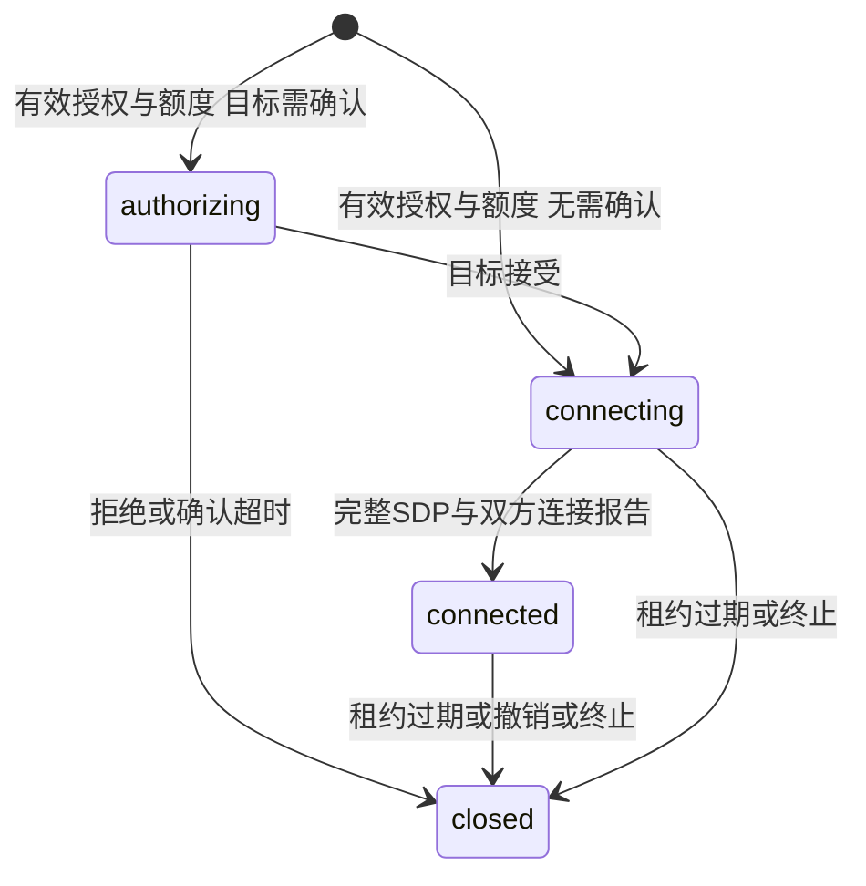

# 会话授权模块

当前实现 grant-only 设备到设备授权，不是完整策略引擎或管理平台。仅接收本次服务端认证得到的设备身份；客户端不能声明租户、源设备或授权结果。

## 权威检查

PostgreSQL 事务验证设备、应用、租户状态以及同租户同方向 grant。跨租户始终拒绝，同租户跨应用可授权。设备连接上限覆盖应用默认值，双向活跃会话均占额度；租户级事务锁串行化额度占用，先保证正确性，不宣称高吞吐。

请求幂等键按租户、源设备与 request_id 绑定；同键换目标冲突。目标确认只能由目标执行，明确拒绝关闭会话，重复接受不能延长租约。租约由两端分别续期，生效期限取较早值，任一端不能无限替另一端保活。默认租约 60 秒、确认窗口 30 秒。

grant 的 `no_new_connections` 到期策略允许已接受会话继续续期，但不能再创建或接受新会话；`terminate`、撤销和主体禁用失败关闭。可信管理层可调用撤销方法，设备信令不公开这个权限。

## 协商与交付

只支持代次 1 的完整 ICE SDP：源设备只能提交一次 offer，目标只能在 offer 后提交一次 answer；检查和标记同事务。双方 SDP 都记录之后才能报告连接，双方报告完成才进入 connected。当前不支持重新协商或 trickle。

WSS 派发使用服务端返回的会话参与者和租户，不把 payload 的身份字段当权限。每秒执行有界过期清理并向当前在线连接通知终止。未收到通知的合规 SDK 仍必须依据本地授权租约到期断开；服务端无法强制互相串通的端点停止自行交换数据。

数据库状态与网络发送不存在跨系统原子提交。消息可能丢失，快照只恢复会话状态，不重放 SDP；首次协商丢失需结束旧会话重新请求。SDK 租约定时器和真实双设备业务链路仍需集成验收，不能把数据库单测当整个平台完成。
