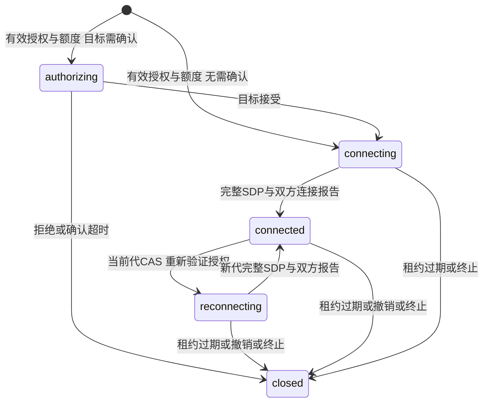
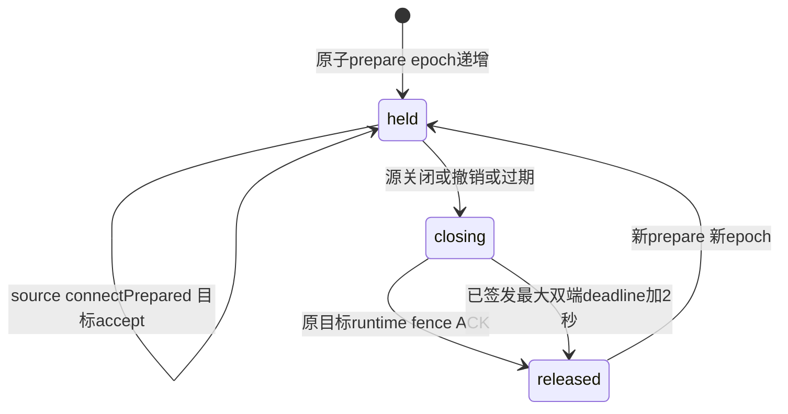

# 会话授权模块

设备到设备授权以同租户方向 grant 为基础；目标应用可显式启用独占准备接入，不是完整策略引擎。仅接收本次服务端认证得到的设备身份；客户端不能声明租户、源设备或授权结果。

## 权威检查

PostgreSQL 事务验证设备、应用、租户状态以及同租户同方向 grant。跨租户始终拒绝，同租户跨应用可授权。设备连接上限覆盖应用默认值：设备 null 继承、-1 不限、0 拒绝新连接，正数才做数量配额；新应用及新 grant 默认 -1，既有配额不自动改写。双向活跃会话在启用配额时均占额度；租户级事务锁串行化额度占用，先保证正确性，不宣称高吞吐。

请求幂等键按租户、源设备与 request_id 绑定；同键换目标冲突。目标确认只能由目标执行，明确拒绝关闭会话，重复接受不能延长租约。租约由两端分别续期，生效期限取较早值，任一端不能无限替另一端保活。默认租约 60 秒、确认窗口 30 秒。

grant 的 `no_new_connections` 到期策略允许已接受会话继续续期，但不能再创建或接受新会话；`terminate`、撤销和主体禁用失败关闭。可信管理层可调用撤销方法，设备信令不公开这个权限。

## 协商与交付

每个协商代次支持完整 ICE SDP：源设备只能提交一次 offer，目标只能在 offer 后提交一次 answer；检查和标记同事务。双方 SDP 都记录之后才能报告连接，双方报告完成才进入 connected。恢复使用当前代CAS得到下一代（1..9007199254740991，JSON 安全整数边界），并清空该代SDP/连接标记；双方并发请求同一旧代只增加一次。旧SDP/connected不得作用于新代；旧connected省略代号只按1处理。CAS命中重放也重新核验实际Bearer与返回前数据库时钟/双端租约。恢复不更换参与者、不续租、不恢复拒绝或closed会话；不实现trickle或原地ICE restart。

WSS 派发使用服务端返回的会话参与者和租户，不把 payload 的身份字段当权限。每秒执行有界过期清理并向当前在线连接通知终止。未收到通知的合规 SDK 仍必须依据本地授权租约到期断开；服务端无法强制互相串通的端点停止自行交换数据。

数据库状态与网络发送不存在跨系统原子提交。消息可能丢失，快照只恢复会话状态，不重放 SDP；协商失败可在授权仍有效时请求新代重建，不复用旧代SDP。独立WIP已有真实TURN故障后新代恢复与PG并发负例验证；尚须按发布门禁完成窄合、reset联合验证和干净CI，不能把局部测试当整个平台完成。

## 目标独占准备接入

应用 `exclusive_target` 默认 false。可信租户 admin 服务通过 `POST /v1/exclusive-sessions/prepare` 提交 source/target 设备和有效期（1..2592000 秒），携带 `Idempotency-Key`。仅服务凭证可调用，不接收设备或浏览器管理身份；双方必须同租户，可跨应用。PostgreSQL 同事务创建专用方向 grant、prepared session 和目标资源 epoch，Redis 仅用于目标在线快照，不承担独占锁。

会话仍使用 `state=authorizing/connecting/connected/reconnecting/closed`，释放过程由 `exclusive_release_state=held/closing/released` 单独表达。30 秒 prepared 建立窗口不因重复请求延长。目标必须在 source 已连接 prepared 后接受；接受与每次续租最多签发 60 秒（更短配置仍生效），每次双端截止的最大值加 2 秒在同事务记录高水位，关闭不会降低它。

`target_epoch` 是 1..9223372036854775807 的规范十进制字符串，不是 JSON number；溢出失败关闭，不回绕。源和目标的所有独占变更信令携带匹配 epoch，首次 `sync.request` 可省略但只是只读查询。管理和回执读取按数据库时钟反映已过期终态，不把缓存 prepared 响应当新权限。ICE 请求使用单值 `X-Peerloom-Target-Epoch`，响应回显；非独占请求省略，兼容原入口。

源关闭只将会话 closed、占用 closing，不证明目标数据流已停止。目标 SDK 必须关闭 gate 并等待其流/worker 退出后才发送 `session.fence_ack`。服务端仅接受目标首次 accept 时认证的 WSS fence 哈希，且提交前再次验证当前 WSS 所有权；新 runtime 不可凭相同设备身份提前确认旧会话。换 fence 后保守等待高水位，不建立跨 runtime 的隐含证明。旧 epoch ACK 可幂等记录历史终态，但绝不释放新 owner。哈希不进入公开 JSON 或日志，管理 terminate 不是 fence ACK。

普通 connect 不能绕过独占应用，返回 `EXCLUSIVE_PREPARE_REQUIRED`；关闭应用独占设置也不能绕过尚未安全释放的占用。启用独占前拒绝尚可能有效的旧非独占会话。原设备/应用连接数配额继续执行。

专用准备回执只存 principal、请求摘要及 session 引用，不存凭证。相同键重读原会话当前状态；更换 source、target 或有效期均冲突，不创建新 epoch。回执至少保留 24 小时，当前没有自动 GC，不能把旧键当新请求复用。部署应将该业务数据纳入正常容量和备份管理。
