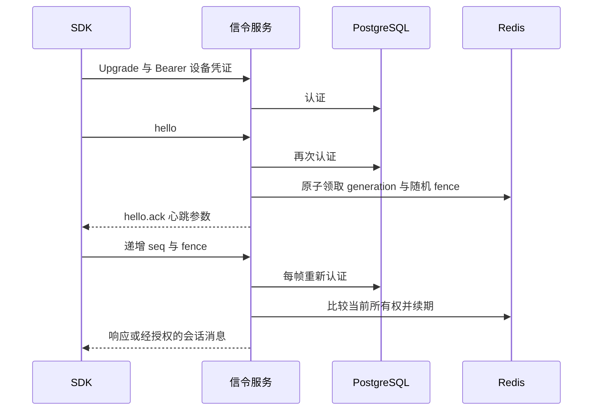
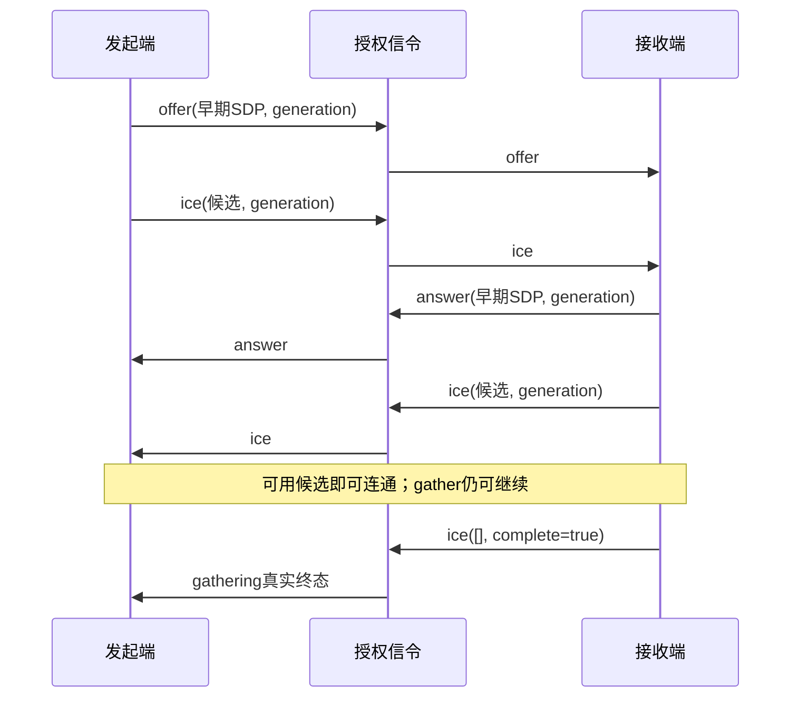

# 信令与在线状态模块

控制面使用原生 WebSocket 端点 `/v1/device-signal`；生产入口必须提供 TLS/WSS，本机 Compose 只绑定回环 HTTP。当前单进程路由，不宣称跨节点转发。Redis 仅保存可重建在线所有权，PostgreSQL 身份与授权仍是权威。

## 边界与生命周期

- native-only：拒绝 Origin 和 URL query，凭证只放 Authorization；不把 token 写入日志。首次 hello 限 10 秒；握手前后均核验身份，防延迟旧凭证抢占。
- 在线租约 45 秒，建议心跳 15 秒，参数在 hello.ack 返回。帧序号从 hello 的 0 开始严格递增，之后必须回传服务器发行的 generation/fence；服务端独立序号。
- 同设备新连接取代旧连接。随机 fence 在 Redis 重启、计数器过期后仍防旧连接续期或删除新连接；Redis 不可用失败关闭。在线布尔值不作为连接授权。
- 每帧上限 128 KiB、每连接发送队列 32 条保持有界；`SIGNAL_MAX_CONNECTIONS` 与 `SIGNAL_FRAMES_PER_SECOND` 省略或为 0 不设对应人工准入/帧率上限，正数启用单进程策略，负数或无效数字拒绝启动。慢接收端队列溢出仍关闭，不无限积压；这些不是集群限流或无限资源承诺。
- 所有升级连接（含等待 hello）均纳入关闭；停机关闭 WebSocket 和写协程。固定分片锁只串行同组安装，不在全局连接表锁下做网络 I/O。
- 下行消息发送前再次核验凭证与当前 fence。只路由服务器授权生成的同租户目标，不接受客户端声明 tenant/source。

## 会话信令

每个协商代次先交换早期 SDP，再通过 `session.ice` 按产生顺序增量转发候选。source 每代一次 offer，target 在 offer 后每代一次 answer；本方描述接纳后才允许候选。`negotiation_generation` 为 1..9007199254740991，恢复通过当前代次 CAS 重建 PeerConnection/Channel；旧代候选不会进入新连接。仍须有效授权和双方租约；closed 不可恢复。

信令交付不是 exactly-once。状态提交后网络或队列失败可能丢失通知；快照用于状态核对，不包含已发送 SDP。失败的协商可在双方授权租约仍有效时请求新代重建，不能复用旧代SDP。多节点路由尚未完成；局部恢复验证不等于所有网络切换场景完成。

## 增量 ICE 的边界

`session.ice` payload 为 `{candidates:[{candidate,sdp_mid,sdp_mline_index,username_fragment}],complete}`。所有字段必需；索引为 uint16。三个字符串分别限制 4096、256、256 UTF-8 字节，禁止 CR/LF/NUL。每批最多 16 候选、序列化 payload 最多 16 KiB；空批次只允许 `complete=true`。

服务端沿用有序 WSS、当前连接 fence、成员/授权/租约检查及 session 行锁。每方向每协商代次累计最多 256 候选、256 KiB 候选字符串字段，重复候选也消耗预算，不能借重复绕过限额。migration 14 仅保存双端计数和终态，不保存 SDP、IP 或 ICE 密码。恢复 CAS 同事务清零计数，不能只因换 socket 重置。

`complete` 仅表示本代真实 gathering 完成。其后非空候选批次返回 `ICE_ALREADY_COMPLETE`；重复空 complete 幂等。未接纳本方 SDP 返回 `DESCRIPTION_REQUIRED`，过代返回 `NEGOTIATION_STALE`，预算超限返回 `ICE_LIMIT`。转发不持久化，信令中断按恢复流程新代重建；不能假定 sync 会补发丢失候选。SDK 在远端 SDP 安装前仅有界排队，同代 SDP 安装后校验 mid/index/ufrag 再交 ICE。关闭清空队列，候选回调不得复活会话。

初始 offer/answer 禁止 `a=candidate`、`a=end-of-candidates` 属性行，服务端按 SDP 属性名逐行识别而非全文子串匹配。所有候选和真实收集终态必须经过 `session.ice`，因此不能以 SDP 内嵌候选绕过每代预算。无候选早期 SDP 不代表 gathering 完成。
