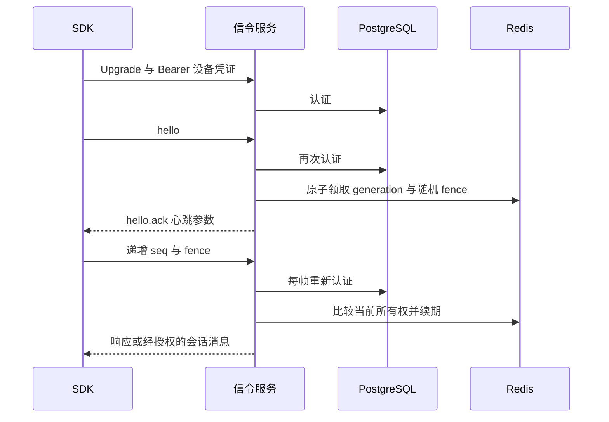

# 信令与在线状态模块

控制面使用原生 WebSocket 端点 `/v1/device-signal`；生产入口必须提供 TLS/WSS，本机 Compose 只绑定回环 HTTP。当前单进程路由，不宣称跨节点转发。Redis 仅保存可重建在线所有权，PostgreSQL 身份与授权仍是权威。

## 边界与生命周期

- native-only：拒绝 Origin 和 URL query，凭证只放 Authorization；不把 token 写入日志。首次 hello 限 10 秒；握手前后均核验身份，防延迟旧凭证抢占。
- 在线租约 45 秒，建议心跳 15 秒，参数在 hello.ack 返回。帧序号从 hello 的 0 开始严格递增，之后必须回传服务器发行的 generation/fence；服务端独立序号。
- 同设备新连接取代旧连接。随机 fence 在 Redis 重启、计数器过期后仍防旧连接续期或删除新连接；Redis 不可用失败关闭。在线布尔值不作为连接授权。
- 每帧上限 128 KiB、每连接发送队列 32 条、进程最多 256 条升级连接、每连接每秒最多 60 帧；慢接收端队列溢出关闭，不无限积压。所有限制是单进程上限，不是集群限流。
- 所有升级连接（含等待 hello）均纳入关闭；停机关闭 WebSocket 和写协程。固定分片锁只串行同组安装，不在全局连接表锁下做网络 I/O。
- 下行消息发送前再次核验凭证与当前 fence。只路由服务器授权生成的同租户目标，不接受客户端声明 tenant/source。

## 会话信令

信封见 `api/signal-envelope.schema.json`；会话请求、接受/拒绝、租约续签、状态报告和 SDP 必须通过 PostgreSQL 授权服务。当前只支持完整 ICE SDP，协商代次固定 1；不支持 trickle、ICE restart 或信令持久重放。重连后可按 session_id 查询权威快照；WSS 重连不等于 WebRTC 数据链路已断开。

信令交付不是 exactly-once。状态提交后网络或队列失败可能丢失通知；快照用于状态核对，不包含已发送 SDP。失败的首次协商应终止会话并重新请求，而不是假设可以复用旧协商代次。尚未完成多节点路由及设备端自动重连闭环。
