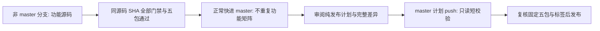

# 发布模块

本模块只负责精确提交、真实产物与受审计划绑定的正式发布；任务分支由仓库拥有者手动维护。已发布的 v0.1.0 不覆盖、不重新打包替换；v0.1.1 拆包调整须独立完成同一发布源码提交的门禁、产物校验与发布审批，不能沿用旧版本资产充当新版本验收。纯发布计划只复用已经验证并锁定的源码与五个产物，不重新构建一套包。未经明确审阅的计划保持 `approved=false`；发布操作不因代码存在而自动获得授权；不提供自动分支删除入口。

## 权限与触发

正式发布只监听固定仓库 `barry-ran/peerloom` 的 `master` push，且变更包含 `release/approved-plan.json`。PR、fork、标签或任意 dispatch 都不授权正式发布。只读 preflight 与普通测试没有写权限；独立 apply job 仅在 preflight 成功后拥有临时 `contents:write`，不配置持久凭证。Checkout 固定事件 SHA，禁用持久化认证。仅支持 `operation=release`；停用计划只需 `approved=false`，直接退出而不调用 GitHub API，不填造 source SHA 或 artifact ID。自动 cleanup 模式及分支删除路径已移除。

同一工作流另对 `master` 与固定验证分支上的精确计划 / 发布脚本 / 工作流路径提供短只读校验，不因 README 或 docs 改动启动。候选使用 `--validate-candidate`，不生成执行授权、不调用发布写入；master 也只有事件确实修改计划时才可进入正式发布。该校验不新增功能矩阵或额外工作流。

计划的 `administration_sha="event"` 由已验证 push 的 SHA 绑定，避免提交内自包含自身 SHA 的不可能循环。运行时还核对当前 master 和工作区受信文件未变。纯文档不启动功能 CI；功能变化在非 master 验证后正常快进，master 不再自动运行第二套矩阵。发布管理提交自身也不等待四个重型工作流，只执行发布代码与计划的短只读检查，再验证受审来源和既有真实包。网络读取或资产核验失败仍失败关闭；执行阶段不等待、不自动重试错误。

## 完整发布门禁

不是调用者传入 run 列表或平台字符串就算通过。发布源码必须通过固定四工作流与七个具体作业：普通 verify；Windows/Apple；Android build/4K/16K；真实 Chromium 后台。所有作业及步骤成功，精确 head SHA、受信 push 来源和固定仓库匹配。接受正常快进前的同 SHA 分支验证，不要求在 master 再生成重复结果；只接受该精确 SHA 的最新 push run / attempt，仍不能挑选旧绿结果掩盖较新的失败。显式手动诊断不等于自动取得正式发布资格。

发布管理提交与发布源码是不同角色：检查两者之间的**完整差异**，不是只看最后一次 push。普通发布管理仅允许固定文档和计划范围；SDK、服务端、依赖、部署、产物与未知脚本变化不能凭“发布提交”名称豁免功能验收。CI / 发布逻辑变更必须经本地正反用例和独立审查。本次从旧触发规则迁移时，只允许与 `v0.1.1` / 已验证 source `489294528319223e4f38a5ec80a2d0192783988e` 绑定、受审代码常量中列出的其它文件前后 Git blob 均精确匹配的规则调整；发布脚本自身由完整代码审阅建立可信边界，不使用自包含哈希，也不读取可任意扩权的例外配置。这不是永久的 `scripts/` 或 `.github/workflows/` 通配放行，任何其它字节变化必须重新审查。

发布提交必须是当前 master 的**此前**祖先，`final_scope_accepted=true` 是经审阅的最终范围确认，不替代机器门禁。v0.1.1 使用 **1 个服务端包＋4 个 SDK 包**，均绑定实际 workflow run：服务端和 Linux SDK 来自普通 CI，Windows/Apple 来自原生 CI，Android 来自 Android CI。必须严格检查 artifact ID、名称、摘要、下载长度、全部 ZIP 清单与包内元数据；不是增加一个名字就允许重复使用同一包。

`server-linux-amd64` 的 `product=server`，包含 5 个 Go 程序、9 对 SQL、运行时部署文件与说明；`linux-x86_64`、`windows-x86_64`、`apple`、`android` 的 `product=sdk`，不夹带服务端程序/迁移/部署工具。Apple 包覆盖 macOS/iOS，不声称生产签名或真机验收。五个包并不意味着五套服务端操作系统已支持，服务端当前限定 Linux amd64。

交付与法律审查分开：完整采集仍记 `collected-not-legally-reviewed`。经明确批准的窄交付例外只允许 `license-gap-policy.py` 固定的四个 Cargo 包/版本/原始归档 SHA、既有 VCS 来源和唯一 `LICENSE_TEXT_MISSING` 原因；派生状态为 `collected_with_documented_gaps_not_legally_reviewed`。这是全部锁定候选依赖中的已知证据缺项，不表示这些包已实际链接，也不是法律清关。

原 `report.json` 的 `incomplete` 与逐包缺项完整保留，`release_evidence_complete=false` 不变；另记 `release_delivery_eligible=true` 和精确 `documented_gaps`（包括原始下载 URL/摘要/原因）。Release 门禁从包内原报告独立重算并比对元数据，不能靠调用者自报。r-efi 已收 AUTHORS 原文的精确摘要必须保留，不能用例外删掉可得 notice。完整外层和各证据子树 SHA 清单、SBOM、所有已有原文仍强制验证。

未知包/版本/摘要/来源/根 issues、归档或清单缺失、未列明额外文件、原文删除、元数据伪造一律拒绝。该四项 Cargo 例外不适用于 Maven 或其他新缺项。用户法务在上线前另行处理许可审查；不伪造版权人或许可批准，不修改项目 MIT 或第三方原文。Android 必须同时带 Maven 解析范围证据。

Maven 另有明确批准的独立窄规则：`release/maven-license-gaps.json` 固定当前两个解析 scope 的完整 21 个坐标与依赖图，其中 19 个包仅缺收集归档中的独立许可正文。`maven-gap-policy.py` 按坐标/版本、POM SHA、解析后二进制名称/大小/SHA、POM 身份及声明来源、已有 notice 和完整图重新核验，不复用 Cargo 例外。包内实际 POM/notice 原文字节与全量 SHA 清单必须逐项验证；原 JAR/AAR 不在该证据子树中，因此这里只证明已解析二进制摘要绑定，不声称重新计算了未随包保存的原二进制，也不等于最终 AAR 的精确链接依赖清单。

Maven 原报告继续保留 `evidence_status=incomplete` 和原逐包缺项，不改成完整采集；包元数据独立列 `maven_documented_gaps`，仅精确匹配该固定图和 19 项后才派生可交付状态，`release_evidence_complete=false` 与无法律清关的说明不变。两个原已完整项的许可原文不能删除，未知版本/来源/摘要、额外 issue、缺 POM、删 package/edge/notice 或伪造元数据均拒绝。即使未来真正补齐许可正文，也必须显式更新并审阅固定政策及证据，不能因新报告自称完整而自动放行。该规则不授权任何新依赖或其它缺项。

外层 ZIP 拒绝链接、特殊文件、路径穿越、Windows 保留名/ADS、大小写重复、文件/目录冲突及未列入 SHA256SUMS 的文件。Linux SDK 与服务端分别使用已知的 `peerloom-linux-x86_64.tar.gz` 和 `peerloom-server-linux-amd64.tar.gz` 安装载荷；逐成员核验路径、类型、所有者、模式、完整内部 SHA 清单与各自必需集合，不把 opaque tar 哈希当内部验收。SDK 的服务端程序混入、服务端缺少任一程序/迁移/部署文件或说明均应拒绝。服务端 Go 程序必须 0755，外层不得复制一份大二进制目录。共享 Cargo/Go evidence 的全锁定候选扫描范围原样披露，不为拆包删除原文或伪称其已按最终二进制精确裁剪。

标签不存在时只创建到精确发布 SHA；已存在但不同即停止，不覆盖。Release 先 draft、上传、重新核验 ID/tag/body/prerelease/全部 asset digest，再 publish；发布后再核验。已发布且完全一致的重复计划为只读无操作，否则需人工审查，绝不覆盖。GitHub Release REST API 不提供原子 compare-and-swap，因此最后一次读与 publish 之间仍存在极短并发编辑窗口；发布后核验能发现而不能追溯防止该窗口内的编辑。执行期间应避免人工编辑同一 Release。

## 人工分支维护

分支由仓库拥有者手动维护，不生成自动删除计划、不等待或触发删除作业。发布流程不需要先清理任务分支，正式发布和分支卫生是独立操作。

人工删除前应确认工作已保留、没有活动开发或待审改动，并核对目标分支；不要删除 `master` 或其他仍在使用的用户分支。发布自动化不替用户判断这些事实，也不在发布成功后追加自动清理提交。

## 验证与接入

`python3 scripts/test-release-admin.py` 只使用本地数据和 mock，不接触 GitHub。发布逻辑变更需保留正反用例和独立复审；短只读验证不得构建产物、启动平台联调或授予写权限。纯文档不运行 CI；显式发布才复核受审计划及固定源码产物。未批准计划不会触发写 job；批准状态只属于经审阅的具体计划，不是可沿用到下一次发布的全局开关。

官方语义依据：[GitHub Releases REST](https://docs.github.com/en/rest/releases/releases)。
