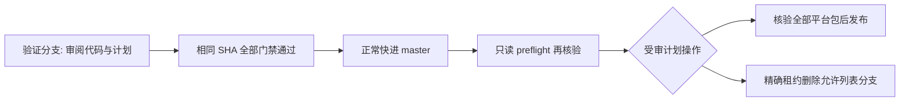

# 发布与分支清理模块

这是待独立复审的本地重建草稿，**未启用、未发布、未删除任何分支**。默认计划 `approved=false`。本地文件不是容器替换前旧草稿的字节恢复，必须重新审阅和跑验证分支。

## 权限与触发

只监听固定仓库 `barry-ran/peerloom` 的 `master` push，且变更包含 `release/approved-plan.json`。不监听 PR、fork、标签或任意 dispatch。只读 preflight 与普通测试没有写权限；独立 apply job 仅在 preflight 成功后拥有临时 `contents:write`，不配置持久凭证。Checkout 固定事件 SHA，禁用持久化认证。

计划的 `administration_sha="event"` 由已验证 push 的 SHA 绑定，避免提交内自包含自身 SHA 的不可能循环。运行时还核对当前 master 和工作区受信文件未变。只读阶段最多等待 90 分钟，解决 master push 同时触发新 CI 的启动顺序；失败、跳过、取消不当成通过。执行阶段不等待、不自动重试错误。

## 完整发布门禁

不是调用者传入 run 列表或平台字符串就算通过。对发布提交和管理计划提交分别查询固定四工作流与七个具体作业：普通 verify；Windows/Apple；Android build/4K/16K；真实 Chromium 后台。所有作业及步骤成功，精确 head SHA、push 来源和固定仓库匹配。仅接受最新精确 SHA push 尝试，不能挑选旧绿结果掩盖较新的失败。

发布提交必须是当前 master 的**此前**祖先，`final_scope_accepted=true` 是经审阅的最终范围确认，不替代机器门禁。四个原生 release 包一一对应各平台实际 workflow run，严格检查 artifact ID、名称、摘要、下载长度、全部 ZIP 清单与包内元数据。Apple 包覆盖 macOS/iOS，但不声称生产签名或真机验收。

证据状态必须为 `collected-not-legally-reviewed`，`incomplete` 阻止正式 Release；这仅表示原文采集完整，不是法律意见或清关。Cargo/Go 是锁定候选依赖集合，不伪称精确链接依赖。Android 必须同时带 Maven 解析范围证据。

外层 ZIP 拒绝链接、特殊文件、路径穿越、Windows 保留名/ADS、大小写重复、文件/目录冲突及未列入 SHA256SUMS 的文件。Linux 只接收已知 tar.gz 安装载荷，逐成员核验路径、类型、所有者、模式、完整内部 SHA 清单和必需 ABI/Go 程序；不把 opaque tar 哈希当内部验收。Unix Go 程序必须 0755，外层不得复制一份大二进制目录。

标签不存在时只创建到精确发布 SHA；已存在但不同即停止，不覆盖。Release 先 draft、上传、重新核验 ID/tag/body/prerelease/全部 asset digest，再 publish；发布后再核验。已发布且完全一致的重复计划为只读无操作，否则需人工审查，绝不覆盖。GitHub Release REST API 不提供原子 compare-and-swap，因此最后一次读与 publish 之间仍存在极短并发编辑窗口；发布后核验能发现而不能追溯防止该窗口内的编辑。执行期间应避免人工编辑同一 Release。

## 清理证明与租约

清理不需要提前完成最终 Release，但管理提交仍须普通完整 CI 成功。只允许代码内明确列举的本任务分支，不使用前缀通配；master、用户分支、活动候选和 WIP 不得列入批准计划。观察到的 branch ledger 只是观察，不是删除批准。

每项必须带精确 SHA、`inactive=true`、`no_wip=true`，再满足其一：

- `proof="ancestor"`：该提交已是当前 master 祖先；
- `proof="equivalent_tree"`：受审计划显式保存 original SHA、`retained_equivalent_commit`、`expected_tree`。通过 Git commit API 检查两棵完整 tree 精确相等，保留提交必须是 master 祖先。不比较文件子集、不改写历史。

删除前重新读取 master 与分支。执行唯一空源 refspec，使用 `--force-with-lease=refs/heads/<明确分支>:<精确SHA>` 原子条件删除。这里 lease 不是历史重写授权：命令没有 `--force`、没有非空源 refspec，没有 master 更新。分支并发变化导致 lease 拒绝，不自动重试；已不存在为幂等无操作。删除后 GET 确认不存在。

## 验证与接入

`python3 scripts/test-release-admin.py` 只使用本地数据和 mock，不接触 GitHub。生产工作流及批准计划必须经过根协调独立复审，再进入验证分支；应把同一测试加入普通只读 CI。当前默认未批准计划不会触发写 job。

官方语义依据：[Git 精确 lease 与删除 refspec](https://git-scm.com/docs/git-push)、[GitHub Releases REST](https://docs.github.com/en/rest/releases/releases)。
