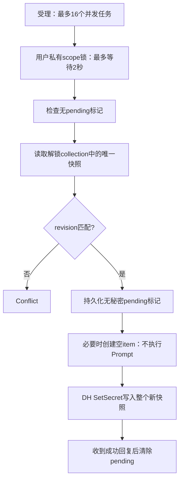

# 身份存储模块

## 范围与状态

`device-storage` 提供 `IdentityStore` 的 load/save-CAS/delete-CAS 契约、显式内存适配器和 Linux Secret Service 适配器。Linux 后端本地单元测试与缺失服务拒绝已运行；真实 GNOME Keyring 集成必须由 `scripts/test-secret-service.sh` 在隔离环境验收。Windows/macOS/Android/iOS 系统存储尚未实现，不得由本模块的 Linux 测试推定五端完成。

内存存储仅供明确选择的临时场景，不保持进程重启身份；系统安全存储不可用时绝不自动退回内存或明文文件。

## Linux 使用与边界

```rust,ignore
use device_storage::LinuxSecretServiceStore;
let store = LinuxSecretServiceStore::new(
    "/home/example/.local/state/peerloom/identity-locks".into()
)?;
```

- 需要当前用户的 session D-Bus、实现 Secret Service 的系统组件，以及已解锁的 `default` collection。SDK 不执行 `Unlock` 或 `Prompt`，不替用户建立/解锁真实 keyring。
- 所有同用户 Peerloom 写入者必须采用同一个绝对锁目录。最后一级目录自动创建为 0700；父目录必须存在。路径逐级 `openat` 并拒绝 symlink；祖先须归 root/当前 UID 所有，拒绝非 sticky 的组/其他用户可写目录（允许可信 root `/tmp`），防止通过 rename 拆分锁命名空间；最终目录检查当前 UID/0700，锁文件检查 UID/0600/单硬链接/普通文件。只支持本地文件系统。
- 同一 OS 用户内的恶意应用、已攻陷的 session bus/keyring 或人为删除锁目录不在隔离保证内。作用域 hash 是避免属性直接暴露 origin/application 的标识，不是针对字典猜测的匿名化协议。
- 每个 Secret Service item 属性只含域分离、长度编码后 SHA-256 的 scope hash；label 固定。identity、凭证、revision 一起作为 secret 保存，不放在 label/attributes。
- 系统组件负责落盘保护；SDK 只使用库的 DH 会话传送实际秘密，不实现自定义加密。创建首次占位 item 时以 plain 会话传送的只有空字节，绝无凭证；若服务返回交互 Prompt，直接失败，不执行它。
- 同 scope 返回多个 item、非空损坏快照、未知 schema、已提交 item 丢失或变空均失败关闭，不任取一条或静默重新注册。

## CAS、取消与退出



删除不是移除 item，而是写入递增 revision 的 tombstone，防止旧请求从 revision 0 复活。存储请求取消不撤销已接受事务：内部异步任务继续持锁直至确认完成或期限到达。D-Bus 调用设置 3 秒期限，事务设置 20 秒期限，锁等待有界；本地文件打开与短 journal fsync 在 blocking pool，不在网络执行器。内核/磁盘永久阻塞不能被 Rust 强制安全终止，因此不承诺坏盘情形的硬实时退出。

发出修改前，锁文件写入并 fsync 一个不含秘密的 `1` 标记；成功确认后改为 `0`。超时、崩溃或服务状态不确定保留 `1`，此后返回 `Unavailable`。不能只取消已发送的 IPC、释放锁并假定远端没提交。

**当前不自动修复不确定提交。** 遇到 pending 标记应停止所有写入者，由应用明确处理持久身份/服务状态；不能自动删除锁文件、重置身份或清除 keyring。当前客户端错误分类仍将锁定、不可用、损坏、pending 归为 `StorageError::Unavailable`，不得声称已具备细粒度诊断/一键恢复。

## 验证

```bash
cargo test --manifest-path src/device-sdk/Cargo.toml -p device-storage --locked
cargo clippy --manifest-path src/device-sdk/Cargo.toml -p device-storage --all-targets --locked -- -D warnings
# Ubuntu CI: 安装 dbus-x11、gnome-keyring；仅创建临时 HOME/DBus/keyring
./scripts/test-secret-service.sh
```

集成脚本以随机临时口令建立测试 keyring，检查：首次写入、跨实例 CAS、tombstone、调用者取消期间锁竞争、客户端和 daemon 重启持久化、锁定/无服务失败、无 Prompt/Unlock 调用、测试凭证未以明文出现在 keyring 文件。脚本不借用真实用户 HOME/keyring，测试结束清理自身临时目录。

默认 `cargo test` 会明确忽略真实 keyring 用例；只有执行上述集成脚本才能称该集成通过。内存单测不替代系统服务验证。

系统测试依赖由 Ubuntu runner 的发行版仓库安装，实际 image、Rust、D-Bus/GNOME Keyring 版本记录在 `dist/validation/secret-service-toolchain.txt`，随该 SHA 的检查产物交付。没有把 runner 可变镜像或 apt 当作完全可重现的固定系统镜像；每次 CI 必须重新执行实际服务测试。Rust 直接依赖版本精确固定，传递依赖与 registry checksum 固定在 Cargo.lock，第三方许可由项目统一产物清单保留。

## Linux Rust 最小示例

`device-core/examples/linux_secure_peer.rs` **始终**构造 `LinuxSecretServiceStore`，没有 memory/file fallback 选项。设置非秘密参数：

```bash
export PEERLOOM_ORIGIN=https://your-control-plane.example
export PEERLOOM_APPLICATION_ID=00000000-0000-0000-0000-000000000001
export PEERLOOM_LOCK_DIR="$HOME/.local/state/peerloom/identity-locks"
# 父目录须预先存在且安全；所有同用户Peerloom进程使用一致的锁目录。
cargo run --manifest-path src/device-sdk/Cargo.toml -p device-core --example linux_secure_peer -- status
```

首次 `register` 命令从受控 stdin 读取 JSON，字段为 `registration_grant`、`installation_public_key`、`idempotency_key`。使用真实控制面签发的 grant/应用安装公钥，并由调用者安全保留精确 body/key 处理有限窗口内的重试；示例不生成假密钥，不把 grant 放命令行或日志，也不提供跨进程注册事务自动恢复。`register` 只有持久化成功后才输出公开 device ID；失败明确退出。重启执行 `status` 从系统 keyring 读取同一身份并调用服务端 self 验证。

建立平台授权关系后，两端分别执行：

```bash
# 接收端只接受指定source ID；不自动接受任意IncomingConnection。
cargo run --manifest-path src/device-sdk/Cargo.toml -p device-core --example linux_secure_peer -- listen SOURCE_DEVICE_ID
# 发送端从stdin读取最多64KiB，输出仅字节数，不打印内容。
printf 'hello' | cargo run --manifest-path src/device-sdk/Cargo.toml -p device-core --example linux_secure_peer -- send TARGET_DEVICE_ID
```

示例使用单连接可靠消息，回显及应用确认后关闭。等待连接最多60秒，然后显式关闭SDK。默认强制HTTPS/WSS；`PEERLOOM_DEV_LOOPBACK=1` 仅启用现有IP-literal loopback开发门禁，不跳过HTTPS证书验证。系统存储锁定/不可用会停止，不会通过重新注册或内存存储继续。该示例的编译与存储失败路径测试不能替代“真实控制面+安全存储+双端通信”的组合验收；组合验收未运行前应明确标记未验证。
