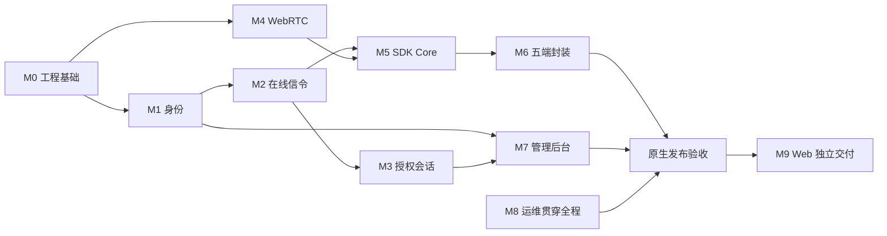

# Peerloom 开发与验收

本文把产品基线拆成可验证的交付模块，规定开发顺序、测试证据和发布门槛。

**状态以每个精确提交的必需 CI 为准。** 已实现身份、信令、授权、三类原生传输、平台安全存储、异步 C ABI、托管 TURN、管理员后台与 Webhook，并已在 CI 执行真实 TLS/备份容器演练；各模块证据并不自动覆盖最新整合提交。仍不是完整五端 SDK 或最终 Release。

## 开发原则

- 遵循根目录 `AGENTS.md`，所有人工文档使用中文，优先修改现有文档而非另建日期记录。
- 开发前核对对应语言的官方工程实践；Go 控制面和 Rust/webrtc-rs 方向已确定，不另设会阻塞开发的技术选型 PoC 门槛。
- 模块边界清晰，优先小而完整的业务切片，避免先堆积全部平台壳和 UI。
- 先定义协议、数据不变量和错误语义，再实现适配器；不要让 HTTP 或数据库细节扩散到业务规则。
- 每个模块独立编译、自测并同步文档；不因单个文案变更盲目重跑所有五端测试。
- UI 修改前检查并复用现有组件；中英文国际化从结构上保留，不硬编码错误判断文本。
- 本项目原创代码按用户确定的 MIT 许可发布，见根目录 LICENSE；第三方依赖保留各自许可与 notice，发布产物需附依赖版本清单/SBOM，不能把项目 MIT 视为第三方已获重新许可或法务审核通过。

## 模块路线

| 模块 | 目标交付 | 必须验收 | 当前 |
|---|---|---|---|
| M0 工程基础 | monorepo、CI、Compose、迁移、协议 schema、指标骨架 | Compose 启动，迁移/回滚，CI 编译测试 | 已通过 M0 CI |
| M1 设备身份 | 租户应用、注册、凭证轮换、存储与 reset | 重启 ID 不变，reset 新 ID，跨租户拒绝，原子注册 | grant/轮换已验证；direct 与 Rust/C reset 在 `624` 起真实普通 CI 通过，最新平台组合仍按各自门禁核验 |
| M2 在线信令 | WSS、心跳、generation/fencing、去重、快照 | 心跳超时离线，旧连接不能覆盖新连接 | 单节点 WSS/Redis fencing 与真实客户端闭环已验证 |
| M3 授权会话 | 显式 grant、目标确认、并发占位、撤销、授权租约 | 拒绝优先，并发无超额，在线/失联撤销边界正确 | grant-only 与真实双端确认、失联租约到期已验证 |
| M4 WebRTC | webrtc-rs、ICE、STUN/TURN、三种连接策略 | 原生互通，强制中继，失败分类可观测 | Linux 直连/强制 TURN 与三类传输已验证；跨平台授权链、复杂网络须分别验收 |
| M5 SDK Core | Rust API、重连、三类通道、缓存、可取消 C ABI | 多连接多通道，有界缓存，FFI 生命周期安全 | Core 与 C/Kotlin/Swift 多连接、三类通道已实现；Linux 真实 C 混合/双工通过，新增平台组合须以当前提交原生门禁验收 |
| M6 五端封装 | 桌面包、Android AAR、iOS XCFramework | Windows/macOS/Linux/Android/iOS 示例可注册连接收发 | Linux 普通 CI 已有多次精确提交终态成功；Android `3a5` 三项任务通过，Apple `2bd6` 新增 Swift 真实 Go 注册/重开同 ID 与三类通道通过；最新同 SHA 全矩阵、Windows 服务联合链和最终打包仍未闭合 |
| M7 管理后台 | 应用、设备、授权、会话、审计界面 | RBAC/租户隔离，查询与权限正确 | 服务 API、内置管理员与中英文管理后台已验证；Webhook 已实现并通过本地 PG/HTTPS 测试，最新 CI 待验收 |
| M8 运维交付 | TLS、备份、指标、限流、升级与恢复 | 故障恢复和备份演练通过，文档可复现 | `624` 起普通 CI 已通过真实 TLS/容器备份、Go 停服有界失效与 Redis 恢复、新授权连接收发；生产运维与长期稳定性边界另行披露 |
| M9 Web 延期 | TypeScript SDK、浏览器 WebRTC | 浏览器与原生互通后独立发布 | 未实现，可延期 |

M1 与 M4 可并行；M3 依赖 M1/M2，M5 依赖 M2/M4，M6 依赖 M5。M7 不应抢在真实通信切片之前完成全部页面。

## 原生首版验收矩阵

下表是发布门槛，不是“代码存在即完成”的清单。某个验证分支通过只能证明其精确提交；仅在全部必需 CI 成功后快进 master。五端硬件和生产部署没有实测时必须保留明确限制。生产签名宿主、真机、复杂公网 NAT 与长期运营限制应如实披露，不因记录这些边界而临时新增无限的发布门槛；当前必须先闭合已有同 SHA 门禁中的实际失败与未执行步骤。

| 模块 | 已实现与已有验证 | 首版尚缺的关键证据或能力 |
|---|---|---|
| M0 工程基础 | Go/Rust 构建、迁移回滚、Compose 真启动及产物 CI | 最终五端产物矩阵、Release 版本/校验和及全部必需任务门控 |
| M1 身份 | grant/direct 注册、轮换、持久幂等与 Rust/C reset；已有真实 PG 竞争与本地恢复测试 | 各平台新增便利接口、崩溃未知结果与平台存储故障恢复的剩余验收；不否认已通过的 Linux direct/reset 实测 |
| M2 信令 | 单节点 WSS、Redis fencing、真实 SDK 重认证/失联闭环 | Android 已验证有限前后台与短 WSS 恢复；`624` 起 Go/Redis 故障后的新授权业务恢复已通过。其他移动生命周期与生产故障场景不在此有限证据内 |
| M3 授权 | 同租户跨应用、隔离、确认拒绝、配额、撤销及租约 | 多连接/重建会话下完整竞争与撤销矩阵；不能以单连接用例替代 |
| M4 传输 | 直连/强制 TURN、实际 Relay/Relay、凭证拒绝；当前协商代托管 ICE 和重建式数据恢复已有实现与本地测试 | 托管 TURN 新代恢复及 Auto 不可达 TURN 已有真实普通 CI；最新五端组合与复杂公网网络不由 Linux 证据替代；使用重建式恢复，未实现原地 ICE restart |
| M5 Core/FFI | Core/C ABI 有界多连接与三类通道、数据恢复及 reset；Linux 三设备双连接 C 混合消息、256 KiB 字节流/双工/FIN 与父子 gate 已通过 | Android `ffc3` 全部任务成功；`624`、`4e3`、`848`、`d8ba` 原 C 三轮压力/reset 与多通道门禁通过；后续 `3a5` 普通 CI 已终态成功，但不能据此称最新候选同 SHA 全矩阵通过 |
| M6 平台封装 | Linux 安全存储/C 动静态链接、Windows DPAPI/MSVC、Android JNI/Keystore 与 Apple Swift/Simulator 的分提交原生证据 | Android `3a5`、Apple `2bd6` Swift 真实 Go 首次注册/重开同 ID 已有精确提交证据；Windows public WSL import/Redis 构建已通过，私有 PG 启动链及 Apple 最终包装仍未闭合；生产签名宿主与真机仍未实测 |
| M7 管理 | scoped 后端 API、真实 HTTP→SDK 通信、租户/read-admin隔离与审计 | `ffc3` 生产路由下 Chromium 门禁成功；固定公网 Webhook 接收器/生产部署场景不由隔离测试替代 |
| M8 运维 | 健康/指标隔离、开发 Compose、限额、用户证书 TLS 覆盖与隔离逻辑备份恢复脚本 | 真实容器 TLS/备份及有限 Go/Redis 业务故障恢复已通过普通 CI；生产证书运维、升级回滚、RPO/RTO 与长期稳定性仍属未实测运营边界 |

Auto 策略在某个 TURN 地址不可达、但非中继候选可用时，允许在原收集操作期限到达后使用同一 peer 已验证且有界的 SDP 快照，并明确标记 partial_at_deadline；不延长期限或改写候选。`4e3` 起普通 CI 的 4 项真实黑洞测试已通过，包含默认 20 秒收集期限、完整双端 45 秒内完成、实际 Host/Host 选中路径、黑洞 UDP 收到请求及双向数据；`848`、`d8ba` 同样通过，当前候选仍须核对自身门禁。每操作期限不等于全链路 deadline。失效共享 TURN 节点的测试生命周期修复与该产品行为修复分别验收；RelayOnly 仍只允许中继，授权/reset/close gate 不得绕过。

当前优先级是闭合最新整合提交的真实客户端与运维门禁，并验收已实现的 Core/FFI 高级通道、移动生命周期及最终运行与发布演练。已经冻结的单点工具不应占用这些关键路径；不得为了提前发布省略权限、TLS、生命周期或失败回归。

## 首个真实纵向切片

优先让两个原生 SDK 完成：注册并保存身份 → 认证心跳在线 → 同租户 grant 授权 → 目标接受 → WebRTC 直连或 TURN 兜底 → 双向消息 → 正常关闭。服务端、传输和 SDK 协同推进，不用模拟状态代替真实数据通路。

切片至少记录源/目标设备、会话 ID、实际连接路径、错误分类和测试环境；不能仅凭“DataChannel 打开”宣称完成注册授权链路。开发优先级不是跳过安全门槛，租户隔离和授权校验必须在第一条真实连接中生效。

## 工程与 CI 要求

| 范围 | 规则 |
|---|---|
| Go | 单一格式化规范、明确错误上下文、context 取消、超时、race 测试、包内边界 |
| Rust | workspace、格式化和 lint、Result 错误边界、异步取消、必要 unsafe 审计 |
| C ABI | C/C++ 编译调用例、版本与所有权测试、回调重入和销毁压力测试 |
| Android | Kotlin/JNI 边界、原生库 ABI 打包、生命周期与后台限制测试 |
| iOS | Swift/XCFramework 架构组合、并发桥接、Keychain 与前后台测试 |
| 前端 | 复用组件、类型检查、可访问性、租户隔离和中英文资源 |
| 数据库 | 版本与校验和、事务、迁移互斥锁、up/down 与约束负测 |
| 交付 | GitHub workflow 构建和测试，受控发布凭证，产物可关联源码版本 |

CI 不应假装 Linux 能验证所有平台签名和运行行为。五端编译、签名和发布使用适当 runner；未具备签名身份时明确阻塞项，不伪造已签名产物。

M0 已实现 `/healthz`、仅 PostgreSQL schema 范围的 `/readyz`、内部 `/metrics` 和独立 `device-migrate`。运行命令见部署指南；设备身份、WSS、授权和管理端点已加入；ready只描述已实现的依赖就绪，不代表完整产品交付。

## 安全与契约测试矩阵

| 测试领域 | 正向用例 | 必须失败或受限的用例 |
|---|---|---|
| 身份 | 首次注册、重启恢复、reset 新 ID、凭证轮换 | 公钥重放恢复秘密、失效凭证、audience 混用 |
| 注册事务 | 相同键重试同一结果、密文有效期内安全重放 | 并发重复消费一次性 grant、过期结果无凭证恢复 |
| 入参 | 六种平台合法值、受限 metadata | 缺失/非法 platform、超大/过深 JSON、公钥格式错误 |
| 租户 | 同租户不同应用经授权连接 | 跨租户连接、跨租户管理查询、NULL 运营资源越权 |
| 数据完整性 | 正向 grant 与 session 一致 | 错租户、错方向、错目标 grant 外键，自连接 |
| 目标确认 | 自动接受或明确接受 | 目标拒绝被策略覆盖、超时后继续协商 |
| 并发 | 上限内多会话，关闭后复用配额 | 并发竞态超额、重复关闭导致负配额、异常泄漏 |
| WSS | 重连快照、候选早到有界缓存 | 旧 fencing 写状态、旧协商候选、未授权 SDP/ICE |
| 撤销 | 在线立即通知，失联租约到期关闭 | WSS 断开后无限续命、时钟回拨延长权限 |
| Webhook | 允许域名签名投递、重试去重 | SSRF、DNS 重绑定、重定向绕过、secret 引用越权 |
| FFI | 正常取消、终态一次、shutdown 后释放 | 回调后借用指针存活、重复完成、释放后回调 |

必须直接对 PostgreSQL 约束执行负面测试，不能只证明 HTTP 层拒绝。迁移回滚不得无条件删除共享扩展；版本/校验和漂移要失败并给出清晰错误。

## 端到端与故障验收

- 三种策略分别验证：`auto`、`direct_only`、`relay_only`，记录真实候选路径。
- 自动重连包含网络切换、ICE restart、服务端重启和 WSS 重连；主动关闭、撤销、认证永久失败停止重连。
- WSS 断开但 WebRTC 仍存活时，在有效授权租约内不误关闭；租约无法续期时有界关闭。
- 三类通道验证边界、背压、流关闭、消息 TTL、队列满与丢弃策略，不将发送完成当成业务确认；可靠流禁止丢字节策略，TTL 到期明确失败或重置。
- 设备/应用停用、grant 到期两种动作、显式撤销和目标拒绝均有独立用例。
- Redis 故障恢复 presence，不重复消费注册 grant；数据库不可用时拒绝不能持久授权的新操作。
- `scripts/test-control-recovery.py` 在本次随机 Compose 项目内执行两项真实门禁：Go 停服期间先验证有效租约内直连数据仍可用，再跨过停服前捕获的数据库双端 deadline，验证旧句柄在有界窗口内失效（捕获与停服之间可能有最后续租，不声称精确最后租约时点）；Redis 短停期间主动发控制帧，恢复后同一 SDK 必须能重新上线、新授权连接并双向收发。Redis 依赖错误不得被测试通过重建 SDK 掩盖成自动恢复成功。脚本始终只恢复已核验项目/服务的容器，不清空卷；`624`、`4e3`、`848`、`d8ba` 普通 CI 已实际执行并通过这两项恢复场景，不再属于未执行；它们不等于任意故障/生产恢复均已验收。
- 数据库备份恢复演练核对设备身份、授权、幂等收据和审计；不得只检查进程启动。
- 移动端前后台、休眠唤醒、网络权限及系统限制在真实设备或明确注明的模拟环境验证。
- 日志扫描不包含凭证、私钥、注册秘密和业务正文；TURN 凭证有效期和重放风险可测。

## 质量与发布证据

初始工程门槛包括：核心契约测试全过、100 次连续建连无死锁、并发授权竞争无超额、所有缓存有硬上限、持续运行内存没有无界增长趋势。测试必须说明机器、网络、客户端版本与持续时间。

性能目标待部署规格与真实压测后制定；不得填写未经测量的吞吐、P95、P2P 成功率或可用性 SLA。100 次建连通过也不能替代安全测试和长期稳定性测试。

每个模块合入前提交：实际功能说明、契约与单元测试、负面安全测试、最小示例、失败排查方法和已知限制。模块实现变化直接更新对应架构和使用说明。

原生发布须附：Compose 配置、五端 SDK/示例、API 文档、配置表、升级回滚步骤、备份恢复步骤、测试报告与产物校验。Web 未完成不阻塞已经满足门槛的原生发布。

## 当前验证证据与限制

以下严格区分代码实现、历史精确提交证据和当前同 SHA 门禁；未执行不等于通过。此表依据 2026-10-28 19:05 UTC 已核结果，后续状态以对应工作流终态为准；运行中的任务不预判成功。

| 精确提交 / 工作流 | 已核证据 | 失败、未执行或不覆盖的范围 |
|---|---|---|
| `624525e3a9f1e0e4bc97008e16c1b6da361b2a65`：[普通 CI](https://github.com/barry-ran/peerloom/actions/runs/40724732772/job/122944816195) | 任务终态成功；原 C 三轮默认 45 秒压力/reset、托管 TURN 新代恢复、Go 停服跨捕获 deadline 后有界失效、Redis 恢复后新授权连接与收发、TLS/容器备份、直连/stream/DCEP/TURN 和产物均通过 | 这是该精确提交的 Linux/隔离服务证据，不代表所有平台或生产恢复 |
| `4e3be4ded9bb29c6694f0a5b8ec57b9f0e79096b`；`848599f295917f1cf2913408d78eddde7a3671d0`：[普通 CI](https://github.com/barry-ran/peerloom/actions/runs/40733736215/job/122976605121)；`d8ba5b0ac26e0429fcc400c17b4969e2dd21ca36`：[普通 CI](https://github.com/barry-ran/peerloom/actions/runs/40738098589) | 三个提交普通 CI 均终态成功；上述 C 压力/恢复场景持续通过，新增 Auto 不可达 TURN 的 4 项真实测试通过，包含默认 20 秒期限和全双端 45 秒内 Host/Host 双向通信 | 不把普通 CI 成功等同 Windows/Apple 服务联合链成功，也不代表任意复杂 NAT 或长期稳定性 |
| `ffc3b39d809d1e397ae80179e9a1b32b2a7b872c`：[Android](https://github.com/barry-ran/peerloom/actions/runs/40740401400)、[Chromium 管理后台](https://github.com/barry-ran/peerloom/actions/runs/40740400288)、[普通 CI](https://github.com/barry-ran/peerloom/actions/runs/40740400237) | Android build、4 KiB / 16 KiB 三项任务全部成功；管理后台任务成功。Android 包含真实 grant 撤销、排队 payload 失效不交付、终态一次、有限 Activity 前后台、短 WSS 中断恢复、轮换/进程重启、CAS、TLS 与清理 | 这是历史分提交证据；后续普通 CI 成功见 `3a5` 行，不能代替最新同 SHA 全矩阵；Android 模拟器不等于物理设备、Doze、长期后台或任意网络切换 |
| `d96cb57595b4e5badf28caa44de3bcd737d28763`：[Apple 原有原生链](https://github.com/barry-ran/peerloom/actions/runs/40709783947/job/122891598846) | 完整五 slice、macOS XCTest 14 项、iOS Simulator XCTest 12 项、Rust TLS、unsigned device build 与打包实际通过 | 该历史测试本身不覆盖 Swift 真实 Go 首次注册；新增场景的成功证据见下方 `2bd6`，不是由原有 XCTest 或预置身份加载推断 |
| `ffc3b39d809d1e397ae80179e9a1b32b2a7b872c`：[Apple 原生链](https://github.com/barry-ran/peerloom/actions/runs/40740400014/job/123000115488) | scheme 检查成功；17:59:07–17:59:39 UTC 的 simctl 枚举触发 30 秒 watchdog，退出码 124 | 该历史任务失败且未进入 XCTest；后续 `2bd6` 已实际执行新增服务测试，不能将本次环境枚举失败写成当前产品测试结论 |
| `ffc3b39d809d1e397ae80179e9a1b32b2a7b872c`：[Windows 原生链](https://github.com/barry-ran/peerloom/actions/runs/40740400014/job/123000114975) | 早期官方 direct WSL import 探针已执行；固定 NTFS、plain tar 长度/hash 校验通过；UTF-8 诊断已正常输出，失败后精确 UUID 不存在的清理检查通过 | 该历史 private import 报 “The handle is invalid.”；后续 public staging import/Redis 构建已通过，故不得据此断言 OS 不支持 WSL1。最新剩余问题见 `3a5`/`f888` 行，完整 Windows SDK→Go 联合链仍未通过 |
| `2bd6b0e911892cac861e2eb43595f15b2225969f`：[Apple 原生链](https://github.com/barry-ran/peerloom/actions/runs/40744088418/job/123013137933) | 19:02:09 UTC Swift 真实 Go 服务测试通过：DPKeychain 首次注册、重开同 ID，3 SDK / 2 个批准会话，三类通道、256 KiB 双工、FIN 与父子 gate；原 macOS 14 / iOS Simulator 12 项、完整五 slice、TLS、四种 cwd 包解析均通过 | 整个 job 最终仍失败：包装测试 `test-third-party.py` 的非零 size tar fixture 未传 fileobj，被 Python 3.14.7 拒绝；不是服务 XCTest 失败。Simulator 不证明生产签名宿主或真机 |
| `3a521500a67b34792bba76eadaa9af154b0f8d35`：[普通 CI](https://github.com/barry-ran/peerloom/actions/runs/40746131822)、[Android](https://github.com/barry-ran/peerloom/actions/runs/40746131818)、[管理后台](https://github.com/barry-ran/peerloom/actions/runs/40746131750)、[Windows](https://github.com/barry-ran/peerloom/actions/runs/40746131859/job/123020300116) | 普通 CI、Android 全三项、管理后台均终态成功；Windows public WSL import、Redis 构建已通过 | Windows 停在私有 PostgreSQL 初始化/启动阶段，未闭合 SDK→Go 全链；具体 PG 原因尚无证据，不猜测权限或版本原因 |
| `f88877e83ceed16a262def250e8b785fb84c648e`（本文件基线） | 增加精确 PG 启动诊断的候选；Windows 新 mock 短路径兼容问题已定位，修复待下一候选验证 | 本轮 mock 失败尚未到达 PG，不能当作 PG 新根因；最新同 SHA 所有必要门禁、最终打包与 Release 仍未闭合 |

历史 `08ac` 的 C 压力失败已定位为前序测试停止 coturn 后遗留启用的共享节点。两个托管区间各自启用/清理节点后，`624` 的完整普通 CI 已验证修复；后续 Auto 不可达 TURN 产品行为另由 `4e3` 起真实黑洞测试验证。不能把历史失败继续写成当前 C 门禁失败，也不能把测试 fixture 修复与产品容错修复混为同一证据。

- Apple 历史 macOS 存储证据使用隔离 DEBUG 文件 Keychain；`2bd6` 新增服务测试实际使用 Simulator 的 DPKeychain 完成 Swift 首次注册/重开。证据 artifact `12844245253` SHA256 `4fd4f316451a7caa181435b7c4090ec675da24a658675a4d0b4b91dad02b38fb`，JSON `status=passed`、`test_count=1`、`swift_first_registration=true`、`swift_reopen_same_identity=true`。该轮 runtime 枚举早期 19.991 秒、完整阶段 0.504 秒，均 exit 0 / recovered=false，未使用 120 秒恢复分支（该分支仅有单测）。这些均不证明生产签名数据保护 Keychain 宿主或物理设备。
- M8 本地独立 PostgreSQL 18.6 已验证 schema 9 的 23 表恢复及真实 Webhook function/trigger DROP、DISABLE、body change 拒绝；`624`、`4e3`、`848`、`d8ba` 另有真实 CI 容器备份恢复证据。本机 Docker daemon 不可用与远端容器验收已通过并不矛盾，不能将本地 PG、配置渲染或 mock 冒充容器证据。
- 控制面与授权通信的 [CI](https://github.com/barry-ran/peerloom/actions/runs/40632013129) 对精确提交 `f89c4d6521249d7fcb52f222316961d3aba036dc` 全部通过后才推进 master；后续功能同样先推验证分支，完整必要 CI 成功后再快进相同提交。
- 真实 PostgreSQL race 测试覆盖并发注册、轮换、幂等回放、授权配额、撤销竞争和迁移回滚；Redis 测试覆盖 fencing、租约、重置与失效拒绝。管理服务另覆盖租户隔离、read/admin 权限、原子审计及绝对到期幂等。
- CI 真实 Compose 启动 Go/PostgreSQL/Redis，再由 Rust 完成设备身份与同租户跨应用授权通信；WSS 失联后仍保留健康数据连接，但不延长授权，到期关闭。
- 真实 coturn 验证 `relay_only` 双端选中 Relay/Relay 候选，并验证错误凭证失败；不以候选文本或 DataChannel 打开替代实际路径证据。
- Linux 原生传输覆盖可靠/低延迟消息、100 次连续建连关闭；可靠流另覆盖分片、背压、半关闭、不同端消息上限和取消。100 次建连与短时测试不代表长期稳定性或 SLA。
- 最小 DeviceSdk facade 的短暂真实服务测试覆盖凭证轮换与WSS重建，不足以单独证明越过批准后的60秒租约；续租专项须捕获实际双端deadline和lease_generation、跨过该deadline后证明双端增长及收发；每次变更仍须以该精确提交的 CI 为发布依据。
- Linux C ABI 历史分提交证据包含 C11/C++17 兼容、真实动态/静态库链接、32 个终态及取消/重入/关闭测试，以及外部 CAS 轮换、WSS 授权、双向二进制消息和跨父句柄拒绝；共享测试 TURN 节点生命周期修复后，`624`、`4e3`、`848`、`d8ba` 原三轮默认 45 秒 C 压力/reset 已实际通过，未放宽压力或用诊断替代必需门禁。HTTPS/WSS 使用统一平台验证器，实际 CA/SAN 正负例通过；宿主阻塞回调后租约到期再恢复的组合场景尚未单独端到端覆盖。
- 本机禁用 Unix socket、使用 SCRAM 回环 TCP PostgreSQL；Docker daemon 本地不可用，容器组合由 CI 验证。测试秘密不写入日志或公开产物。
- Core/C/Kotlin/Swift 多连接与高级通道已有实现；Android `3a5` 全部任务通过，Apple `2bd6` 原有原生链及新增 Swift 真实 Go 首次注册/重开同 ID 已通过，但最终包装测试与 Windows 服务联合链仍需修复验收。分平台已绿不等于最新整合全部已绿。有限 Go/Redis/托管 TURN 恢复已验收；生产签名宿主、真机、长期稳定性与超出上述范围的生产恢复仍未验证；正式 Release、发布版本/tag 及最终任务清理均未执行，不得宣称原生首版或生产交付完成。
