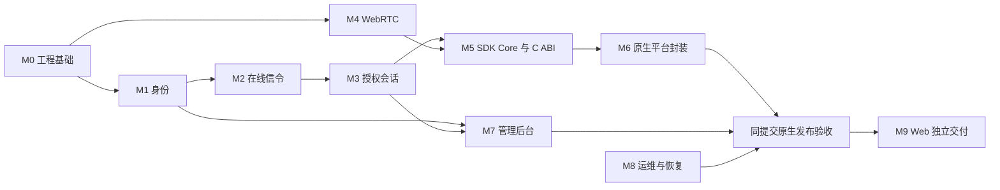

# Peerloom 开发与验收

本文规定模块交付、可复现测试和发布门槛。**实现存在、某个平台测试通过、发布源码提交全部门禁通过、正式发布，是四种不同状态。**

身份、信令、授权、三类原生通道、平台安全存储、异步 C ABI、托管 TURN、管理后台、Webhook 与运维脚本已有实现及下述实际验证。原生服务链已经分别在 Linux、Windows、Android 和 iOS Simulator 执行；这不等于生产签名宿主、物理设备或复杂公网长期运行已经验证。正式交付以同一发布源码 SHA 的完整必需门禁、经审核的发布计划和实际 Release 资产为准，不凭实现或分平台成功认定。

功能、依赖、部署或产物行为变化必须以**对应精确源码提交**的完整必需 CI 验收；前序证据不能代替。纯文档和纯发布管理不重复执行功能矩阵，也不能借此掩盖尚未验证的功能变化。

## 当前容量变更的验收边界

已发布 v0.1.1 的资产仍是其受验源码版本，保留旧连接/通道数量上限；当前源码不改变旧资产。当前源码移除默认人工数量配额，服务端 -1/SDK 0 表示不限，正数仍可选；这不是无限物理容量。

### 原生连接容量

精确源码 [`f9e7414`](https://github.com/barry-ran/peerloom/commit/f9e7414675c94bc84cb1f7d468a16ae9ea477764) 的[真实容量任务](https://github.com/barry-ran/peerloom/actions/runs/40841362359/job/123338267847)与其全部八个必需 CI job 已通过，之后正常快进到 master。一个 PC 身份、一个 PC SDK 实例连接 500 个原生模拟 peer，真实注册 501 个设备、500 条连接同时 Ready，以唯一可靠小消息双向通信。保持至少 120 秒，跨越全部初始双端租约期限并续租；PC 凭证轮换后的 WSS 重连及 20 次显式关闭后新建会话也通过。最终 501 个设备、520 条历史会话全部 closed，Redis presence 501→0，owned 进程已回收。

该次耗时 162.741 秒，520 次 Ready 观测 p50 459.011 ms、p95 752.538 ms、最大 954.751 ms；未预期错误 0。4 vCPU Linux CI runner 上峰值合计 RSS 825,982,976 字节、FD 3,717、线程 43，累计 CPU 114.75 秒。RSS 为进程集合求和，共享页可能重复计数，CPU 为累计处理器时间。使用同主机 DirectOnly 回环 UDP/DTLS、测试构建和每实例显式 MemoryIdentityStore，不是 500 份平台安全存储、500 台真实 Android、视频、公网/NAT、长期稳定性或容量 SLA 验收。

独立下载核验的[证据包 `12882763094`](https://github.com/barry-ran/peerloom/actions/runs/40841362359/artifacts/12882763094) 为 47,284 字节，SHA256 `3431b35f7d9d9a8ac0f40f0a95bc611509222381af49ef2e897bc12543c2a2c5`。四份公开 JSON 绑定全部 882 个 Git 文件、测试二进制、断言与资源采样；不含逐会话原始 deadline，不能仅凭公开摘要独立重算全部租约。

### 动态 C ABI 并发流读取

上述原生小消息测试不能证明 500 个 C ABI READ 同时待完成。动态预算切片的必需验收使用真实编译 C 宿主、公开 `dp_*` 接口及一个 PC 实例，与 Go/PostgreSQL/Redis 和 500 个独立原生设备端建立可靠流：在任何对端写入前，500 个 READ 均受理且实际进入运行；持续至少 120 秒并验证双端租约续期，再完成逐字节双向部分读写、FIN、管理终止唤醒、兄弟连接继续、reset 与恰好一次终态/无迟到回调/资源回收。

本地冻结源码已实际完成上述 500 C ABI 流测试：500 条 READ 同时运行，实际保持 120.523 秒且逐会话核对双端租约推进；双向共 262,144,000 字节，20 条管理终止唤醒，480 条兄弟流完成 FIN，48,943 个受理操作对应 48,943 个唯一完成事件，reset 后无 pending READ、shutdown 后无迟到回调。501 个真实注册设备、500 条会话最终全 closed，Redis presence 501→0，owned 进程已回收。测试二进制 SHA256 `8e84030e01483746f253b786104b28f1c945fb81dab1c36da95a411b46b24ae6`，结果 JSON SHA256 `f1e00a3b7aa31ab6055ca46bb4df8b113f124871b60f720e53a5c07ca8512485`；这是本地组合源码实测，不冒称已提交候选 CI 通过。

该轮 9 CPU 环境耗时 322.254 秒，峰值合计 RSS 1,023,123,456 字节、FD 3,753、线程 50，累计 CPU 380.94 秒。双向流量阶段 153.377 秒，发送窗口固定为 8；这是该有界场景端到端测量，不是吞吐上限。连接延迟包含批次等待，不是网络 RTT。

此项与原生 core 容量 case 分别记录源码、C 适配器、二进制与资源证据，两者都必须通过；不能用 5/33-peer smoke、单元票据计数、零用例执行或顺序 32 个一批代替。当前切片的最终精确提交与平台证据以实际 CI 为准，不沿用上述 f9 的完成状态。500 个模拟字节流仍不等于 500 路真实视频编解码或 Android 真机。

## 按改动触发 CI

| 改动 / 操作 | 验证方式 |
|---|---|
| 仅已列明文档或 README 横幅 | 不自动启动四个功能工作流；仍检查文档与链接的准确性 |
| 功能、SDK、服务端、依赖、配置、脚本或工作流 | 在非 `master` 验证分支执行完整必需门禁；通过后正常快进 `master`，不因同一 SHA 落到 `master` 再跑一轮 |
| 仅经审核的发布计划 | 只读发布校验复用已验证的精确发布源码 SHA 和五个固定产物；不重建、不拿管理提交的新包替换源产物 |
| 显式诊断或重验 | 四个功能工作流保留 `workflow_dispatch`；必须明确指定受测 ref，失败恢复不自动扩大重试次数 |

四个规范功能工作流仍为普通检查、Windows/Apple 原生、Android 和真实管理后台浏览器验证。`push` 排除 `master`；现有 PR 入口使用相同文档过滤，未为原先没有 PR 入口的原生工作流新增入口。过滤仅包括：`README.md`、`docs/*.md`（顶层）、`docs/assets/peerloom-banner.svg`、`deploy/server/README.md`、`bindings/android/README.md`、`bindings/android/scripts/Maven证据说明.md`、`bindings/ios/Apple封装说明.md` 和 `release/approved-plan.json`。混合改动只要包含未忽略文件，就触发相应工作流。

这不是任意 `*.md` 或任意资源的全仓库豁免：`AGENTS.md`、第三方证据、可执行 API schema、其它 SVG、脚本、依赖和工作流本身均不在忽略清单。CI / 发布逻辑变更还需本地正反用例、静态校验和独立审阅，不能伪装成文档改动。直接把未验证功能推到 `master` 不属于允许的发布路径；`master` 不自动重跑不等于功能已验收，发布器仍要求受信源码门禁和产物证据。

README 的“功能验证”徽章只是运行记录入口，不是 `master` 当前状态的绿色证明。应按精确源码 SHA 查看实际门禁，不把历史 master run 或手动选择的旧绿结果当作新功能证据。

## 开发原则

- 遵循根目录 `AGENTS.md`：中文人工文档，模块变化直接更新既有文档，不建立日期流水账。
- Go 控制面与 Rust/webrtc-rs 方向已确定；按官方工程实践开发，不另设阻塞原生开发的技术选型 PoC。
- 先定义协议、数据不变量、权限和错误语义，再实现适配器；HTTP、数据库和平台存储不侵入业务规则。
- 优先完成真实注册→授权→通信切片，而非先堆叠平台壳或管理页面。SDK 不是业务 UI；浏览器管理后台不等于移动 SDK 界面。
- 模块独立编译、自测、同步文档；测试范围与改动相称，不把静态检查冒充真实平台运行。
- UI 修改复用已有组件，中英文资源与稳定错误码分离；超过 16 ms 的操作不放在主线程。
- 本项目原创代码使用 MIT；第三方仍遵守各自许可，必须保留锁定版本、原文 notice 和 SBOM。证据收集与已明确记录的缺项不等于法律审核通过。

## 模块与验收矩阵

| 模块 | 已实现、实际验证 | 必须保持的验收与限制 |
|---|---|---|
| M0 工程基础 | Go/Rust workspace、格式化/lint、迁移校验和与互斥、Compose 真启动、健康/指标与产物 CI | 迁移 up/down 及漂移拒绝；所有平台交付包必须绑定源码、锁文件和完整校验清单。`/readyz` 只描述已实现依赖范围，不是产品完成标志 |
| M1 设备身份 | grant/direct 注册、凭证轮换、持久幂等、CAS 存储、Rust/C reset；真实 PG 竞争；Swift 首次注册后 Keychain 保存与同 ID 重开 | 一次性 grant 原子消费；跨租户/audience 拒绝；公钥不是未经 PoP 定义的认证或恢复凭据。平台崩溃未知结果不能凭内存重试宣称已持久恢复 |
| M2 在线信令 | 单节点 WSS、心跳、连接 generation/fencing、去重和重连；真实 Go/Redis 故障恢复 | 旧连接不得覆盖新连接；WSS 中断不立即误杀有效租约内的数据通路，也不能延长授权。未承诺多节点路由 |
| M3 授权会话 | grant-only 默认拒绝、同租户跨应用授权、目标确认、配额、撤销、双端租约；真实 PG 竞争与续租测试 | 跨租户永拒绝，方向/目标 FK 正确；在线通知与失联有界撤销分开验证。服务端不能强制停止不遵循 SDK 的串通端点 |
| M4 WebRTC | webrtc-rs、直连/强制 TURN、实际 Relay/Relay 与错误密码拒绝；三类传输和 Auto 不可达 TURN 回退 | 记录实际选中路径，不以候选文本替代；当前数据恢复是重建式恢复，未实现原地 ICE restart。复杂公网 NAT、长期切网不由回环测试替代 |
| M5 Core/FFI | 单身份多连接、多通道、消息 TTL/丢弃策略、字节流/背压/FIN、取消、父子句柄 gate；Linux C 三设备混合与双工实际通过 | 当前源码取消 Core/FFI 默认人工数量上限，三项配置 0=不限、正数可选；上述精确 CI 的500连接容量任务已通过，交付候选仍须通过全部相关门禁，旧 v0.1.1 资产不变。可靠流不得丢中间字节；关闭、撤销及消费时再次校验权限 |
| M6 原生封装 | Linux 安全存储与 C 动静态链接；Windows DPAPI/MSVC 与真实 Go 服务链；Android JNI/Keystore/4 KiB与16 KiB模拟器；Apple 五 slice、Swift/Keychain/Simulator 与真实 Go 服务链 | 各平台已有证据仍须汇合为同 SHA 门禁。macOS 存储测试采用 DEBUG 隔离文件 Keychain；iOS 服务测试使用 Simulator DP Keychain，均不能证明生产签名宿主或物理设备 |
| M7 管理与投递 | scoped API、应用/设备/授权/会话/审计、真实 HTTP→SDK、内置管理员、中英文管理后台与 Chromium 安全测试；Webhook PG/HTTPS 测试 | tenant/read-admin 隔离、原子审计、SSRF/DNS/重定向和 secret_ref 权限保持必测；隔离接收器不是生产公网投递验收 |
| M8 运维交付 | TLS 覆盖、指标隔离、有界资源、隔离逻辑备份恢复；真实容器 TLS/备份及 Go/Redis 故障后的业务恢复 | 不安装 CI CA 到宿主信任库，不使用 `-k`；恢复核对实际业务数据/函数/trigger，不能只看进程启动。生产证书运营、升级回滚、RPO/RTO、长期稳定性未实测 |
| M9 Web 延期 | 尚未实现浏览器 SDK | 浏览器与原生互通后独立交付；不阻塞已满足门槛的原生交付 |

首个纵向切片必须真实完成：注册并保存身份 → 认证心跳 → 同租户授权 → 目标接受 → WebRTC/TURN → 双向数据 → 正常关闭。不得用预置身份、模拟授权或仅 DataChannel 打开代替完整链路；首次注册与恢复需独立断言。

## 可复核的实际证据

这里只保留能说明当前能力的精确提交证据，不保留已经关闭的环境排障流水。链接指向不可变提交的运行；后续提交仍需自己的完整门禁。

| 范围 | 精确证据与结果 | 不覆盖的范围 |
|---|---|---|
| Linux / 控制面 / 运维 | [普通 CI：`624525e`](https://github.com/barry-ran/peerloom/actions/runs/40724732772/job/122944816195) 已通过 C 三轮默认 45 秒压力/reset、托管 TURN 新代恢复、Go 停服后的租约有界失效、Redis 恢复后新授权收发、真实 TLS/容器备份；[Auto 回退：`848599f`](https://github.com/barry-ran/peerloom/actions/runs/40733736215/job/122976605121) 包含真实黑洞 TURN、默认 20 秒收集期限和全双端 45 秒内 Host/Host 双向数据 | 任意故障、任意 NAT、生产恢复或可用性 SLA；每操作期限不是全链路期限 |
| Windows | [真实服务：`f4ed44a`](https://github.com/barry-ran/peerloom/actions/runs/40756261067/job/123055872836) 已通过原生 SDK→Go/PostgreSQL/Redis 的注册、轮换、关闭和安全存储重启；双端租约 generation 从 2 增至 10，跨过原 deadline 后双向数据仍可用；[`e4a6ba3`](https://github.com/barry-ran/peerloom/actions/runs/40759252133/job/123066410766) 再次通过服务阶段 | Windows SDK 与 Go 是原生进程，临时 WSL1 只提供 Redis 依赖；上述 job 后续包装失败，不能称 Windows 包已通过或以 WSL 测试替代原生 SDK |
| Android | [`ffc3b39` 原生验证](https://github.com/barry-ran/peerloom/actions/runs/40740401400) 的 build、4 KiB、16 KiB 三项任务均通过；包括真实 grant 撤销、暂停交付后 payload 失效、终态一次、有限 Activity 前后台、短 WSS 恢复、轮换与进程重启、CAS/TLS | 模拟器不等于真机、Doze、OEM 限制、任意切网或长期后台；Maven 发布证据必须与实际解析依赖绑定；21/21 POM 的收集闭环不等于全部许可原文已经齐全 |
| Apple | [`cf3c50a` Apple job](https://github.com/barry-ran/peerloom/actions/runs/40752590811/job/123043607293) 完整成功：五 slice；macOS 14项、iOS Simulator 12项；Swift/Rust TLS；四种 cwd/包类型真实解析；unsigned device build；独立真实 Go 服务测试；最终打包 | macOS DEBUG 文件 Keychain 不替代生产数据保护 Keychain 签名宿主；Simulator app-host 及 unsigned device build 不替代真机或生产签名 |
| 管理后台 | [`ffc3b39` Chromium 门禁](https://github.com/barry-ran/peerloom/actions/runs/40740400288) 已通过真实生产路由、权限/租户隔离与 UI 失败恢复 | 该浏览器验收不是移动 SDK UI 或生产部署 |

[`e4a6ba3` 普通 CI](https://github.com/barry-ran/peerloom/actions/runs/40759252128) 的 Linux artifact `12847954297`（187,398,702 字节，SHA256 `3c44bd8c1badae3d99d898d3a9e6d95653ba7a19dd2a638fdf80b1a69d59235f`）已用未修改的 `release-policy.verify_zip` 实际通过。Android Maven POM 收集与绑定已在 `3c19c6c` 的真实产物完成 21/21 闭环，不再列为当前缺失能力。另有 19 项许可原文缺项：代码已按明确构件/版本及证据摘要实现精确披露，而非通用忽略缺项；该披露实现仍须由当前精确提交的真实包与未修改发布策略验收。POM 齐全、构建或模拟器通过都不能替代产物/许可证据校验，也不代表法务清关。

Apple 独立服务测试仍只有 **1 个具名场景**，不替代原 14/12 项：Swift 空 Keychain 首次注册并保存 → 关闭/重开保持同 ID → 三设备、两个明确批准会话 → 可靠消息/低延迟消息/256 KiB 字节流、双工、FIN 和父子 gate。`cf3c50a` 服务 artifact `12847506114` 的 SHA256 为 `f37a8c7582c96904bccba29ba2b1ace370b84a93fe719d3b51d37b78386412c1`。

同提交 Apple release-profile artifact `12847091166`（90,088,998 字节）的 SHA256 为 `663e7c440daf7e4e06fe578ea152b873721bc1c6b38967d1e3b1862a658191df`。已用未修改的 `release-policy.verify_zip` 检查全包校验和、源码版本、三平台变体/五架构、二进制与一致 C 头、notice/SBOM；三份 C 头另与该提交规范头逐字节核对。包中明确保留四项第三方原文缺项与未经法务审核状态，不将该校验描述为法律清关。

Apple 环境枚举保留 30 秒快路径，仅在命令失败后每个 job 允许一次 120 秒同只读探测；只有严格 JSON 且唯一目标 runtime 可用才能继续。两次退出码、耗时与恢复事实分别保留，取消不重试。此为环境准备，不改变 SDK 45 秒等产品期限；[精确提交 `f4ed44a` 的 Apple job](https://github.com/barry-ran/peerloom/actions/runs/40756261067/job/123055872309) 已实际经历快路径 exit 124（32.091 秒）后，唯一恢复探测 exit 0（2.886 秒），累计 34.977 秒；随后完整原生、服务与包装通过。该累计时间不是全新冷启动耗时，也不证明特定 CoreSimulator 故障机制。

## 服务端与 SDK 拆包验收

v0.1.0 已发布资产保留不变。v0.1.1 新交付结构为 Linux amd64 服务端包与 Linux/Windows/Apple/Android 四个 SDK 包；此调整的实现、干净目录部署及五包校验须以新候选的实际 CI 为准，不由上表历史成功代替。

| 拆包门槛 | 必须验证 |
|---|---|
| 服务端完整性 | 5 个可执行 Go 程序、9 对迁移 SQL、运行时 Dockerfile/Compose/TLS/secret 初始化和两份部署说明；元数据明确 `product=server` |
| 无源码启动 | 只解压真实服务端载荷，在没有项目源码/Go/Rust/Node 的干净目录构建运行镜像；宿主所需 Docker/Compose、Python 3 与联网拉取固定镜像须公开说明 |
| 部署安全 | 默认回环、数据库/Redis不对外发布、仅服务端获受控出站、初始化拒绝覆盖秘密、迁移真实成功；TLS 新私有副本不得改变原 0600 私钥；没有默认管理员，HTTPS/WSS 与管理 Cookie/Origin 正反用例保持 |
| SDK 独立性 | 四个 SDK 的 `product=sdk`；不得混入 Go 服务、迁移和部署工具；各自原生通信与生命周期门禁不因拆包而减少 |
| 产物与证据 | 五包分别核对 API digest、内部完整校验和、版本/源码绑定和严格必需集合；共同 all-lock 清单仍明确扫描范围、许可原文和已批准缺项，不伪称最终二进制依赖或法务清关 |

服务端包不是离线镜像全集、生产证书服务或完整 TURN 部署。下载包运行成功仍不覆盖公网、长期容量、生产签名及真机边界；新版本尚未实际发布前，不写成已交付。

## 安全与契约必测项

| 领域 | 正向用例 | 必须拒绝或有界失败 |
|---|---|---|
| 身份 | 首次注册、重启恢复、reset 新 ID、轮换 | 公钥重放取得秘密、失效凭证、错误 audience |
| 注册事务 | 同键结果重放、密文窗口内安全恢复 | 一次性 grant 并发重复消费、过期回执返回不可恢复秘密 |
| 入参 | 合法 platform、受限 metadata | 缺失/非法 platform、超大/过深 JSON、非法公钥字段 |
| 租户与方向 | 同租户跨应用经授权连接 | 跨租户、自连接、错方向/目标 grant FK、NULL 运营资源越权 |
| 目标确认 | 明确接受或已配置自动接受 | 拒绝被覆盖、超时后继续协商 |
| 并发与额度 | 多会话、关闭后复用配额 | 并发超额、重复关闭负计数、异常资源泄漏 |
| WSS | 重连快照、有界早到候选 | 旧 fencing、旧协商代、未授权 SDP/ICE |
| 撤销与租约 | 在线通知、失联到期关闭、双端续租 | 断线无限续命、时钟回拨延权、排队数据过期后继续交付 |
| Webhook | 允许地址、签名、重试去重 | SSRF、DNS 重绑定、重定向绕过、secret 引用越权 |
| FFI/平台桥接 | 取消、终态一次、quiescent 后释放 | 借用指针逃逸、释放后回调、跨父句柄、消费时权限失效 |

PostgreSQL FK/约束必须直接执行负测，不能只证明 HTTP 拒绝。迁移 up/down 不得无条件删除共享扩展；版本或校验和漂移必须失败。真实 PG race 覆盖注册、轮换、幂等、授权配额及撤销竞争；Redis 覆盖 fencing、租约、重置和失效拒绝。

## 故障与生命周期验收

- 三种策略分别记录实际选中路径；强制中继必须确证 Relay/Relay，错误凭证拒绝。Auto 有界回退不改写候选、不延长收集期限，RelayOnly 不降级为直连。
- 数据恢复采用已实现的重建式恢复；主动 close、reset、撤销和永久认证失败必须停止自动恢复。原地 ICE restart 不得写成已实现能力。
- WSS 断开时，在有效授权租约内保留健康 WebRTC；无法续租则有界关闭。续租专项捕获双端 deadline 和 generation，再跨过原 deadline 证明双方增长与收发，不能仅跑短于租约的测试。
- 三类通道检查消息大小、背压、TTL、溢出策略、部分 read/write 与 FIN。发送完成不等于业务确认；可靠流不允许丢字节策略，发送期限届满明确失败/关闭。
- `scripts/test-control-recovery.py` 使用本次随机 Compose 项目：Go 停服前捕获数据库双端 deadline，停服后验证租约内可用与后续有界失效；Redis 短停时主动发控制帧，恢复后同一 SDK 重新上线、新授权连接并双向收发，不用重建 SDK 掩盖恢复失败。
- 停服与 deadline 捕获之间可能发生最后一次续租，测试不宣称观测到了精确最后续租时点；测试只恢复自身项目容器，不清空卷。
- 备份演练核对身份、授权、幂等收据、审计及迁移。schema 9 本地独立 PostgreSQL 18.6 已验证 23 表恢复，Webhook function/trigger 的 DROP、DISABLE、body change 均能被证据校验拒绝；远端另有真实容器演练。
- 移动生命周期必须标明模拟器/设备、操作和持续时间。有限 Activity 前后台或短 WSS 中断不能外推长期后台、系统休眠、Doze 或复杂切网。
- 日志和公开产物不得包含凭证、私钥、注册秘密、业务正文或服务夹具数据库。备份、测试 CA 和临时服务只在明确隔离范围内使用。

## 工程、产物与发布门控

| 范围 | 规则 |
|---|---|
| Go/Rust | 格式化/lint、错误上下文、取消/超时、race 与 unsafe 边界审计 |
| C ABI | C11/C++17 真实调用、动静态链接、回调重入/关闭/终态/所有权压力 |
| Android | Kotlin/JNI、ABI 包装、真实模拟器服务测试、Keystore 与生命周期；Maven 证据绑定已解析构件和实际原文 |
| Apple | macOS Swift、Simulator app-host、五 slice XCFramework，不混合 device/simulator；签名和真机边界独立披露 |
| 管理后台 | 类型检查、真实浏览器、权限/租户/失败恢复、中英文资源与可访问性 |
| 运维 | Compose/TLS、迁移、只恢复隔离数据库的备份演练、指标与秘密隔离 |
| 发布 | 四个规范工作流及其全部必需 job/step 对同一发布源码 SHA 成功，五包校验和与 API artifact digest 一致；纯发布管理单独只读核验受审计划，不重复功能矩阵 |

100 次连续建连、并发授权和缓存硬上限是已设工程门槛，不是长期稳定性或 SLA。性能目标应在明确机器/网络/持续时间后测量；不得捏造吞吐、P95、P2P 成功率或可用性指标。

每个模块合入需要功能说明、契约及负测、最小例程、错误排查与已知限制。发布前还需五端产物/示例、API 与配置说明、迁移回滚/备份恢复步骤、测试报告、版本和校验清单。Linux 不能代验 Windows/macOS/iOS 的实际运行；原生五端产物也不等于完成 M9 Web。

最终快进、版本标签与 GitHub Release 按经过审核且绑定精确提交/产物的发布计划执行；未实际执行前，不得写成已发布或生产交付完成。本轮任务分支由仓库拥有者手动清理，不作为拆包交付的自动删除待办。
