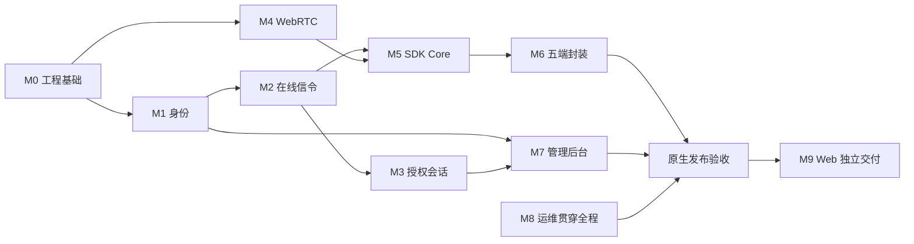

# Peerloom 开发与验收

本文把产品基线拆成可验证的交付模块，规定开发顺序、测试证据和发布门槛。

**状态以每个精确提交的必需 CI 为准。** 已实现身份、信令、授权、三类原生传输、平台安全存储、异步 C ABI、托管 TURN、管理员后台与 Webhook，并新增 TLS/备份演练入口；各模块证据并不自动覆盖最新整合提交。仍不是完整五端 SDK 或最终 Release。

## 开发原则

- 遵循根目录 `AGENTS.md`，所有人工文档使用中文，优先修改现有文档而非另建日期记录。
- 开发前核对对应语言的官方工程实践；Go 控制面和 Rust/webrtc-rs 方向已确定，不另设会阻塞开发的技术选型 PoC 门槛。
- 模块边界清晰，优先小而完整的业务切片，避免先堆积全部平台壳和 UI。
- 先定义协议、数据不变量和错误语义，再实现适配器；不要让 HTTP 或数据库细节扩散到业务规则。
- 每个模块独立编译、自测并同步文档；不因单个文案变更盲目重跑所有五端测试。
- UI 修改前检查并复用现有组件；中英文国际化从结构上保留，不硬编码错误判断文本。
- 本项目原创代码按用户确定的 MIT 许可发布，见根目录 LICENSE；第三方依赖保留各自许可与 notice，发布产物需附依赖版本清单/SBOM，不能把项目 MIT 视为第三方已获重新许可或法务审核通过。

## 模块路线

| 模块 | 目标交付 | 必须验收 | 当前 |
|---|---|---|---|
| M0 工程基础 | monorepo、CI、Compose、迁移、协议 schema、指标骨架 | Compose 启动，迁移/回滚，CI 编译测试 | 已通过 M0 CI |
| M1 设备身份 | 租户应用、注册、凭证轮换、存储与 reset | 重启 ID 不变，reset 新 ID，跨租户拒绝，原子注册 | grant/轮换已验证；direct 与 Rust/C reset 已实现并有本地真实服务测试，最新平台组合待门禁 |
| M2 在线信令 | WSS、心跳、generation/fencing、去重、快照 | 心跳超时离线，旧连接不能覆盖新连接 | 单节点 WSS/Redis fencing 与真实客户端闭环已验证 |
| M3 授权会话 | 显式 grant、目标确认、并发占位、撤销、授权租约 | 拒绝优先，并发无超额，在线/失联撤销边界正确 | grant-only 与真实双端确认、失联租约到期已验证 |
| M4 WebRTC | webrtc-rs、ICE、STUN/TURN、三种连接策略 | 原生互通，强制中继，失败分类可观测 | Linux 直连/强制 TURN 与三类传输已验证；跨平台授权链、复杂网络须分别验收 |
| M5 SDK Core | Rust API、重连、三类通道、缓存、可取消 C ABI | 多连接多通道，有界缓存，FFI 生命周期安全 | Core 与 C/Kotlin/Swift 多连接、三类通道已实现；Linux 真实 C 混合/双工通过，新增平台组合须以当前提交原生门禁验收 |
| M6 五端封装 | 桌面包、Android AAR、iOS XCFramework | Windows/macOS/Linux/Android/iOS 示例可注册连接收发 | Linux已验证；Android 653、Apple 2db 原生门禁通过；新增 Windows 联合链及最新整合候选待验收 |
| M7 管理后台 | 应用、设备、授权、会话、审计界面 | RBAC/租户隔离，查询与权限正确 | 服务 API、内置管理员与中英文管理后台已验证；Webhook 已实现并通过本地 PG/HTTPS 测试，最新 CI 待验收 |
| M8 运维交付 | TLS、备份、指标、限流、升级与恢复 | 故障恢复和备份演练通过，文档可复现 | TLS 覆盖与隔离备份恢复已实现；本地 PG 通过，真实容器演练及完整 M8 未验收 |
| M9 Web 延期 | TypeScript SDK、浏览器 WebRTC | 浏览器与原生互通后独立发布 | 未实现，可延期 |

M1 与 M4 可并行；M3 依赖 M1/M2，M5 依赖 M2/M4，M6 依赖 M5。M7 不应抢在真实通信切片之前完成全部页面。

## 原生首版验收矩阵

下表是发布门槛，不是“代码存在即完成”的清单。某个验证分支通过只能证明其精确提交；仅在全部必需 CI 成功后快进 master。五端硬件和生产部署没有实测时必须保留明确限制。

| 模块 | 已实现与已有验证 | 首版尚缺的关键证据或能力 |
|---|---|---|
| M0 工程基础 | Go/Rust 构建、迁移回滚、Compose 真启动及产物 CI | 最终五端产物矩阵、Release 版本/校验和及全部必需任务门控 |
| M1 身份 | grant/direct 注册、轮换、持久幂等与 Rust/C reset；已有真实 PG 竞争与本地恢复测试 | direct/reset 与新增平台便利接口的精确 CI、崩溃未知结果与平台存储故障恢复 |
| M2 信令 | 单节点 WSS、Redis fencing、真实 SDK 重认证/失联闭环 | 各平台网络切换/前后台行为；服务重启与 Redis 故障的完整业务恢复演练 |
| M3 授权 | 同租户跨应用、隔离、确认拒绝、配额、撤销及租约 | 多连接/重建会话下完整竞争与撤销矩阵；不能以单连接用例替代 |
| M4 传输 | 直连/强制 TURN、实际 Relay/Relay、凭证拒绝；当前协商代托管 ICE 和重建式数据恢复已有实现与本地测试 | 最新恢复组合精确 CI、五端互通、复杂 NAT/弱网；未实现原地 ICE restart |
| M5 Core/FFI | Core/C ABI 有界多连接与三类通道、数据恢复及 reset；Linux 三设备双连接 C 混合消息、256 KiB 字节流/双工/FIN 与父子 gate 已通过 | 新增 C/Kotlin/Swift 通道的同 SHA 原生门禁；宿主排队完成/事件与撤销组合、移动生命周期 |
| M6 平台封装 | Linux 安全存储/C 动静态链接、Windows DPAPI/MSVC、Android JNI/Keystore 与 Apple Swift/Simulator 的分提交原生证据 | Android 653 与 Apple 2db 已有真实原生证据；最新整合、Windows 新服务联合测试、生产签名宿主、真机与移动生命周期仍须验收 |
| M7 管理 | scoped 后端 API、真实 HTTP→SDK 通信、租户/read-admin隔离与审计 | 管理后台真实 Chromium 门禁与新增 Webhook 精确候选 CI；固定公网接收器/部署场景未实测 |
| M8 运维 | 健康/指标隔离、开发 Compose、限额、用户证书 TLS 覆盖与隔离逻辑备份恢复脚本 | 新增真实容器 TLS/备份 CI、全栈故障恢复、生产证书运维、升级回滚、RPO/RTO 与长期稳定性 |

当前优先级是闭合最新整合提交的真实客户端与运维门禁，并验收已实现的 Core/FFI 高级通道、移动生命周期及最终运行与发布演练。已经冻结的单点工具不应占用这些关键路径；不得为了提前发布省略权限、TLS、生命周期或失败回归。

## 首个真实纵向切片

优先让两个原生 SDK 完成：注册并保存身份 → 认证心跳在线 → 同租户 grant 授权 → 目标接受 → WebRTC 直连或 TURN 兜底 → 双向消息 → 正常关闭。服务端、传输和 SDK 协同推进，不用模拟状态代替真实数据通路。

切片至少记录源/目标设备、会话 ID、实际连接路径、错误分类和测试环境；不能仅凭“DataChannel 打开”宣称完成注册授权链路。开发优先级不是跳过安全门槛，租户隔离和授权校验必须在第一条真实连接中生效。

## 工程与 CI 要求

| 范围 | 规则 |
|---|---|
| Go | 单一格式化规范、明确错误上下文、context 取消、超时、race 测试、包内边界 |
| Rust | workspace、格式化和 lint、Result 错误边界、异步取消、必要 unsafe 审计 |
| C ABI | C/C++ 编译调用例、版本与所有权测试、回调重入和销毁压力测试 |
| Android | Kotlin/JNI 边界、原生库 ABI 打包、生命周期与后台限制测试 |
| iOS | Swift/XCFramework 架构组合、并发桥接、Keychain 与前后台测试 |
| 前端 | 复用组件、类型检查、可访问性、租户隔离和中英文资源 |
| 数据库 | 版本与校验和、事务、迁移互斥锁、up/down 与约束负测 |
| 交付 | GitHub workflow 构建和测试，受控发布凭证，产物可关联源码版本 |

CI 不应假装 Linux 能验证所有平台签名和运行行为。五端编译、签名和发布使用适当 runner；未具备签名身份时明确阻塞项，不伪造已签名产物。

M0 已实现 `/healthz`、仅 PostgreSQL schema 范围的 `/readyz`、内部 `/metrics` 和独立 `device-migrate`。运行命令见部署指南；设备身份、WSS、授权和管理端点已加入；ready只描述已实现的依赖就绪，不代表完整产品交付。

## 安全与契约测试矩阵

| 测试领域 | 正向用例 | 必须失败或受限的用例 |
|---|---|---|
| 身份 | 首次注册、重启恢复、reset 新 ID、凭证轮换 | 公钥重放恢复秘密、失效凭证、audience 混用 |
| 注册事务 | 相同键重试同一结果、密文有效期内安全重放 | 并发重复消费一次性 grant、过期结果无凭证恢复 |
| 入参 | 六种平台合法值、受限 metadata | 缺失/非法 platform、超大/过深 JSON、公钥格式错误 |
| 租户 | 同租户不同应用经授权连接 | 跨租户连接、跨租户管理查询、NULL 运营资源越权 |
| 数据完整性 | 正向 grant 与 session 一致 | 错租户、错方向、错目标 grant 外键，自连接 |
| 目标确认 | 自动接受或明确接受 | 目标拒绝被策略覆盖、超时后继续协商 |
| 并发 | 上限内多会话，关闭后复用配额 | 并发竞态超额、重复关闭导致负配额、异常泄漏 |
| WSS | 重连快照、候选早到有界缓存 | 旧 fencing 写状态、旧协商候选、未授权 SDP/ICE |
| 撤销 | 在线立即通知，失联租约到期关闭 | WSS 断开后无限续命、时钟回拨延长权限 |
| Webhook | 允许域名签名投递、重试去重 | SSRF、DNS 重绑定、重定向绕过、secret 引用越权 |
| FFI | 正常取消、终态一次、shutdown 后释放 | 回调后借用指针存活、重复完成、释放后回调 |

必须直接对 PostgreSQL 约束执行负面测试，不能只证明 HTTP 层拒绝。迁移回滚不得无条件删除共享扩展；版本/校验和漂移要失败并给出清晰错误。

## 端到端与故障验收

- 三种策略分别验证：`auto`、`direct_only`、`relay_only`，记录真实候选路径。
- 自动重连包含网络切换、ICE restart、服务端重启和 WSS 重连；主动关闭、撤销、认证永久失败停止重连。
- WSS 断开但 WebRTC 仍存活时，在有效授权租约内不误关闭；租约无法续期时有界关闭。
- 三类通道验证边界、背压、流关闭、消息 TTL、队列满与丢弃策略，不将发送完成当成业务确认；可靠流禁止丢字节策略，TTL 到期明确失败或重置。
- 设备/应用停用、grant 到期两种动作、显式撤销和目标拒绝均有独立用例。
- Redis 故障恢复 presence，不重复消费注册 grant；数据库不可用时拒绝不能持久授权的新操作。
- 数据库备份恢复演练核对设备身份、授权、幂等收据和审计；不得只检查进程启动。
- 移动端前后台、休眠唤醒、网络权限及系统限制在真实设备或明确注明的模拟环境验证。
- 日志扫描不包含凭证、私钥、注册秘密和业务正文；TURN 凭证有效期和重放风险可测。

## 质量与发布证据

初始工程门槛包括：核心契约测试全过、100 次连续建连无死锁、并发授权竞争无超额、所有缓存有硬上限、持续运行内存没有无界增长趋势。测试必须说明机器、网络、客户端版本与持续时间。

性能目标待部署规格与真实压测后制定；不得填写未经测量的吞吐、P95、P2P 成功率或可用性 SLA。100 次建连通过也不能替代安全测试和长期稳定性测试。

每个模块合入前提交：实际功能说明、契约与单元测试、负面安全测试、最小示例、失败排查方法和已知限制。模块实现变化直接更新对应架构和使用说明。

原生发布须附：Compose 配置、五端 SDK/示例、API 文档、配置表、升级回滚步骤、备份恢复步骤、测试报告与产物校验。Web 未完成不阻塞已经满足门槛的原生发布。

## 当前验证证据与限制

- 新增 TLS/备份容器、Windows 原生服务联合测试与 Gradle 依赖证据等组合能力，须以当前提交的完整必需 CI 验收；接线不等于通过，前序提交的成功证据不能替代当前结果。
- [Android 原生工作流](https://github.com/barry-ran/peerloom/actions/runs/40686771276) 对 `653e244e41878ebda911a69c57d3f81a0ad6caf4` 实际通过；这不是所有平台或最新提交同时通过，也不等于真机/后台生命周期验收。
- [Apple/Windows 原生工作流](https://github.com/barry-ran/peerloom/actions/runs/40682077497) 对 `2db4a06d9748cd0fa127b5c0f7c4306e68855d6e` 实际通过：Apple 完整五 slice、macOS XCTest 10 项、Rust TLS 2 项、iOS Simulator 原有 XCTest 8 项和 unsigned device build。macOS 存储测试使用隔离 DEBUG 文件 Keychain，iOS 使用 Xcode 的 Simulator 应用宿主；不证明生产签名数据保护 Keychain 宿主或物理设备。Windows 当时证明 DPAPI/MSVC 等原生用例，新增服务联合 fixture 另等最新 CI。
- M8 本地独立 PostgreSQL 18.6 已验证 schema 9 的 23 表恢复及真实 Webhook function/trigger DROP、DISABLE、body change 拒绝；本机 Docker daemon 不可用，不能将本地 PG、配置渲染或 mock 测试写作真实容器通过。
- 控制面与授权通信的 [CI](https://github.com/barry-ran/peerloom/actions/runs/40632013129) 对精确提交 `f89c4d6521249d7fcb52f222316961d3aba036dc` 全部通过后才推进 master；后续功能同样先推验证分支，完整必要 CI 成功后再快进相同提交。
- 真实 PostgreSQL race 测试覆盖并发注册、轮换、幂等回放、授权配额、撤销竞争和迁移回滚；Redis 测试覆盖 fencing、租约、重置与失效拒绝。管理服务另覆盖租户隔离、read/admin 权限、原子审计及绝对到期幂等。
- CI 真实 Compose 启动 Go/PostgreSQL/Redis，再由 Rust 完成设备身份与同租户跨应用授权通信；WSS 失联后仍保留健康数据连接，但不延长授权，到期关闭。
- 真实 coturn 验证 `relay_only` 双端选中 Relay/Relay 候选，并验证错误凭证失败；不以候选文本或 DataChannel 打开替代实际路径证据。
- Linux 原生传输覆盖可靠/低延迟消息、100 次连续建连关闭；可靠流另覆盖分片、背压、半关闭、不同端消息上限和取消。100 次建连与短时测试不代表长期稳定性或 SLA。
- 最小 DeviceSdk facade 的短暂真实服务测试覆盖凭证轮换与WSS重建，不足以单独证明越过批准后的60秒租约；续租专项须捕获实际双端deadline和lease_generation、跨过该deadline后证明双端增长及收发；每次变更仍须以该精确提交的 CI 为发布依据。
- Linux C ABI 运行 C11/C++17 兼容、真实动态/静态库链接、32 个终态及取消/重入/关闭测试；真实服务验证外部 CAS 轮换、WSS 授权、双向二进制消息和跨父句柄拒绝。HTTPS/WSS 使用统一平台验证器，实际 CA/SAN 正负例通过；宿主阻塞回调后租约到期再恢复的组合场景尚未单独端到端覆盖。
- 本机禁用 Unix socket、使用 SCRAM 回环 TCP PostgreSQL；Docker daemon 本地不可用，容器组合由 CI 验证。测试秘密不写入日志或公开产物。
- Core/C/Kotlin/Swift 多连接与高级通道已有实现，Linux 真 C 通信已验证，Kotlin 主源编译通过；新增 Swift 实现与测试仍须 Xcode 原生 CI。分平台已绿不等于最新整合全部已绿。生产签名宿主、真机、长期稳定性与完整恢复未验收；正式 Release、发布版本/tag 及最终任务清理均未执行，不得宣称原生首版或生产交付完成。
