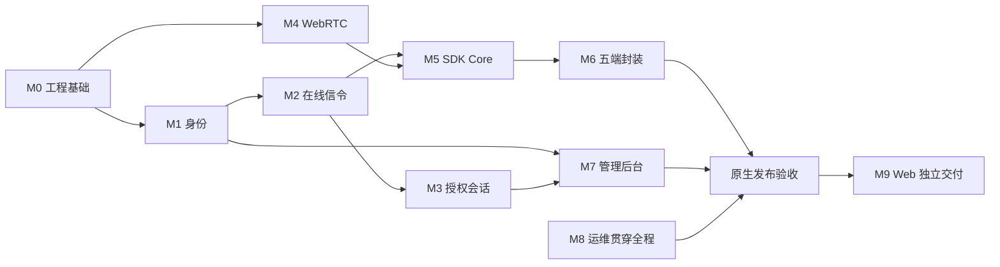

# Peerloom 开发与验收

本文把产品基线拆成可验证的交付模块，规定开发顺序、测试证据和发布门槛。

**当前状态：设计基线已建立，M0 正在开发。** M0 至 M9 均未完成；尚无本文件可据以宣称通过的产品测试证据，也没有可下载的 SDK。文档中的命令类别和产物是开发要求，不是当前可执行入口。

## 开发原则

- 遵循根目录 `AGENTS.md`，所有人工文档使用中文，优先修改现有文档而非另建日期记录。
- 开发前核对对应语言的官方工程实践；Go 控制面和 Rust/webrtc-rs 方向已确定，不另设会阻塞开发的技术选型 PoC 门槛。
- 模块边界清晰，优先小而完整的业务切片，避免先堆积全部平台壳和 UI。
- 先定义协议、数据不变量和错误语义，再实现适配器；不要让 HTTP 或数据库细节扩散到业务规则。
- 每个模块独立编译、自测并同步文档；不因单个文案变更盲目重跑所有五端测试。
- UI 修改前检查并复用现有组件；中英文国际化从结构上保留，不硬编码错误判断文本。
- 许可协议尚未确定，不擅自添加许可证或宣称开源许可条款。

## 模块路线

| 模块 | 目标交付 | 必须验收 | 当前 |
|---|---|---|---|
| M0 工程基础 | monorepo、CI、Compose、迁移、协议 schema、指标骨架 | Compose 启动，迁移/回滚，CI 编译测试 | 开发中，待验收 |
| M1 设备身份 | 租户应用、注册、凭证轮换、存储与 reset | 重启 ID 不变，reset 新 ID，跨租户拒绝，原子注册 | 未实现 |
| M2 在线信令 | WSS、心跳、generation/fencing、去重、快照 | 心跳超时离线，旧连接不能覆盖新连接 | 未实现 |
| M3 授权会话 | 显式 grant、目标确认、并发占位、撤销、授权租约 | 拒绝优先，并发无超额，在线/失联撤销边界正确 | 未实现 |
| M4 WebRTC | webrtc-rs、ICE、STUN/TURN、三种连接策略 | 原生互通，强制中继，失败分类可观测 | 未实现 |
| M5 SDK Core | Rust API、重连、三类通道、缓存、可取消 C ABI | 多连接多通道，有界缓存，FFI 生命周期安全 | 未实现 |
| M6 五端封装 | 桌面包、Android AAR、iOS XCFramework | Windows/macOS/Linux/Android/iOS 示例可注册连接收发 | 未实现 |
| M7 管理后台 | 应用、设备、授权、会话、审计界面 | RBAC/租户隔离，查询与权限正确 | 未实现 |
| M8 运维交付 | TLS、备份、指标、限流、升级与恢复 | 故障恢复和备份演练通过，文档可复现 | 未实现 |
| M9 Web 延期 | TypeScript SDK、浏览器 WebRTC | 浏览器与原生互通后独立发布 | 未实现，可延期 |

M1 与 M4 可并行；M3 依赖 M1/M2，M5 依赖 M2/M4，M6 依赖 M5。M7 不应抢在真实通信切片之前完成全部页面。

## 首个真实纵向切片

优先让两个原生 SDK 完成：注册并保存身份 → 认证心跳在线 → 同租户 grant 授权 → 目标接受 → WebRTC 直连或 TURN 兜底 → 双向消息 → 正常关闭。服务端、传输和 SDK 协同推进，不用模拟状态代替真实数据通路。

切片至少记录源/目标设备、会话 ID、实际连接路径、错误分类和测试环境；不能仅凭“DataChannel 打开”宣称完成注册授权链路。开发优先级不是跳过安全门槛，租户隔离和授权校验必须在第一条真实连接中生效。

## 工程与 CI 要求

| 范围 | 规则 |
|---|---|
| Go | 单一格式化规范、明确错误上下文、context 取消、超时、race 测试、包内边界 |
| Rust | workspace、格式化和 lint、Result 错误边界、异步取消、必要 unsafe 审计 |
| C ABI | C/C++ 编译调用例、版本与所有权测试、回调重入和销毁压力测试 |
| Android | Kotlin/JNI 边界、原生库 ABI 打包、生命周期与后台限制测试 |
| iOS | Swift/XCFramework 架构组合、并发桥接、Keychain 与前后台测试 |
| 前端 | 复用组件、类型检查、可访问性、租户隔离和中英文资源 |
| 数据库 | 版本与校验和、事务、迁移互斥锁、up/down 与约束负测 |
| 交付 | GitHub workflow 构建和测试，受控发布凭证，产物可关联源码版本 |

CI 不应假装 Linux 能验证所有平台签名和运行行为。五端编译、签名和发布使用适当 runner；未具备签名身份时明确阻塞项，不伪造已签名产物。

M0 的目标包括 `/healthz` 存活检查、依赖与 schema 就绪检查，以及独立迁移入口。最终路径、命令和参数随实现更新；当前没有可运行命令。

## 安全与契约测试矩阵

| 测试领域 | 正向用例 | 必须失败或受限的用例 |
|---|---|---|
| 身份 | 首次注册、重启恢复、reset 新 ID、凭证轮换 | 公钥重放恢复秘密、失效凭证、audience 混用 |
| 注册事务 | 相同键重试同一结果、密文有效期内安全重放 | 并发重复消费一次性 grant、过期结果无凭证恢复 |
| 入参 | 六种平台合法值、受限 metadata | 缺失/非法 platform、超大/过深 JSON、公钥格式错误 |
| 租户 | 同租户不同应用经授权连接 | 跨租户连接、跨租户管理查询、NULL 运营资源越权 |
| 数据完整性 | 正向 grant 与 session 一致 | 错租户、错方向、错目标 grant 外键，自连接 |
| 目标确认 | 自动接受或明确接受 | 目标拒绝被策略覆盖、超时后继续协商 |
| 并发 | 上限内多会话，关闭后复用配额 | 并发竞态超额、重复关闭导致负配额、异常泄漏 |
| WSS | 重连快照、候选早到有界缓存 | 旧 fencing 写状态、旧协商候选、未授权 SDP/ICE |
| 撤销 | 在线立即通知，失联租约到期关闭 | WSS 断开后无限续命、时钟回拨延长权限 |
| Webhook | 允许域名签名投递、重试去重 | SSRF、DNS 重绑定、重定向绕过、secret 引用越权 |
| FFI | 正常取消、终态一次、shutdown 后释放 | 回调后借用指针存活、重复完成、释放后回调 |

必须直接对 PostgreSQL 约束执行负面测试，不能只证明 HTTP 层拒绝。迁移回滚不得无条件删除共享扩展；版本/校验和漂移要失败并给出清晰错误。

## 端到端与故障验收

- 三种策略分别验证：`auto`、`direct_only`、`relay_only`，记录真实候选路径。
- 自动重连包含网络切换、ICE restart、服务端重启和 WSS 重连；主动关闭、撤销、认证永久失败停止重连。
- WSS 断开但 WebRTC 仍存活时，在有效授权租约内不误关闭；租约无法续期时有界关闭。
- 三类通道验证边界、背压、流关闭、消息 TTL、队列满与丢弃策略，不将发送完成当成业务确认；可靠流禁止丢字节策略，TTL 到期明确失败或重置。
- 设备/应用停用、grant 到期两种动作、显式撤销和目标拒绝均有独立用例。
- Redis 故障恢复 presence，不重复消费注册 grant；数据库不可用时拒绝不能持久授权的新操作。
- 数据库备份恢复演练核对设备身份、授权、幂等收据和审计；不得只检查进程启动。
- 移动端前后台、休眠唤醒、网络权限及系统限制在真实设备或明确注明的模拟环境验证。
- 日志扫描不包含凭证、私钥、注册秘密和业务正文；TURN 凭证有效期和重放风险可测。

## 质量与发布证据

初始工程门槛包括：核心契约测试全过、100 次连续建连无死锁、并发授权竞争无超额、所有缓存有硬上限、持续运行内存没有无界增长趋势。测试必须说明机器、网络、客户端版本与持续时间。

性能目标待部署规格与真实压测后制定；不得填写未经测量的吞吐、P95、P2P 成功率或可用性 SLA。100 次建连通过也不能替代安全测试和长期稳定性测试。

每个模块合入前提交：实际功能说明、契约与单元测试、负面安全测试、最小示例、失败排查方法和已知限制。模块实现变化直接更新对应架构和使用说明。

原生发布须附：Compose 配置、五端 SDK/示例、API 文档、配置表、升级回滚步骤、备份恢复步骤、测试报告与产物校验。Web 未完成不阻塞已经满足门槛的原生发布。
