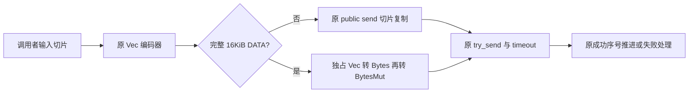

# Peerloom 性能候选独立安全审查

## 结论与适用范围

对方案 A、A2、保留原复核频率的 C1，以及 C2 的指定产品变更，**静态审查未发现功能性阻断或确认的 P1/P2 问题**。这不是全面正确性证明，也不是性能验收结论。

- A、A2：发送所有权调整未发现改变公开 API、C ABI、线协议、顺序、错误分类、超时、背压、序号、FIN 或取消规则的路径。
- C1、C2：接收容量通知与 permit 生命周期调整未发现改变四槽上限、单生产者/单读者、双向写入、EOF 或授权检查的公开语义。
- **C1、C2 已由性能 owner 因性能结果拒绝**；本报告不推翻该决定，不提出提交、发布或重新试参。
- 收到本次汇总请求时，A2 全矩阵仍由 owner 运行；最终性能结论以其后续汇总为准。局部减少复制、原子引用或 permit 操作，不等于端到端 CPU、延迟、吞吐或 RSS 改善。

审查遵循仓库 `AGENTS.md`。除此前与 owner 协调空档后独立执行 C1 测试外，工作为只读代码、依赖实现和日志核验。本次汇总仅创建本报告，不修改仓库、不编译、不运行测试或性能工具。未尝试绕过 perf/ptrace 权限限制。

## 工件身份

以下为本次重新读取所得 SHA256。证据目录均指本报告所在目录。二进制哈希用于识别工件，不单独证明可重复构建，也不能将不同二进制的运行结果互相替代。

| 方案 / 工件 | 文件 | SHA256 |
|---|---|---|
| A 完整 patch | `candidate-a.patch` | `bc908e18a8cadeb0c24d79a5827ced544c4480dd3033b5d3893700658eda09e5` |
| A 性能二进制；未独立执行 | `candidate-a` | `18189d53bdc9e3e921ce04d3a5bf0e049b8fb41c9638833eb8d707f6ed555c7c` |
| A2 完整 patch | `candidate-a2.patch` | `eb4d1bc286687037c1e25bd72248120aeb35edce6e8f2a785e52a95bbd30bb20` |
| A2 源码 delta，含局部单元测试 | `candidate-a2-product.patch` | `7f73d7921836c6966510f506afd46aeaed0af5ff8147d30069183ac59dd1a6bd` |
| A2 性能二进制；未独立执行 | `candidate-a2` | `e75f9294e609f22cef102e3e1ecccdc40901072352848dab46d6c21bd3c6bbda` |
| C1 保留 5ms 的 patch | `candidate-c-retained-checks.patch` | `fe12b5fa986411e5eb9664bd3e7b99741fd1023452bfab06a55785d6881b5e50` |
| C1 本审查者实际执行的测试二进制 | `sdk-candidate-c` | `ef5d530c868fc4a745bf96a19543063721ec15d571c7b914ef38697a5bea351d` |
| C1 后续 final 二进制；不是上述独立运行对象 | `sdk-candidate-c-final` | `f3ce99cba5a4f86c80999da12ac1a39fa928e05250b9640af76a8839f0a0121f` |
| C2 patch | `candidate-c2-product.patch` | `6f49d4715253bdb823f74f8260bc5a8a32cb07bad6b0f334f8ad9fd9b72e177c` |
| C2 测试/性能二进制；未独立执行 | `sdk-candidate-c2-final` | `76c3d5fbab53e5c4b0611cdc441998019253c75fcd33478231d19cb1fd8ee041` |

C2 冻结源码 `c2-final-stream.rs` 的 SHA256 为 `06408c0461f6b0e2852f141e597d257ed2fc6ad5c2c76b90d0901474d4ee2b4d`，Git blob 为 `8c64c3afb81af877895f2f8ff8246a53ee2b9dbe`，与 patch 的目标索引一致。审查期间 owner 曾临时恢复 baseline 构建对照，C2 判断以该冻结文件和指定 patch 为准。

A2 冻结 `a2-final-lib.rs` / `a2-final-stream.rs` 的 SHA256 分别为：

```text
851fd00a5e60625b1dcfdb9eab76d180ac111619236712cc024dd006e869af93
d3338cfbe35eda6f1f9e771cbe941bf56bc148d9d1f36d51c18c21d1b9124386
```

本次汇总时，仓库当前 tracked diff 的 SHA256 与 A2 完整 patch 相同；core 产品文件无 diff，没有混入 C2。

**不适用对象：**旧 `candidate-c-product.patch`（SHA256 `3ca2ac3b58cfcf847576cc23e57de1843dd3c60c27b29b5f675aef45bdaa71d1`）删除了 5ms 分支，不是本报告通过静态审查和独立执行测试的保守 C1。方案 B 不在本报告汇总范围。

## A / A2：所有权、失败发送与协议边界

### 方案 A

A 将 `encode_frame` 的输出改为 `BytesMut`，通过私有 `send_owned` 移交底层；公开 `send(&[u8])` 仍复制调用者切片。审查确认：

- `send_owned` 保留消息长度上限、同一个 `try_send`、同一个 timeout 包装和 `classify_backend`。
- `send_frame` 仍在发送 await 前设置 `tx_pending`，只在返回后清除；只在成功时递增序号；BufferFull 不递增、不将流标记失败；其他错误仍失败关闭。
- 发送 future 被取消时，不猜测或重放可能已接纳的字节。底层拒绝会消耗传入的 owned buffer，这不等于消费调用者的原始输入。
- FIN 成功入队后才设置 `write_closed`。接收、partial read、EOF、反向写入路径未修改。

固定依赖 `webrtc-0.21.1/crate/src/data_channel/mod.rs:539–565` 的容量检查和入队仍在同一 core 锁内；`rtc-0.21.1/crate/src/data_channel/mod.rs:345–364` 仍只在成功入队后增加 outstanding 字节计数。

### 方案 A2

A2 保留原 `Vec` 编码器与公开 `MessageChannel::send`，仅在 `kind == DATA && payload.len() == MAX_CHUNK` 时移交完整帧。16KiB 指的是 payload；实际 wire frame 为 **16401 字节**。

精确引用以 A2 源码为准：

- `device-transport-webrtc/src/lib.rs:768–776`：私有 `send_owned_frame(Vec<u8>)` 保留长度检查、timeout、`try_send` 和错误分类。
- `lib.rs:824–827`：转换链为 `BytesMut::from(bytes::Bytes::from(frame))`，没有 clone、slice 或额外 await。
- `stream.rs:188–206`：两个发送分支共用原 `tx_pending`、序号推进、BufferFull 和失败处理。
- `stream.rs:210–220`：FIN 仍使用原路径，成功后才关闭写方向。SETTINGS、小包、短尾以及协商得到的小分片也仍使用原路径。



FFI 生命周期未缩短或延长：`device-ffi/src/state.rs:561–563` 仍先复制 host input；`device-core/src/sdk/channels/stream.rs:138–146` 仍由队列持有独立 Vec。没有将 host 指针跨异步边界借用，也没有改变公开 C 结构或导出函数。

### bytes 1.12.0：无帧复制不等于零分配

核验的是本地锁定源码 `bytes-1.12.0/src/bytes.rs` 与 `bytes_mut.rs`，不是对未来版本的承诺：

- `bytes.rs:947–979`：`Bytes::from(Vec)` 接管原指针。`len == capacity` 使用 boxed-slice/promotable 表示；存在剩余容量时保留原数据指针，但额外分配 `Shared` 元数据，引用计数初始为 1。
- `bytes.rs:1013–1032、1220–1245、1392–1423`：独占缓冲可重建原 Vec 后交给 BytesMut；共享引用存在时可能走 `to_vec()` 复制分支。
- `bytes_mut.rs:975–989`：内部 `from_vec` 接管指针、长度和容量，不复制帧字节。

因此 A2 当前直接、完整、独占的转换链可复用帧分配；不能称为无条件“零分配”，也不能将其扩大为端到端零复制。若以后插入共享/clone 或改变来源，必须重新审查。新增单测通过原始指针、长度及逐字节内容检查，分别配置无额外容量和 128 字节额外容量；它验证局部机制，不证明端到端性能收益或进程峰值内存下降。

## C1 / C2：容量通知、关闭与授权复核

### 保守 C1

在满接收队列分支加入 Tokio `mpsc::Sender::reserve()`，收到 permit 后释放，下轮重新取得 raw read 所需 permit；**原 5ms backstop 保留**，`ChannelGate::invalidated` 原 100ms 连续授权复核也未移除。

- 出队发生于 try-reserve 失败与 reserve 首次 poll 之间时，Tokio semaphore 仍记录可用容量，不依赖手写边沿通知，因此没有发现丢唤醒窗口。
- 固定 Tokio 1.52.3 的 `mpsc/bounded.rs:1072–1118`、`batch_semaphore.rs:397–521、686–707` 覆盖容量申请、注册和取消归还。取消 reserve 可能丢排队位置，不会消费消息或泄漏已获得的容量。
- 产品中只有 StreamWorker 生产接收块；SdkStreamReader 不可 Clone，`read` 需要 `&mut self`，FFI 也保留单个在途 reading。临时释放后重新取得 permit 没有另一生产者竞争。
- writes、gate 和原 5ms 分支仍参与公平 select；EOF 后禁用容量等待；闭队列 reserve 错误直接返回 Closed，不发生 ready-error 忙转。
- 队列仍是四槽；raw read 前必须取得交付容量，不预先消费后丢弃数据，没有新增无界缓冲。

删除 5ms 的旧草案会使满队列、无其他活动、无通知的失效复核依赖既有 100ms 路径。为不降低原隐含复核频率，该草案不在本次通过对象内。

### C2

C2 在 operation 内跨循环保存借用 `Option<Permit>`，不再 clone Sender，也不再对已获容量先释放再重新申请。精确引用以 `c2-final-stream.rs` 为准：

- 第 242 行：permit 只存在于 operation 生命周期内；退出/取消时自动释放，不延续到外层清理之后。
- 第 244–253 行：每轮先检查 gate，再检查 `received.is_closed()`，然后按需申请容量。
- 第 295–307 行：raw timeout 保留 permit 并回到循环；成功数据或 FIN 均 `take().send()`，容量通知取得的 permit 直接保留。
- 第 309–311 行：原 5ms backstop 保留。公平 select、gate 检查、读写错误规则不变。

唯一生产者下，跨 write 或 raw timeout 持有一个空槽不引入第二份 payload，也不扩大四槽上限；原实现等待 raw read 时同样持有一个槽。public reader/writer Drop 仍关闭 gate 并通知 worker，退出不依赖 raw read 超时。

此前识别的潜在边界是：**私有 receiver 被直接 close，但未 Drop、未通知 gate，且 worker 已持 permit**。若永久复用 permit 而不检查 closed，可能跨读超时无限继续。当前 C2 的循环 `is_closed()` 已处理该路径。无其他活动时可在原默认 20 秒 raw-read timeout 返回后收口；新增测试允许 25 秒并通过，不将该私有路径宣称为即时关闭接口。

性能风险另行保留：C2 并未消除即时容量唤醒；满队列没有已获 permit 时，原 5ms 分支仍可能导致 reserve waiter 取消/重建。不能仅因减少 Arc/permit 操作而推断能解决高连接数退化。

## 动态证据：独立执行与只读核验严格区分

### 本审查者独立执行：仅保守 C1

在 owner 确认无性能测量/编译的空档，执行指定 `sdk-candidate-c`，随后立即释放空档。两条命令均 exit 0，无残留测试进程；不是执行后续 `sdk-candidate-c-final`。

```bash
/workspace/shared/peerloom-performance-evidence/sdk-candidate-c --test-threads=1
/workspace/shared/peerloom-performance-evidence/sdk-candidate-c \
  sdk::channels::stream::tests::worker_performance::full_delivery_queue_ \
  --ignored --test-threads=1
```

| 独立运行 | 结果 | 日志 |
|---|---|---|
| 普通 core | 75 passed，6 ignored，0 failed；0.45 秒 | `c-independent-core.log` |
| 满队列真实 UDP | 5 passed，0 failed；3.05 秒 | `c-independent-udp.log` |

五项 UDP 覆盖：满队列仍可反向写并响应父授权失效、无通知连续时钟失效、无通知 installation close、reader Drop 释放 worker/预算、私有 receiver close 不忙转。

独立日志 SHA256：

```text
41def54f1bc65df8722ae705e7c553ddd0ff8389ea777627961dfa79b4cdd69f  c-independent-core.log
7349757b325a96c376a76c2a7043e22db52a7f7c41c461d8434b87f9acb955c1  c-independent-udp.log
```

### owner 执行、本审查者只读核验的最终日志

下表不冒充独立执行。已读取最终 `test result: ok`，而不是以测试启动或中间输出判断通过。

| 方案 | 核验结果 | 日志 |
|---|---|---|
| A | 单元 12 passed / 1 ignored；stream 6、native 3、mixed 1 全通过 | `a-unit.log`、`a-network.log` |
| A2 | 单元 12 passed / 1 ignored；stream 8、native 3、mixed 1 全通过 | `a2-unit.log`、`a2-network.log` |
| C2 | core 75 passed / 8 ignored；满队列 UDP 5 passed | `c2-core-tests.log`、`c2-udp-tests.log` |
| C2 持槽边界 | 2 passed；21.21 秒 | `c2-held-permit-tests.log` |

A2 的 stream 新增完整 16401 字节帧容量下的 BufferFull→恢复序号回归，以及 1/16384/63/1023/1 字节混合帧、partial read、空读、FIN 后反向写回归。编码和发送失败路径由静态审查补充，而非把这些测试解释为所有取消时点都已穷尽。

C2 持槽测试先确认 `len == 0 && capacity == 3`，然后分别检查：私有 receiver close 经原 raw timeout 收口；public reader Drop 通知退出并释放 active/budget。测试前置条件能确认已有一个空槽被保留。

## 未验证事项与结论边界

- 未独立重跑 A、A2、C2，未运行完整 FFI C/C++ 验收、跨平台或交叉编译验收；FFI/API 不变结论来自相关源码未改及生命周期链路检查。
- 未穷举 send 正在 pending 的所有取消时点、panic、分配失败或每种网络错误；已有取消状态机未改的结论不是全状态动态证明。
- 默认 ignored 测试不计为通过；表中的网络项目是另外显式执行所得日志。单元测试中 ignored 的 DCEP 项没有被本报告冒充执行。
- 未独立验证端到端性能改善、总进程峰值内存、所有负载无退化或所有平台收益；不从指针保留、源码少复制、局部 smoke 推导这些结论。
- C1/C2 性能拒绝是 owner 的最终处置；A2 仍待 owner 完成全矩阵汇总。此报告到证据汇总为止，不承担后续监控，也不授权任何提交、推送或发布。
