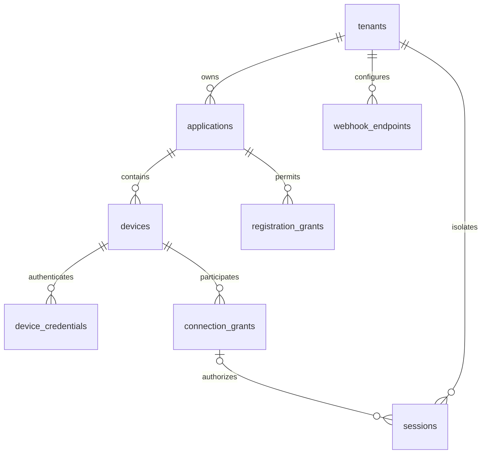

# Peerloom 接口与数据契约

本文定义待实现的 REST、WSS、持久数据和原生 SDK 边界。完整 API/WSS/ABI 仍是**目标设计**；当前实际子集在文末及机器可读 OpenAPI 标明，未列为实际的能力不得视为已实现。M0 至 M5 必须把这些规则落实为机器可校验 schema、迁移和契约测试。

## 通用约定

- HTTPS API 前缀为 `/v1`，JSON 使用 UTF-8，时间使用 RFC3339 UTC，资源 ID 使用 UUID，请求追踪标识为不透明字符串。
- 列表使用 `limit`、不透明 `cursor`；过滤字段需白名单校验。
- 租户身份来自已验证凭证，不能信任请求体、查询串或任意 Header 自报的 `tenant_id`。
- 管理 API 使用租户服务端凭证，设备 API 使用专属设备凭证，严格区分 audience。
- 变更操作支持 `Idempotency-Key`；作用域包括身份、租户、路由与请求摘要，相同键不同请求返回冲突。
- 跨租户资源查询隐藏存在性，通常返回 404；内部保留真正拒绝原因用于审计。
- 文本展示默认中文并预留英文；程序判断稳定 `code`，不解析本地化 `detail`。

错误响应使用 `application/problem+json`：

```json
{"type":"about:blank","title":"连接未获授权","status":403,"code":"GRANT_REQUIRED","detail":"需要有效的方向性连接授权","request_id":"请求标识"}
```

| HTTP 状态 | 使用场景 |
|---|---|
| 401 | 未认证、凭证无效或过期 |
| 403 | 已认证但无权限 |
| 404 | 资源不存在，或为隔离而隐藏存在性 |
| 409 | 状态冲突、幂等键请求摘要不一致 |
| 422 | 字段、平台枚举或数据范围无效 |
| 429 | 速率、配额或并发限制 |
| 503 | 依赖不可用，不能安全完成请求 |

## 管理 API 清单

| 方法与路径 | 目标语义 |
|---|---|
| `POST /v1/applications` | 创建本租户应用 |
| `GET /v1/applications` | 分页列出本租户应用 |
| `PATCH /v1/applications/{id}` | 修改启用状态、注册模式、目标确认和限制 |
| `POST /v1/registration-grants` | 签发一次性短期注册 grant，返回 secret 与到期时间 |
| `GET /v1/devices` | 按应用、在线和标签查询；在线状态来自租约 |
| `GET /v1/devices/{id}` | 查询设备身份与管理属性 |
| `PATCH /v1/devices/{id}` | 修改名称、标签、connectable 与限额 |
| `POST /v1/devices/{id}/revoke` | 撤销设备凭证并终止相关授权会话 |
| `POST /v1/connection-grants` | 创建方向性连接授权 |
| `DELETE /v1/connection-grants/{id}` | 显式撤销，幂等记录 revoked 状态 |
| `GET /v1/sessions` | 分页查询本租户会话 |
| `GET /v1/sessions/{id}` | 查询状态、路径和关闭原因 |
| `POST /v1/sessions/{id}/terminate` | 幂等终止并释放并发占位 |
| `GET /v1/relay-nodes` | 查询当前身份获准使用的节点信息 |
| `POST /v1/relay-nodes` | 按运营或租户权限创建节点，不允许越权绑定 secret |
| `POST /v1/webhook-endpoints` | 创建受出口安全策略约束的事件端点 |
| `GET /v1/audit-events` | 按权限查询审计，不把平台级事件暴露给租户 |

连接 grant 输入至少包含：

```json
{"source_device_id":"源设备 UUID","target_device_id":"目标设备 UUID","expires_at":"2026-11-01T00:00:00Z","expiry_action":"terminate","max_sessions":1}
```

`max_sessions` 为正整数，grant 有方向；源和目标必须不同且属于调用方租户。`expiry_action` 仅允许 `terminate` 或 `no_new_connections`。创建 grant 不绕过目标拒绝和应用限制。

Webhook 在启用投递前必须规定签名、时间戳、事件 ID、重试窗口和消费者去重规则。URL 需执行协议、域名/IP、DNS 重绑定与重定向校验；默认阻止访问元数据服务、环回和未获准内网。私有化部署的内网目的地只能经运营者显式允许。`secret_ref` 必须经过所有权检查，不能把任意引用当成读取平台 secret 的能力。

## 设备 API 与注册

| 方法与路径 | 输入和输出 |
|---|---|
| `POST /v1/device-registrations` | 应用、平台、安装公钥、可选注册 grant 与 metadata；返回设备 ID、设备凭证及引导信息 |
| `POST /v1/device-credentials/refresh` | 以有效设备身份轮换凭证，保留受限重叠窗口 |
| `GET /v1/bootstrap` | 公共端点、协议版本和能力，不返回租户秘密 |
| `GET /v1/device-self` | 当前设备身份、应用与有效策略摘要 |

```json
{
  "application_id":"应用 UUID",
  "platform":"android",
  "installation_public_key":"受支持格式的公钥",
  "registration_grant":"仅 grant 注册模式需要的秘密",
  "sdk_version":"待发布版本",
  "metadata":{"display_name":"测试设备"}
}
```

`platform` **必填**，取值为 `windows|macos|linux|android|ios|web`，与数据库非空枚举一致。公钥格式、长度和算法必须校验；metadata/tags 的字节数、深度、允许类型和键长度在 schema 固定上限，超限返回 422。

```json
{"device_id":"设备 UUID","device_credential":"仅安全通道返回的秘密","expires_at":"2026-11-01T00:00:00Z","signaling_url":"wss://服务域名/v1/device-signal","ice_servers":[]}
```

公开安装公钥不是持有证明；没有有效凭证或完整挑战证明时，不得查询、领取或恢复原设备凭证。直接重复提交公钥不能接管既有设备。

### 原子性与秘密结果重试

注册必须在同一数据库事务内校验并消费注册 grant、创建设备、写入凭证哈希及持久幂等收据；并发相同请求只产生一个设备，重复消费不同请求必须失败。

选定的设计方向是限时加密重放结果：幂等收据记录请求摘要和结果状态，含凭证的响应采用受控 secret 密钥加密并设置有限过期时间，仅在相同身份/注册授权上下文与键匹配时重放。密文、保留期限、密钥轮换和删除流程须测试；日志不得包含重放响应。

密文过期后不得通过安装公钥恢复秘密，也不能重新消费已用 grant。已有有效设备凭证可走正常轮换；没有可用凭证时，通过客户业务系统重新授权注册新身份，并显式处理旧身份。这一恢复分支必须被客户端识别，不能无限重试一次性 secret。

凭证轮换同样需要持久幂等与结果恢复设计。Redis 可缓存幂等响应但不是唯一权威；重启和 Redis 清空不得破坏上述保证。当前未实现这些机制。

## WSS 信令

端点为 `wss://服务域名/v1/device-signal`。原生客户端通过 `Authorization` Header 认证，禁止在 URL 查询串携带长期 token。未来浏览器使用短期票据，不能直接沿用不安全的 URL 方案。

```json
{
  "v":1,
  "type":"session.offer",
  "id":"消息 UUID",
  "request_id":"请求 UUID",
  "session_id":"会话 UUID",
  "connection_generation":3,
  "fencing_token":"服务端分配的不透明令牌",
  "negotiation_generation":1,
  "seq":42,
  "sent_at":"2026-10-28T01:00:00Z",
  "payload":{}
}
```

`hello` 尚未取得连接代次时不携带 generation/fencing，服务端 `hello.ack` 分配；后续消息必须匹配当前连接。`seq` 仅在同一连接 generation 内单调，不是永久全局顺序。

当前 `negotiation_generation` 固定 1，仅支持完整 ICE SDP：source 一次 offer，target 在 offer 后一次 answer。trickle/ICE restart 与多代次恢复未实现；非协商消息省略代次。

| 类别 | 消息 |
|---|---|
| 握手与在线 | `hello`、`hello.ack`、`presence.heartbeat`、`presence.ack` |
| 连接授权 | `session.request`、`session.pending`、`session.accept`、`session.reject` |
| 协商与路径 | `session.offer`、`session.answer`（不接收 trickle 候选） |
| 状态 | `session.connected`、`session.updated`、`session.terminate`、`session.terminated` |
| 同步与错误 | `sync.request`、`sync.snapshot`、`error` |
| 授权租约 | `session.renew` 逐端续租；`session.updated` 返回权威期限和代次 |

仅对获授权且处于允许状态的会话双方转发 SDP/ICE；消息的 session/device/tenant 均由服务端比对。限制信封大小、候选尺寸与数量、频率、队列和去重窗口。重复消息不能重复占用配额或推进状态。

新 WSS 连接替换旧连接后，旧 fencing token 无权更新 presence 或转发信令。客户端重连请求快照并重新验证权限，不假定离线消息全部补发。

错误码至少包括 `AUTH_INVALID`、`DEVICE_REVOKED`、`TENANT_FORBIDDEN`、`TARGET_OFFLINE`、`TARGET_NOT_CONNECTABLE`、`GRANT_REQUIRED`、`GRANT_EXPIRED`、`TARGET_REJECTED`、`CONCURRENCY_LIMIT`、`RELAY_UNAVAILABLE`、`PROTOCOL_UNSUPPORTED`。

### 授权租约边界

会话租约应绑定租户、会话、双方设备、授权依据及版本、有效期与租约代次，并可验证服务端来源。续租必须重新核验显式撤销、设备/应用状态和会话终态；旧租约不能无限重放或延长有效期。

SDK 以单调计时器执行有限期限；不得因进程休眠、WSS 重连或系统时钟回拨延长期限。信令断开但租约仍有效时，可保留健康的数据连接；无法续租则到期停止发送并关闭通道。

在线撤销通知尽快触达，失联撤销受已签发租约上界约束；服务端默认双端 60 秒租约、30 秒确认窗口；SDK 单调计时器与时钟裕量仍待端到端验收。此机制约束合规 SDK，不保证强制关闭串通端点的私有连接。

## 数据模型与必须修正的约束



ER 图省略部分字段；下面的完整性规则优先，不能只用图里的单列关系实现。

| 表 | 权威数据与限制 |
|---|---|
| `tenants` | `active|suspended`；停用影响认证与新授权 |
| `applications` | 租户、注册模式、启用状态、目标确认、并发限制 |
| `devices` | 租户/应用复合归属、平台、公钥哈希、connectable、active/revoked |
| `device_credentials` | 设备/租户、凭证哈希、有效期与撤销时间 |
| `registration_grants` | 租户/应用复合归属、secret 哈希、到期与消费时间 |
| `connection_grants` | 同租户的不同源/目标、方向、到期动作、并发与撤销 |
| `sessions` | 同租户不同源/目标、授权依据、状态、路径、关闭原因 |
| `relay_nodes` | 租户节点或运营者共享节点；secret 仅保存引用 |
| `webhook_endpoints` | 租户端点与签名 secret 引用 |
| `audit_events` | 行为、主体、资源、脱敏细节和时间 |
| 待新增幂等收据 | 注册/轮换的持久请求摘要、结果状态、限时加密结果 |

输入 DDL 是草案，迁移实现必须包含以下补强：

1. `devices(application_id, tenant_id)` 引用 `applications(id, tenant_id)`。
2. `device_credentials` 显式增加 `tenant_id`，通过 `(device_id, tenant_id)` 引用设备；所有凭证查询也保持租户约束。
3. grant 的源、目标分别与设备建立租户复合外键，且 `source_device_id <> target_device_id`。
4. grant 增加唯一键 `(id, tenant_id, source_device_id, target_device_id)`；session 的 `(grant_id, tenant_id, source_device_id, target_device_id)` 整体引用此键，避免授权错租户、错目标或反向使用。
5. session 自身也约束源目标不同，并分别与设备建立租户复合外键。
6. grant 授权会话要求 `grant_id IS NOT NULL`；未来策略授权才可为空，且必须记录非空策略标识、版本和授权依据，使用 CHECK 排除无依据会话。首期不启用策略分支。
7. `tenant_id=NULL` 的 relay/audit 是运营者资源，不是租户通配；服务层另做可见性与修改权校验。
8. 实时 online 由 Redis 认证租约计算，SQL `last_seen_at` 只作历史提示。

数据库约束不能验证 grant 当前是否过期、撤销或有剩余配额；这些必须在事务内完成，并发测试不能只验证外键成功。

迁移版本化 up/down，记录版本与校验和并串行加锁执行。避免回滚误删其他系统共享的扩展；应用迁移不得无条件 `DROP EXTENSION pgcrypto`。生产降级先评估数据损失，优先扩展后收缩。

## Rust API 与配置

目标调用链为 `builder → start → connect → open_channel → send → shutdown`。异步方法可取消，状态与分类错误通过事件流提供；注册确认和会话终态不依赖阻塞调用。

应用身份和可用的 bootstrap 是初始化前提。服务器地址、注册凭证提供者、存储适配器、心跳、超时、重连、路径、通道、缓存、E2EE 与日志采用可配置默认值；grant 模式所需秘密由提供者取得，不要求业务硬编码。

建议心跳 20 秒、离线阈值 60 秒，自动重连采用 1 至 30 秒指数退避加抖动；这些尚未压测，不是可靠性承诺。动态路径优化和应用层 E2EE 默认关闭，WebRTC DTLS 不可关闭。

通道类型为 `reliable_message`、`reliable_stream`、`low_latency_message`。流接口必须定义背压和关闭语义，不能把 DataChannel 消息边界误称为字节流。`reliable_stream` 禁止 `drop_oldest` 和 `drop_newest`；队列满应背压或明确失败，TTL 到期须使对应写入失败并按协议关闭或重置流，不得静默移除字节后继续伪装完整流。发送完成表示 SDK 约定的本地发送阶段完成，不表示业务已消费。

## C ABI 与生命周期

当前已实现 Linux 原生 C ABI 的单连接、单可靠消息通道子集。唯一规范声明为 [`src/device-sdk/device-ffi/include/device_sdk.h`](../src/device-sdk/device-ffi/include/device_sdk.h)，调用方式、容量、线程、测试与不支持项见 [C 语言接口模块](C语言接口模块.md)。原输入指针式头文件不是实现依据，不再在本文维护第二份示意声明。

- SDK/connection/request 使用不可复用整数句柄并验证归属，不暴露内部地址或可绕过租约的 transport。
- `submit` 支持 start（load/register）、connect、respond、send、refresh、close；所有接受的普通操作有 request ID 与恰好一次 COMPLETE。未知操作立即 `UNSUPPORTED`，不伪造 open-channel、stream 或 reset 实现。
- 立即失败输出 ID 为零，不产生完成事件；每个受理操作预留终态信用，慢 callback 不会使终态无限排队。
- queued 操作可取消；运行中的变更与已接受的 close 返回 Busy，不声称回滚远端注册/轮换。响应丢失保留 OutcomeUnknown 的语义。
- 输入限长并立即复制；事件 payload 只在串行专用 callback 内借用。没有 owned-byte 返回接口，因此不导出无用途释放函数。
- callback 不持内部锁，可重入非阻塞 API，不能阻塞等待自身。callback 内 release 返回 Busy，不会自 join。
- shutdown 停止受理，结算已有操作并关闭资源；最后 SHUTDOWN callback 返回、拥有线程退出后才允许 release/卸载库。若宿主 callback 不返回，不能强杀或承诺固定时限安全释放。
- 外部存储通过异步 load/saveCAS/deleteCAS 请求与 completion 注入；默认没有明文文件后备。保存超时或取消可能已完整提交，不能据此回滚新凭证。
- FFI 仅在审核边界允许 unsafe、捕获可恢复 Rust unwind；这不保护 abort、任意外部悬空指针、C 异常或未定义行为。core 仍禁止 unsafe。
- ABI 主版本、配置版本、事件结构尺寸与 capability 明确；Android/iOS 等未实际验收平台不得据 Linux 结果宣称可用。

## 契约落地门槛

M0 产出 OpenAPI、信令 schema 和迁移基础；M1 固定注册/幂等；M2 固定 generation；M3 固定授权租约及并发；M5 固定 ABI。每次变更同步版本、负面测试与兼容说明，未定项不得被示例代码静默决定。

## 当前机器可读范围

`api/openapi.json` 记录基础端点和三个真实身份 API：grant 注册、self 查询、凭证轮换。`api/device-registration.schema.json` 与 HTTP 输入验证对齐；`api/signal-envelope.schema.json` 仍未接入 WSS 运行时。

当前只支持一次性 grant，metadata 至多 32 个标量字段、键 64 字符、字符串 1024 字符，禁止嵌套和 NUL，数字限有限 double 范围；入口限制原始请求体 16 KiB。`installation_public_key` 暂为长度 1–4096 的不透明安装标签并仅存哈希，不保证算法/格式验证，也绝不用于认证或公钥恢复。

注册响应仅返回 device_id、device_credential、expires_at，不伪造未实现的 signaling_url/ICE 配置。幂等重放保留身份与 token，expires_at 反映数据库当前有效期（可能因轮换缩短）；上层仍须处理 401。

初始 SQL 允许 requested/authorizing/closed 审计记录暂无 grant，但 connecting/connected/reconnecting 必须有绑定方向和租户的 grant；策略授权分支尚未启用。
