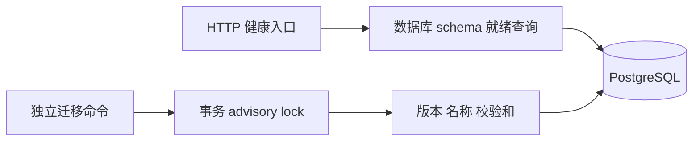

# 控制面基础模块

本模块是 M0 已实现的 Go 服务与迁移入口，身份服务见[设备身份模块](设备身份模块.md)。Go 1.27.3，唯一运行时外部数据库依赖为 pgx/v5；准确版本见 go.mod/go.sum。

`cmd/device-server` 负责配置、日志、信号和有界退出；`internal/httpserver` 不持有 SQL，接收可替换 readiness 检查。`internal/database` 限制池上限和连接超时，不记录数据库 URL。`internal/migrate` 读取连续版本 up/down 文件，用同一事务串行检查历史并执行变更。

- GET `/healthz` 只说明进程活着。
- GET `/readyz` 检查数据库迁移版本等于当前代码版本；同时检查 Redis；返回 `scope=control_plane_dependencies`，不承诺 TURN 或五端 SDK 就绪。
- GET `/metrics` 为内部 HTTP 请求计数，不通过开发网关公开。
- 业务路径交给身份 API 处理器；目前没有管理或信令 API。

迁移校验和覆盖 up 和 down 内容。历史不匹配、版本不连续和缺失回滚文件都拒绝执行；事务取消显式 rollback，提交结果不确定时提示先检查数据库，不盲目重试。回滚只撤销最后一个版本，不删除共享 pgcrypto 扩展。

数据库第二道隔离防线包含应用/设备/凭证 tenant 复合外键，以及会话与 grant 的租户、源、目标四列约束。连接状态不能没有 grant。数据库不能代替过期/撤销检查和并发占位事务，这些留给 M3。

验证入口为 `make check` 和 CI 的 `go test -tags=integration -race ./...`。集成测试要求显式 `TEST_DATABASE_URL`，无数据库时失败而非偷偷跳过；测试建立随机 schema 并在结束时清理。单用户 SQL 测试仅验证 DDL，不算并发事务证明。
