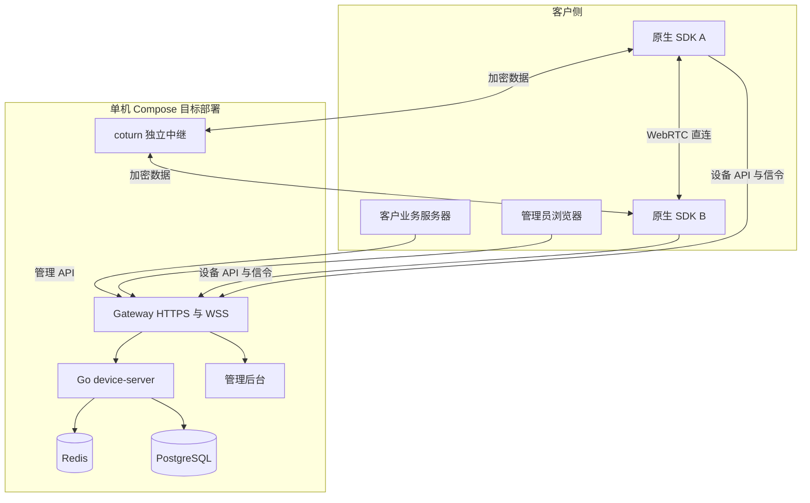
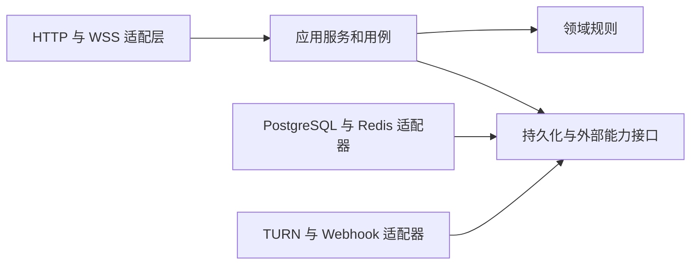
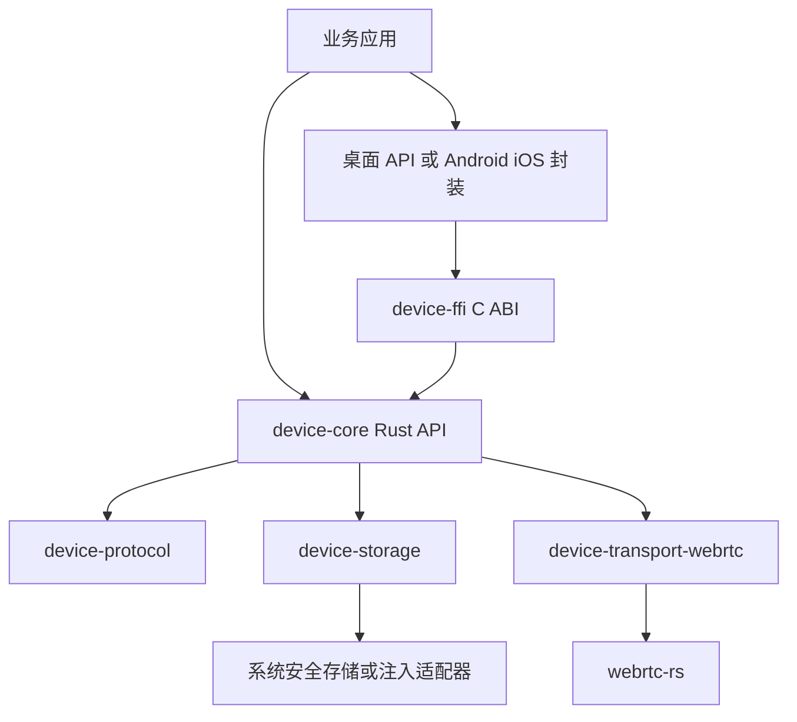
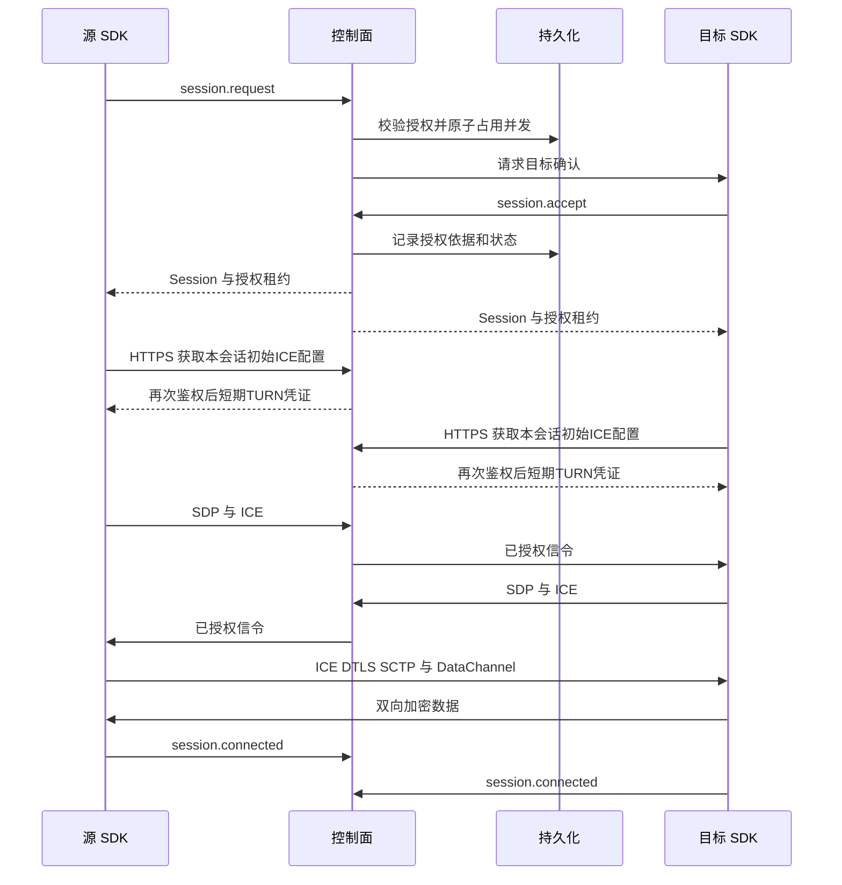
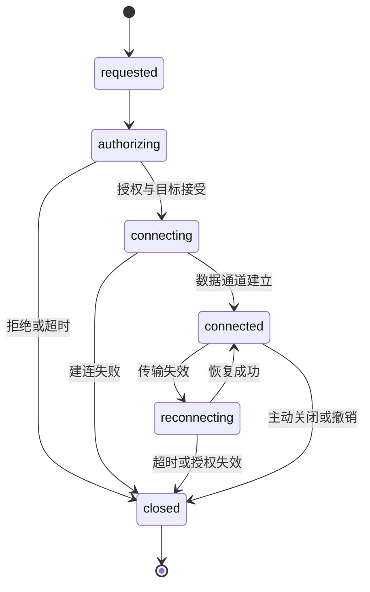

# Peerloom 整体架构

本文说明控制面、原生 SDK、数据平面与运维组件的目标结构。设计强调租户隔离、可验证的授权和模块边界，避免在单机首版引入不必要的微服务复杂度。

**状态：目标架构与已实现子集并列说明。** 当前代码覆盖 grant 身份 API、单节点 WSS/Redis fencing、PostgreSQL 授权与双端租约、Rust 身份信令和原生直连/强制中继；真实授权通信链已跑通。管理平台、自动恢复、可靠流、平台安全存储、C ABI 和五端封装仍是目标，不代表已实现。接口细节以[接口与数据契约](接口与数据契约.md)为准。

## 总体拓扑



HTTPS/WSS 负责身份、授权、发现和协商；WebRTC DataChannel 承载业务数据。Go 服务不转发业务 DataChannel 数据。TURN 位于独立数据平面，不应与 WSS 反向代理的网络要求混为一谈。

## 模块与依赖原则

Go 采用模块化单体。一个模块拥有自己的业务规则和表访问，其他模块通过内部接口调用；不允许跨模块随意更新表。共享基础设施只提供数据库事务、时钟、日志、配置和监控等能力，不承载隐式业务授权。



领域逻辑不依赖 HTTP 结构、数据库客户端或 WebSocket 对象。事务边界由用例协调，必要的跨模块原子操作通过明确事务接口完成，而不是绕开拥有者直接写表。

## 控制面模块架构

| 模块 | 拥有的职责 | 主要依赖 |
|---|---|---|
| `auth` | 凭证校验、audience、认证上下文、撤销检查 | 凭证仓储、租户状态 |
| `tenant` | 租户状态与资源边界 | 持久化 |
| `application` | 应用配置、注册模式、默认限制 | tenant |
| `registration` | 原子注册、一次性 grant、幂等结果 | application、device、事务 |
| `device` | 安装身份、凭证轮换、connectable、撤销 | auth、持久化 |
| `presence` | 认证心跳租约、在线判定 | Redis、auth |
| `policy` | 授权决策接口、默认拒绝 | 设备和应用只读接口 |
| `grant` | 方向性许可、到期、撤销和配额 | device、事务 |
| `session` | 状态机、授权租约、并发占位和释放 | policy、grant、presence |
| `signaling` | WSS generation、路由、信封验证 | auth、session、presence |
| `relay` | 中继选择、短期 TURN 凭证 | 节点仓储、secret provider |
| `webhook` | 签名事件投递、重试与安全校验 | 持久事件、HTTP 出口 |
| `audit` | 安全与管理操作审计 | 持久化、脱敏 |
| `metrics` | 指标、健康检查和可观测性 | 各模块受控埋点 |

首期 `policy` 只定义可测试的授权接口，M3 默认使用有效 grant；策略存储模型未完成前不宣称支持可配置预设策略。未来策略会话需记录策略 ID、版本和决策依据。

`webhook` 已实现审计事务 outbox、租户端点管理、HMAC-SHA256 签名、有界重试与端点 revision 校验。出站仅使用运维批准的租户/URL/秘密引用及固定公网 IP，保留 HTTPS 主机名验证，拒绝代理和重定向；未配置批准注册表时不能投递。事件格式、去重和容量契约见[Webhook 通知模块](Webhook通知模块.md)。发送成功但事务提交前崩溃仍可能重投，不承诺恰好一次送达；公网部署与接收器去重须另行验收。

## SDK 模块架构



| Rust 模块 | 职责 | 不负责 |
|---|---|---|
| `device-core` | SDK 生命周期、注册、会话、重连、事件和取消 | 平台 UI、视频业务 |
| `device-transport-webrtc` | PeerConnection、ICE、DTLS、SCTP、DataChannel | 业务授权决策 |
| `device-protocol` | REST/WSS 类型、版本、错误码和校验 | 网络连接与存储 |
| `device-storage` | 身份 load/save/delete、原子更新 | 自动信任任意恢复数据 |
| `device-ffi` | opaque handle、ABI、回调、内存与 panic 边界 | 在回调线程执行业务重任务 |
| `examples` | 注册、授权连接、收发与关闭演示 | 生产业务协议 |

Android 使用 Kotlin 和 JNI，隐藏裸指针并映射到平台异步 API；iOS 使用 Swift 与 XCFramework，映射到 Swift 并发模型。Windows、macOS、Linux 使用 Rust API 或 C ABI。

本地存储适配器不阻塞网络线程。UI 耗时操作必须移交适当执行器；预计超过 16ms 的工作不得在 UI 线程执行。回调与 shutdown 的线程及重入规则在 ABI 契约中明确。

## 目标目录结构

```text
peerloom/
├── AGENTS.md
├── README.md
├── docs/                     中文架构与使用文档
├── src/
│   ├── device-server/        Go 模块化控制面
│   ├── device-sdk/                  Rust workspace
│   └── admin-web/            独立管理前端
├── bindings/
│   ├── android/              Kotlin 与 JNI
│   └── ios/                  Swift 与 XCFramework
├── examples/                 五端最小示例
├── api/                      OpenAPI 与信令 schema
├── infra/                    Compose 网关 中继与监控配置
├── infra/migrations/               版本化数据库迁移
├── scripts/                  开发 检查 打包与恢复脚本
└── .github/workflows/         编译 测试与发布
```

这不是当前文件清单。M0 落地时可以调整不影响边界的路径，但必须同步 README、脚本和文档。Go、Rust、Android 与 Swift 的包内测试遵循各自生态习惯，不机械复制其他语言的测试布局。

## 身份与权限边界

服务端凭证仅由客户业务服务器或授权管理员使用。SDK 只持有自己的设备凭证；设备 API 不接受管理 audience 替代设备身份，管理 API 也不能仅因设备认证成功而授权。

租户上下文来自已验证身份，不信任请求体中的 `tenant_id`。所有资源访问都采用租户约束，跨租户资源可返回隐藏存在性的 404，但内部审计保留拒绝原因。

数据库复合外键是隔离的第二道防线，不替代服务层校验。凭证、grant、session 等子表也必须显式绑定租户，不能只依赖全局 UUID“不容易猜”。

共享中继节点和平台级审计可使用 `tenant_id=NULL`，其含义是运营者所有，不是所有租户的通配权限；租户 API 不得越权配置或查询运营资源。

## 会话建立与授权租约



客户端报告不是不可伪造的网络事实。服务端记录双方状态和证据，不因单方报告就绕过权限或关闭配额校验。

会话授权租约与 presence 在线租约不同。前者约束数据连接继续存活的权限，后者用于在线发现。SDK 按短期授权有效期续租，拒绝续租或无法续租时有界关闭；本地采用单调时间避免系统时钟回拨延长许可。

租约具体格式、期限、续租接口和时钟误差策略是 M3 的必交付契约。`no_new_connections` 的存量会话可以在原 grant 到期后按原决策续租，但显式撤销、租户停用或设备撤销应拒绝续租。

## 状态与信令分离



`path=direct|relay|unknown` 是独立属性，不等同于会话状态。WSS 断开不必立即关闭健康的 WebRTC 数据连接，但不能无限延长授权租约。

WSS 重连生成新的服务端连接 generation 与 fencing token，旧连接不再有权写在线状态或转发消息。SDP/ICE 协商另有 negotiation generation，避免 ICE restart 的旧候选污染新协商。

双方同时 offer 时由服务端指定 polite/impolite 角色。重连通过同步快照重建当前状态，WSS 不充当离线业务消息队列。

## 持久化与一致性

PostgreSQL 保存租户、应用、设备、凭证哈希、注册 grant、连接 grant、会话、节点配置、Webhook 配置和审计。还需要注册/轮换幂等收据与后续可靠事件投递记录，不能仅照抄输入 DDL 即称数据模型完整。

Redis 保存可重建的在线租约、路由和临时缓存。故障后设备重新认证建立 presence；未恢复租约的设备按离线处理。单机内存不得成为租户权限、授权消费或并发配额的唯一权威。

注册事务必须原子消费 grant、创建设备、记录凭证哈希并保存幂等收据。包含新凭证的重试响应只允许加密、限时保存，密钥来自独立 secret 管理；不能为了重试把明文凭证永久存库。

会话并发限制采用数据库事务或可证明等效的原子协调，按一致锁顺序处理源、目标、应用及 grant，终态释放幂等。超时清理和重启对账需要覆盖占位泄漏及重复关闭。

## 故障边界与可观测性

| 故障 | 安全行为 | 恢复要求 |
|---|---|---|
| 控制面重启 | 不依赖旧内存授权；禁止未认证续租 | 重新认证、fencing、会话快照和配额对账 |
| Redis 不可用 | 不把未知在线状态当在线 | 重建租约与路由，不重复消费注册 grant |
| PostgreSQL 不可用 | 拒绝需要持久授权的新操作 | 恢复后检查幂等、凭证和会话一致性 |
| TURN 不可用 | relay_only 明确失败 | auto 可用直连，但不得绕过策略 |
| WSS 断开 | WebRTC 可短暂继续，受授权租约约束 | 有抖动重连、权限重验、同步快照 |
| 设备撤销 | 拒绝新操作并通知在线端 | 合规失联 SDK 最迟租约到期关闭 |
| SDK 退出 | 停止新任务并有界取消现有任务 | 不悬挂 UI，不无限等待后台线程 |

指标覆盖注册、认证、连接成功/失败、授权拒绝、在线租约、路径、队列水位、续租失败和中继用量。日志关联 request/session/device ID，隐藏凭证和业务内容；指标标签避免设备 ID 等高基数维度。

## 安全传输与业务加密

WebRTC DTLS 是强制传输安全，TURN 中继不因此成为业务明文终点。额外应用 E2EE 默认关闭，不表示“传输不加密”。开启应用 E2EE 前需规定密钥来源、轮换、身份绑定、重放保护和对端验证。

P2P 端点绕过 SDK 时，控制面不能从网络外部强行切断其既有连接。授权租约约束合规实现，不是对恶意端点的物理控制保证。

## 演进规则

先交付模块化单体和单机 Compose，再由真实指标决定是否拆分。未来集群需要跨实例路由、fencing、原子配额与故障接管，不能只增加副本数。

每个模块落地时补齐实际模块架构、配置和测试说明，更新本文对应章节；不建立日期流水文档，也不保留与实现冲突的旧路径。
