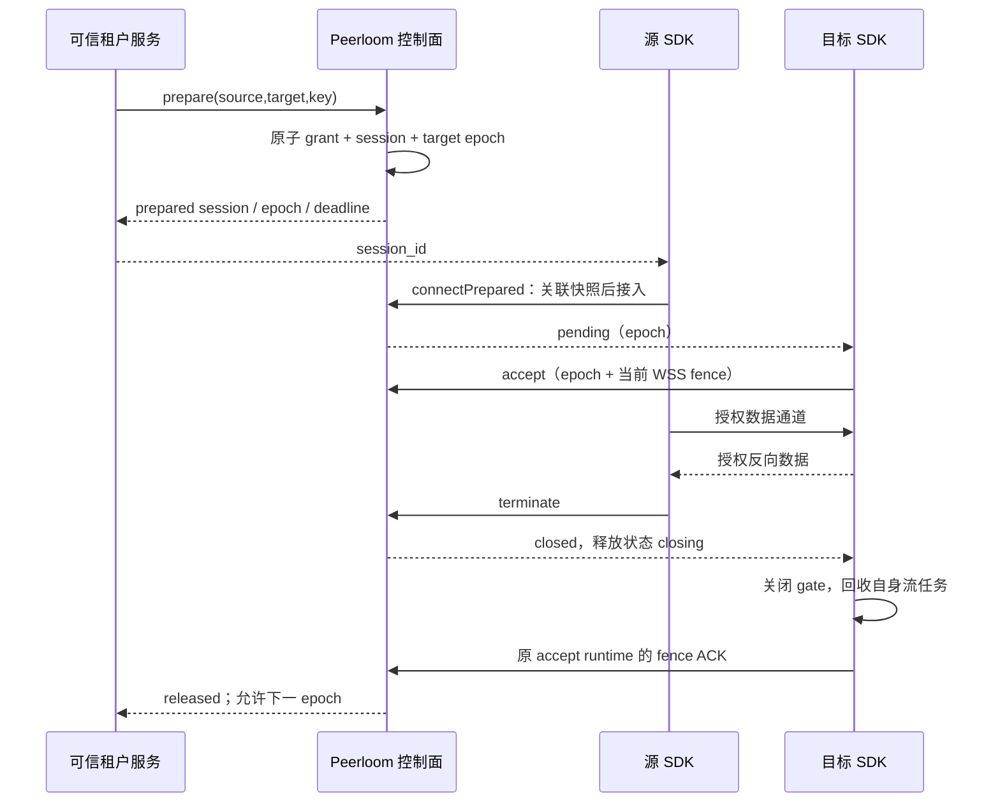

# 独占会话模块

## 边界

独占是同租户内**一个目标设备当前只授予一个源设备会话**的通用能力，不包含 PC/mobile 角色、业务账号或脚本生命周期。不同应用的设备可以互连，仍受双方应用、设备状态和方向授权约束。应用 `exclusive_target` 默认 `false`，原非独占客户端和连接方式不变。

Redis 在线状态只用于可达性观察；独占所有权、递增 epoch 和已签发截止高水位由 PostgreSQL 事务决定。`online=true`、`state=closed`、源端关闭成功都不能单独证明目标可交接。

## 准备与接入

1. 管理接口创建或更新目标所属应用，设置 `exclusive_target=true`。启用前若仍有可能有效的旧非独占会话，操作拒绝，不能让不支持 epoch 的旧 SDK 被静默升级为独占。
2. 可信服务使用该租户 `admin` 服务凭证调用 `POST /v1/exclusive-sessions/prepare`，携带 `Idempotency-Key`（8–128 可打印 ASCII 字符）。请求仅含 `source_device_id`、`target_device_id`、`expires_in_seconds`（1–2592000）。凭证不得下发给设备 SDK。
3. 一次事务创建方向 grant、原始 session 和目标所有权。源 SDK 调用 `connect_prepared(session_id)`；C ABI 为 `CONNECT_PREPARED=9`，Kotlin/Swift 为 `connectPrepared`。完成仅表示已提交接入，不是连接 Ready。
4. SDK 先取得与请求关联的权威快照，验证自己是源端、协议版本、epoch 和截止，再接入同一 session。目标显式接受后才允许 SDP 和数据。普通 CONNECT 不能绕过独占准备。

重复相同 principal/key/请求返回原 session 的**当前状态或终态**，不重建授权；异参返回 409。非秘密幂等摘要和原 session 关联暂无自动回收，不能靠复用旧 key 重新取得目标。建立窗口最长 30 秒，重试不延长；grant 到期更早时取更早截止。

## 状态与 epoch

独占响应包含 `exclusive_target=true`、`exclusive_protocol_version=1`、`target_epoch`、`prepared`、`connect_deadline`、`exclusive_release_state`、`release_not_before`、`fence_required`、`target_fenced`。新增时间字段为 RFC3339 UTC；原双端租约字段继续接受 RFC3339 显式时区偏移；epoch 为无前导零十进制**字符串**，范围 1–9223372036854775807。到达上限失败关闭，绝不回绕或复用；它与租约/协商 generation 不同。

| 字段/状态 | 含义 |
|---|---|
| `prepared=true`, `state=authorizing` | 保留目标，尚未允许目标开始协商 |
| `prepared=false` | 源已提交接入；不等于目标已接受或连接 Ready |
| `exclusive_release_state=held` | 会话仍持有独占资源 |
| `state=closed`, release=`closing` | 权限已关闭，但可能仍有已签发授权的旧运行时，暂不交接 |
| release=`released` | 原目标运行时确认关闭，或全部已签发截止高水位加 2 秒已过去 |

所有独占变更信令必须带匹配 epoch；初次只读 sync 可以省略但不能授予权限。未知版本、缺失 epoch、过期准备和旧代变更失败关闭。管理 GET/terminate 提供权威状态；业务只展示，不另建独占锁，也不自行从 closing 推进 released。

## 安全释放与持续时钟

每次可能扩展双端租约的事务，先持久化最大发行截止，再向客户端发送授权。独占租约最多 60 秒；关闭、撤销和旧响应都不能降低高水位。即使应用被改回非独占，尚未安全释放的目标占用也不能绕过。

目标首次 accept 绑定当前已认证 WSS fence 的摘要。只有同一绑定且仍持有当前 WSS 的目标运行时，完成自身 gate/流/传输任务退出后才可发送 ACK；源不能代为确认。换 runtime/fence、未知会话、任务强制 abort 或无法证明回收时，不提前确认，等待截止高水位加 2 秒。旧 epoch 的 ACK 不能释放新 owner。

SDK 使用包含系统休眠的单调时钟：Linux/Android `CLOCK_BOOTTIME`、Apple `mach_continuous_time`、Windows `QueryInterruptTime`。权限判断不依赖墙钟或定时器准时唤醒；时钟读取失败、倒退或溢出锁存失败关闭，不自动重新授予权限。原队列、字节预算和帧校验保留。

ACK 不宣称撤回已交付给宿主的数据，也不等待任意业务回调或终止已经启动的脚本。新命令必须由宿主在最终执行前复验当前 epoch/有效性，并与实际执行线性化；业务脚本的持续运行规则不由 SDK 决定。恢复产生的旧 transport `ConnectionClosed` 与权威会话终态是两个阶段，不得把前者当成释放证明。

## 验证与不包含的能力

本模块以三真实 SDK、真实 Go/PostgreSQL/Redis 的双源竞争、双向消息、跨初始租约续租、流关闭与高 epoch 接管验证；它不是 500 台安卓真机或视频压测。平台编译和原生验收以当前提交 CI 为准。公开 presence 增量事件、会话自定义 TURN profile、Android ARM32 不属于此模块；不得通过未知请求字段或静默回退假装支持。
