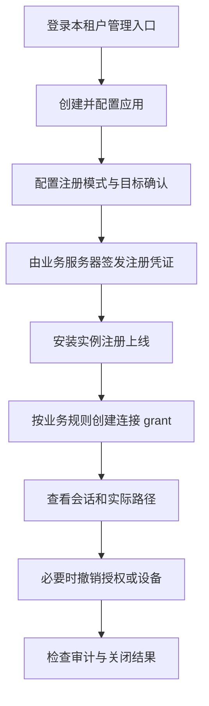
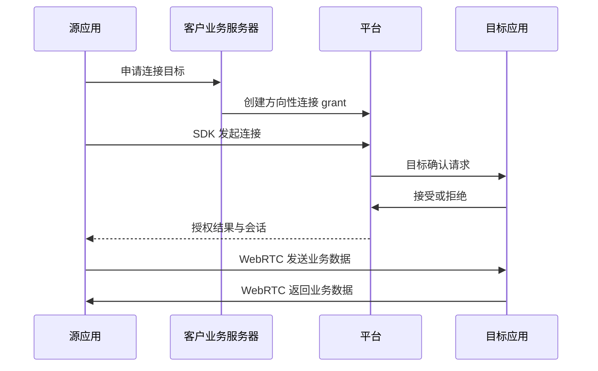

# Peerloom 用户使用说明

本文面向租户管理员、客户业务服务器开发者和 SDK 集成者，解释目标使用流程、权限语义与常见失败。

**当前提供开发阶段服务与 Rust SDK，不是完整原生 Release。** 已实现的入口见下节；后文同时描述目标使用流程，尚未交付的安全存储、五端封装、交互后台和高级通道能力不能视为已可用。开发进度与测试边界见[开发与验收](开发与验收.md)，部署准备见[部署指南](部署指南.md)。

## 当前可用的开发入口

- 本地 Compose 开发环境：按仓库 README 生成秘密、校验配置并启动；默认仅回环 HTTP，不是生产公网入口。
- 管理服务：数据库运维者先运行 `device-admin bootstrap --offline` 显式建立租户并签发 `admin` 或 `read` scoped key，可信后端再调用管理 API。具体命令、密钥 TTL 与权限见[管理服务模块](管理服务模块.md)。没有浏览器登录页面，不应把该服务密钥存入前端。
- 设备接入：业务后端默认创建 grant 应用并签发一次性注册 grant；明确开放的应用也可启用受持久配额保护的 direct 注册（见[设备身份模块](设备身份模块.md)）；Rust `DeviceSdk` 可以注册或从注入存储加载身份、连上 WSS、发起连接、处理目标确认及可靠消息。当前 facade 每实例只有一个连接和一个可靠消息通道，见[SDK 身份与信令模块](SDK身份与信令模块.md)。
- 当前内置身份存储只有显式内存实现，进程退出会丢失；需要持久身份时必须注入满足原子 CAS 的安全存储。平台默认安全存储仍待实现，不能把内存模式当作重启恢复。
- 连接传输支持直连与 TURN 策略；SDK在已接受会话中自动取得平台批准的gen1初始TURN配置，RelayOnly无可用节点明确失败。尚无ICE restart或持续凭据替换，不要把测试TURN夹具当成生产配置。传输层可靠字节流尚未进入 facade。
- `/v1/bootstrap` 只返回实际协议能力，不包含租户秘密；它不证明 TURN 节点已部署，也不替代 readiness。

## 接入前明确什么

- 确定租户和应用：一个租户可以有多个应用，设备属于某个 App 的安装实例。
- 确定服务地址：平台可用于公网托管或私有部署，设备必须能访问 HTTPS/WSS 和需要的中继。
- 确定注册模式：推荐由业务服务器提供短期一次性注册 grant；启用直接注册也要配额和防滥用。
- 确定目标是否需要用户确认，不能用平台授权绕过目标拒绝。
- 确定业务自己的身份、权限和数据协议，平台不代替这些业务规则。

不要把租户服务端凭证打包进桌面或移动 App。`application_id` 可以放入客户端配置，但它不是秘密，也不能独立证明用户有权创建无限设备。

## 管理员操作流程

应用配置包括启用状态、注册模式、默认并发上限和目标确认。关闭应用与撤销设备会影响连接授权，正式行为由契约和测试固定；不能仅隐藏后台按钮而继续发放新授权。

设备列表应显示应用、平台、名称、在线状态与可连接状态。设备在线只代表最近认证心跳有效；`connectable=false` 时不接受新连接。

## SDK 首次启动

1. 提供应用标识和可用的 bootstrap；如使用私有部署则配置对应服务器地址。
2. 使用默认安全存储，或注入具备 `load/save/delete` 和原子更新的存储适配器。
3. grant 模式通过客户业务服务器取得一次性注册凭证，不在应用中嵌入长期管理密钥。
4. SDK 提交必填平台、安装公钥与受限 metadata，完成注册后原子保存设备 ID 和凭证。
5. 建立认证信令连接，开始心跳；READY 事件表示约定启动流程完成，不代表任何目标已授权。

除应用身份和可用引导配置外，服务器、存储、心跳、超时、重连、路径、通道、缓冲、日志与 E2EE 均提供可配置默认值。应用业务代码不应被迫手动管理每一个底层参数。

安装公钥不是认证凭证。注册超时后按同一幂等请求重试；若秘密响应已超过安全重放期限且没有有效设备凭证，需要业务服务器重新授权注册，不能凭公钥领取旧秘密。

## 身份保存与重置

正常重启和升级复用 Device ID。用户主动 reset 或本地身份存储丢失时创建新设备身份，旧授权不会自动转移给新 ID。

平台无法在所有系统上识别卸载重装。Android Keystore、iOS Keychain、桌面凭据库以及系统备份可能有不同保留行为，最终平台包必须说明这些差异。

自定义存储需要防止未授权读取和并发更新损坏；不可把秘密存入日志。复制身份到多个进程或设备会产生凭证共享和连接替换风险，不应作为设备迁移捷径。

## 发起连接

客户业务服务器先判断业务用户是否有权连接目标，再为同租户内源、目标设备创建方向性 grant。即使两个设备属于同一应用，也不默认互信；同租户不同应用可以在合法授权后连接。

不同租户之间始终拒绝连接。反向连接需要对应的反向授权；不能把 A 到 B 的 grant 当作 B 到 A 的许可。自己连接自己也被拒绝。

目标可以配置自动接受，或由 SDK 回调交给业务 UI 决定。回调处理不得阻塞网络线程；拒绝、超时和目标不可连接都应展示为明确结果。

## 选择连接与通道

| 选项 | 适用行为 | 需要注意 |
|---|---|---|
| `auto` | 默认优先直连，TURN 兜底 | 实际路径可变化，不能预估必定直连 |
| `direct_only` | 只允许直接连接 | 网络不支持就失败 |
| `relay_only` | 强制通过中继 | 中继不可用就失败，不退回直连 |
| `reliable_message` | 可靠、有序、保留消息边界 | 默认通道，仍需业务消费确认 |
| `reliable_stream` | 带背压和关闭语义的字节流 | 业务自行解析帧和处理断流 |
| `low_latency_message` | 无序或有限重传消息 | 可能丢包，适合可被新状态覆盖的数据 |

一个会话可以开多个通道，分别设置缓冲和速率。发送队列满时默认返回失败；启用丢旧/丢新策略意味着业务接受相应丢失。TTL 过期消息不应无限滞留。可靠字节流禁止丢旧/丢新；遇到超限或 TTL 过期必须背压、失败或重置，不能静默抽掉字节后继续传输。

SDK 发送完成不等于对方业务处理成功。需要可靠业务交付时，应用应设计消息 ID、确认、去重和恢复协议，不能依赖平台提供 exactly-once。

## 重连与关闭

默认自动重连采用有上限的指数退避与抖动。主动关闭、明确撤销和永久认证失败会停止重连，避免无限消耗资源。

WSS 断开不一定影响已经建立的 WebRTC 数据连接。在仍有效的会话授权租约内，SDK 可以继续收发；续租失败后必须在到期时关闭，不保证控制面不可达时永久通信。

网络切换或 ICE restart 可能需要重建通道。动态路径优化默认关闭，不承诺无损换路；业务要处理重新打开通道和未确认消息。

退出时先 shutdown，等待最后完成通知，再释放 SDK。不得在事件回调里释放 SDK，也不得从 UI 线程同步等待可能耗时的网络关闭。

## 撤销与到期的含义

`terminate` 到期会终止存量会话；`no_new_connections` 到期只阻止新会话。两者都受显式撤销约束。

管理员撤销后，控制面立即拒绝新授权并通知在线 SDK；信令失联时合规 SDK 最迟在现有授权租约到期后关闭。界面需区分“控制面已撤销”“已通知端点”和“端点已确认关闭”。

平台不能强制切断两个串通端点自行维持的 P2P 通信。重要业务操作仍应在业务协议中验证用户和权限，不把连接存在视为永远有效的授权。

## 安全传输与移动平台限制

WebRTC DTLS 始终开启。额外应用层 E2EE 默认关闭；如需启用，集成方必须确定密钥来源、对端验证、轮换和恢复责任，不能自行关闭 DTLS 替代它。

平台不负责移动应用后台保活。Android/iOS 的后台、休眠、网络切换和系统权限限制可能导致离线或重连，业务应尊重系统生命周期，而不是承诺持续常驻。

SDK 不提供屏幕采集、视频编码、输入注入、文件协议或远程命令执行；这些属于上层业务的独立设计和授权范围。

## 常见失败与排查

| 错误或现象 | 检查方向 |
|---|---|
| `AUTH_INVALID` | 设备凭证、有效期、服务器地址和 audience 是否正确 |
| `DEVICE_REVOKED` | 管理员是否撤销；不要无限自动重试 |
| `TENANT_FORBIDDEN` | 两端租户是否不同；跨租户连接不可配置放行 |
| `TARGET_OFFLINE` | 目标进程、心跳、WSS 和系统后台限制 |
| `TARGET_NOT_CONNECTABLE` | 目标是否关闭接入 |
| `GRANT_REQUIRED` / `GRANT_EXPIRED` | grant 是否存在、有效、方向正确 |
| `TARGET_REJECTED` | 目标用户或目标策略拒绝，不能绕过 |
| `CONCURRENCY_LIMIT` | 源/目标/应用/grant 的并发占用 |
| `RELAY_UNAVAILABLE` | TURN 配置、短期凭证、防火墙及网络可达性 |
| 缓冲区满 | 减速、处理背压或明确选择可接受的丢弃策略 |
| 在线但连接失败 | 在线不等于可连接，检查授权、确认和网络路径 |

提交问题时提供 SDK/服务端版本、平台、脱敏 request/session ID、时间和错误码，不提供设备凭证、注册秘密、私钥或完整业务正文。先凭日志和可复现证据定位，不按猜测修改安全配置。

## 交付后的最小验收

集成方应验证两端注册、重启 ID 不变、授权连接、双向消息、目标拒绝、授权撤销、强制中继、断线重连和安全退出。再结合业务协议测试消息去重、重试、前后台与网络切换。

当实现完成后，本文件会加入实际包名、配置项、可运行示例和平台限制。当前示例流程不能替代相应代码与测试证据。
