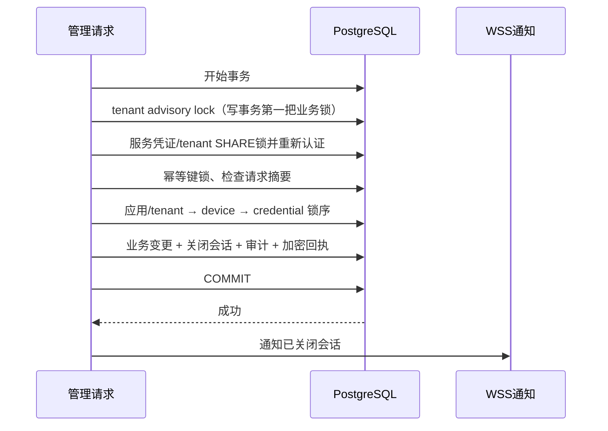

# 管理服务模块

## 范围与身份边界

`src/device-server/internal/management` 提供租户后端管理 API，`cmd/device-admin` 提供显式离线初始化工具，依赖迁移 `000004_tenant_management`。它不是浏览器登录系统：尚未选择交互式 OIDC，也没有本地用户名密码、管理前端或 webhook 管理；relay 节点管理与会话 TURN 凭证见[中继服务模块](中继服务模块.md)。

- 服务凭证为 `svc_` 加 32 字节安全随机数的 Base64URL 表示；数据库只保存 SHA-256 摘要。
- 服务凭证、`dev_` 设备凭证和注册 grant 使用不同表、前缀与授权入口，不可互换。
- `read` 只能查询，`admin` 可以查询和变更；权限属于单个 tenant，跨 tenant 资源返回未找到。
- tenant 来自服务端认证结果，不来自请求体；每个业务事务重新验证当前凭证、到期时间、scope 和租户状态，持有旧 Principal 也不能绕过撤销。
- 服务凭证只交付可信租户后端，不能嵌入网页、移动端包、URL、截图、工单或日志。公网入口必须 HTTPS。


## 离线密钥操作

先完成数据库迁移，并使用 `DATABASE_URL_FILE` 指向受限权限的数据库连接文件；也支持 `DATABASE_URL`，但不应写入命令历史。CLI 必须显式加 `--offline`，数据库操作权本身就是此工具的信任边界，不提供匿名 HTTP 发钥入口。

```sh
# stdout 含一次性秘密，保存到访问受限文件，不要 tee 到日志。
umask 077
device-admin bootstrap --offline --tenant-name '示例租户' \
  --scope admin --ttl 24h --label '后端管理' > tenant-key.json

# 为现有 tenant 发额外的只读服务凭证。
device-admin issue-key --offline --tenant-id "$TENANT_ID" \
  --scope read --ttl 24h --label '审计读取' > reader-key.json

# 撤销指定服务凭证，不输出秘密。
device-admin revoke-key --offline --tenant-id "$TENANT_ID" \
  --credential-id "$SERVICE_CREDENTIAL_ID"
```

`bootstrap` 创建新 tenant，不冒充恢复或接管已有 tenant。密钥 TTL 默认 24 小时，允许 1 分钟至 30 天；scope 必须显式为 `read` 或 `admin`。密钥遗失时通过受控数据库运维通道重新签发并撤销旧凭证，不从摘要恢复秘密。离线发钥和撤销记录真实数据库操作用户的审计。

## HTTP 契约

完整机器契约见 [`api/openapi.json`](../api/openapi.json)。所有路径均要求服务 Bearer；下表查询需要 `read` 或 `admin`，变更需要 `admin` 和 8–128 字符的 ASCII `Idempotency-Key`。

| 路径 | 方法 | 语义 |
|---|---|---|
| `/v1/applications` | GET、POST | 分页查询、创建 grant-only 应用 |
| `/v1/applications/{id}` | GET、PATCH | 查询、部分更新；禁用应用关闭其会话 |
| `/v1/registration-grants` | POST | 签发一次性注册 grant，默认 300 秒，最长 3600 秒 |
| `/v1/devices` | GET | 应用、在线、标签过滤与分页 |
| `/v1/devices/{id}` | GET、PATCH | 查询、更新公共属性，不修改身份和 status |
| `/v1/devices/{id}/revoke` | POST | 不可逆撤销设备和全部设备凭证，关闭相关会话 |
| `/v1/connection-grants` | GET、POST | 查询、创建定向连接授权 |
| `/v1/connection-grants/{id}` | GET、DELETE | 查询、撤销授权并关闭会话；不物理删除记录 |
| `/v1/sessions`、`/v1/sessions/{id}` | GET | 查询持久化状态，不续租、不授予 SDP 权限 |
| `/v1/sessions/{id}/terminate` | POST | 管理终止会话 |
| `/v1/audit-events` | GET | 当前租户审计分页 |

JSON 请求体上限 16 KiB，拒绝未知字段。每个 Handler 最多 64 个在途请求、单请求 5 秒上下文。错误为 `application/problem+json`，包含稳定 `code`、`request_id`；响应禁止缓存。消息展示应按 code 做中英文映射，不依赖英语错误详情。

PATCH 保留未提供字段，显式 `false`、`0` 不会丢失；空 PATCH 拒绝。`device.max_connections: null` 恢复继承应用限制；其他可选字段的 null 不执行更新，不能用全 null 请求绕过空 PATCH 检查。`metadata`、`tags` 是最多 32 项的标量对象，键最长 64 字符、字符串值最长 1024 字符，拒绝嵌套对象、数组和 NUL。应用名称最长 128 字符，设备显示名称可为空、最长 128 字符；应用和设备连接上限最大 1024。

应用创建只支持 grant 模式，direct 注册尚无必要的防滥用控制。连接 grant 限定同 tenant、两个不同的有效设备，可跨 app；规范到期字段为 `expires_at`（RFC3339，接收时区偏移后统一为 UTC），由事务数据库时钟验证尚未到期且不超过 30 天；也支持互斥的 `expires_in_seconds` 便利字段（1 秒至 30 天），两者不能同时提供。规范化输入摘要不包含重新计算的当前时间，合法同键回放先读取既有回执，不因重试时刻变化而重执行。默认 `expiry_action=terminate`，也支持 `no_new_connections`；`max_sessions` 默认 1、最大 1024。grant 的创建不是目标用户自动同意，运行时仍按目标应用配置执行接受/拒绝和双端租约检查。

## 分页、过滤与在线状态

- `limit` 默认 50、最大 100；`cursor` 是绑定 tenant、资源和过滤条件的 keyset 游标，不保证快照或总数。
- 设备过滤使用 `application_id`、`online=true|false`、`tags`。`tags` 是 URL 编码 JSON 标量对象，query 值最多 8192 字节，按 PostgreSQL JSON 包含关系匹配。
- 在线真值来自 Redis，不来自 PostgreSQL。未注入 presence 时 `online: null`；请求在线过滤但没有 provider，或 Redis 查询失败，返回 503，不能伪造 `false`。
- 在线过滤每页最多扫描 `10 × limit` 个候选，最多 1000 个；可能返回空 `items` 和非空 `next_cursor`，调用方必须继续翻页，不应把空页当作结尾。
- 审计按递增 bigint ID 倒序，JSON 使用字符串 ID，避免 JavaScript 整数精度丢失。

## 事务、撤销与通知



管理写事务与授权 Request/Renew 使用同一个 tenant advisory lock，避免额度、撤销和新会话准入竞争。`identity.RevokeDeviceTx` 与设备刷新保持应用/tenant、device、credential 的锁顺序；Tx helper 不自行开始或提交事务。设备撤销与 Refresh 竞争时，无论谁先成功，撤销提交后旧凭证及可能刚签发的新凭证都失效。

关闭通知仅在提交成功后发送。幂等重试可能重复通知已关闭状态；提交成功后进程退出、WSS 断开或投递失败时也可能丢通知。目前没有持久化事件 outbox、跨节点投递或 exactly-once 承诺；设备 SDK 的独立租约截止仍是必要保护。

## 幂等、秘密与审计

管理回执的作用域是 tenant、服务凭证 ID、operation、幂等键；规范化请求 JSON 的 SHA-256 摘要防止同键换请求。标准库 AES-GCM 使用随机 nonce，AAD 绑定上述完整上下文与请求摘要。管理回执与设备身份回执具有独立的域标签，即使注入同一个 32 字节密钥也不共享认证上下文。

默认响应密文可回放 10 分钟，注册秘密还受 grant 到期时间限制；请求摘要和资源标识保留 24 小时。`PurgeExpired` 先清掉过期秘密密文，保留幂等墓碑；其间重试返回 `REPLAY_EXPIRED`，不会重新签发。24 小时回执清理后不再承诺该键的幂等保证。换请求返回 409；密钥错误、密文损坏或跨 scope 移植返回 `REPLAY_UNAVAILABLE`，绝不回退成重新执行。部署必须持久保存 replay key，不能每次启动重新生成。

业务变更、成功操作审计、回执在同一 PostgreSQL 事务内提交。审计保存操作类型、主体 ID、资源 ID 与必要非秘密细节，不保存服务 key、设备 token 或注册 grant 原文。当前审计不是不可篡改外部审计存储，也未承诺所有被拒请求都有持久审计。

## 验证与规模边界

真实 PostgreSQL 集成测试覆盖跨租户默认拒绝、read/admin、旧 Principal 撤销、撤销锁屏障、并发幂等、跨主体密文移植、设备撤销与 Refresh/Request/Renew 竞争、PATCH、过滤分页、提交后通知以及迁移回滚重放。

```sh
cd src/device-server
go test -race ./internal/management ./cmd/device-admin
go test -tags=integration -race ./internal/management ./internal/authorization ./internal/identity
```

集成测试要求隔离的 `TEST_DATABASE_URL`，自行创建随机 schema；不得指向真实业务数据库。列表与单请求输入有界，但禁用应用、撤销设备或授权会返回全部相关 `closed_sessions` 并保存加密回执，大小随活跃会话增长。目前未完成大租户管理变更容量验收，不能把列表边界误称为所有事务工作量和响应均严格有界。真实部署前还需网关限流、密钥管理与审计保留策略、容量测试、备份恢复和运维权限审查。
