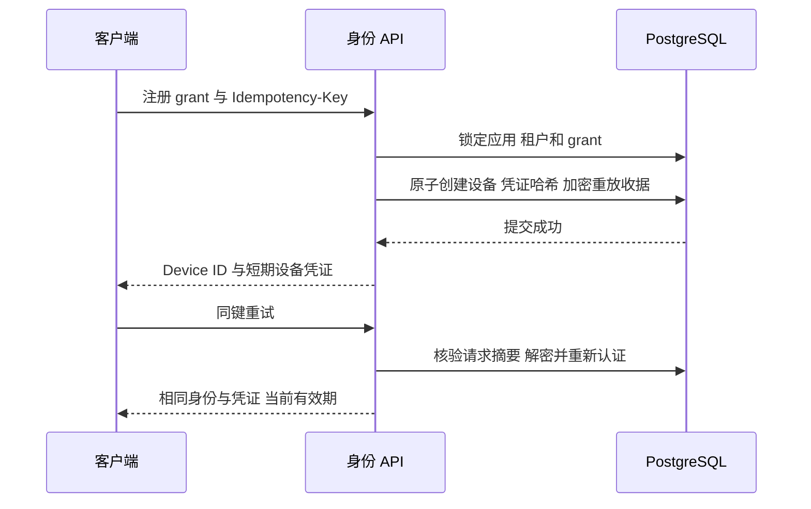
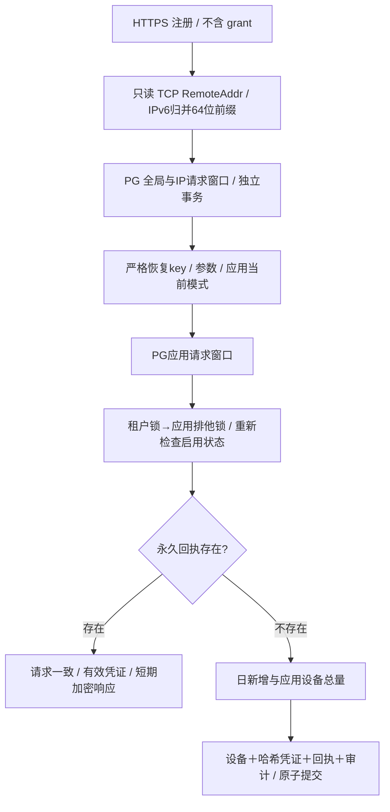

# 设备身份模块

服务端支持默认 grant 注册及应用显式开放的 direct 注册、身份自查与凭证轮换；direct 的恢复秘密、持久配额和验收边界见下文。客户端 reset/安全存储由对应 SDK 模块说明，不把服务端登记成功等同于端侧持久化完成。

三个实际端点为 POST `/v1/device-registrations`、GET `/v1/device-self`、POST `/v1/device-credentials/refresh`。grant 注册/刷新端点必需 8–128 字符的 Idempotency-Key，direct 使用32字节随机恢复秘密的43字符base64url，JSON Content-Type，入口限 16 KiB 和 64 个并发请求、5 秒操作期限。刷新允许空 body 或 `{}`；设备端仅接受 `Bearer dev_...`。管理端点独立验证服务凭证或浏览器会话，不能使用设备凭证代替。

注册事务持有应用/租户共享锁及 grant 排他锁。一次性 grant 消费、设备、256 位随机设备 token 的 SHA-256 哈希和重放收据同事务提交。相同授权上下文同键返回同一身份，不凭公开安装标签恢复任何凭证。direct 仅在应用显式开启后走独立受配额保护的事务，带非空无效grant不会降级direct。

重放使用标准 AES-GCM，附加认证数据绑定操作、租户、主体、幂等键与请求摘要。数据库只持有 token 哈希及有限期加密响应；密钥通过单独文件注入。过期响应由清理任务有界删除；direct另外保存无秘密的永久回执tombstone，防止过期恢复key创建第二设备。重放重新核验设备、应用、租户、凭证状态，不复活撤销秘密。

刷新统一按设备、凭证顺序加锁，在凭证锁后再次认证，防止“认证成功后并发撤销”仍签发后继。rotated_at 限制一个旧 token 只产生一个后继；同键在有效窗口内可安全重放。返回 expires_at 取实际数据库有效期，不把旧发行期限当成仍有效。

默认凭证 24h、注册重放 10m、旧凭证重叠 30s，可在安全范围调整。服务器重启必须复用重放密钥；更换密钥后无法解密时失败关闭，不回退明文或绕过认证。

已通过真实 SCRAM PostgreSQL 的事务与 race 测试、8 路并发注册和轮换、错误租户/授权/到期/撤销、AEAD 篡改和上下文隔离、撤销竞争；实际 HTTP 服务重启仍恢复同一注册结果。测试使用独立 schema/测试数据，不需要生产授权。

安装公钥字段目前只是非认证的不透明标签；算法与持有证明未实现。64 路入口并发限制不替代direct的数据库请求/应用配额；现有SDK能力以对应模块及精确CI结果为准。

## 直接注册

直接注册是应用所有者显式开放的匿名设备登记，不是设备真实性或安装公钥持有证明。`application_id`、`installation_public_key` 都是公开标识，不可当作授权秘密。新应用默认 `grant`；只有管理员创建或 PATCH 为 `registration_mode=direct` 后，省略 `registration_grant` 的注册才会进入本模块。`both` 不作为管理 API 可选模式。

### HTTP 与恢复秘密

`POST /v1/device-registrations` 保留既有 JSON 格式，direct 请求省略 `registration_grant`，其余字段与 grant 相同。带非空 grant 的请求仍走原有 grant 路径，不会在无效 grant 时降级 direct。任何请求都不能传入 `tenant_id`；租户只从服务端 application 记录派生。

Direct 的 `Idempotency-Key` 必须是 **CSPRNG 生成的 32 字节，canonical base64url、无填充，恰好 43 字符**。服务端严格解码并检查32字节，但不能证明客户端随机源质量。不要使用公钥、UUID、用户名、固定字符串或可猜测值；也不能将该 header 写入代理或应用日志。它是含设备凭证响应的短期恢复秘密，不是公开追踪 ID。

同 application/key/body 重试只返回同一设备；同 key 改 body 返回 `IDEMPOTENCY_CONFLICT`。成功但客户端超时必须保留原 key/body 重试，不能因超时自动改 key。恢复响应按既有 `REPLAY_TTL` 加密短期保存；过期后保留只含哈希/设备引用的回执，返回 `REPLAY_EXPIRED`，不会重建新设备。恢复前重新检查 application 模式、应用/租户启用状态、设备及凭证有效性；切回 grant、禁用或撤销后不能借旧回执取得凭证。

成功重放不再次消耗日新增/设备总量；启用正数请求限额时仍消耗其请求预算。不同恢复秘密代表不同登记尝试，安装公钥相同也不自动合并身份；明确 reset 流程必须由 SDK/宿主单独管理，不应把不确定注册结果当作 reset。

### 持久限额

| 配置 | 默认 | 可配置范围 |
|---|---:|---:|
| `DIRECT_GLOBAL_PER_MINUTE` | 0（不限） | 0–2147483647 |
| `DIRECT_IP_PER_MINUTE` | 0（不限） | 0–2147483647 |
| `DIRECT_APP_PER_MINUTE` | 0（不限） | 0–2147483647 |
| `DIRECT_APP_PER_DAY` | 0（不限） | 0–2147483647 |
| `DIRECT_APP_DEVICES` | 0（不限） | 0–2147483647 |

五项都是可选数量策略：`0` 不限制且不建立对应请求计数桶；正数保留持久、原子限额。2147483647 是当前 SQL `integer` 的表示上界，不是产品容量承诺。默认不会扫描设备总数或当日日新增数；仅启用对应正数策略时执行计数。应用注册模式仍默认 `grant`，必须由管理员显式切换 `direct`，不限不会自动开放登记。

分钟采用 PostgreSQL 时间的固定窗口，日新增按 UTC 自然日。窗口边界存在最多两个相邻窗口的突发容量，不承诺滑动窗口。启用时，全局/IP准入先提交，格式/恢复key/应用失败及重放也计数；应用窗口仅为存在且当前开放的应用记数。正数计数在额度用尽后保持当前值，后续请求仍返回429，不为拒绝请求继续累加或溢出。HTTP 无效JSON/超大body由既有长度与并发上限拒绝，不进入本数据库计数器。启用的请求窗口以哈希键持久化，多实例和重启不重置配额；启用正数全局预算时，其优先计数控制任意IP键的新增速度，过期窗口按有界批次清理。IPv4-mapped IPv6归一化，IPv6按 /64 聚合；哈希IP不等于不可逆匿名化，不对数据库运营方宣称匿名保障。

**只信 TCP peer，不读 `X-Forwarded-For` 或 `Forwarded`。** 经 gateway 访问时，同一代理后的用户共享代理IP预算，这比相信任意转发header保守。公开启用 direct 的部署方应根据负载显式设置正数全局/IP/应用反滥用预算，或给入口再加可靠限流；部署包 Compose 透传上述五个环境变量，未设置时均为0。当前没有“可信代理CIDR”功能。分布式机器人仍可使用多个网络来源，因此需要运营方自行选择应用/全局预算与总设备上限；默认不限不等于反滥用防护。高风险/非公开业务应保持 grant，不把限流当作真人验证。

启用正数总设备限额时，计数包括已撤销设备，防止通过撤销循环绕过限额；永久回执仍保留。不限模式下设备及回执数量可能持续增长，需运营方规划存储与入口防护。达到显式容量需明确运营治理，不能自动删除回执重开旧key。计数、创建、凭证与回执在应用排他锁下原子处理，不能多个并发请求各自检查后超卖。

### 数据迁移与验收

迁移7新增 `direct_registration_windows` 与 `direct_registration_receipts`，不改设备凭证明文存储策略；凭证只存哈希，恢复响应沿用既有 AES-GCM。回滚迁移7会丢失direct回执与滥用计数，必须先关闭direct并遵循备份/停写程序，不能用于无损在线降级。

验证覆盖：32字节canonical key、IP来源忽略伪造header、IPv6前缀归并；真实PG并发同key只一设备、不同key原子配额、服务重建后计数不变、失败/重放限额、模式/租户/设备撤销后拒绝重放、ciphertext清理后tombstone仍拒绝重复登记、数据库不出现测试恢复秘密/设备token/IP原文；同时回归原grant注册、管理API和迁移up/down。CI结果以验证分支精确提交为准，本模块文档不替代CI记录。
