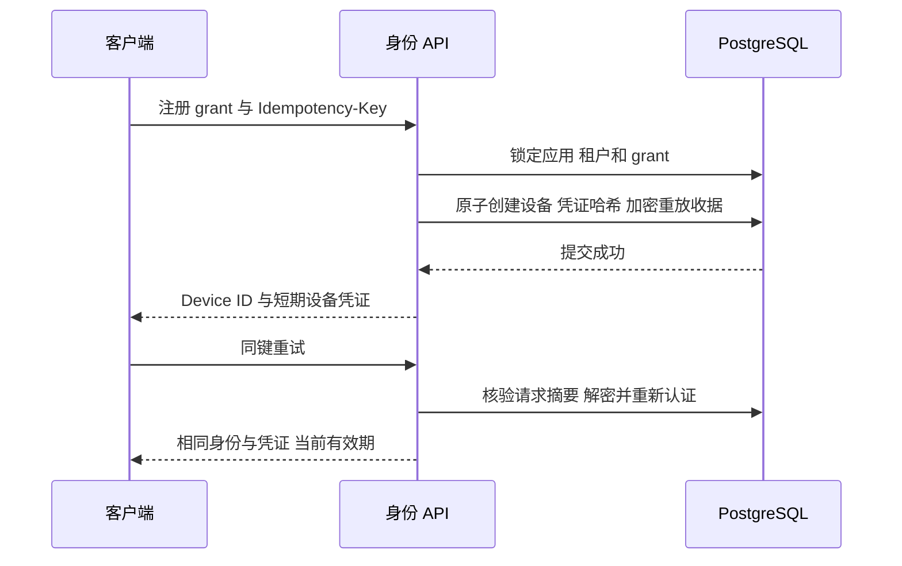

# 设备身份模块

当前完成 M1 的服务端 grant-only 子集。它提供持久身份，不等于客户端安全存储、direct 注册或完整管理平台。

三个实际端点为 POST `/v1/device-registrations`、GET `/v1/device-self`、POST `/v1/device-credentials/refresh`。变更端点必需 8–128 字符的 Idempotency-Key，JSON Content-Type，入口限 16 KiB 和 64 个并发请求、5 秒操作期限。刷新允许空 body 或 `{}`；设备端仅接受 `Bearer dev_...`。不存在公开管理端点。

注册事务持有应用/租户共享锁及 grant 排他锁。一次性 grant 消费、设备、256 位随机设备 token 的 SHA-256 哈希和重放收据同事务提交。相同授权上下文同键返回同一身份，不凭公开安装标签恢复任何凭证。direct 模式未实现，不能靠把应用设为 direct 绕过 grant。

重放使用标准 AES-GCM，附加认证数据绑定操作、租户、主体、幂等键与请求摘要。数据库只持有 token 哈希及有限期加密响应；密钥通过单独文件注入。过期记录由清理任务删除。重放重新核验设备、应用、租户、凭证状态，不复活撤销秘密。

刷新统一按设备、凭证顺序加锁，在凭证锁后再次认证，防止“认证成功后并发撤销”仍签发后继。rotated_at 限制一个旧 token 只产生一个后继；同键在有效窗口内可安全重放。返回 expires_at 取实际数据库有效期，不把旧发行期限当成仍有效。

默认凭证 24h、注册重放 10m、旧凭证重叠 30s，可在安全范围调整。服务器重启必须复用重放密钥；更换密钥后无法解密时失败关闭，不回退明文或绕过认证。

已通过真实 SCRAM PostgreSQL 的事务与 race 测试、8 路并发注册和轮换、错误租户/授权/到期/撤销、AEAD 篡改和上下文隔离、撤销竞争；实际 HTTP 服务重启仍恢复同一注册结果。测试使用独立 schema/测试数据，不需要生产授权。

安装公钥字段目前只是非认证的不透明标签；算法与持有证明未实现。SDK 安全存储、用户 reset 封装、管理认证、按 IP/应用限流和 direct 注册仍待后续交付。当前 64 路进程内上限不是完整租户配额或集群协调。
