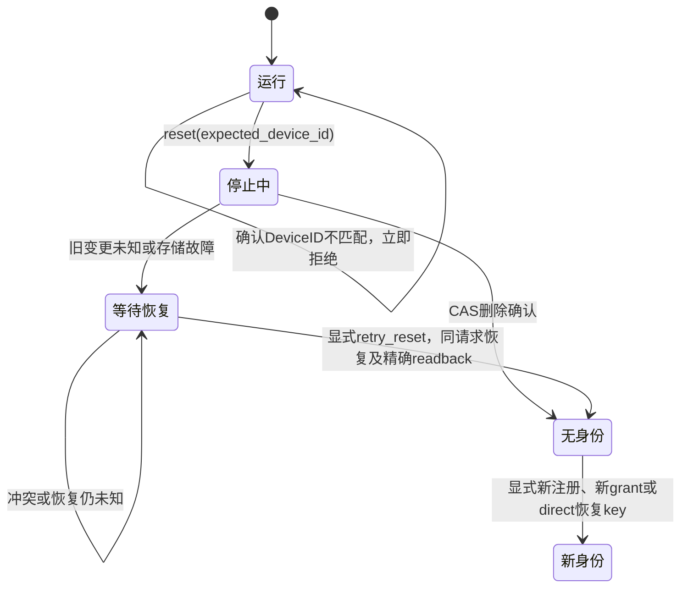

# 身份重置模块

本模块实现**显式本地安装身份重置**，不等于服务端设备吊销，也不删除其他进程、安装或备份中的凭证。重置成功只留下身份存储 CAS tombstone；创建新 DeviceID 必须再显式注册，不能静默复用旧 grant 或恢复 key。

## 状态与关闭顺序



1. 调用方必须提供当前 DeviceID，防止误清理已更换的身份。
2. 首个异步等待之前关闭共享 installation gate，所有旧 `Connection` 的 send/receive/validity 均失效；不能等待网络断开之后才禁止业务交付。
3. 停止 WSS 自动恢复和 actor，等待既有凭证轮换收束，再清理 transport。正在执行的变更不可假装回滚；发生关闭超时或 worker panic 时返回未知结果，不继续删除。
4. 身份仍有 pending 注册/轮换或新凭证尚未持久化时，首次 reset 不删除。显式 `retry_reset` 才按原 key/body 恢复既有变更或保存新值，再尝试 CAS 删除。
5. 删除以原 revision 为条件，写入 revision+1、identity=null。失败/取消后对象保留 reset journal；仅精确的下一 revision tombstone 可确认成功。更新的其他身份、更晚 tombstone 均冲突，不覆盖、不认作本次成功。

Rust `DeviceSdk::reset(&mut self, expected_device_id)` 和 `retry_reset` 保留调用方对象，因此错误或 Future 取消不会立即丢失这份内存恢复状态。开始 reset 后，该对象不能重新发送、连接或轮换；成功后应丢弃旧对象，再使用新的注册请求创建 facade。

内存 journal 不是跨进程持久事务日志。应用杀进程或主动丢弃对象后，应根据持久存储和服务端幂等结果恢复；不能宣称任意掉电点都可自动恢复。

## C ABI

唯一规范头增加 `DP_OP_RESET_IDENTITY=7` 与 `DP_CAP_RESET_IDENTITY=8`，ABI major 仍为 1。请求：

```json
{"expected_device_id":"当前设备UUID","retry":false}
```

connection 必须为 0。确认错误立即 INVALID_ARGUMENT、request ID 为 0，无 completion、无重置副作用。

- 接受后立即关闭旧业务 admission/宿主事件有效性检查，并取消尚未开始的可取消旧操作。运行中的旧操作按实际结果收束。
- reset 自身进入不可取消阶段；`dp_sdk_cancel` 返回 BUSY，不谎报 CANCELLED。
- 完整成功返回 `{"identity_reset":true,"registration_required":true}`，此时实例可以显式 START/register；新 handle 不复用旧 connection ID。
- 失败保持停止态；普通 START/SEND 等返回 CLOSED。只有同 DeviceID 的 `retry:true` 可恢复这次 reset，且同时至多一个 reset operation。
- 存储提交后响应丢失返回 OUTCOME_UNKNOWN。调用方不得当作成功或自动生成新身份，须保留实例并重试核对 tombstone；真实 CAS 冲突返回 BUSY，不覆盖并发写者。
- shutdown 不把已不可逆接受的 reset 冒充取消：排空时仍执行并按实际结果完成，最后才 SHUTDOWN/quiescence/release。

## Direct 注册衔接

服务端应用必须显式启用 direct，默认仍为 grant。请求不传 registration_grant；旧公共 installation key 不是恢复秘密。

`IdempotencyKey::recovery()` 生成 32 字节操作系统 CSPRNG 随机值，编码为 canonical base64url、无 padding 的 43 字符。`Debug` 隐藏所有幂等 key，SDK 自持副本使用 Zeroizing；不声称 HTTP/第三方库的每份内存副本均擦除。宿主必须把原 key 与原请求安全保存到有限 replay 窗口结束或结果确定。同 key/body 可重试，不能在未知结果后换 key 创建第二个设备。`IdempotencyKey::random()` 的 UUID 仍仅供既有 grant/refresh 契约，不能用于 direct。

## 验证边界

- 身份单测覆盖显式确认、tombstone、delete 前失败/提交后报错/提交后 Future 取消、同 revision 精确恢复、不重复删除、并发更新和更晚 tombstone 拒绝。
- facade 测试覆盖真实本地 HTTP/WSS 的停止与 tombstone、普通 API 停止、重复恢复不增加 revision；共享 gate 单测检查既有 observer 立即失效。
- C 生命周期回归覆盖已有 32 credit、取消、慢 callback、重入和 release；reset 专项服务测试设计为真实两端授权/WebRTC后，host CAS 提交但故障回复、运行取消 BUSY、Unknown 阻新注册、重试不重复 delete、全新 direct 注册产生不同 DeviceID。
- reset/direct 真实服务专项已在独立 Go schema7、PostgreSQL、Redis 和本地原生 WebRTC 上通过；额外 SQL 核对恰好一条 direct receipt、三条设备记录（两旧一新）。精确发布 SHA 的 CI 仍待运行，不能以本地结果替代。五端封装尚未提供 reset convenience API，宿主仅可在明确能力位支持时调用对应 C ABI。
