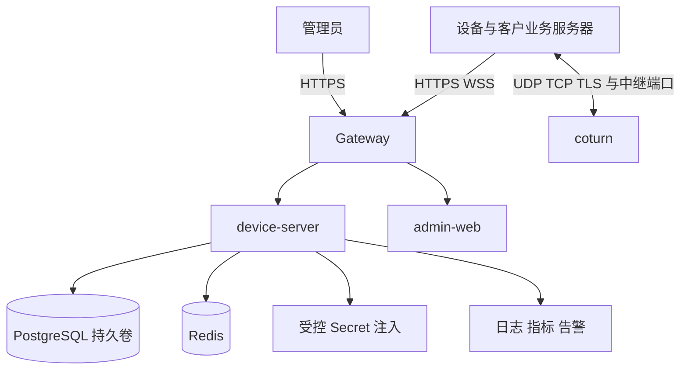

# Peerloom 部署指南

本文面向部署与运维人员，规定公有服务和私有化部署的单机 Compose 目标，以及安全、网络、升级和恢复检查。

**当前不能按本文启动产品。** M0 正在开发，尚未形成可按本文验证的部署产物；以下是交付要求和部署流程设计，不是已经执行成功的命令。可运行入口会随 M0/M8 更新到本文件。

## 部署范围

首版采用单机 Compose，不以 Kubernetes 或分布式部署作为前置要求。公网托管与内网私有化共用协议和模块边界；私有部署需自行提供可达的 HTTPS/WSS、STUN/TURN 及安全配置。

## 目标服务与持久性

| 服务 | 职责 | 持久与网络要求 |
|---|---|---|
| `gateway` | HTTPS/WSS 入口、TLS 与反向代理 | 证书续期；支持长连接；配置大小和超时限制 |
| `device-server` | API、认证、授权、信令与租约 | 非 root；就绪检查包含必要依赖与 schema |
| `postgres` | 身份、授权、会话、审计及幂等收据 | 独立卷、备份、恢复演练；不开放公网 |
| `redis` | presence、路由与可重建缓存 | 不开放公网；故障不能改变持久授权事实 |
| `coturn` | 独立 TURN 数据中继 | 明确公网地址、监听与中继端口；短期凭证 |
| `admin-web` | 管理界面静态资源 | 通过受控网关访问，不内嵌管理秘密 |

在线布尔值不持久化为 SQL 权威。Redis 被清空后重新认证建立租约；数据库、密钥和配置不可按“可重建缓存”处理。

## 部署前准备

1. 确认运行系统、容器运行时、磁盘和网络规格，记录预期连接数量和中继流量。
2. 配置服务域名与有效 TLS 证书，确认设备能解析并访问。
3. 确定数据库持久卷、加密备份位置、保留周期、恢复目标与负责人。
4. 准备数据库、Redis、管理认证、TURN 与幂等重放加密等 secrets，禁止提交到仓库。
5. 确定公开和内部网络边界，验证数据库和 Redis 不对公网监听。
6. 指定运营管理员初始化方式；后台认证方案定稿前不得开放无认证后台。
7. 配置出口访问规则、Webhook 允许目标、日志保留与审计访问权限。
8. 为每个平台准备最小客户端，不能仅用 HTTP 健康检查代替通信验证。

## 网络与 TURN

HTTPS/WSS 入口通常经 TLS 网关；TURN 的 UDP/TCP/TLS 监听和中继端口必须单独规划。实际端口由部署配置决定，不能只开放 443 就宣称 TURN 可用。

| 网络项 | 必须确认 |
|---|---|
| 设备到网关 | TLS 链、主机名验证、WSS 升级、代理空闲超时 |
| 设备到 TURN | 明确的监听协议与端口、凭证有效期、证书 |
| TURN 中继 | 已配置且有限的中继端口范围、双向防火墙规则 |
| NAT 后中继 | 公网/内部地址映射与候选可达性正确 |
| 私有化网络 | 设备能访问内网域名和中继，证书信任可管理 |
| 数据库与 Redis | 只允许内部授权服务访问 |

不要把长期 TURN 主密钥下发给 SDK。控制面生成短期凭证，SDK 仅获得获授权会话需要的中继配置。共享节点配置属于运营者资源，租户不能任意指定 `secret_ref` 读取其他节点秘密。

## 配置分组

最终环境变量名、配置文件结构及默认值随实现定稿，本阶段不提供可能误导执行的伪命令。

| 分组 | 必须可配置内容 |
|---|---|
| 公共端点 | 外部 HTTPS/WSS 地址、能力与协议版本 |
| 数据库 | 连接、连接池、超时、迁移版本要求 |
| Redis | 连接、超时、租约命名空间与恢复策略 |
| 安全 | 凭证有效期、重叠窗口、重放加密密钥、管理 audience |
| 在线 | 心跳与离线阈值；建议初值 20 秒/60 秒 |
| 授权 | 会话租约期限、续租提前量、目标确认超时 |
| 限额 | 注册、API、信令、并发、JSON、SDP/ICE 与缓存限制 |
| TURN | 节点、地域、短期凭证期限、secret 引用 |
| 可观测性 | 日志级别、脱敏、指标、审计保留 |
| Webhook | 出口允许策略、签名、超时、重试与保留 |

生产配置必须有有限上限，不能用零或空配置隐式表示无限队列。默认值须在测试环境验证后记录。

## 首次上线流程

迁移须采用互斥执行、版本和校验和记录，事务失败不得留下被误标成功的版本。应用部署与迁移执行不能互相竞态；实例只在 schema 兼容且必要依赖可用时就绪。

真实通信检查包括两个 SDK 注册与重启恢复、heartbeat、grant 授权、目标接受、直连或中继双向消息及正常关闭。另行强制 `relay_only` 测试以确认中继，不以一次 auto 直连成功代替。

## 安全加固

- TLS 主机名和证书校验不得为方便部署默认关闭。
- 所有容器以非 root 运行，最小文件和网络权限，启用健康检查和资源限制。
- 敏感值通过 secret 注入；不输出到启动参数、日志、异常正文或前端构建包。
- 数据库凭证权限最小化，迁移角色与运行角色按需要分离。
- Gateway 与服务层都有限流；不能只靠入口 IP 限流保护共享租户配额。
- 管理入口、指标入口和备份介质实施访问控制，审计关键配置变更。
- Webhook 默认防 SSRF；内网目的地只经显式部署策略批准，重定向和 DNS 解析需持续校验。
- 不公开原始业务 payload、安装私钥或注册/设备凭证明文。

## 监控与告警

监控注册成功/失败、认证拒绝、在线设备租约、会话状态与路径、授权拒绝、TURN 分配失败、队列水位、数据库/Redis 错误、授权续租失败和进程资源。

告警阈值根据真实基线配置；设备 ID 不应成为无限增长的指标标签。排障使用 request ID、session ID 和分类错误关联脱敏日志。

在线终止通知与失联租约到期关闭是不同指标。控制面标记 revoked 后，不能把未确认收到通知的设备描述为已经物理断网。

## 备份与恢复

备份必须覆盖 PostgreSQL、所需 secret、配置及版本信息；加密重放结果若无法解密，应进入明确恢复分支而不是绕过身份检查。Redis 通常按可重建状态处理，但需要验证恢复流程。

恢复顺序：隔离业务写入 → 恢复兼容版本数据库和 secret → 验证 schema 与数据约束 → 启动服务 → 重建 presence/fencing → 对账会话与配额 → 双端通信测试 → 逐步恢复业务。

不得只验证备份文件存在。演练需要检查已撤销凭证不复活、已消费 grant 不重复消费、租户约束完整、审计可查询、旧连接不能覆盖新连接。

## 升级与回滚

先备份并验证兼容性，再扩展 schema、升级应用、观察指标，最后在后续版本清理旧字段。回滚前评估 down 迁移是否丢失数据；数据库备份不是无成本的在线撤销按钮。

回滚不能无条件删除 `pgcrypto` 等共享扩展。版本漂移、校验和不符或迁移部分失败应阻止启动，并保留诊断证据。

## 故障处置与交付缺口

| 现象 | 首先检查 | 安全处理 |
|---|---|---|
| 全部设备离线 | Redis、WSS、认证与心跳 | 不伪造在线，恢复后重建租约 |
| 直连失败 | ICE 候选、网络、策略 | auto 验证 TURN；direct_only 保持失败 |
| relay_only 失败 | TURN 凭证、证书、端口与公网地址 | 明确返回中继错误，不绕过策略 |
| 数据连接尚在但 WSS 断开 | 信令网络、剩余授权租约 | 租约内可继续，过期关闭 |
| 注册重试失败 | 幂等摘要、grant 消费、加密结果期限 | 不通过公开公钥恢复设备秘密 |

当前未完成镜像、Compose、实际配置名、迁移命令、备份脚本和健康端点的整体部署验证。相关实现进入仓库后，必须用已验证命令替换本节的交付缺口，不把设计说明当作部署成功证据。
