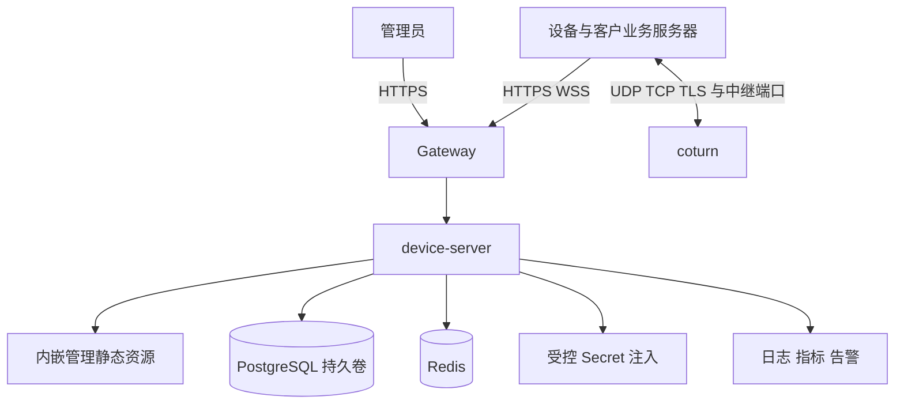
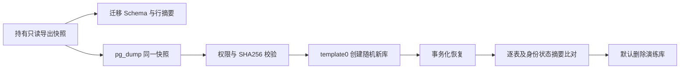

# Peerloom 部署指南

本文面向部署与运维人员，先说明独立服务端运行包，再给出通用运维要求与源码维护工具。SDK 包只供客户端集成，不能当作服务器安装包。

**当前已实现控制面、管理后台及原生 SDK 的隔离部署与通信验证，但未实际部署生产环境。** Compose 真启动、迁移、真实授权通信、容器备份恢复和 HTTPS/WSS 已有 CI 证据；最终交付仍以对应版本记录的功能验收来源、实际构建源码、产物校验和 Release 为准，见[已发布 v0.1.0 验收基线](https://github.com/barry-ran/peerloom/blob/v0.1.0/docs/开发与验收.md)。默认仅回环监听，不能把测试通过视为公网配置、生产容量或灾难恢复已验收。

## 独立服务端包：无需源码或编译工具链

历史已发布资产保持不变。请在 [Releases](https://github.com/barry-ran/peerloom/releases) 选择实际发布的版本，核对功能验收来源、实际构建源码及包内元数据；文档本身不是新版本“已可下载”的保证。服务端运行包命名为 `peerloom-server-v<版本>-linux-amd64.zip`，SDK 资产另以 `peerloom-sdk-` 区分。

| 包内路径 | 作用 |
|---|---|
| `bin/` | `device-server`、`device-migrate`、`device-bootstrap`、`device-admin`、`device-admin-user` 共 5 个预编译 Linux amd64 程序 |
| `infra/migrations/` | 版本 1–10 的 up/down SQL，共 20 个文件 |
| `deploy/` | 运行时 Dockerfile、Compose/TLS 配置、网关、`init-private.py` 与自足 `README.md` |
| `docs/部署指南.md` | 本文；通用运维边界与源码工具参考 |
| 元数据与许可证据 | `release-metadata.json`、完整 SHA 清单、MIT 和第三方原文/SBOM/明确缺项 |

外层 ZIP 校验后，在**新目录**解压其 `peerloom-server-linux-amd64.tar.gz` 安装载荷，保留可执行位，再执行 `sha256sum -c SHA256SUMS`。元数据须为对应版本/提交、`platform=server-linux-amd64`、`product=server`；不要从外层松散文件安装程序。详细解压命令及管理员创建完整流程已在随包 `deploy/README.md`，不要求下载仓库或旧文档才能启动。

宿主需要 Linux amd64、Docker Engine、Docker Compose、Python 3.10+（标准库即可）和解压/校验工具；TLS 覆盖要求 Compose ≥2.24.4。**不需要源码、Go、Rust/Cargo、Node/npm。** 运行镜像只复制已编译程序，管理后台静态资源已内嵌；仍需联网拉取文件中固定摘要的基础镜像/PostgreSQL/Redis/nginx，不能把包描述为完整离线镜像介质。

在安装载荷根目录首次执行：

```sh
python3 deploy/init-private.py
docker compose -f deploy/compose.yaml config --quiet
docker compose -f deploy/compose.yaml build
docker compose -f deploy/compose.yaml up -d --wait postgres redis
docker compose -f deploy/compose.yaml run --rm migrate
docker compose -f deploy/compose.yaml up -d --wait device-server gateway
curl --fail http://127.0.0.1:18080/readyz
```

初始化新建 `.secrets` 父目录 0700、授权单文件只读 0444；只给所需容器逐文件挂载。已有路径或不安全路径一律拒绝，不生成 `.env`、不创建账户或自动启动。中途失败保留新目录供运维核对，不能靠反复删除秘密解决已有数据库认证问题。父目录限制宿主其他 UID，单文件模式兼容非 root 容器；宿主 root、Docker daemon 和获授权挂载容器属于信任边界，不把该模式称作不受信主机隔离。

默认网关只绑定 `127.0.0.1:18080`，数据库/Redis不开放宿主端口，管理后台默认关闭且无默认账号。只有 `device-server` 增加独立 `egress` 出站网络供策略允许的 HTTPS Webhook 等使用，不新增宿主监听；数据库、Redis 和迁移仍只在内部网络，应用层 SSRF/DNS/重定向/授权检查继续生效。

HTTPS/WSS 使用用户提供的证书与私钥，先在包根运行：

```sh
python3 deploy/init-private.py --stage-tls \
  --certificate /absolute/private/fullchain.pem \
  --private-key /absolute/private/server.key
```

工具校验当前用户拥有、单硬链接的普通文件与安全祖先，拒绝符号链接；每个文件最多 1 MiB。原私钥必须保持 0600/0400 等禁止组/其他用户访问的权限；**不 chmod 或修改原私钥**。仅在新 `.tls` 0700 目录中生成两个 0444 只读副本，分别为 `certificate.pem`、`private-key.pem`，供非 root 网关精确挂载。已有 `.tls` 或失败后的残留均拒绝覆盖，续期不自动替换；运维须在新安全目录准备并保留现有项目/卷及数据库秘密。

叠加 `deploy/compose.tls.yaml` 固定挂载这两份副本，设置 `TLS_ADMIN_ORIGIN` 为精确 HTTPS origin（留空关闭后台）；不使用源码开发模板的 `TLS_CERTIFICATE_FILE` / `TLS_PRIVATE_KEY_FILE` 变量。覆盖层替换为回环 `18443`，关闭明文管理例外；完整启动命令见随包 README，禁止用 `-k` 绕过信任。

`device-admin bootstrap --offline` 是显式新租户操作；`device-admin-user create --offline --password-stdin` 创建指定租户管理员，秘密输出必须只进私有文件。`device-bootstrap --development` 是开发夹具，不是生产初始化。保留既有项目名、数据库卷、配置和重放密钥，升级不覆盖旧配置/secret、不使用 `down -v`；先备份并验证迁移兼容性。

**该 Compose 不包含 TURN 完整部署。** 需外置运营的中继、明确公网/中继端口及证书，再按既有授权模型登记 `secret_ref`；长期 TURN 密钥不能下发 SDK。新拆包的干净目录启动、TLS/管理/WSS 必须在对应 CI 实际验证，既有源码 Compose 成功不能替代。

后文的 `infra/compose*.yaml`、`make` 与 `scripts/` 专指**源码维护者入口**，不在独立运行包内；需要对应源码及所述工具。运行包使用 `deploy/compose*.yaml`，不要混用。未改变的 API/中继/备份工具参考固定公开 v0.1.0 文档，新运行包命令以包内 README 为准。

## 部署范围

首版采用单机 Compose，不以 Kubernetes 或分布式部署作为前置要求。公网托管与内网私有化共用协议和模块边界；私有部署需自行提供可达的 HTTPS/WSS、STUN/TURN 及安全配置。



## 服务与持久性

| 服务 | 职责 | 持久与网络要求 |
|---|---|---|
| `gateway` | HTTPS/WSS 入口、TLS 与反向代理 | 证书续期；支持长连接；配置大小和超时限制 |
| `device-server` | API、认证、授权、信令与租约 | 非 root；就绪检查包含必要依赖与 schema |
| `postgres` | 身份、授权、会话、审计及幂等收据 | 独立卷、备份、恢复演练；不开放公网 |
| `redis` | presence、路由与可重建缓存 | 不开放公网；故障不能改变持久授权事实 |
| `coturn` | 独立 TURN 数据中继 | 明确公网地址、监听与中继端口；短期凭证 |
| 管理界面静态资源 | 由 `device-server` 内嵌并提供 `/admin/` | 配置精确 `ADMIN_ORIGIN` 才启用；不是独立 Compose 服务，不内嵌管理秘密 |

在线布尔值不持久化为 SQL 权威。Redis 被清空后重新认证建立租约；数据库、密钥和配置不可按“可重建缓存”处理。

## 部署前准备

1. 确认运行系统、容器运行时、磁盘和网络规格，记录预期连接数量和中继流量。
2. 配置服务域名与有效 TLS 证书，确认设备能解析并访问。
3. 确定数据库持久卷、加密备份位置、保留周期、恢复目标与负责人。
4. 准备数据库、Redis、管理认证、TURN 与幂等重放加密等 secrets，禁止提交到仓库。
5. 确定公开和内部网络边界，验证数据库和 Redis 不对公网监听。
6. 使用离线 `device-admin-user` 明确创建管理员，配置精确管理 Origin；没有默认密码，不得开放无认证后台。
7. 配置出口访问规则、Webhook 允许目标、日志保留与审计访问权限。
8. 为每个平台准备最小客户端，不能仅用 HTTP 健康检查代替通信验证。

## 网络与 TURN

HTTPS/WSS 入口通常经 TLS 网关；TURN 的 UDP/TCP/TLS 监听和中继端口必须单独规划。实际端口由部署配置决定，不能只开放 443 就宣称 TURN 可用。

| 网络项 | 必须确认 |
|---|---|
| 设备到网关 | TLS 链、主机名验证、WSS 升级、代理空闲超时 |
| 设备到 TURN | 明确的监听协议与端口、凭证有效期、证书 |
| TURN 中继 | 已配置且有限的中继端口范围、双向防火墙规则 |
| NAT 后中继 | 公网/内部地址映射与候选可达性正确 |
| 私有化网络 | 设备能访问内网域名和中继，证书信任可管理 |
| 数据库与 Redis | 只允许内部授权服务访问 |

不要把长期 TURN 主密钥下发给 SDK。控制面生成短期凭证，SDK 仅获得获授权会话需要的中继配置。共享节点配置属于运营者资源，租户不能任意指定 `secret_ref` 读取其他节点秘密。

## 配置分组

运行包实际变量以 `deploy/compose.yaml`、`deploy/compose.tls.yaml` 为准；源码开发另用 `infra/compose*.yaml`。本文后半部的维护命令需要源码，不能直接在 SDK 包中执行。下表用于检查配置覆盖面，不表示存在同名环境变量。

| 分组 | 必须可配置内容 |
|---|---|
| 公共端点 | 外部 HTTPS/WSS 地址、能力与协议版本 |
| 数据库 | 连接、连接池、超时、迁移版本要求 |
| Redis | 连接、超时、租约命名空间与恢复策略 |
| 安全 | 凭证有效期、重叠窗口、重放加密密钥、管理 audience |
| 在线 | 心跳与离线阈值；建议初值 20 秒/60 秒 |
| 授权 | 会话租约期限、续租提前量、目标确认超时 |
| 限额 | 注册、API、信令、并发、JSON、SDP/ICE 与缓存限制 |
| TURN | 节点、地域、短期凭证期限、secret 引用 |
| 可观测性 | 日志级别、脱敏、指标、审计保留 |
| Webhook | 出口允许策略、签名、超时、重试与保留 |

生产配置必须有有限上限，不能用零或空配置隐式表示无限队列。默认值须在测试环境验证后记录。

## 首次上线流程


迁移须采用互斥执行、版本和校验和记录，事务失败不得留下被误标成功的版本。应用部署与迁移执行不能互相竞态；实例只在 schema 兼容且必要依赖可用时就绪。

真实通信检查包括两个 SDK 注册与重启恢复、heartbeat、grant 授权、目标接受、直连或中继双向消息及正常关闭。另行强制 `relay_only` 测试以确认中继，不以一次 auto 直连成功代替。

## 安全加固

- TLS 主机名和证书校验不得为方便部署默认关闭。
- 控制面和网关以非 root 运行；数据库/缓存还需遵守各固定镜像的初始化用户模型。最小化文件和网络权限，保持健康检查和资源限制。
- 敏感值通过 secret 注入；不输出到启动参数、日志、异常正文或前端构建包。
- 数据库凭证权限最小化，迁移角色与运行角色按需要分离。
- Gateway 与服务层都有限流；不能只靠入口 IP 限流保护共享租户配额。
- 管理入口、指标入口和备份介质实施访问控制，审计关键配置变更。
- Webhook 默认防 SSRF；内网目的地只经显式部署策略批准，重定向和 DNS 解析需持续校验。
- 不公开原始业务 payload、安装私钥或注册/设备凭证明文。

## 监控与告警

监控注册成功/失败、认证拒绝、在线设备租约、会话状态与路径、授权拒绝、TURN 分配失败、队列水位、数据库/Redis 错误、授权续租失败和进程资源。

告警阈值根据真实基线配置；设备 ID 不应成为无限增长的指标标签。排障使用 request ID、session ID 和分类错误关联脱敏日志。

在线终止通知与失联租约到期关闭是不同指标。控制面标记 revoked 后，不能把未确认收到通知的设备描述为已经物理断网。

## 备份与恢复

备份必须覆盖 PostgreSQL、所需 secret、配置及版本信息；加密重放结果若无法解密，应进入明确恢复分支而不是绕过身份检查。Redis 通常按可重建状态处理，但需要验证恢复流程。

恢复顺序：隔离业务写入 → 恢复兼容版本数据库和 secret → 验证 schema 与数据约束 → 启动服务 → 重建 presence/fencing → 对账会话与配额 → 双端通信测试 → 逐步恢复业务。

不得只验证备份文件存在。演练需要检查已撤销凭证不复活、已消费 grant 不重复消费、租户约束完整、审计可查询、旧连接不能覆盖新连接。

### 源码维护工具：M8 本地逻辑备份切片

以下脚本不在独立服务端运行包内，需取得匹配源码并准备 PostgreSQL 客户端。`scripts/postgres-backup.py` 已提供受控本机备份和**新建隔离数据库**恢复演练；不是生产恢复入口，也不代表 M8 全部完成。当前仅接受回环地址或本机 Unix socket，需显式 `--local-operator`。默认 Compose 不暴露数据库端口；不要为运行此脚本而把 PostgreSQL 开放公网，使用独立本机测试实例或运维批准的本地访问方式。

准备同一主版本的 `psql`、`pg_dump`、`pg_restore`（当前真实验证 PostgreSQL 18.6），以及已完成当前仓库迁移的 UTF-8 数据库。脚本要求客户端、源库与恢复库主版本完全一致，不用于跨版本升级。连接仅从 `PGHOST`、`PGPORT`、`PGUSER`、`PGDATABASE` 读取，数据库名不能是 DSN；密码使用当前用户拥有的普通 `PGPASSFILE` 文件，权限不得向组/其他用户开放。拒绝 `PGPASSWORD`、连接 service 和覆盖地址，禁止在命令行粘贴密码。密码文件格式与 0600 要求见 [PostgreSQL 官方说明](https://www.postgresql.org/docs/18/libpq-pgpass.html)。

```sh
# 根据已授权的本机实例调整；PGPASSFILE 由运维安全注入，不输出其内容。
export PGHOST=127.0.0.1 PGPORT=55432 PGUSER=peerloom PGDATABASE=peerloom
export PGPASSFILE=/path/to/private/pgpass
mkdir -p dist
python3 scripts/postgres-backup.py backup --local-operator --directory dist/local-backup
python3 scripts/postgres-backup.py drill --local-operator --trust-local-archive --directory dist/local-backup
```

备份目录必须不存在；新目录 0700，归档、元数据、校验清单和演练报告 0600，均不可提交仓库。`database.dump` 为自定义格式，`metadata.json` 使用显式 `peerloom-local-logical-v2` 格式，记录版本、迁移校验和及数据摘要；旧 v1 包不会隐式按新格式验收，需保留原版本工具或重新生成 v2 备份。`checksums.json` 校验归档与元数据。**文件权限不等于加密**：备份包含数据库敏感内容，异地保存、加密和保留策略仍由运维负责；校验和也不是来源签名。



- 备份与行摘要共用导出快照；迁移锁阻止仓库迁移程序并发改 schema。数据行不落入元数据明文，仅记录数量及排序行 SHA-256 的汇总。检查全部 public 普通表、迁移台账、列/约束/索引、扩展版本及序列状态；另校验 public 中非 extension-owned 的函数完整定义，以及非内部、非 extension-owned 的 trigger 定义与启用状态。函数最多 128 个、trigger 最多 256 个，用户自定义 aggregate 明确拒绝。不会忽略函数体变化、trigger 丢失或禁用；不覆盖任意 view、所有权或 ACL，不把这些摘要称为任意 PostgreSQL schema 的完整校验或数据库安全审计。[PostgreSQL 函数与 trigger 定义读取](https://www.postgresql.org/docs/18/functions-info.html)、[pg_trigger 启用状态](https://www.postgresql.org/docs/18/catalog-pg-trigger.html)。
- Schema 摘要仅忽略 `contype=n` 的 NOT NULL 约束名称：PostgreSQL 18 对 `LIKE` 复制的约束在恢复时可能重新命名。约束类型、定义、表归属、validated/enforced 状态及重复数量仍逐项校验；CHECK/FK/PK/UNIQUE 等其他名称不忽略。catalog 无自动命名标志，因此本工具不验收任意 NOT NULL 约束名的原样还原；不会把这种名称差异误当数据恢复失败，也不会忽略实际非空约束丢失。参见 [PostgreSQL pg_constraint](https://www.postgresql.org/docs/18/catalog-pg-constraint.html)。
- 序列不是 MVCC 快照状态，因此前后状态变化会拒绝完成备份，提示暂停源库写入后重试。当前限制为最多 64 表、10 万行、1 GiB 归档；分区表、外部表、物化视图、其他业务 schema 和 large objects 不在此切片支持范围。
- 恢复只允许**不存在的** `peerloom_drill_*` 数据库，默认随机命名，从 `template0` 创建，不使用 `--clean` 或归档中的原库名创建选项。已有库及源库永不覆盖；`--target` 也不能绕过此检查。
- 默认成功/失败均尝试删除本次创建的库；`--keep-target` 仅在验证成功后保留。脚本先显示目标名，不强行终止其他连接；断电、连接故障或其他连接阻止删除时，运维须核对该目标确属本次演练后处理，不能承诺跨故障原子清理。
- 恢复省略 owner/ACL/tablespace、publication/subscription，验证范围是应用 schema 与数据，而非角色权限还原。单库逻辑备份不含集群角色、应用加密密钥、Redis、配置或 WAL/PITR；这些仍需独立备份与演练。
- **仅恢复可信本地来源。** PostgreSQL 明确提示恢复归档会执行源超级用户可控制的 SQL；同一实例的新数据库不是针对恶意归档的安全沙箱。`--trust-local-archive` 是操作确认，不是恶意 SQL 检测。参见 [pg_restore 官方说明](https://www.postgresql.org/docs/18/app-pgrestore.html)；一致性导出和单库范围参见 [pg_dump 官方说明](https://www.postgresql.org/docs/18/app-pgdump.html)。

验证入口：`python3 scripts/test-postgres-backup.py` 默认运行无服务安全/编排测试，实际 PG 测试需显式启用：

```sh
# 使用有创建数据库权限的已授权本机测试角色；保持上述 PG 环境和 PGPASSFILE。
PEERLOOM_BACKUP_INTEGRATION=1 \
PEERLOOM_TEST_MIGRATE_BIN="$PWD/dist/linux-amd64/device-migrate" \
python3 scripts/test-postgres-backup.py
```

本地 PostgreSQL 18.6 真实演练已核验 schema 6 的 20 表及当前 schema 9 的 23 表，包括序列状态、撤销设备/凭证、已消费注册 grant、审计、租户 FK、Webhook outbox 待投递记录，以及快照后并发新增记录不混入归档和默认目标清理。独立 `test-backup-cluster.py --run-isolated` 创建自己的随机 PGDATA、回环端口及 source/target，应用当前目录的全部迁移并清理，不使用共享开发库。PG18.6 已复现 10 个非空约束名重新生成后摘要等价；额外删除真实 NOT NULL 约束，或删除/禁用真实 Webhook trigger、替换/删除其函数体，都会拒绝恢复验收并清理目标。容器入口 `scripts/test-backup-container.sh` 为两次容器执行分别分配随机 owned 名称；正常结束或 INT/TERM 均精确清理自身容器再删除临时镜像，不依赖 `--rm` 在 Docker CLI 中断后自动生效。真实容器备份恢复已通过[普通 CI（e4a）](https://github.com/barry-ran/peerloom/actions/runs/40759252128)，与本地 PG 和 mock 清理证据分开记录。**这不是恢复后设备登录、加密重放解密、租约/fencing 重建或端到端通信验收**；生产恢复、定时加密备份、异地介质、RPO/RTO、监控告警和全栈恢复仍待后续完成。

## 源码维护入口：用户证书 HTTPS/WSS 配置

以下只描述源码开发模板的手动文件挂载；普通 0600 原私钥不能直接供 UID65532 网关读取，也不能为此放宽原私钥权限。独立运行包应使用前述 `--stage-tls` 安全副本与固定挂载流程，不复制本节旧环境路径配置。

`infra/compose.tls.yaml` 是现有 Compose 的 TLS 覆盖层（需要 Compose ≥2.24.4 的 `!override`），替换而非叠加 HTTP 端口。默认只监听主机 `127.0.0.1:18443`；不会自动申请证书、导入系统信任根或发布公网。用户提供与访问主机名匹配的完整 PEM 证书链和私钥，容器仅通过只读 secret 挂载。nginx 使用 TLS1.2/1.3，WSS 复用 TLS 网关；`/metrics` 仍不公开，Host 保留端口，转发 IP 不信任客户端自带 X-Forwarded-For 链。[nginx TLS 配置](https://nginx.org/en/docs/http/ngx_http_ssl_module.html)

```sh
# 仅示意已获授权的本机配置；证书 SAN 必须匹配实际域名。
export TLS_CERTIFICATE_FILE=/absolute/private/fullchain.pem
export TLS_PRIVATE_KEY_FILE=/absolute/private/server.key
export TLS_ADMIN_ORIGIN=https://localhost:18443  # 留空则关闭管理后台
# 沿用先启动数据库/Redis、执行迁移、再启动服务的顺序。
docker compose -f infra/compose.yaml -f infra/compose.tls.yaml config --quiet
docker compose -f infra/compose.yaml -f infra/compose.tls.yaml up -d --wait postgres redis
docker compose -f infra/compose.yaml -f infra/compose.tls.yaml run --rm migrate
docker compose -f infra/compose.yaml -f infra/compose.tls.yaml up -d --wait device-server gateway
curl --cacert /absolute/private/issuing-ca.pem https://localhost:18443/readyz
```

- 私钥不得进入仓库、日志或产物。Compose 文件 secret 的 bind mount 不保证重映射 UID/mode；须由运维确保容器 UID65532 有只读权限，并限制宿主父目录访问。脚本只对自身随机测试密钥设置兼容权限，不更改用户证书。
- 管理后台启用 HTTPS Origin 后使用 `__Host-`、Secure、HttpOnly、SameSite=Strict Cookie；覆盖层强制关闭明文开发例外。证书信任必须正常验证，不能使用 `curl -k`。仅当前请求指定 `--cacert` 不会修改系统信任库。[curl 证书校验](https://curl.se/docs/sslcerts.html)
- 如需公网部署，端口、防火墙、证书轮换、DNS 与信任链须由运维明确审核配置；默认回环绑定不自动转换为公网。这里提供配置，不代表已在公网部署或完成生产验收。

M8 CI 入口为 `scripts/test-backup-container.sh` 和 `python3 scripts/test-tls-compose.py --integration`：前者在固定镜像、无网络容器内创建自己的 PGDATA，按当前全部迁移备份恢复；后者创建唯一 Compose 项目和临时 CA/叶证书，只读挂载叶证书，不安装 CA，验证 HTTPS 管理安全边界及真实认证 WSS hello/heartbeat。两者只接受本机 Unix-socket Docker context，默认清理自身容器/卷/密钥，不触碰已有开发环境。脚本的单元/TLS 夹具、Compose 合并配置及真实容器 HTTPS/WSS 与备份场景均已通过[普通 CI（e4a）](https://github.com/barry-ran/peerloom/actions/runs/40759252128)。新提交仍须重跑对应门禁，不以历史成功替代最终提交验证。

## 升级与回滚

先备份并验证兼容性，再扩展 schema、升级应用、观察指标，最后在后续版本清理旧字段。回滚前评估 down 迁移是否丢失数据；数据库备份不是无成本的在线撤销按钮。

回滚不能无条件删除 `pgcrypto` 等共享扩展。版本漂移、校验和不符或迁移部分失败应阻止启动，并保留诊断证据。

## 故障处置与生产边界

| 现象 | 首先检查 | 安全处理 |
|---|---|---|
| 全部设备离线 | Redis、WSS、认证与心跳 | 不伪造在线，恢复后重建租约 |
| 直连失败 | ICE 候选、网络、策略 | auto 验证 TURN；direct_only 保持失败 |
| relay_only 失败 | TURN 凭证、证书、端口与公网地址 | 明确返回中继错误，不绕过策略 |
| 数据连接尚在但 WSS 断开 | 信令网络、剩余授权租约 | 租约内可继续，过期关闭 |
| 注册重试失败 | 幂等摘要、grant 消费、加密结果期限 | 不通过公开公钥恢复设备秘密 |

镜像构建、Compose 真启动、迁移、健康端点、真实通信、备份与 TLS 覆盖层已有隔离 CI 验证。公网域名与证书运维、生产密钥分发、容量、升级回滚演练、异地备份和 RPO/RTO 仍须在目标部署环境验收；本文不声明已上线。

## 源码维护入口：本机开发操作

```sh
python3 -m pip install -r scripts/requirements-contracts.txt
make check
make secrets          # 仅首次生成；已有目录或符号链接时拒绝覆盖
make compose-config
make dev-up           # 构建、启动依赖、显式迁移、启动服务与网关
curl --fail http://127.0.0.1:18080/readyz
make dev-down         # 停服务但保留数据库卷
```

开发网关只绑定回环 18080，明文 HTTP 不可开放公网。数据库和 Redis 在默认配置无主机端口；CI 覆盖层仅为隔离测试开放回环数据库端口。`/metrics` 只在后端网络可见。

`.secrets` 被 git 忽略：目录 0700、文件 0444。文件模式是为 Compose 单文件挂载兼容非 root 服务；其他主机用户不能穿过目录，容器只挂载自己获准的文件。这仅适用于可丢弃开发秘密，不是生产 secret 分发方案。不要输出文件内容，不要删除秘密后继续使用旧数据库卷。

Go 服务读取互斥的 `DATABASE_URL_FILE` 或 `DATABASE_URL`，`LISTEN_ADDRESS` 默认 `:8080`。应用不自动迁移；独立入口为 `device-migrate --dir infra/migrations up`，`down` 每次撤销一个版本。down 可能删除数据，仅在备份和授权后执行。

`make integration` 创建随机独立 Compose 项目并在结束时删除该测试项目的卷，不对已有开发卷操作。此命令依赖可用 Docker daemon；无 daemon 时配置校验通过不等于集成通过。

## 源码维护入口：设备身份配置与开发升级

服务启动必需 `REPLAY_KEY_FILE`，内容为 Base64 编码的随机 32 字节 AES 密钥。Compose 从 `.secrets/replay_key` 单独挂载给 device-server，不给 gateway、Redis 或迁移服务。新环境 `make secrets` 自动生成；已有环境仅运行 `python3 scripts/generate-dev-secrets.py --add-replay-key`，该命令不覆盖已有密钥、不改变数据库密码。

密钥须随数据库跨重启保存；过早更换会让尚在窗口内的重放返回 `REPLAY_UNAVAILABLE`，不会通过公钥恢复秘密。密钥轮换的多版本管理还未实现。

可配置 `CREDENTIAL_TTL`（默认 24h）、`REPLAY_TTL`（10m）、`ROTATION_OVERLAP`（30s）；代码验证有限范围。清理任务每分钟删除过期重放密文，认证仍以数据库有效状态为准。

本地管理员可显式执行 `device-bootstrap --development` 创建测试租户/应用/一次性注册 grant；它不会自动启动，标准输出含一次性秘密，务必重定向到权限受限文件且不要进入 CI 日志。此 CLI 不是公开管理 API，不应连接生产数据库演示。

`device-bootstrap --development --pair` 仅用于受控开发验收：创建同租户两个应用，调用真实注册服务生成两端身份，再创建需要目标确认的定向连接 grant。标准输出包含两端设备秘密，同样必须写入 0600 临时文件；失败可能留下本次新建的部分开发 fixture，不会删除既有租户。它不是生产管理入口，也不授予匿名调用者任何管理能力。

服务端新增 `REDIS_ADDRESS`（Compose 内默认为 `redis:6379`）与 `REDIS_PASSWORD_FILE`。密码只从单独 secret 文件读取；readyz 同时核验 PostgreSQL 迁移和 Redis。网关仅为 `/v1/device-signal` 开启 WebSocket upgrade；当前开发配置仍是回环 HTTP/WS，不能直接公开。

## 可选浏览器管理入口

管理 UI 的 HTML/CSS/JavaScript 已内嵌在 Go `device-server`，运行镜像不需要 Node。镜像和跨平台 Go 产物包含 `device-admin-user`；该工具仅供已获授权的数据库运维者离线创建、禁用、重新启用或重置账户。**没有默认账户，不在镜像构建或 Compose 启动时自动创建管理员。**

`ADMIN_ORIGIN` 默认空，管理静态页面和浏览器 API 均关闭；`ADMIN_DEVELOPMENT_LOOPBACK` 默认也为空。生产仅设置唯一的 `https://` 规范 origin，并由经过配置的 TLS 网关终止连接；开发例外只能显式使用回环 IP。数据库先执行当前完整迁移（包含浏览器管理表）；账户所属租户必须已存在。

下例使用**源码开发 Compose**，只适用于本机 `127.0.0.1:18080`，不能改成公网 HTTP 或照搬到生产。独立包使用随包 README 的 `deploy/compose.yaml` 与完整租户初始化步骤：

```bash
export ADMIN_ORIGIN=http://127.0.0.1:18080
export ADMIN_DEVELOPMENT_LOOPBACK=true
# 按上文先生成本机 secrets、启动数据库并完成迁移，再重建启动服务。
docker compose -f infra/compose.yaml up -d --build device-server gateway

# TENANT_ID 必须是运维者已确认的现有租户；密码不进入 argv、环境或 shell 历史。
set +x
IFS= read -r -s -p '新的管理员密码（至少 15 个字符）: ' admin_password
printf '\n'
printf '%s\n' "$admin_password" | docker compose -f infra/compose.yaml \
  --profile tools run --rm -T --entrypoint device-admin-user migrate \
  create --offline --tenant-id "${TENANT_ID:?设置现有租户 UUID}" \
  --username owner --scope admin --password-stdin
unset admin_password
# 浏览器打开 http://127.0.0.1:18080/admin/
```

代理对 `/admin/` 保留 `$http_host`，包括显式端口，让后端精确核对 Host/Origin；不能换成会丢失端口的 `$host`。收到的 X-Forwarded-For 由网关用自身看到的来源覆盖，不信任外部传入的转发链；后端当前仍不读取该头，因此代理后的用户可能共享来源 IP 登录配额。`/metrics` 的网关拒绝规则和原有信令/API 路由保持不变。参见 [nginx 的 Host 转发说明](https://nginx.org/en/docs/http/ngx_http_proxy_module.html#proxy_set_header) 与 [Compose 插值规则](https://docs.docker.com/compose/how-tos/environment-variables/variable-interpolation/)。

关闭入口需清空两个开关并重建 `device-server`；这不自动删除账户或已有数据库会话。需要撤销会话时使用账户禁用/重置接口，不只隐藏网页。

配置解析、默认关闭/显式回环配置、部署结构和 CLI 均有测试；真实容器 TLS/管理安全边界已通过普通 CI，生产路由下浏览器登录、租户角色和交互流程通过[管理后台浏览器 CI（e4a）](https://github.com/barry-ran/peerloom/actions/runs/40759252158)。这些是隔离环境证据，不替代目标生产部署验收。
