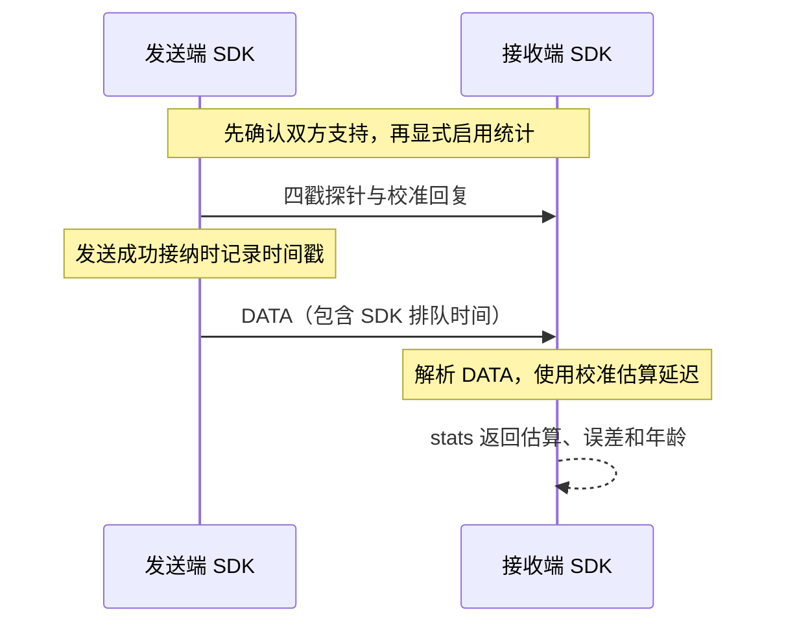

# Peerloom v0.5.0

## 通道延迟统计

- 新增可选可靠字节流发送到接收解析的延迟估算，包括公开发送 API 成功接纳后的 SDK 排队时间，不代表采集到渲染的端到端延迟。
- C API 新增 `DP_CAP_CHANNEL_STATS` 和 `DP_CHANNEL_STATS`，返回 `available`、`rx_delay_us`、`uncertainty_us`、`sample_age_ms`、`sample_count`；Android 可用 `PeerloomSdk.capabilities()` 查询 native 能力。
- 统计使用实际 DATA 时间戳及四戳校准，不直接跨设备相减，也不将探针 RTT/2 当作视频延迟。误差预算包含路径不对称及 100 ppm 相对时钟漂移工程假设，不是任意设备与网络条件下的精度保证。
- 无有效校准、校准过期或推导负延迟时不可用；调用方应检查误差与样本年龄。半关闭后校准停止，存活反向数据仍可传输，统计最终过期。

## 兼容与升级

默认仍使用可靠有序 `peerloom.stream.v1`，不改变现有可靠性、顺序、背压与 FIN 行为。只有明确配置 `measure_latency:true` 的通道使用 v2；应用必须先确认远端也支持该能力。对未知或旧版远端继续使用 v1，不展示统计，不能仅凭本地能力启用 v2。

C ABI 仍为 2，新增能力位为 1024。需按实际能力位判断，不能要求 capability 掩码精确等于旧常量。PC 和 Android 若需统计，必须成对升级对应的 SDK 产物；此功能不需要服务端数据库或配置迁移。

## 验证与发布边界

功能候选已覆盖实际 UDP DATA、排队计时、FULL、读取消、半关闭、高 RTT 校准和正负时钟偏移/漂移。正式产物必须通过本版本最终源码 SHA 的各平台 CI 与归档校验，不能将旧版本候选包改名作为新版本发布。

发布包沿用现有第三方证据说明；不得将可交付状态当作完成法律审查。正式发布时将本说明并入 release notes，并附实际源码 SHA 与平台验证结果。
