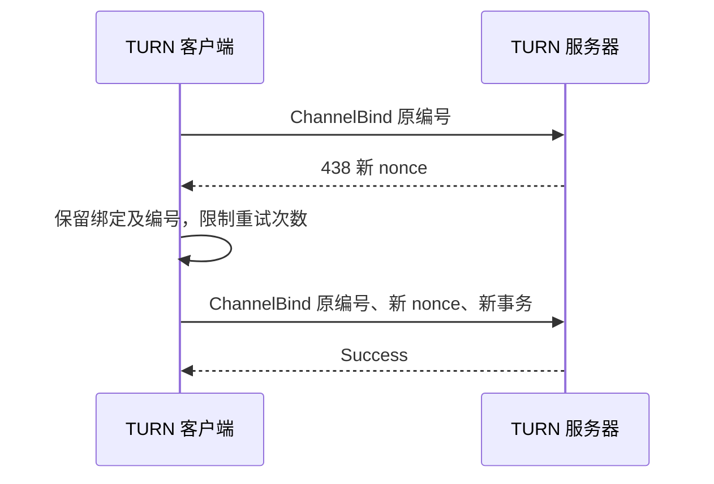

# TURN ChannelBind 过期 nonce 修复

固定 rtc-turn 0.21.1 原始归档及 VCS 提交，来源和逐文件哈希见 `来源.json`。归档没有许可证文本，补充同一上游提交的 rtc 0.21.1 LICENSE-MIT/Apache 原文。没有改共享 Cargo 缓存。

438 表示 nonce 过期，不能删除仍存活的绑定，否则同一 peer 换用新 channel number 会被符合 RFC 8656 的服务器拒绝为 400。本补丁保存绑定与编号，校验新 nonce 后立即使用原编号重试；单次连续过期最多重试三次，成功清零，非法 nonce 不生成新请求。未引入应用特例、RelayOnly 或诊断日志。

确定性回归覆盖原编号不变、新 nonce、三次上限、成功重置、空或缺失 nonce。47 个库测试通过；PC 隔离 Debug 真机 Relay 会话持续 13 分 20 秒，服务器观测 438 后 11ms 原编号重试成功、无 400，后续控制和正常停止通过。Android 尚未使用此补丁完成相同长测，不宣称双端验收。

参考 https://github.com/webrtc-rs/rtc/issues/267 和 RFC 8656 第 12 节。此为本地补丁，不声称已被上游合并；上游采用等下一次发送重试的较小方案，本补丁采用立即有界重试。以后升级须重新运行协议回归、长连接验证与跨平台 CI，再决定移除此 vendor。此补丁不包含另一个 allocation Refresh timer 问题 #263。
