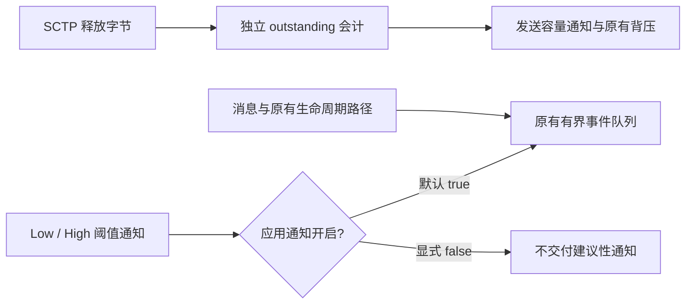

# webrtc 0.21.1 本地修正

来源为固定 crates.io 原归档；全部原始文件摘要、明确排除清单和保留文件修改前后摘要见 `来源.json`。原 MIT / Apache-2.0 许可证逐字保留，不重新授权第三方。以下为 Peerloom 本地补丁，不宣称已被上游合并。

## TURN 同轮排空

core 写操作可能在第一轮 TURN 输出排空之后才产生新的 relay 数据；同一次 `poll_writes` 返回前再排空一次 TURN 输出，避免依赖后续唤醒。没有重试循环、超时放宽或凭证变更。

同一 driver 内 `cfg(test)` 注入只在精确 core 输出边界插入一个数据包；原 relayer 编码、路由、UDP socket 与单次 flush 均实际执行。测试要求无下一次唤醒且本次已发出、无残留。生产构建不含注入字段。

## 未消费的缓冲阈值通知

只发送、不读取同一通道事件时，`OnBufferedAmountLow` / `OnBufferedAmountHigh` 建议性通知会占满该通道的应用事件队列。后端保留未交付事件并暂停同一关联的 data-channel 消息排空，因此其它通道也可能停顿。Peerloom 不向调用者暴露这两类通知，其可靠发送使用独立的 outstanding 会计与发送预算。

新增 `PeerConnectionBuilder::with_data_channel_buffered_amount_events(bool)`，**默认 `true`，保留上游行为**。值在构建时传入 `PeerConnectionRef`，运行期间不可变。选择 `false` 时，driver 在进入应用有界队列前只过滤上述两类建议性通知。

不修改 SCTP 释放事件、outstanding 计数、`writable()` 唤醒、发送限额、256 槽事件容量、真实消息/生命周期排队规则、阈值值本身或 TLS。`OnOpen`、`OnClosing`、`OnClose`、`OnError` 均沿原有交付路径，不被过滤。`build` 的构建主体移入私有 `build_inner`，公开返回类型和调用契约不变，便于回归检查完整配置传递而不新增公开检查接口。

后端回归使用相同构建路径和真实 driver 事件处理：默认/显式开启时 Low/High 正常交付、满队列保留；关闭时连续 2048 个建议性通知不占队列，而消息与生命周期的顺序、保留和真实队列背压不变。回归只验证通知交付边界，不冒充完整网络性能结果；真实单向字节流、控制竞争、发送背压与性能结果由 Peerloom 对应验收记录提供，以精确候选实际执行结果为准。

## 保留范围与复核

仅保留 22 个库源码、规范 Cargo.toml、README 与双许可证。Cargo.toml 删除不交付的外部 example/test 声明及其 dev-dependencies；正常依赖和 feature 声明保持原样。排除上游 CI、示例、外部测试、独立 lock 和编辑器配置，既不打包不相关密钥样例，也不复制 CI 配置中的令牌。本文不声明所有模式或平台已经测试；以精确候选 CI 为准。

应用补丁从逐文件摘要已验证的原始保留文件重新生成，使用零上下文统一差异格式，避免作为仓库文本保存时空上下文标记被误报为尾随空白；反向应用必须使用零 fuzz，恢复结果逐文件匹配 `upstream_sha256`。原归档 URL、归档摘要、VCS 提交和许可证摘要保持不变。
